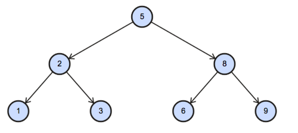

# 3. SQL Binary Tree Nodes

## Question and image

`BST` contains one row for each node of a binary tree. `N` is the node's value and `P` is the value of its parent. A missing `P` is `NULL`.

Report each node's type as `Root`, `Inner`, or `Leaf`, ordered by `N` ascending:

- **Root:** the node has no parent.
- **Inner:** the node is neither the root nor a leaf.
- **Leaf:** the node has no children.

**Example 1**

Input — `BST`:

| N | P |
|---:|---:|
| 1 | 2 |
| 3 | 2 |
| 6 | 8 |
| 9 | 8 |
| 2 | 5 |
| 8 | 5 |
| 5 | NULL |

The supplied diagram shows the same relationships:

Expected output:

| N | NodeType |
|---:|---|
| 1 | Leaf |
| 2 | Inner |
| 3 | Leaf |
| 5 | Root |
| 6 | Leaf |
| 8 | Inner |
| 9 | Leaf |

Node 5 has no parent, so it is the root. Nodes 2 and 8 have children and are inner nodes. Nodes 1, 3, 6, and 9 have no children, so they are leaves.

### Problem solving checklist

1. **Define the output:** state what one result row represents, the required columns, and the ordering.
2. **Understand the inputs:** identify table meanings, keys, relationships, duplicates, and NULLs.
3. **Explain the logic:** describe the steps, calculations, and comparisons in plain English.
4. **Choose SQL operations:** match each step to the SQL operations it needs.
5. **Plan intermediate results:** list the needed columns and what each intermediate row represents.
6. **Build gradually:** write one part, inspect its output, and check row counts after joins.
7. **Verify the answer:** check the sample, duplicates, missing matches, NULLs, arithmetic, boundaries, ties, and sorting.

## Schema

`BST`:

| Column Name | Type |
|---|---|
| N | Integer |
| P | Integer |

`N` is the value of a node. `P` is the value of its parent, or `NULL` for the root.

## My solution — SQLite

Pending final solution.

## My solution — SQL Server

Pending SQLite final solution.

## Official solution

Pending final review of the supplied handout solution.
