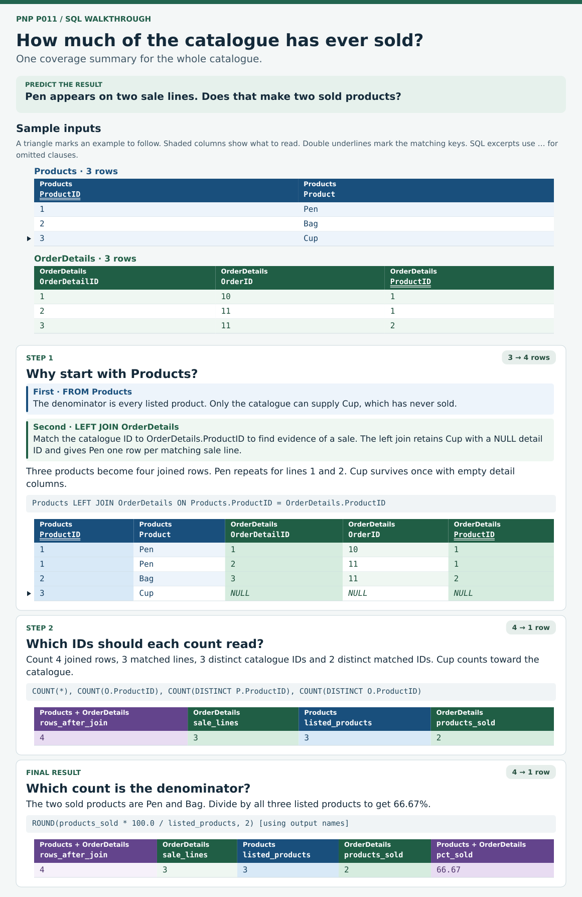

# PNP P011 — How much of the catalogue has ever sold?

**Topic:** Aggregation  
**Difficulty:** Easy

## Question

**Table colors** · 🟦 `Products` · 🟩 `OrderDetails` · 🟪 multiple sources

**Business scenario.** The merchandising head suspects the catalogue is far bigger than what customers actually buy. Before a clean-up, she wants four numbers in one row: how many products are listed, how many sale lines exist, how many distinct products have sold at least once, and what share of the catalogue that is.

**Task.** Starting from every product, attach its order lines. In one row, return the rows produced by that join, the number of order lines, the number of listed products, the number of products that sold at least once, and the percentage of listed products that sold.

[PNP source question](../../../2.PNP-%20foundations%20and%20practice/4.%20Aggregation/P011.%20How%20much%20of%20the%20catalogue%20has%20ever%20sold.md#question-and-image)

### Required output columns

One output row represents one catalogue-wide sales summary, including products with no sale lines.

| Output column | Source or calculation | Meaning and applicable rules | Example value |
| --- | --- | --- | --- |
| `rows_after_join` | 🟪 `Products` + `OrderDetails` | Number of combined catalogue and sale-line rows, including a row for each unsold product. | 4 |
| `sale_lines` | 🟩 `OrderDetails` | Number of sale lines matched to a listed product. | 3 |
| `listed_products` | 🟦 `Products` | Number of distinct products in the catalogue. | 3 |
| `products_sold` | 🟩 `OrderDetails` | Number of distinct catalogue products with at least one sale line. | 2 |
| `pct_sold` | 🟪 `Products` + `OrderDetails` | Sold products as a percentage of all listed products, rounded to two decimals. | 66.67 |

### Practice example · Sample input

**🟦 `Products`**

| 🟦 ProductID | 🟦 Product |
|---:|---|
| 🟦 1 | 🟦 Pen |
| 🟦 2 | 🟦 Bag |
| 🟦 3 | 🟦 Cup |

**🟩 `OrderDetails`**

| 🟩 OrderDetailID | 🟩 OrderID | 🟩 ProductID |
|---:|---:|---:|
| 🟩 1 | 🟩 10 | 🟩 1 |
| 🟩 2 | 🟩 11 | 🟩 1 |
| 🟩 3 | 🟩 11 | 🟩 2 |

### Expected output

| 🟪 rows_after_join | 🟩 sale_lines | 🟦 listed_products | 🟩 products_sold | 🟪 pct_sold |
|---:|---:|---:|---:|---:|
| 🟪 4 | 🟩 3 | 🟦 3 | 🟩 2 | 🟪 66.67 |

[View sample inputs and output with colored cells](../../assets/question-samples/p011.svg?raw=1)

### How the sample produces this output

The catalogue contains 🟦 three products. 🟩 Pen has two sale lines and 🟩 Bag has one, giving 🟩 **🟩 3 sale lines** across 🟩 **🟩 2 sold products**. 🟩 Cup has no sale, but still appears once in the catalogue comparison. The row total is 🟪 **🟩 2 for 🟩 Pen + 🟩 1 for 🟩 Bag + 🟩 1 for 🟩 Cup = 🟩 4**.

The denominator for catalogue coverage includes all three listed products. 🟩 Pen and 🟩 Bag account for 🟪 `🟩 2 / 🟩 3 × 🟩 100 = 🟩 66.67%` of the catalogue.

## Step 1 · Your approach before writing SQL

1. What does one row of the final output represent?
2. Which table would you put in `FROM`? If you need other tables, which comes second, third, and so on, and why?
3. Would you use a join at any step? For each join you choose, name its type and matching columns and explain why it fits the question.

## Learner solution — SQLite

```sql
SELECT COUNT(*) AS rows_after_join,
       COUNT(O.ProductID) AS sale_lines,
       COUNT(DISTINCT P.ProductID) AS listed_products,
       COUNT(DISTINCT (O.ProductID)) AS products_sold,
       ROUND(COUNT(DISTINCT O.ProductID) * 100.0 / COUNT(DISTINCT P.ProductID), 2) AS pct_sold
FROM Products AS P
LEFT JOIN OrderDetails AS O ON P.ProductID = O.ProductID;
```

Verified the sample, an order line for an unlisted product, a catalogue with no sales, and an empty catalogue. The submitted SQL was reformatted to remove chat markup.

## Visual walkthrough

[Open the Previous / Next walkthrough](../../assets/steps/PNP-P011/01.md)

Follow the sample rows through each query step. **Predict the result.** Pen appears on two sale lines. Does that make two sold products?



[Open the full-size walkthrough](../../assets/walkthroughs/p011.svg?raw=1)

## Step-by-step walkthrough

**How to start.** Which population defines the denominator?

Use the same sample throughout and check the output after each step.

### 1. Join from the catalogue

🟦 **First · FROM Products** · The denominator is every listed product. Only the catalogue can supply Cup, which has never sold.

🟩 **Second · LEFT JOIN OrderDetails** · Match the catalogue ID to `OrderDetails.ProductID` to find evidence of a sale. The left join retains Cup with a NULL detail ID and gives Pen one row per matching sale line.

**Golden rule.** Ask “Out of what?” to find the denominator. For “What percentage of listed products have sold?”, the denominator is all distinct listed products, and the numerator is the distinct listed products with a sale.

Choose the join by asking which unmatched rows must stay. Use `LEFT JOIN` with the required population on the left when its unmatched rows must stay. Use `INNER JOIN` when only matches belong in the result, and `FULL OUTER JOIN` when unmatched rows on both sides belong. Here, all three catalogue products must stay, so start from `Products` and left join `OrderDetails`. Count distinct product IDs because one product can match several order lines.

**Why `LEFT JOIN`?** The denominator is the entire catalogue, so every row from `Products` must survive even when no order line matches. An `INNER JOIN` would drop Cup, shrinking the denominator from three products to two and raising the sample percentage to 100%. A `FULL OUTER JOIN` could also retain order lines for products absent from the catalogue. `LEFT JOIN` keeps every catalogue product and attaches only its matching order lines.

Pen matches two lines, Bag matches one, and Cup retains a row with NULLs on the order-line side.

```sql
SELECT P.ProductID, P.Product, O.OrderDetailID, O.ProductID AS matched_product_id
FROM Products AS P
LEFT JOIN OrderDetails AS O ON P.ProductID = O.ProductID
ORDER BY P.ProductID, O.OrderDetailID;
```

| ProductID | Product | OrderDetailID | matched_product_id |
| ---: | --- | ---: | ---: |
| 1 | Pen | 1 | 1 |
| 1 | Pen | 2 | 1 |
| 2 | Bag | 3 | 2 |
| 3 | Cup | `NULL` | `NULL` |

### 2. Count rows, sale lines, and distinct products

**What to do.** Count rows, sale lines, and distinct products.

**Why.** Joined rows and distinct products answer different questions.

COUNT(*) counts all four joined rows. COUNT(O.ProductID) counts the three matched lines. The distinct catalogue IDs are 1, 2, and 3. The distinct matched IDs are 1 and 2.

```sql
SELECT COUNT(*) AS rows_after_join,
       COUNT(O.ProductID) AS sale_lines,
       COUNT(DISTINCT P.ProductID) AS listed_products,
       COUNT(DISTINCT (O.ProductID)) AS products_sold
FROM Products AS P
LEFT JOIN OrderDetails AS O ON P.ProductID = O.ProductID;
```

| rows_after_join | sale_lines | listed_products | products_sold |
| ---: | ---: | ---: | ---: |
| 4 | 3 | 3 | 2 |

### 3. Calculate the percentage

**What to do.** Calculate the percentage.

**Why.** The fraction measures sold products out of all listed products.

Divide the distinct sold count by the distinct listed count. Multiplying by 100.0 before dividing preserves the fractional part. The final query computes 2 × 100.0 ÷ 3 and rounds it to 66.67.

```sql
SELECT COUNT(*) AS rows_after_join,
       COUNT(O.ProductID) AS sale_lines,
       COUNT(DISTINCT P.ProductID) AS listed_products,
       COUNT(DISTINCT (O.ProductID)) AS products_sold,
       ROUND(COUNT(DISTINCT O.ProductID) * 100.0 / COUNT(DISTINCT P.ProductID), 2) AS pct_sold
FROM Products AS P
LEFT JOIN OrderDetails AS O ON P.ProductID = O.ProductID;
```

| rows_after_join | sale_lines | listed_products | products_sold | pct_sold |
| ---: | ---: | ---: | ---: | ---: |
| 4 | 3 | 3 | 2 | 66.67 |

## Learner solution — SQL Server

```sql
SELECT COUNT(*) AS rows_after_join,
       COUNT(O.ProductID) AS sale_lines,
       COUNT(DISTINCT P.ProductID) AS listed_products,
       COUNT(DISTINCT (O.ProductID)) AS products_sold,
       ROUND(COUNT(DISTINCT O.ProductID) * 100.0 / NULLIF(COUNT(DISTINCT P.ProductID), 0), 2) AS pct_sold
FROM Products AS P
LEFT JOIN OrderDetails AS O ON P.ProductID = O.ProductID;
```

The adaptation uses NULLIF to return NULL for an empty catalogue and avoid division by zero. It was reviewed by inspection.

## Official solution

[PNP answer key, Q11](https://github.com/MulikShrikantDattatray14/Data-Engineering-Mastry/blob/main/1.%20SQL%20Mastery/1.%20SQL%20Mastry/2.PNP-%20foundations%20and%20practice/Source%20Materials/PrepNPlaced_SQL_100_v2/sql/all_100_solutions.sql)

```sql
SELECT COUNT(*)                                       AS rows_after_join,
       COUNT(od.OrderDetailID)                        AS sale_lines,
       COUNT(DISTINCT p.ProductID)                    AS listed_products,
       COUNT(DISTINCT od.ProductID)                   AS products_sold,
       ROUND(100.0 * COUNT(DISTINCT od.ProductID)
             / NULLIF(COUNT(DISTINCT p.ProductID), 0), 2) AS pct_sold
FROM Products AS p
LEFT JOIN OrderDetails AS od ON od.ProductID = p.ProductID;
```

The answer key counts the order line ID for sale_lines. Counting the matched product ID gives the same result when order line IDs are non-NULL. Both approaches count distinct order-side product IDs for products_sold.

### Official answer — SQLite adaptation

```sql
SELECT COUNT(*)                                       AS rows_after_join,
       COUNT(od.OrderDetailID)                        AS sale_lines,
       COUNT(DISTINCT p.ProductID)                    AS listed_products,
       COUNT(DISTINCT od.ProductID)                   AS products_sold,
       ROUND(100.0 * COUNT(DISTINCT od.ProductID)
             / NULLIF(COUNT(DISTINCT p.ProductID), 0), 2) AS pct_sold
FROM Products AS p
LEFT JOIN OrderDetails AS od ON od.ProductID = p.ProductID;
```

### Official answer — SQL Server adaptation

```sql
SELECT COUNT(*)                                       AS rows_after_join,
       COUNT(od.OrderDetailID)                        AS sale_lines,
       COUNT(DISTINCT p.ProductID)                    AS listed_products,
       COUNT(DISTINCT od.ProductID)                   AS products_sold,
       ROUND(100.0 * COUNT(DISTINCT od.ProductID)
             / NULLIF(COUNT(DISTINCT p.ProductID), 0), 2) AS pct_sold
FROM Products AS p
LEFT JOIN OrderDetails AS od ON od.ProductID = p.ProductID;
```

SQLite adaptation executed on representative fixtures. SQL Server adaptation reviewed by inspection.

## Verification

The saved learner query ran in SQLite on the [walkthrough fixture](../../assets/steps/PNP-P011/walkthrough.json). The column names and all 1 expected row matched in the displayed order.
