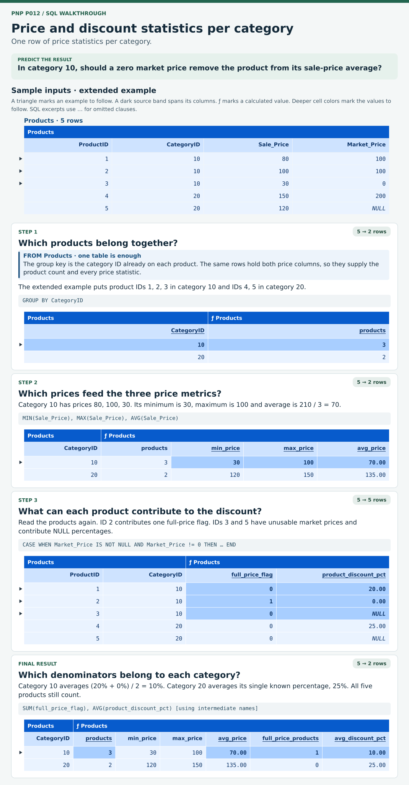

# PNP P012 — Price and discount statistics per category ID

**Topic:** Aggregation  
**Difficulty:** Easy  
**Status:** Final learner submission verified in SQLite.

## Question

**Table colors** · 🟦 `Products`

**Business scenario.** The pricing team is preparing a quarterly review of category price ranges. For each category code they want the size of the range, the price spread, and how much of it is sold below the printed price (🟦 `Market_Price`), so they can spot categories that lean too hard on discounts.

**Task.** For each `CategoryID` in `Products`, return the number of `products`, the lowest, highest and average `Sale_Price`, how many `products` sell at full price (`Sale_Price` = `Market_Price`), and the average discount percentage across the category. Round averages to two decimals. Sort by `CategoryID`.

[PNP source question](../../../2.PNP-%20foundations%20and%20practice/4.%20Aggregation/P012.%20Price%20and%20discount%20statistics%20per%20category%20ID.md#question-and-image)

### Required output columns

| Column | Meaning | Source |
|---|---|---|
| `CategoryID` | Category identifier. | 🟦 `Products` |
| `products` | Number of products in the category. | 🟦 `Products` |
| `min_price` | Lowest sale price. | 🟦 `Products` |
| `max_price` | Highest sale price. | 🟦 `Products` |
| `avg_price` | Average sale price, rounded to two decimals. | 🟦 `Products` |
| `full_price_products` | Number of products whose sale and market prices are equal. | 🟦 `Products` |
| `avg_discount_pct` | Average of the individual product discount percentages with a usable market price, rounded to two decimals. | 🟦 `Products` |

### Practice example · Sample input

**🟦 `Products`**

| 🟦 ProductID | 🟦 CategoryID | 🟦 Sale_Price | 🟦 Market_Price |
|---:|---:|---:|---:|
| 1 | 10 | 80 | 100 |
| 2 | 10 | 100 | 100 |

### Expected output

| 🟦 CategoryID | 🟦 products | 🟦 min_price | 🟦 max_price | 🟦 avg_price | 🟦 full_price_products | 🟦 avg_discount_pct |
|---:|---:|---:|---:|---:|---:|---:|
| 10 | 2 | 80 | 100 | 90.00 | 1 | 10.00 |

[View sample inputs and output with colored cells](../../assets/question-samples/p012.svg?raw=1)

### How the sample produces this output

🟦 Both products belong to category 10. Their sale prices are 80 and 100, so the minimum is **80**, the maximum is **100**, and the average is `(80 + 100) / 2 = 90.00`.

🟦 Product 1 sells for 80 against a market price of 100, a **20% discount**. Product 2 sells at its full market price of 100, a **0% discount**. That gives **1 full-price product** and an average product discount of `(20 + 0) / 2 = 10.00%`.

## Step 1 · Your approach before writing SQL

1. What does one row of the final output represent?
2. Which table would you put in `FROM`? If you need other tables, which comes second, third, and so on, and why?
3. Would you use a join at any step? For each join you choose, name its type and matching columns and explain why it fits the question.

## Visual walkthrough

The diagram follows the extended sample used in the step-by-step walkthrough. **Predict the result.** In category 10, should a zero market price remove the product from its sale-price average?



[Open the full-size walkthrough](../../assets/walkthroughs/p012.svg?raw=1)

## Learner solution — SQLite

```sql
SELECT
    CategoryID,
    COUNT(ProductID) AS products,
    MIN(Sale_Price) AS min_price,
    MAX(Sale_Price) AS max_price,
    ROUND(AVG(Sale_Price), 2) AS avg_price,
    SUM(CASE
        WHEN Market_Price = Sale_Price THEN 1
        ELSE 0
    END) AS full_price_products,
    ROUND(AVG(CASE
        WHEN Market_Price IS NOT NULL AND Market_Price != 0
        THEN (Market_Price - Sale_Price) * 100.0 / Market_Price
    END), 2) AS avg_discount_pct
FROM Products
GROUP BY CategoryID
ORDER BY CategoryID ASC;
```

The sample and extended tests passed, including multiple categories, missing and zero market prices, a fractional discount, and a category with no usable discount percentage. COUNT(ProductID) counts every product when ProductID is non-NULL, as with a primary key.

## Step-by-step walkthrough

🟦 **FROM Products · one table is enough** · The group key is the category ID already on each product. The same rows hold both price columns, so they supply the product count and every price statistic.

Start by asking what one output row represents and which products should contribute to each metric. Use one extended example throughout. It includes the original sample, a zero market price, and a second category with a missing market price.

| ProductID | CategoryID | Sale_Price | Market_Price |
|---:|---:|---:|---:|
| 1 | 10 | 80 | 100 |
| 2 | 10 | 100 | 100 |
| 3 | 10 | 30 | 0 |
| 4 | 20 | 150 | 200 |
| 5 | 20 | 120 | `NULL` |

### 1. Get one row per category

**What to do.** Group by CategoryID and count products.

**Why.** Each input row is a product and each output row is a category. All the fields come from Products, so this query reads a single table.

```sql
SELECT CategoryID, COUNT(ProductID) AS products
FROM Products
GROUP BY CategoryID
ORDER BY CategoryID;
```

| CategoryID | products |
|---:|---:|
| 10 | 3 |
| 20 | 2 |

The grouping gives each category its own product count. ORDER BY sorts the two finished rows.

### 2. Add the sale-price statistics

**What to do.** Add MIN, MAX, and the rounded AVG of Sale_Price within each category.

**Why.** These metrics use the sale price. Products 3 and 5 have usable sale prices and still contribute even though their market prices are zero or missing.

```sql
SELECT CategoryID, COUNT(ProductID) AS products,
       MIN(Sale_Price) AS min_price,
       MAX(Sale_Price) AS max_price,
       ROUND(AVG(Sale_Price), 2) AS avg_price
FROM Products
GROUP BY CategoryID
ORDER BY CategoryID;
```

| CategoryID | products | min_price | max_price | avg_price |
|---:|---:|---:|---:|---:|
| 10 | 3 | 30 | 100 | 70.00 |
| 20 | 2 | 120 | 150 | 135.00 |

Category 10 averages 80, 100, and 30. Its minimum remains 30.

### 3. Preview the contribution of each product

**What to do.** Give each full-price product a flag of 1 and each other product a flag of 0. Calculate a discount percentage only for usable market prices.

**Why.** CASE checks each product before the aggregate runs. AVG skips NULL and includes a measured 0%. Multiplying by 100.0 before dividing preserves fractions in SQLite.

```sql
SELECT ProductID, CategoryID,
       CASE WHEN Sale_Price = Market_Price THEN 1 ELSE 0 END AS full_price_flag,
       CASE
           WHEN Market_Price IS NOT NULL AND Market_Price != 0
           THEN (Market_Price - Sale_Price) * 100.0 / Market_Price
       END AS product_discount_pct
FROM Products
ORDER BY ProductID;
```

| ProductID | CategoryID | full_price_flag | product_discount_pct |
|---:|---:|---:|---:|
| 1 | 10 | 0 | 20.00 |
| 2 | 10 | 1 | 0.00 |
| 3 | 10 | 0 | `NULL` |
| 4 | 20 | 0 | 25.00 |
| 5 | 20 | 0 | `NULL` |

Product 2 contributes a real zero to the average and a one to the full-price count. Product 3 contributes no percentage.

### 4. Combine the category metrics

**What to do.** Add SUM around the flags and AVG around the individual percentages. Round that average to two decimals.

**Why.** The flags count products when added. Each eligible product contributes one percentage to the average.

```sql
SELECT
    CategoryID,
    COUNT(ProductID) AS products,
    MIN(Sale_Price) AS min_price,
    MAX(Sale_Price) AS max_price,
    ROUND(AVG(Sale_Price), 2) AS avg_price,
    SUM(CASE
        WHEN Market_Price = Sale_Price THEN 1
        ELSE 0
    END) AS full_price_products,
    ROUND(AVG(CASE
        WHEN Market_Price IS NOT NULL AND Market_Price != 0
        THEN (Market_Price - Sale_Price) * 100.0 / Market_Price
    END), 2) AS avg_discount_pct
FROM Products
GROUP BY CategoryID
ORDER BY CategoryID ASC;
```

| CategoryID | products | min_price | max_price | avg_price | full_price_products | avg_discount_pct |
|---:|---:|---:|---:|---:|---:|---:|
| 10 | 3 | 30 | 100 | 70.00 | 1 | 10.00 |
| 20 | 2 | 120 | 150 | 135.00 | 0 | 25.00 |

Category 10 averages 20% and 0%. Category 20 counts both products, and only product 4 contributes 25% to its discount average. SQLite may display fewer trailing zeros than shown.

### Where to put conditions

| Requirement | Place |
|---|---|
| One summary row per category | GROUP BY CategoryID |
| Exclude products from all metrics | WHERE |
| Exclude an entire category based on a calculated metric | HAVING |
| Ignore unusable market prices in the discount average only | CASE inside AVG |

For this question, a WHERE filter on market price would remove products 3 and 5 from all metrics. In category 10 that would change the count from 3 to 2 and the minimum from 30 to 80.

All four stages were checked in SQLite on the extended example. The submitted query also matches the original sample.

## Learner solution — SQL Server

```sql
SELECT
    CategoryID,
    COUNT(ProductID) AS products,
    MIN(Sale_Price) AS min_price,
    MAX(Sale_Price) AS max_price,
    ROUND(AVG(CAST(Sale_Price AS DECIMAL(28, 6))), 2) AS avg_price,
    SUM(CASE
        WHEN Market_Price = Sale_Price THEN 1
        ELSE 0
    END) AS full_price_products,
    ROUND(AVG(CASE
        WHEN Market_Price IS NOT NULL AND Market_Price != 0
        THEN (Market_Price - Sale_Price) * 100.0 / Market_Price
    END), 2) AS avg_discount_pct
FROM Products
GROUP BY CategoryID
ORDER BY CategoryID ASC;
```

Casting Sale_Price before AVG preserves fractional averages for integer inputs. Reviewed by inspection.

## Official solution

[PNP answer key, Q12](https://github.com/MulikShrikantDattatray14/Data-Engineering-Mastry/blob/8b55ca0d79972b02075f3e1b33289c310dd05862/1.%20SQL%20Mastery/1.%20SQL%20Mastry/2.PNP-%20foundations%20and%20practice/Source%20Materials/PrepNPlaced_SQL_100_v2/sql/all_100_solutions.sql)

```sql
SELECT p.CategoryID,
       COUNT(*)                                                  AS products,
       MIN(p.Sale_Price)                                         AS min_price,
       MAX(p.Sale_Price)                                         AS max_price,
       ROUND(AVG(p.Sale_Price), 2)                               AS avg_price,
       COUNT(*) FILTER (WHERE p.Sale_Price = p.Market_Price)     AS full_price_products,
       ROUND(AVG(100.0 * (p.Market_Price - p.Sale_Price)
                 / NULLIF(p.Market_Price, 0)), 2)                AS avg_discount_pct
FROM Products AS p
GROUP BY p.CategoryID
ORDER BY p.CategoryID NULLS LAST;
```

### Official answer — SQLite adaptation

```sql
SELECT p.CategoryID,
       COUNT(*)                                                  AS products,
       MIN(p.Sale_Price)                                         AS min_price,
       MAX(p.Sale_Price)                                         AS max_price,
       ROUND(AVG(p.Sale_Price), 2)                               AS avg_price,
       COUNT(*) FILTER (WHERE p.Sale_Price = p.Market_Price)     AS full_price_products,
       ROUND(AVG(100.0 * (p.Market_Price - p.Sale_Price)
                 / NULLIF(p.Market_Price, 0)), 2)                AS avg_discount_pct
FROM Products AS p
GROUP BY p.CategoryID
ORDER BY p.CategoryID NULLS LAST;
```

### Official answer — SQL Server adaptation

```sql
SELECT p.CategoryID,
       COUNT(*)                                                  AS products,
       MIN(p.Sale_Price)                                         AS min_price,
       MAX(p.Sale_Price)                                         AS max_price,
       ROUND(AVG(CAST(p.Sale_Price AS DECIMAL(28, 6))), 2)                               AS avg_price,
       COUNT(CASE WHEN p.Sale_Price = p.Market_Price THEN 1 END)     AS full_price_products,
       ROUND(AVG(100.0 * (p.Market_Price - p.Sale_Price)
                 / NULLIF(p.Market_Price, 0)), 2)                AS avg_discount_pct
FROM Products AS p
GROUP BY p.CategoryID
ORDER BY CASE WHEN p.CategoryID IS NULL THEN 1 ELSE 0 END, p.CategoryID;
```

SQLite supports the source FILTER and NULLS LAST clauses. The SQL Server adaptation uses a conditional COUNT and an explicit NULL sort key.

SQLite adaptation executed on representative fixtures. SQL Server adaptation reviewed by inspection.
