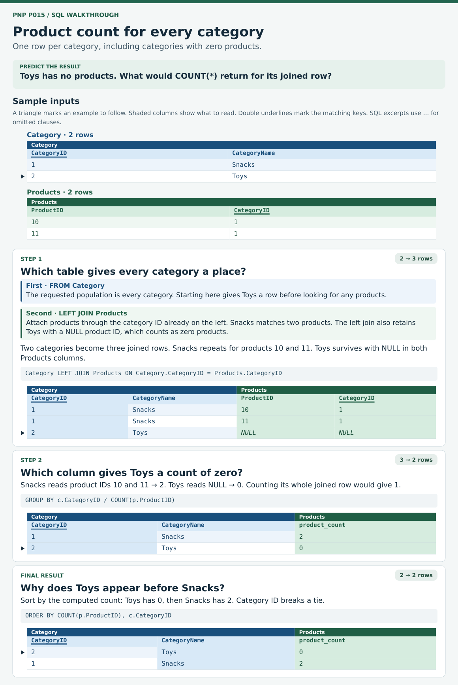

# PNP P015 — Product count for every category

**Topic:** Joins  
**Difficulty:** Easy

## Question

**Table colors** · 🟦 `Category` · 🟩 `Products`

**Business scenario.** The catalogue team is cleaning up the app's category menu. An empty category leads shoppers to a blank page, so they want every category with its product count, empty ones included and listed first.

**Task.** For every row in 🟦 `Category`, return the number of products assigned to it. A category with no products must appear with 0. Sort by product count ascending, then `CategoryID`.

[PNP source question](../../../2.PNP-%20foundations%20and%20practice/2.%20Joins/P015.%20Product%20count%20for%20every%20category.md#question-and-image)

### Required output columns

| Column | Meaning | Source |
|---|---|---|
| `CategoryID` | Category identifier. | 🟦 `Category` |
| `CategoryName` | Category name. | 🟦 `Category` |
| `product_count` | Number of products assigned to the category, including zero for an empty category. | 🟩 `Products` |

### Practice example · Sample input

**🟦 `Category`**

| 🟦 CategoryID | 🟦 CategoryName |
|---:|---|
| 1 | Snacks |
| 2 | Toys |

**🟩 `Products`**

| 🟩 ProductID | 🟩 CategoryID |
|---:|---:|
| 10 | 1 |
| 11 | 1 |

### Expected output

| 🟦 CategoryID | 🟦 CategoryName | 🟩 product_count |
|---:|---|---:|
| 2 | Toys | 0 |
| 1 | Snacks | 2 |

[View sample inputs and output with colored cells](../../assets/question-samples/p015.svg?raw=1)

### How the sample produces this output

Category 2, 🟦 **Toys**, has no product assigned to it. It still appears in the report with a count of 🟩 **0**. Category 1, 🟦 **Snacks**, has product IDs 10 and 11, so its count is 🟩 **2**.

The report orders the counts from smallest to largest. That puts Toys first even though its category ID is larger.

## Step 1 · Your approach before writing SQL

1. What does one row of the final output represent?
2. Which table would you put in `FROM`? If you need other tables, which comes second, third, and so on, and why?
3. Would you use a join at any step? For each join you choose, name its type and matching columns and explain why it fits the question.

## Visual walkthrough

[Open the Previous / Next walkthrough](../../assets/steps/PNP-P015/01.md)

Follow the sample rows through each query step. **Predict the result.** Toys has no products. What would COUNT(*) return for its joined row?



[Open the full-size walkthrough](../../assets/walkthroughs/p015.svg?raw=1)

## Learner solution — SQLite

```sql
SELECT c.CategoryID, c.CategoryName, COUNT(p.ProductID) AS product_count
FROM Category AS c
LEFT JOIN Products AS p ON c.CategoryID = p.CategoryID
GROUP BY c.CategoryID
ORDER BY COUNT(p.ProductID) ASC, c.CategoryID ASC;
```

Chat markup and formatting were cleaned up. The SQLite checks covered the sample, tied counts, categories sharing a name, and products without a matching category.

## Step-by-step walkthrough

One final row represents one category. Use the same sample throughout.

### 1. Attach matching products to every category

🟦 **First · FROM Category** · The requested population is every category. Starting here gives Toys a row before looking for any products.

🟩 **Second · LEFT JOIN Products** · Attach products through the category ID already on the left. Snacks matches two products. The left join also retains Toys with a NULL product ID, which counts as zero products. An inner join would drop Toys. A full outer join could also admit products outside the category list.

```sql
SELECT c.CategoryID, c.CategoryName, p.ProductID
FROM Category AS c
LEFT JOIN Products AS p ON c.CategoryID = p.CategoryID
ORDER BY c.CategoryID, p.ProductID;
```

| CategoryID | CategoryName | ProductID |
|---:|---|---:|
| 1 | Snacks | 10 |
| 1 | Snacks | 11 |
| 2 | Toys | `NULL` |

Snacks contributes two matched rows. Toys gets one unmatched row.

### 2. Group the rows and count matched products

**What to do.** Group by the unique category ID and count ProductID from the Products side. Sort by category ID temporarily to check the grouped results.

**Why.** COUNT(ProductID) counts non-NULL product IDs. COUNT(*) would count Toys' unmatched join row and incorrectly report one product.

```sql
SELECT c.CategoryID, c.CategoryName, COUNT(p.ProductID) AS product_count
FROM Category AS c
LEFT JOIN Products AS p ON c.CategoryID = p.CategoryID
GROUP BY c.CategoryID
ORDER BY c.CategoryID;
```

| CategoryID | CategoryName | product_count |
|---:|---|---:|
| 1 | Snacks | 2 |
| 2 | Toys | 0 |

### 3. Sort the report

**What to do.** Sort by product count ascending, then category ID ascending.

**Why.** This puts empty categories first and resolves ties consistently.

```sql
SELECT c.CategoryID, c.CategoryName, COUNT(p.ProductID) AS product_count
FROM Category AS c
LEFT JOIN Products AS p ON c.CategoryID = p.CategoryID
GROUP BY c.CategoryID
ORDER BY COUNT(p.ProductID) ASC, c.CategoryID ASC;
```

| CategoryID | CategoryName | product_count |
|---:|---|---:|
| 2 | Toys | 0 |
| 1 | Snacks | 2 |

## Learner solution — SQL Server

```sql
SELECT c.CategoryID, c.CategoryName, COUNT(p.ProductID) AS product_count
FROM Category AS c
LEFT JOIN Products AS p ON c.CategoryID = p.CategoryID
GROUP BY c.CategoryID, c.CategoryName
ORDER BY COUNT(p.ProductID) ASC, c.CategoryID ASC;
```

The adaptation includes CategoryName in GROUP BY because it is selected and is neither aggregated nor otherwise grouped. Reviewed by inspection.

## Official solution

[PNP answer key, Q15](https://github.com/MulikShrikantDattatray14/Data-Engineering-Mastry/blob/main/1.%20SQL%20Mastery/1.%20SQL%20Mastry/2.PNP-%20foundations%20and%20practice/Source%20Materials/PrepNPlaced_SQL_100_v2/sql/all_100_solutions.sql)

```sql
SELECT cat.CategoryID,
       cat.CategoryName,
       COUNT(p.ProductID) AS product_count
FROM Category AS cat
LEFT JOIN Products AS p ON p.CategoryID = cat.CategoryID
GROUP BY cat.CategoryID, cat.CategoryName
ORDER BY product_count, cat.CategoryID;
```

### Official answer — SQLite adaptation

```sql
SELECT cat.CategoryID,
       cat.CategoryName,
       COUNT(p.ProductID) AS product_count
FROM Category AS cat
LEFT JOIN Products AS p ON p.CategoryID = cat.CategoryID
GROUP BY cat.CategoryID, cat.CategoryName
ORDER BY product_count, cat.CategoryID;
```

### Official answer — SQL Server adaptation

```sql
SELECT cat.CategoryID,
       cat.CategoryName,
       COUNT(p.ProductID) AS product_count
FROM Category AS cat
LEFT JOIN Products AS p ON p.CategoryID = cat.CategoryID
GROUP BY cat.CategoryID, cat.CategoryName
ORDER BY product_count, cat.CategoryID;
```

The answer key runs unchanged in SQLite and passed the extended test. The SQL Server version was reviewed by inspection.
