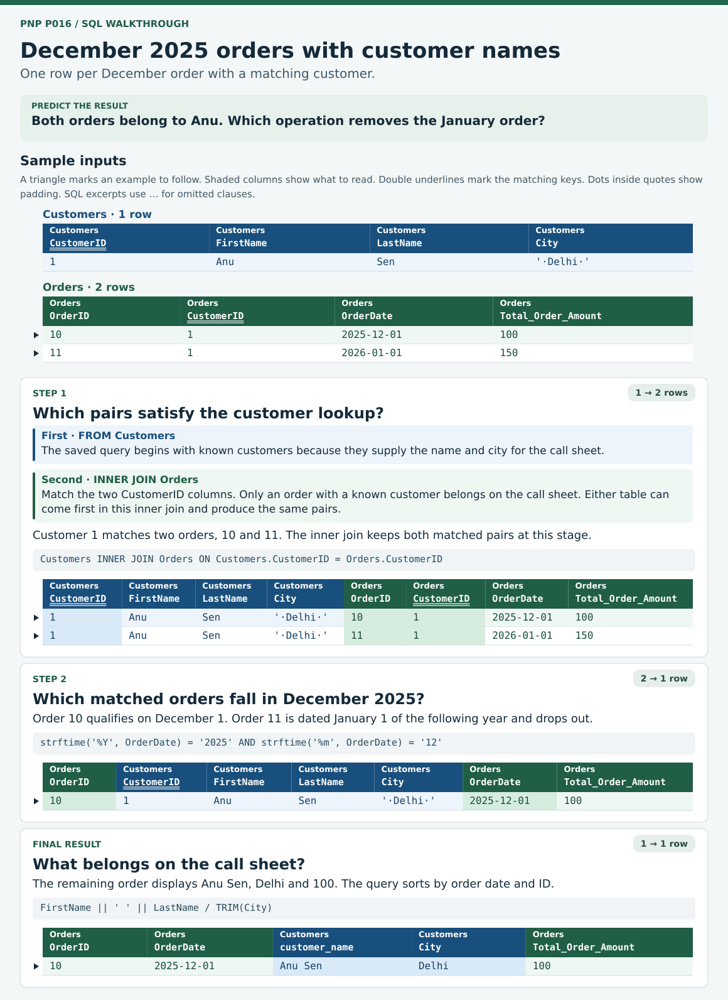

# PNP P016 — December 2025 orders with customer names

**Topic:** Joins  
**Difficulty:** Easy

## Question

**Table colors** · 🟦 `Customers` · 🟩 `Orders`

**Business scenario.** Customer support is calling customers for feedback on orders placed in December 2025. Each agent's call sheet needs the order, the customer's full name and city, and the order amount, so the agent can greet the customer by name and confirm the right order.

**Task.** List every December 2025 order that belongs to a known customer, with the customer's full name and city. Sort by 🟩 `OrderDate`, then `OrderID`.

[PNP source question](../../../2.PNP-%20foundations%20and%20practice/2.%20Joins/P016.%20December%202025%20orders%20with%20customer%20names.md#question-and-image)

### Required output columns

One output row represents one December 2025 order with a matching customer.

| Output column | Source or calculation | Meaning and applicable rules | Example value |
| --- | --- | --- | --- |
| `OrderID` | 🟩 `Orders.OrderID` | Order identifier. | 10 |
| `OrderDate` | 🟩 `Orders.OrderDate` | Date the order was placed. | 2025-12-01 |
| `customer_name` | 🟦 `Customers` | Customer’s first and last names, separated by a space. | Anu Sen |
| `City` | 🟦 `Customers.City` | Customer’s city with surrounding spaces removed. | Delhi |
| `Total_Order_Amount` | 🟩 `Orders.Total_Order_Amount` | Value of the order. | 100 |

### Practice example · Sample input

Quotes around text values make surrounding spaces visible.

**🟦 `Customers`**

| 🟦 CustomerID | 🟦 FirstName | 🟦 LastName | 🟦 City |
|---:|---|---|---|
| 1 | Anu | Sen | `' Delhi '` |

**🟩 `Orders`**

| 🟩 OrderID | 🟩 CustomerID | 🟩 OrderDate | 🟩 Total_Order_Amount |
|---:|---:|---|---:|
| 10 | 1 | 2025-12-01 | 100 |
| 11 | 1 | 2026-01-01 | 150 |

### Expected output

| 🟩 OrderID | 🟩 OrderDate | 🟦 customer_name | 🟦 City | 🟩 Total_Order_Amount |
|---:|---|---|---|---:|
| 10 | 2025-12-01 | Anu Sen | Delhi | 100 |

[View sample inputs and output with colored cells](../../assets/question-samples/p016.svg?raw=1)

### How the sample produces this output

Customer 1 is 🟦 Anu Sen and the stored city has spaces around Delhi. Order 10 belongs to that customer, was placed on 🟩 **2025-12-01**, and is worth 🟩 **100**. The call-sheet row therefore shows 🟦 **Anu Sen**, **Delhi**, and 🟩 **100**.

Order 11 belongs to the same customer but was placed on 🟩 **2026-01-01**, outside December 2025. Only order 10 appears.

## Step 1 · Your approach before writing SQL

1. What does one row of the final output represent?
2. Which table would you put in `FROM`? If you need other tables, which comes second, third, and so on, and why?
3. Would you use a join at any step? For each join you choose, name its type and matching columns and explain why it fits the question.

## Learner solution — SQLite

```sql
select o.OrderID, o.OrderDate, (c.FirstName||" "|| c.LastName) as customer_name, trim(c.City) as City, o.Total_Order_Amount
from Customers as c
inner join Orders as o on c.CustomerID = o.CustomerID
where strftime('%Y', OrderDate) = '2025' and strftime('%m', OrderDate)='12'
order by o.OrderDate asc,o.OrderID asc;
```

The query was cleaned up to remove chat markup. It passed the sample, a same-date tie, an unmatched order, and the year and month boundaries. The tested SQLite configuration accepts double-quoted string literals. Single quotes are the standard form.

## Visual walkthrough

[Open the Previous / Next walkthrough](../../assets/steps/PNP-P016/01.md)

Follow the sample rows through each query step. **Predict the result.** Both orders belong to Anu. Which operation removes the January order?



[Open the full-size walkthrough](../../assets/walkthroughs/p016.svg?raw=1)

## Step-by-step walkthrough

One output row represents one eligible order.

### 1. Match each order to its customer

🟦 **First · FROM Customers** · The saved query begins with known customers because they supply the name and city for the call sheet.

🟩 **Second · INNER JOIN Orders** · Match the two `CustomerID` columns. Only an order with a known customer belongs on the call sheet. Either table can come first in this inner join and produce the same pairs. A customer without an order and an order with an unknown customer produce no pair. The December filter applies to the matched orders.

```sql
SELECT o.OrderID, c.CustomerID, c.FirstName, c.LastName, c.City, o.OrderDate, o.Total_Order_Amount
FROM Customers AS c
INNER JOIN Orders AS o ON c.CustomerID = o.CustomerID
ORDER BY o.OrderID;
```

| OrderID | CustomerID | FirstName | LastName | City | OrderDate | Total_Order_Amount |
|---:|---:|---|---|---|---|---:|
| 10 | 1 | Anu | Sen | `' Delhi '` | 2025-12-01 | 100 |
| 11 | 1 | Anu | Sen | `' Delhi '` | 2026-01-01 | 150 |

Both sample orders match Anu, so both remain before the date filter.

### 2. Filter to December 2025

**What to do.** Check the year and month of each matched order in WHERE.

**Why.** The reporting period applies to the entire result. January 2026 is outside the call sheet period.

```sql
SELECT o.OrderID, c.CustomerID, c.FirstName, c.LastName, c.City, o.OrderDate, o.Total_Order_Amount
FROM Customers AS c
INNER JOIN Orders AS o ON c.CustomerID = o.CustomerID
WHERE strftime('%Y', o.OrderDate) = '2025' AND strftime('%m', o.OrderDate) = '12'
ORDER BY o.OrderID;
```

| OrderID | CustomerID | FirstName | LastName | City | OrderDate | Total_Order_Amount |
|---:|---:|---|---|---|---|---:|
| 10 | 1 | Anu | Sen | `' Delhi '` | 2025-12-01 | 100 |

### 3. Format and sort the call sheet

**What to do.** Combine the first and last name with a space, trim the city, and sort by the order date and ID.

**Why.** The support team needs readable customer names and cities. The ID breaks ties when orders have the same date.

```sql
select o.OrderID, o.OrderDate, (c.FirstName||" "|| c.LastName) as customer_name, trim(c.City) as City, o.Total_Order_Amount
from Customers as c
inner join Orders as o on c.CustomerID = o.CustomerID
where strftime('%Y', OrderDate) = '2025' and strftime('%m', OrderDate)='12'
order by o.OrderDate asc,o.OrderID asc;
```

| OrderID | OrderDate | customer_name | City | Total_Order_Amount |
|---:|---|---|---|---:|
| 10 | 2025-12-01 | Anu Sen | Delhi | 100 |

## Learner solution — SQL Server

```sql
select o.OrderID, o.OrderDate, (c.FirstName + ' ' + c.LastName) as customer_name, trim(c.City) as City, o.Total_Order_Amount
from Customers as c
inner join Orders as o on c.CustomerID = o.CustomerID
where YEAR(o.OrderDate) = 2025 AND MONTH(o.OrderDate) = 12
order by o.OrderDate asc,o.OrderID asc;
```

The SQL Server version uses YEAR, MONTH, and string concatenation with a single-quoted space. Reviewed by inspection.

## Official solution

[PNP answer key, Q16](https://github.com/MulikShrikantDattatray14/Data-Engineering-Mastry/blob/main/1.%20SQL%20Mastery/1.%20SQL%20Mastry/2.PNP-%20foundations%20and%20practice/Source%20Materials/PrepNPlaced_SQL_100_v2/sql/all_100_solutions.sql)

```sql
SELECT o.OrderID,
       o.OrderDate,
       CONCAT_WS(' ', c.FirstName, c.LastName) AS customer_name,
       TRIM(c.City)                            AS City,
       o.Total_Order_Amount
FROM Orders AS o
JOIN Customers AS c ON c.CustomerID = o.CustomerID
WHERE o.OrderDate >= DATE '2025-12-01'
  AND o.OrderDate <  DATE '2026-01-01'
ORDER BY o.OrderDate, o.OrderID;
```

### Official answer — SQLite adaptation

```sql
SELECT o.OrderID,
       o.OrderDate,
       CASE
           WHEN c.FirstName IS NULL THEN COALESCE(c.LastName, '')
           WHEN c.LastName IS NULL THEN c.FirstName
           ELSE c.FirstName || ' ' || c.LastName
       END AS customer_name,
       TRIM(c.City)                            AS City,
       o.Total_Order_Amount
FROM Orders AS o
JOIN Customers AS c ON c.CustomerID = o.CustomerID
WHERE o.OrderDate >= '2025-12-01'
  AND o.OrderDate <  '2026-01-01'
ORDER BY o.OrderDate, o.OrderID;
```

### Official answer — SQL Server adaptation

```sql
SELECT o.OrderID,
       o.OrderDate,
       CONCAT_WS(' ', c.FirstName, c.LastName) AS customer_name,
       TRIM(c.City)                            AS City,
       o.Total_Order_Amount
FROM Orders AS o
JOIN Customers AS c ON c.CustomerID = o.CustomerID
WHERE o.OrderDate >= DATEFROMPARTS(2025, 12, 01)
  AND o.OrderDate <  DATEFROMPARTS(2026, 01, 01)
ORDER BY o.OrderDate, o.OrderID;
```

The official answer uses a half-open date range and skips missing name parts. The SQLite adaptation preserves that behavior with CASE. With the learner's concatenation, either missing name part yields a NULL customer name. Both SQLite versions were checked on complete and missing names. The SQL Server versions were reviewed by inspection.

## Verification

The saved learner query ran in SQLite on the [walkthrough fixture](../../assets/steps/PNP-P016/walkthrough.json). The column names and all 1 expected row matched in the displayed order.
