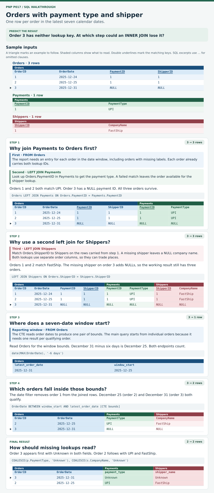

# PNP P017 — Orders with payment type and shipper

**Topic:** Joins  
**Difficulty:** Easy

## Question

**Table colors** · 🟦 `Orders` · 🟩 `Payments` · 🟥 `Shippers`

**Business scenario.** Every morning the operations desk reviews the most recent week of orders: how each was paid and which courier took it. An order with a missing or unrecognised payment or shipper code is exactly what they need to chase, so it must appear on the list, not vanish from it.

**Task.** For orders placed in the last 7 days covered by the data, return the payment type and shipper name. Show Unknown where the code is `NULL` or matches nothing. Sort newest first, then by 🟦 `OrderID` descending.

[PNP source question](../../../2.PNP-%20foundations%20and%20practice/2.%20Joins/P017.%20Orders%20with%20payment%20type%20and%20shipper.md#question-and-image)

### Required output columns

| Column | Meaning | Source |
|---|---|---|
| `OrderID` | Order identifier. | 🟦 `Orders` |
| `OrderDate` | Date the order was placed. | 🟦 `Orders` |
| `payment_type` | Payment type name, or `Unknown` for a missing or unrecognized code. | 🟩 `Payments` |
| `shipper_name` | Shipper’s company name, or `Unknown` for a missing or unrecognized code. | 🟥 `Shippers` |

### Practice example · Sample input

**🟦 `Orders`**

| 🟦 OrderID | 🟦 OrderDate | 🟦 PaymentID | 🟦 ShipperID |
|---:|---|---:|---:|
| 1 | 2025-12-24 | 1 | 1 |
| 2 | 2025-12-25 | 1 | 1 |
| 3 | 2025-12-31 | `NULL` | `NULL` |

**🟩 `Payments`**

| 🟩 PaymentID | 🟩 PaymentType |
|---:|---|
| 1 | UPI |

**🟥 `Shippers`**

| 🟥 ShipperID | 🟥 CompanyName |
|---:|---|
| 1 | FastShip |

### Expected output

| 🟦 OrderID | 🟦 OrderDate | 🟩 payment_type | 🟥 shipper_name |
|---:|---|---|---|
| 3 | 2025-12-31 | Unknown | Unknown |
| 2 | 2025-12-25 | UPI | FastShip |

[View sample inputs and output with colored cells](../../assets/question-samples/p017.svg?raw=1)

### How the sample produces this output

The latest order date is December 31, so the seven calendar dates are 🟦 **December 25–31 inclusive**. Order 3 falls on December 31 and both lookup IDs are missing. Its row shows **Unknown** for both payment type and shipper.

Order 2 falls on December 25. Payment ID 1 is 🟩 **UPI** and shipper ID 1 is 🟥 **FastShip**. Order 1 falls on December 24 and is outside the window. Newest-first ordering puts order 3 before order 2.

## Step 1 · Your approach before writing SQL

1. What does one row of the final output represent?
2. Which table would you put in `FROM`? If you need other tables, which comes second, third, and so on, and why?
3. Would you use a join at any step? For each join you choose, name its type and matching columns and explain why it fits the question.

## Visual walkthrough

[Open the Previous / Next walkthrough](../../assets/steps/PNP-P017/01.md)

Follow the sample rows through each query step. **Predict the result.** Order 3 has neither lookup key. At which step could an INNER JOIN lose it?



[Open the full-size walkthrough](../../assets/walkthroughs/p017.svg?raw=1)

## Earlier learner solution — SQLite

```sql
SELECT
    o.OrderID,
    o.OrderDate,
    COALESCE(p.PaymentType, 'Unknown') AS payment_type,
    COALESCE(s.CompanyName, 'Unknown') AS shipper_name
FROM Orders AS o
LEFT JOIN Payments AS p ON o.PaymentID = p.PaymentID
LEFT JOIN Shippers AS s ON o.ShipperID = s.ShipperID
WHERE date(o.OrderDate) >= (
    SELECT date(MAX(OrderDate), '-6 days')
    FROM Orders
)
ORDER BY o.OrderDate DESC, o.OrderID DESC;
```

This was a guided submission. The SQLite checks covered the sample, missing and unmatched lookup IDs, a rolling window crossing into a new year, a first-day timestamp, equal timestamps, and an empty Orders table.

## Step-by-step walkthrough

One output row represents one order in the reporting window. Use the same sample for each step.

### 1. Attach payment and shipper details

🟦 **First · FROM Orders** · The report needs an entry for each order in the date window, including orders with missing labels. Each order already carries both lookup IDs.

🟩 **Second · LEFT JOIN Payments** · Look up `Orders.PaymentID` in Payments to get the payment type. A failed match leaves the order available for the shipper lookup.

🟥 **Third · LEFT JOIN Shippers** · Match `Orders.ShipperID` to Shippers on the rows carried from step 1. A missing shipper leaves a NULL company name. Both lookups use separate order columns, so they can trade places.

```sql
SELECT o.OrderID, o.OrderDate, p.PaymentType, s.CompanyName
FROM Orders AS o
LEFT JOIN Payments AS p ON o.PaymentID = p.PaymentID
LEFT JOIN Shippers AS s ON o.ShipperID = s.ShipperID
ORDER BY o.OrderID;
```

| OrderID | OrderDate | PaymentType | CompanyName |
|---:|---|---|---|
| 1 | 2025-12-24 | UPI | FastShip |
| 2 | 2025-12-25 | UPI | FastShip |
| 3 | 2025-12-31 | `NULL` | `NULL` |

### 2. Find the data's latest date and window start

**What to do.** Take the maximum order date and subtract six calendar days.

**Why.** The latest day itself counts as one of the seven days. Using MAX makes the window move as new orders arrive.

```sql
SELECT date(MAX(OrderDate)) AS latest_order_date,
       date(MAX(OrderDate), '-6 days') AS window_start
FROM Orders;
```

| latest_order_date | window_start |
|---|---|
| 2025-12-31 | 2025-12-25 |

### 3. Keep orders on or after the start

**What to do.** Use the calculated start in WHERE. Keep the original OrderDate in the output while comparing its calendar date.

**Why.** December 25 is included. No upper bound is needed because no order has a date later than the maximum of the same Orders table.

```sql
SELECT o.OrderID, o.OrderDate, p.PaymentType, s.CompanyName
FROM Orders AS o
LEFT JOIN Payments AS p ON o.PaymentID = p.PaymentID
LEFT JOIN Shippers AS s ON o.ShipperID = s.ShipperID
WHERE date(o.OrderDate) >= (
    SELECT date(MAX(OrderDate), '-6 days')
    FROM Orders
)
ORDER BY o.OrderID;
```

| OrderID | OrderDate | PaymentType | CompanyName |
|---:|---|---|---|
| 2 | 2025-12-25 | UPI | FastShip |
| 3 | 2025-12-31 | `NULL` | `NULL` |

### 4. Label missing values and sort newest first

**What to do.** Apply COALESCE to each lookup label and sort by date descending, then ID descending.

**Why.** Missing lookups should be visible as Unknown. Order ID resolves a tie on OrderDate.

```sql
SELECT
    o.OrderID,
    o.OrderDate,
    COALESCE(p.PaymentType, 'Unknown') AS payment_type,
    COALESCE(s.CompanyName, 'Unknown') AS shipper_name
FROM Orders AS o
LEFT JOIN Payments AS p ON o.PaymentID = p.PaymentID
LEFT JOIN Shippers AS s ON o.ShipperID = s.ShipperID
WHERE date(o.OrderDate) >= (
    SELECT date(MAX(OrderDate), '-6 days')
    FROM Orders
)
ORDER BY o.OrderDate DESC, o.OrderID DESC;
```

| OrderID | OrderDate | payment_type | shipper_name |
|---:|---|---|---|
| 3 | 2025-12-31 | Unknown | Unknown |
| 2 | 2025-12-25 | UPI | FastShip |

## Earlier learner solution — SQL Server adaptation

```sql
SELECT
    o.OrderID,
    o.OrderDate,
    COALESCE(p.PaymentType, 'Unknown') AS payment_type,
    COALESCE(s.CompanyName, 'Unknown') AS shipper_name
FROM Orders AS o
LEFT JOIN Payments AS p ON o.PaymentID = p.PaymentID
LEFT JOIN Shippers AS s ON o.ShipperID = s.ShipperID
WHERE CAST(o.OrderDate AS date) >= (
    SELECT DATEADD(day, -6, CAST(MAX(OrderDate) AS date))
    FROM Orders
)
ORDER BY o.OrderDate DESC, o.OrderID DESC;
```

Uses DATEADD and a date cast. Reviewed by inspection.

## Final learner solution — CTE and scalar subqueries

### SQLite

```sql
WITH reporting_window AS (
    SELECT
        date(MAX(OrderDate)) AS latest_order_date,
        date(MAX(OrderDate), '-6 days') AS window_start
    FROM Orders
)
SELECT
    o.OrderID,
    o.OrderDate,
    COALESCE(p.PaymentType, 'Unknown') AS payment_type,
    COALESCE(s.CompanyName, 'Unknown') AS shipper_name
FROM Orders AS o
LEFT JOIN Payments AS p ON o.PaymentID = p.PaymentID
LEFT JOIN Shippers AS s ON o.ShipperID = s.ShipperID
WHERE (o.OrderDate) BETWEEN
    (SELECT window_start FROM reporting_window)
    AND
    (SELECT latest_order_date FROM reporting_window)
ORDER BY o.OrderDate DESC, o.OrderID DESC;
```

The learner selected the two LEFT JOINs, join keys, MAX, six-day offset, and CTE approach. The completed query incorporates help with SQLite syntax and connecting the CTE.

### Step-by-step walkthrough

The example uses the three Orders rows above throughout. Step tables use order ID ascending for readability until the final sort.

#### 1. Calculate the reporting window

🟦 **Reporting window · FROM Orders** · The CTE reads order dates to produce one pair of bounds. The main query starts from individual orders because it needs one result per qualifying order. Subtract six days from the latest date to get seven inclusive calendar dates.

```sql
WITH reporting_window AS (
    SELECT
        date(MAX(OrderDate)) AS latest_order_date,
        date(MAX(OrderDate), '-6 days') AS window_start
    FROM Orders
)
SELECT latest_order_date, window_start FROM reporting_window;
```

| latest_order_date | window_start |
|---|---|
| 2025-12-31 | 2025-12-25 |

#### 2. Join the lookup tables

🟦 **First · FROM Orders** · The report needs an entry for each order in the date window, including orders with missing labels. Each order already carries both lookup IDs.

🟩 **Second · LEFT JOIN Payments** · Look up `Orders.PaymentID` in Payments to get the payment type. A failed match leaves the order available for the shipper lookup.

🟥 **Third · LEFT JOIN Shippers** · Match `Orders.ShipperID` to Shippers on the rows carried from step 1. A missing shipper leaves a NULL company name. Both lookups use separate order columns, so they can trade places.

```sql
SELECT o.OrderID, o.OrderDate, p.PaymentType, s.CompanyName
FROM Orders AS o
LEFT JOIN Payments AS p ON o.PaymentID = p.PaymentID
LEFT JOIN Shippers AS s ON o.ShipperID = s.ShipperID
ORDER BY o.OrderID;
```

| OrderID | OrderDate | PaymentType | CompanyName |
|---:|---|---|---|
| 1 | 2025-12-24 | UPI | FastShip |
| 2 | 2025-12-25 | UPI | FastShip |
| 3 | 2025-12-31 | NULL | NULL |

#### 3. Keep orders within the window

**What to do.** Read each boundary from the CTE using a scalar subquery. Compare the order date with BETWEEN. **Why.** Each subquery returns one value and BETWEEN includes both endpoints. This query assumes ISO date-only text (YYYY-MM-DD), so the order date can be compared directly. With timestamps, use the earlier timestamp-safe version above.

```sql
WITH reporting_window AS (
    SELECT
        date(MAX(OrderDate)) AS latest_order_date,
        date(MAX(OrderDate), '-6 days') AS window_start
    FROM Orders
)
SELECT o.OrderID, o.OrderDate, p.PaymentType, s.CompanyName
FROM Orders AS o
LEFT JOIN Payments AS p ON o.PaymentID = p.PaymentID
LEFT JOIN Shippers AS s ON o.ShipperID = s.ShipperID
WHERE (o.OrderDate) BETWEEN
    (SELECT window_start FROM reporting_window)
    AND
    (SELECT latest_order_date FROM reporting_window)
ORDER BY o.OrderID;
```

| OrderID | OrderDate | PaymentType | CompanyName |
|---:|---|---|---|
| 2 | 2025-12-25 | UPI | FastShip |
| 3 | 2025-12-31 | NULL | NULL |

Order 1 falls before December 25. Orders 2 and 3 sit exactly on the two inclusive boundaries.

#### 4. Label missing values and sort

**What to do.** Apply COALESCE to each lookup label, then order by OrderDate descending and OrderID descending. **Why.** Unknown makes missing lookups visible, and the ID resolves ties on the order date.

```sql
WITH reporting_window AS (
    SELECT
        date(MAX(OrderDate)) AS latest_order_date,
        date(MAX(OrderDate), '-6 days') AS window_start
    FROM Orders
)
SELECT
    o.OrderID,
    o.OrderDate,
    COALESCE(p.PaymentType, 'Unknown') AS payment_type,
    COALESCE(s.CompanyName, 'Unknown') AS shipper_name
FROM Orders AS o
LEFT JOIN Payments AS p ON o.PaymentID = p.PaymentID
LEFT JOIN Shippers AS s ON o.ShipperID = s.ShipperID
WHERE (o.OrderDate) BETWEEN
    (SELECT window_start FROM reporting_window)
    AND
    (SELECT latest_order_date FROM reporting_window)
ORDER BY o.OrderDate DESC, o.OrderID DESC;
```

| OrderID | OrderDate | payment_type | shipper_name |
|---:|---|---|---|
| 3 | 2025-12-31 | Unknown | Unknown |
| 2 | 2025-12-25 | UPI | FastShip |

Verified in SQLite on the original sample and on date-only fixtures for the rolling window, missing matches, sort ties, and empty input.

### SQL Server adaptation

```sql
;WITH reporting_window AS (
    SELECT
        CAST(MAX(OrderDate) AS date) AS latest_order_date,
        DATEADD(day, -6, CAST(MAX(OrderDate) AS date)) AS window_start
    FROM Orders
)
SELECT
    o.OrderID,
    o.OrderDate,
    COALESCE(p.PaymentType, 'Unknown') AS payment_type,
    COALESCE(s.CompanyName, 'Unknown') AS shipper_name
FROM Orders AS o
LEFT JOIN Payments AS p ON o.PaymentID = p.PaymentID
LEFT JOIN Shippers AS s ON o.ShipperID = s.ShipperID
WHERE (o.OrderDate) BETWEEN
    (SELECT window_start FROM reporting_window)
    AND
    (SELECT latest_order_date FROM reporting_window)
ORDER BY o.OrderDate DESC, o.OrderID DESC;
```

Assumes a date-only OrderDate column. Reviewed by inspection.

## Official solution

[PNP answer key, Q17](https://github.com/MulikShrikantDattatray14/Data-Engineering-Mastry/blob/main/1.%20SQL%20Mastery/1.%20SQL%20Mastry/2.PNP-%20foundations%20and%20practice/Source%20Materials/PrepNPlaced_SQL_100_v2/sql/all_100_solutions.sql)

```sql
SELECT o.OrderID,
       o.OrderDate,
       COALESCE(pay.PaymentType, 'Unknown') AS payment_type,
       COALESCE(sh.CompanyName, 'Unknown')  AS shipper_name
FROM Orders AS o
LEFT JOIN Payments AS pay ON pay.PaymentID = o.PaymentID
LEFT JOIN Shippers AS sh  ON sh.ShipperID  = o.ShipperID
WHERE o.OrderDate >= (SELECT MAX(latest.OrderDate)::date - 6 FROM Orders AS latest)
ORDER BY o.OrderDate DESC, o.OrderID DESC;
```

### Official answer — SQLite adaptation

```sql
SELECT o.OrderID,
       o.OrderDate,
       COALESCE(pay.PaymentType, 'Unknown') AS payment_type,
       COALESCE(sh.CompanyName, 'Unknown')  AS shipper_name
FROM Orders AS o
LEFT JOIN Payments AS pay ON pay.PaymentID = o.PaymentID
LEFT JOIN Shippers AS sh  ON sh.ShipperID  = o.ShipperID
WHERE date(o.OrderDate) >= (SELECT date(MAX(latest.OrderDate), '-6 days') FROM Orders AS latest)
ORDER BY o.OrderDate DESC, o.OrderID DESC;
```

### Official answer — SQL Server adaptation

```sql
SELECT o.OrderID,
       o.OrderDate,
       COALESCE(pay.PaymentType, 'Unknown') AS payment_type,
       COALESCE(sh.CompanyName, 'Unknown')  AS shipper_name
FROM Orders AS o
LEFT JOIN Payments AS pay ON pay.PaymentID = o.PaymentID
LEFT JOIN Shippers AS sh  ON sh.ShipperID  = o.ShipperID
WHERE o.OrderDate >= (SELECT DATEADD(day, -6, CAST(MAX(latest.OrderDate) AS date)) FROM Orders AS latest)
ORDER BY o.OrderDate DESC, o.OrderID DESC;
```

The SQLite adaptation passed the sample and extended fixture. The SQL Server adaptations were reviewed by inspection.
