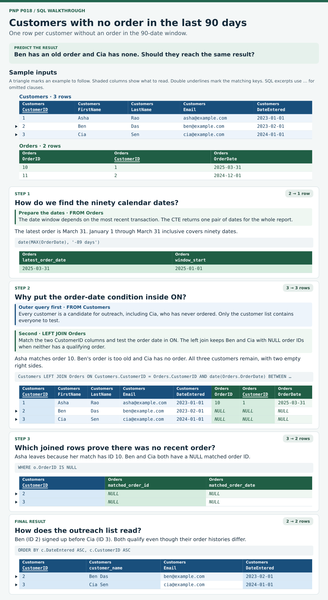

# PNP P018 — Customers with no order in the last 90 days

**Topic:** Joins  
**Difficulty:** Easy

## Question

**Table colors** · 🟦 `Customers` · 🟩 `Orders`

**Business scenario.** The retention team sends a "we miss you" offer to customers who have gone quiet. The list is every registered customer with no order in the last 90 days of data, whether they went quiet or never ordered at all; the team splits the two groups later. "Last 90 days" ends on the latest 🟩 `OrderDate` in the table, not on today's date, because the extract may be weeks old.

**Task.** Return every customer who has no order dated within the 90 days ending on the latest `OrderDate` in `Orders`. Show their name, email and sign-up date. Sort by 🟦 `DateEntered`, then `CustomerID`.

[PNP source question](../../../2.PNP-%20foundations%20and%20practice/2.%20Joins/P018.%20Customers%20with%20no%20order%20in%20the%20last%2090%20days.md#question-and-image)

### Required output columns

One output row represents one customer with no order in the 90-day reporting window.

| Output column | Source or calculation | Meaning and applicable rules | Example value |
| --- | --- | --- | --- |
| `CustomerID` | 🟦 `Customers.CustomerID` | Customer identifier. | 2 |
| `customer_name` | 🟦 `Customers` | Customer’s first and last names, separated by a space. | Ben Das |
| `Email` | 🟦 `Customers.Email` | Email address as stored. | ben@example.com |
| `DateEntered` | 🟦 `Customers.DateEntered` | Customer’s sign-up date. | 2023-02-01 |

### Practice example · Sample input

**🟦 `Customers`**

| 🟦 CustomerID | 🟦 FirstName | 🟦 LastName | 🟦 Email | 🟦 DateEntered |
|---:|---|---|---|---|
| 1 | Asha | Rao | asha@example.com | 2023-01-01 |
| 2 | Ben | Das | ben@example.com | 2023-02-01 |
| 3 | Cia | Sen | cia@example.com | 2024-01-01 |

**🟩 `Orders`**

| 🟩 OrderID | 🟩 CustomerID | 🟩 OrderDate |
|---:|---:|---|
| 10 | 1 | 2025-03-31 |
| 11 | 2 | 2024-12-01 |

### Expected output

| 🟦 CustomerID | 🟦 customer_name | 🟦 Email | 🟦 DateEntered |
|---:|---|---|---|
| 2 | Ben Das | ben@example.com | 2023-02-01 |
| 3 | Cia Sen | cia@example.com | 2024-01-01 |

[View sample inputs and output with colored cells](../../assets/question-samples/p018.svg?raw=1)

### How the sample produces this output

The latest order date is March 31, 2025. The 90 calendar dates ending that day run from 🟩 **January 1 through March 31**. Asha placed 🟩 order 10 on March 31 and is outside the outreach list.

Ben’s only order was on December 1, 2024. Cia has no order in the sample. Both qualify, so their names, email addresses and sign-up dates appear. 🟦 Ben signed up on February 1, 2023, before Cia on January 1, 2024, which explains their order.

## Step 1 · Your approach before writing SQL

1. What does one row of the final output represent?
2. Which table would you put in `FROM`? If you need other tables, which comes second, third, and so on, and why?
3. Would you use a join at any step? For each join you choose, name its type and matching columns and explain why it fits the question.

## Final learner submission — SQLite

```sql
WITH reporting_window AS (
    SELECT
        date(MAX(OrderDate)) AS latest_order_date,
        date(MAX(OrderDate), '-89 days') AS window_start
    FROM Orders
)
SELECT
    c.CustomerID,
    c.FirstName || ' ' || c.LastName AS customer_name,
    c.Email,
    c.DateEntered
FROM Customers AS c
LEFT JOIN Orders AS o
    ON o.CustomerID = c.CustomerID
   AND date(o.OrderDate) BETWEEN
       (SELECT window_start FROM reporting_window)
       AND (SELECT latest_order_date FROM reporting_window)
WHERE o.OrderID IS NULL
ORDER BY c.DateEntered ASC, c.CustomerID ASC;
```

Guided submission. This final version uses table aliases and a single-quoted space. Verified on the sample, a first-day timestamp for a customer with an older order, and an empty Orders table.

## Visual walkthrough

[Open the Previous / Next walkthrough](../../assets/steps/PNP-P018/01.md)

Follow the sample rows through each query step. **Predict the result.** Ben has an old order and Cia has none. Should they reach the same result?



[Open the full-size walkthrough](../../assets/walkthroughs/p018.svg?raw=1)

## Step-by-step walkthrough

### 1. Calculate the 90-day window

🟩 **Prepare the dates · FROM Orders** · The date window depends on the most recent transaction. The CTE returns one pair of dates for the whole report. Subtract 89 days because the latest date counts as one of the 90.

```sql
WITH reporting_window AS (
    SELECT date(MAX(OrderDate)) AS latest_order_date,
           date(MAX(OrderDate), '-89 days') AS window_start
    FROM Orders
)
SELECT latest_order_date, window_start FROM reporting_window;
```

| latest_order_date | window_start |
|---|---|
| 2025-03-31 | 2025-01-01 |

### 2. Match only orders inside the window

🟦 **Outer query first · FROM Customers** · Every customer is a candidate for outreach, including Cia, who has never ordered. Only the customer list contains everyone to test.

🟩 **Second · LEFT JOIN Orders** · Match the two `CustomerID` columns and test the order date in `ON`. The left join keeps Ben and Cia with NULL order IDs when neither has a qualifying order. Ben has an order outside the window. Cia has never ordered.

```sql
WITH reporting_window AS (
    SELECT date(MAX(OrderDate)) AS latest_order_date,
           date(MAX(OrderDate), '-89 days') AS window_start
    FROM Orders
)
SELECT Customers.CustomerID, Orders.OrderID AS matched_order_id, Orders.OrderDate AS matched_order_date
FROM Customers
LEFT JOIN Orders
    ON Orders.CustomerID = Customers.CustomerID
   AND date(Orders.OrderDate) BETWEEN
       (SELECT window_start FROM reporting_window)
       AND (SELECT latest_order_date FROM reporting_window)
ORDER BY Customers.CustomerID;
```

| CustomerID | matched_order_id | matched_order_date |
|---:|---:|---|
| 1 | 10 | 2025-03-31 |
| 2 | NULL | NULL |
| 3 | NULL | NULL |

### 3. Keep customers with no recent match

**What to do.** Add WHERE Orders.OrderID IS NULL to the preview.

**Why.** Ben and Cia have no matching order inside the window, so their joined order IDs are NULL.

```sql
WITH reporting_window AS (
    SELECT date(MAX(OrderDate)) AS latest_order_date,
           date(MAX(OrderDate), '-89 days') AS window_start
    FROM Orders
)
SELECT Customers.CustomerID, Orders.OrderID AS matched_order_id, Orders.OrderDate AS matched_order_date
FROM Customers
LEFT JOIN Orders
    ON Orders.CustomerID = Customers.CustomerID
   AND date(Orders.OrderDate) BETWEEN
       (SELECT window_start FROM reporting_window)
       AND (SELECT latest_order_date FROM reporting_window)
WHERE Orders.OrderID IS NULL
ORDER BY Customers.CustomerID;
```

| CustomerID | matched_order_id | matched_order_date |
|---:|---|---|
| 2 | NULL | NULL |
| 3 | NULL | NULL |

### 4. Select the customer details and sort

**What to do.** Use WHERE to retain rows with a NULL order ID and apply the two ascending sort keys.

**Why.** A NULL order ID indicates the recent-order join found no match. Testing whether an order is outside the window could let a customer with both an old and a recent order through. The customer ID breaks sign-up date ties.

```sql
WITH reporting_window AS (
    SELECT
        date(MAX(OrderDate)) AS latest_order_date,
        date(MAX(OrderDate), '-89 days') AS window_start
    FROM Orders
)
SELECT
    c.CustomerID,
    c.FirstName || ' ' || c.LastName AS customer_name,
    c.Email,
    c.DateEntered
FROM Customers AS c
LEFT JOIN Orders AS o
    ON o.CustomerID = c.CustomerID
   AND date(o.OrderDate) BETWEEN
       (SELECT window_start FROM reporting_window)
       AND (SELECT latest_order_date FROM reporting_window)
WHERE o.OrderID IS NULL
ORDER BY c.DateEntered ASC, c.CustomerID ASC;
```

| CustomerID | customer_name | Email | DateEntered |
|---:|---|---|---|
| 2 | Ben Das | ben@example.com | 2023-02-01 |
| 3 | Cia Sen | cia@example.com | 2024-01-01 |

The SQLite checks covered the original sample, a customer with both old and recent orders, timestamps on both boundary dates, tied sign-up dates, and empty Orders.

## Learner submission — SQL Server adaptation

```sql
;WITH reporting_window AS (
    SELECT CAST(MAX(OrderDate) AS date) AS latest_order_date,
           DATEADD(day, -89, CAST(MAX(OrderDate) AS date)) AS window_start
    FROM Orders
)
SELECT Customers.CustomerID,
       (Customers.FirstName + ' ' + Customers.LastName) AS customer_name,
       Customers.Email,
       Customers.DateEntered
FROM Customers
LEFT JOIN Orders
    ON Orders.CustomerID = Customers.CustomerID
   AND CAST(Orders.OrderDate AS date) BETWEEN
       (SELECT window_start FROM reporting_window)
       AND (SELECT latest_order_date FROM reporting_window)
WHERE Orders.OrderID IS NULL
ORDER BY Customers.DateEntered, Customers.CustomerID ASC;
```

Uses CAST and DATEADD for the calendar boundaries and single quotes for the joining space. Reviewed by inspection.

## Official solution

[PNP answer key, Q18](https://github.com/MulikShrikantDattatray14/Data-Engineering-Mastry/blob/main/1.%20SQL%20Mastery/1.%20SQL%20Mastry/2.PNP-%20foundations%20and%20practice/Source%20Materials/PrepNPlaced_SQL_100_v2/sql/all_100_solutions.sql)

```sql
SELECT c.CustomerID,
       CONCAT_WS(' ', c.FirstName, c.LastName) AS customer_name,
       c.Email,
       c.DateEntered
FROM Customers AS c
LEFT JOIN Orders AS o
       ON o.CustomerID = c.CustomerID
      AND o.OrderDate >= (SELECT MAX(OrderDate) FROM Orders) - 89
WHERE o.OrderID IS NULL
ORDER BY c.DateEntered, c.CustomerID;
```

### Official answer — SQLite adaptation

```sql
SELECT c.CustomerID,
       CASE WHEN c.FirstName IS NULL THEN COALESCE(c.LastName, '')
            WHEN c.LastName IS NULL THEN c.FirstName
            ELSE c.FirstName || ' ' || c.LastName END AS customer_name,
       c.Email,
       c.DateEntered
FROM Customers AS c
LEFT JOIN Orders AS o
       ON o.CustomerID = c.CustomerID
      AND date(o.OrderDate) >= (SELECT date(MAX(OrderDate), '-89 days') FROM Orders)
WHERE o.OrderID IS NULL
ORDER BY c.DateEntered, c.CustomerID;
```

### Official answer — SQL Server adaptation

```sql
SELECT c.CustomerID,
       CONCAT_WS(' ', c.FirstName, c.LastName) AS customer_name,
       c.Email,
       c.DateEntered
FROM Customers AS c
LEFT JOIN Orders AS o
       ON o.CustomerID = c.CustomerID
      AND o.OrderDate >= (SELECT DATEADD(day, -89, CAST(MAX(OrderDate) AS date)) FROM Orders)
WHERE o.OrderID IS NULL
ORDER BY c.DateEntered, c.CustomerID;
```

The official version needs only a lower-bound check because its window ends on the latest order date in the same table. Its name formatting skips missing name parts. The SQLite adaptation was executed on the sample and extended fixtures. The SQL Server versions were reviewed by inspection.

## Comparison with the course answer

The official answer uses `CONCAT_WS` (and its SQLite adaptation) to skip missing name parts. The locked query concatenates with `||`, so if either name part is `NULL`, the whole `customer_name` becomes `NULL`. The original sample has complete names, so both queries return the same displayed names.

**Practice example (added only to check missing-name behavior):** a customer with `FirstName = NULL`, `LastName = 'Rao'`, and no order in the recent window remains eligible in both queries. The locked query displays a NULL name; the official SQLite adaptation displays `Rao`. The learner query is preserved.

## Verification

The saved learner query ran in SQLite on the [walkthrough fixture](../../assets/steps/PNP-P018/walkthrough.json). The column names and all 2 expected rows matched in the displayed order.
