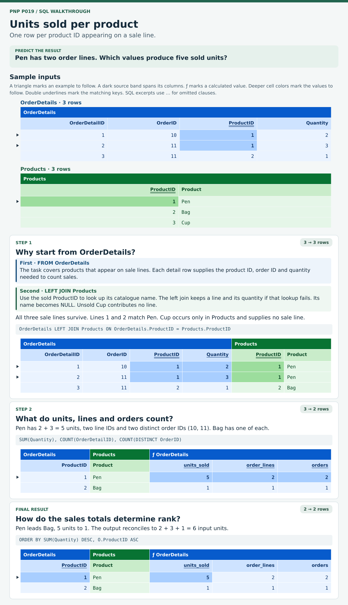

# PNP P019 — Units sold per product

**Topic:** Joins and aggregation  
**Difficulty:** Easy

## Question

**Table colors** · 🟩 `Products` · 🟦 `OrderDetails`

**Business scenario.** Merchandising decides which products get the end-of-aisle display in the app. They look at three numbers per product: units sold, the number of order lines, and the number of distinct 🟦 `orders`. A product bought in bulk by a few customers and one bought one at a time by many need different promotions. Cancellations and returns are not recorded here, so every order line counts as sold.

**Task.** For each product that appears in `OrderDetails`, return units sold, order lines and distinct `orders`. Sort by units sold, highest first, then `ProductID`.

[PNP source question](../../../2.PNP-%20foundations%20and%20practice/2.%20Joins/P019.%20Units%20sold%20per%20product.md#question-and-image)

### Required output columns

One output row represents one product ID appearing on a sale line.

| Output column | Source or calculation | Meaning and applicable rules | Example value |
| --- | --- | --- | --- |
| `ProductID` | 🟦 `OrderDetails.ProductID` | Product identifier. | 1 |
| `Product` | 🟩 `Products.Product` | Product name. | Pen |
| `units_sold` | 🟦 `OrderDetails` | Total quantity on the product’s sale lines. | 5 |
| `order_lines` | 🟦 `OrderDetails` | Number of sale lines for the product. | 2 |
| `orders` | 🟦 `OrderDetails` | Number of distinct orders containing that product. | 2 |

### Practice example · Sample input

**🟩 `Products`**

| 🟩 ProductID | 🟩 Product |
|---:|---|
| 1 | Pen |
| 2 | Bag |
| 3 | Cup |

**🟦 `OrderDetails`**

| 🟦 OrderDetailID | 🟦 OrderID | 🟦 ProductID | 🟦 Quantity |
|---:|---:|---:|---:|
| 1 | 10 | 1 | 2 |
| 2 | 11 | 1 | 3 |
| 3 | 11 | 2 | 1 |

### Expected output

| 🟦 ProductID | 🟩 Product | 🟦 units_sold | 🟦 order_lines | 🟦 orders |
|---:|---|---:|---:|---:|
| 1 | Pen | 5 | 2 | 2 |
| 2 | Bag | 1 | 1 | 1 |

[View sample inputs and output with colored cells](../../assets/question-samples/p019.svg?raw=1)

### How the sample produces this output

🟩 Pen appears on detail lines 1 and 2 with quantities 2 and 3. It therefore has 🟦 **5 units**, **2 lines**, and **2 distinct orders** (10 and 11). 🟩 Bag appears on line 3 of order 11 with quantity 1, giving it 🟦 **1 unit, 1 line and 1 order**.

Cup has no sale line. Pen comes first because 5 units exceeds 1. The output accounts for the same six units as the three input quantities.

## Step 1 · Your approach before writing SQL

1. What does one row of the final output represent?
2. Which table would you put in `FROM`? If you need other tables, which comes second, third, and so on, and why?
3. Would you use a join at any step? For each join you choose, name its type and matching columns and explain why it fits the question.

## Learner solution — SQLite

```sql
select O.ProductID,P.Product,sum (O.Quantity) as units_sold, count(OrderDetailID)  as order_lines, count(distinct(OrderID)) as orders
from OrderDetails as O
left join Products as P on O.ProductID =P.ProductID
group by O.ProductID
order by sum (O.Quantity) desc , O.ProductID asc
```

## Visual walkthrough

[Open the Previous / Next walkthrough](../../assets/steps/PNP-P019/01.md)

Follow the sample rows through each query step. **Predict the result.** Pen has two order lines. Which values produce five sold units?



[Open the full-size walkthrough](../../assets/walkthroughs/p019.svg?raw=1)

## Step-by-step walkthrough

One output row represents one product appearing in OrderDetails. The sample stays the same throughout.

### 1. Attach the product name to each order line

🟦 **First · FROM OrderDetails** · The task covers products that appear on sale lines. Each detail row supplies the product ID, order ID and quantity needed to count sales.

🟩 **Second · LEFT JOIN Products** · Use the sold `ProductID` to look up its catalogue name. The left join keeps a line and its quantity if that lookup fails. Its name becomes NULL. Unsold Cup contributes no line. The official inner join requires a catalogue match.

```sql
SELECT O.OrderDetailID, O.OrderID, O.ProductID, P.Product, O.Quantity
FROM OrderDetails AS O
LEFT JOIN Products AS P ON O.ProductID = P.ProductID
ORDER BY O.OrderDetailID;
```

| OrderDetailID | OrderID | ProductID | Product | Quantity |
|---:|---:|---:|---|---:|
| 1 | 10 | 1 | Pen | 2 |
| 2 | 11 | 1 | Pen | 3 |
| 3 | 11 | 2 | Bag | 1 |

### 2. Group by product and calculate the metrics

**What to do.** Group by the order-line product ID, then sum quantities, count lines, and count distinct order IDs.

**Why.** The metrics answer different questions. Pen's quantities add up to five. Its two lines happen to belong to different orders. If it appears again in order 10, the line count increases and the distinct order count stays at two.

```sql
select O.ProductID,P.Product,sum (O.Quantity) as units_sold, count(OrderDetailID)  as order_lines, count(distinct(OrderID)) as orders
from OrderDetails as O
left join Products as P on O.ProductID =P.ProductID
group by O.ProductID
ORDER BY O.ProductID;
```

| ProductID | Product | units_sold | order_lines | orders |
|---:|---|---:|---:|---:|
| 1 | Pen | 5 | 2 | 2 |
| 2 | Bag | 1 | 1 | 1 |

### 3. Apply the ranking and verify ties

**What to do.** Sort by total quantity descending and by OrderDetails.ProductID ascending for tied totals.

**Why.** Both tables have ProductID, so qualifying the tie-breaker makes it unambiguous. Run the learner query above.

```sql
select O.ProductID,P.Product,sum (O.Quantity) as units_sold, count(OrderDetailID)  as order_lines, count(distinct(OrderID)) as orders
from OrderDetails as O
left join Products as P on O.ProductID =P.ProductID
group by O.ProductID
order by sum (O.Quantity) desc , O.ProductID asc
```

| ProductID | Product | units_sold | order_lines | orders |
|---:|---|---:|---:|---:|
| 1 | Pen | 5 | 2 | 2 |
| 2 | Bag | 1 | 1 | 1 |

SQLite checks covered the sample, a repeated product within one order, tied sales totals, and a missing catalogue match. The repeated-order fixture returned nine units, three lines and two distinct orders for Pen.

## Learner solution — SQL Server

```sql
select O.ProductID,P.Product,sum (O.Quantity) as units_sold, count(OrderDetailID)  as order_lines, count(distinct(OrderID)) as orders
from OrderDetails as O
left join Products as P on O.ProductID =P.ProductID
group by O.ProductID, P.Product
order by sum (O.Quantity) desc , O.ProductID asc;
```

SQL Server requires the selected product name in GROUP BY. Reviewed by inspection.

## Official solution

[PNP answer key, Q19](https://github.com/MulikShrikantDattatray14/Data-Engineering-Mastry/blob/main/1.%20SQL%20Mastery/1.%20SQL%20Mastry/2.PNP-%20foundations%20and%20practice/Source%20Materials/PrepNPlaced_SQL_100_v2/sql/all_100_solutions.sql)

```sql
SELECT p.ProductID,
       p.Product,
       SUM(od.Quantity)           AS units_sold,
       COUNT(*)                   AS order_lines,
       COUNT(DISTINCT od.OrderID) AS orders
FROM OrderDetails AS od
JOIN Products AS p ON p.ProductID = od.ProductID
GROUP BY p.ProductID, p.Product
ORDER BY units_sold DESC NULLS LAST, p.ProductID;
```

### Official answer — SQLite adaptation

```sql
SELECT p.ProductID,
       p.Product,
       SUM(od.Quantity)           AS units_sold,
       COUNT(*)                   AS order_lines,
       COUNT(DISTINCT od.OrderID) AS orders
FROM OrderDetails AS od
JOIN Products AS p ON p.ProductID = od.ProductID
GROUP BY p.ProductID, p.Product
ORDER BY units_sold DESC, p.ProductID;
```

### Official answer — SQL Server adaptation

```sql
SELECT p.ProductID,
       p.Product,
       SUM(od.Quantity)           AS units_sold,
       COUNT(*)                   AS order_lines,
       COUNT(DISTINCT od.OrderID) AS orders
FROM OrderDetails AS od
JOIN Products AS p ON p.ProductID = od.ProductID
GROUP BY p.ProductID, p.Product
ORDER BY units_sold DESC, p.ProductID;
```

Descending order places NULL totals last in both engines. The SQLite adaptation passed the sample and extended fixture. The SQL Server adaptation was reviewed by inspection.

## Comparison with the course answer

The locked query uses `LEFT JOIN Products` from `OrderDetails`, so every detail-line ProductID remains in the result, including an ID with no matching product row. The official answer uses an inner `JOIN` and excludes those unmatched IDs. The original sample contains only matching product IDs, so the expected sample output is unchanged.

**Practice example (added only to test unmatched products):** add `OrderDetails(4, 12, 999, 5)` with no `Products.ProductID = 999`. The learner query returns `ProductID = 999`, `Product = NULL`, `units_sold = 5`, `order_lines = 1`, and `orders = 1`; the official inner join drops it. The selected learner query is preserved.

## Verification

The saved learner query ran in SQLite on the [walkthrough fixture](../../assets/steps/PNP-P019/walkthrough.json). The column names and all 2 expected rows matched in the displayed order.
