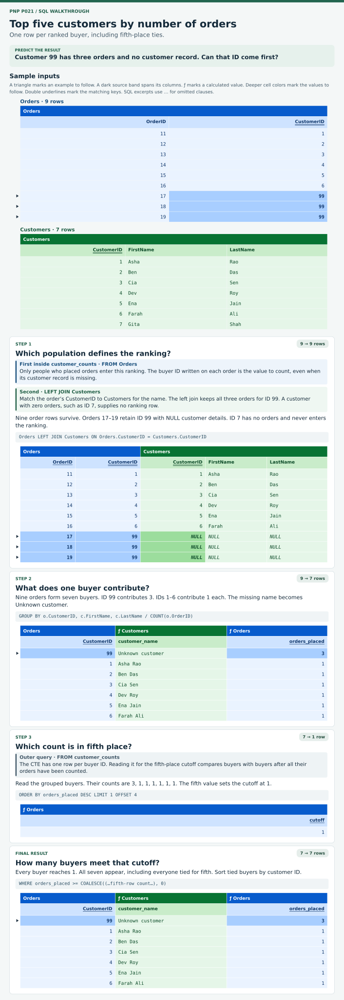

# PNP P021 — Top five customers by number of orders

**Topic:** Joins and aggregation  
**Difficulty:** Easy

## Question

**Business scenario.** The CRM team is sending thank-you hampers to its most frequent buyers, meaning the most orders placed, regardless of value. The budget covers five, but if customers tie for fifth place, the team would rather send an extra hamper than leave one out.

**Task.** Return the customers with the five highest order counts, including everyone tied at fifth place. Show Unknown customer when the `CustomerID` on the orders has no match in `Customers`. Sort by orders placed, highest first, then `CustomerID`.

[PNP source question](../../../2.PNP-%20foundations%20and%20practice/3.%20Sorting%20and%20Grouping/P021.%20Top%20five%20customers%20by%20number%20of%20orders.md#question-and-image)

### Required output columns

| Column | Meaning |
|---|---|
| `CustomerID` | Customer identifier. |
| `customer_name` | First and last name, or `Unknown customer` for an unrecognized customer ID. |
| `orders_placed` | Number of orders placed by that customer ID. |

### Practice example · Sample input

**`Customers`**

| CustomerID | FirstName | LastName |
|---:|---|---|
| 1 | Asha | Rao |
| 2 | Ben | Das |
| 3 | Cia | Sen |
| 4 | Dev | Roy |
| 5 | Ena | Jain |
| 6 | Farah | Ali |
| 7 | Gita | Shah |

**`Orders`**

| OrderID | CustomerID |
|---:|---:|
| 11 | 1 |
| 12 | 2 |
| 13 | 3 |
| 14 | 4 |
| 15 | 5 |
| 16 | 6 |
| 17 | 99 |
| 18 | 99 |
| 19 | 99 |

### Expected output

| CustomerID | customer_name | orders_placed |
|---:|---|---:|
| 99 | Unknown customer | 3 |
| 1 | Asha Rao | 1 |
| 2 | Ben Das | 1 |
| 3 | Cia Sen | 1 |
| 4 | Dev Roy | 1 |
| 5 | Ena Jain | 1 |
| 6 | Farah Ali | 1 |

### How the sample produces this output

Customer ID 99 placed orders 17, 18 and 19, giving it the highest count of **3**. Its ID has no customer record, so the displayed name is **Unknown customer**. Each of customer IDs 1 through 6 placed one order. Customer 7 placed none.

The fifth buyer in descending order has **1 order**. All six one-order buyers meet that same cutoff. The report therefore has **7 rows**, with ID 99 first and the six tied buyers in ascending customer ID order.

## Step 1 · Your approach before writing SQL

1. What does one row of the final output represent?
2. Which table would you put in `FROM`? If you need other tables, which comes second, third, and so on, and why?
3. Would you use a join at any step? For each join you choose, name its type and matching columns and explain why it fits the question.

## Visual walkthrough

Follow the sample rows through each query step. **Predict the result.** Customer 99 has three orders and no customer record. Can that ID come first?



[Open the full-size walkthrough](../../assets/walkthroughs/p021.svg?raw=1)

## Final learner submission — SQLite

```sql
WITH customer_counts AS (
    SELECT
        o.CustomerID,
        COALESCE(c.FirstName || ' ' || c.LastName, 'Unknown customer') AS customer_name,
        COUNT(o.OrderID) AS orders_placed
    FROM Orders AS o
    LEFT JOIN Customers AS c ON o.CustomerID = c.CustomerID
    GROUP BY o.CustomerID, c.FirstName, c.LastName
)
SELECT CustomerID, customer_name, orders_placed
FROM customer_counts
WHERE orders_placed >= COALESCE(
    (
        SELECT orders_placed
        FROM customer_counts
        ORDER BY orders_placed DESC
        LIMIT 1 OFFSET 4
    ),
    0
)
ORDER BY orders_placed DESC, CustomerID ASC;
```

Guided submission. The learner chose grouping by customer ID, counting orders, and preserving unmatched customer IDs. The cutoff subquery was developed with guidance.

## Step-by-step walkthrough

### 1. Build one row per customer ID that placed an order

**What to do.** Start from Orders, join customer names, and count orders for each customer ID.

**Why this join.** The LEFT JOIN keeps orders for ID 99 even without a catalogue match. ID 7 has no order and never enters the ranking.

```sql
WITH customer_counts AS (
    SELECT
        o.CustomerID,
        COALESCE(c.FirstName || ' ' || c.LastName, 'Unknown customer') AS customer_name,
        COUNT(o.OrderID) AS orders_placed
    FROM Orders AS o
    LEFT JOIN Customers AS c ON o.CustomerID = c.CustomerID
    GROUP BY o.CustomerID, c.FirstName, c.LastName
)
SELECT * FROM customer_counts
ORDER BY orders_placed DESC, CustomerID ASC;
```

| CustomerID | customer_name | orders_placed |
|---:|---|---:|
| 99 | Unknown customer | 3 |
| 1 | Asha Rao | 1 |
| 2 | Ben Das | 1 |
| 3 | Cia Sen | 1 |
| 4 | Dev Roy | 1 |
| 5 | Ena Jain | 1 |
| 6 | Farah Ali | 1 |

These are the candidate counts before the cutoff. The learner's COALESCE also supplies the fallback when a matched customer's name has a NULL part.

### 2. Find the fifth row's count

**What to do.** Sort the counts descending, skip four rows, and read the next count. Use zero when the fifth row is absent.

**Why.** The fifth row sets the minimum qualifying count. The fallback keeps all eligible customers when there are fewer than five.

```sql
WITH customer_counts AS (
    SELECT
        o.CustomerID,
        COALESCE(c.FirstName || ' ' || c.LastName, 'Unknown customer') AS customer_name,
        COUNT(o.OrderID) AS orders_placed
    FROM Orders AS o
    LEFT JOIN Customers AS c ON o.CustomerID = c.CustomerID
    GROUP BY o.CustomerID, c.FirstName, c.LastName
)
SELECT COALESCE((SELECT orders_placed FROM customer_counts
                 ORDER BY orders_placed DESC LIMIT 1 OFFSET 4), 0) AS cutoff;
```

| cutoff |
|---:|
| 1 |

### 3. Keep everyone who meets the cutoff and sort

**What to do.** Use the cutoff in the outer WHERE and apply the requested sort.

**Why.** The >= comparison includes everyone tied at the cutoff. CustomerID controls the display order of ties.

```sql
WITH customer_counts AS (
    SELECT
        o.CustomerID,
        COALESCE(c.FirstName || ' ' || c.LastName, 'Unknown customer') AS customer_name,
        COUNT(o.OrderID) AS orders_placed
    FROM Orders AS o
    LEFT JOIN Customers AS c ON o.CustomerID = c.CustomerID
    GROUP BY o.CustomerID, c.FirstName, c.LastName
)
SELECT CustomerID, customer_name, orders_placed
FROM customer_counts
WHERE orders_placed >= COALESCE(
    (
        SELECT orders_placed
        FROM customer_counts
        ORDER BY orders_placed DESC
        LIMIT 1 OFFSET 4
    ),
    0
)
ORDER BY orders_placed DESC, CustomerID ASC;
```

| CustomerID | customer_name | orders_placed |
|---:|---|---:|
| 99 | Unknown customer | 3 |
| 1 | Asha Rao | 1 |
| 2 | Ben Das | 1 |
| 3 | Cia Sen | 1 |
| 4 | Dev Roy | 1 |
| 5 | Ena Jain | 1 |
| 6 | Farah Ali | 1 |

In an extended boundary test with counts 9, 8, 7, 6, 5, 5, and 4, the cutoff was 5 and six customers qualified. SQLite also passed the original sample, fewer than five candidates, and an empty Orders table.

## Learner submission — SQL Server adaptation

```sql
WITH customer_counts AS (
    SELECT
        o.CustomerID,
        COALESCE(c.FirstName + ' ' + c.LastName, 'Unknown customer') AS customer_name,
        COUNT(o.OrderID) AS orders_placed
    FROM Orders AS o
    LEFT JOIN Customers AS c ON o.CustomerID = c.CustomerID
    GROUP BY o.CustomerID, c.FirstName, c.LastName
)
SELECT CustomerID, customer_name, orders_placed
FROM customer_counts
WHERE orders_placed >= COALESCE(
    (
        SELECT orders_placed
        FROM customer_counts
        ORDER BY orders_placed DESC
        OFFSET 4 ROWS FETCH NEXT 1 ROW ONLY
    ),
    0
)
ORDER BY orders_placed DESC, CustomerID ASC;
```

Uses OFFSET and FETCH for the cutoff. Reviewed by inspection.

## Official solution

[PNP answer key, Q21](https://github.com/MulikShrikantDattatray14/Data-Engineering-Mastry/blob/main/1.%20SQL%20Mastery/1.%20SQL%20Mastry/2.PNP-%20foundations%20and%20practice/Source%20Materials/PrepNPlaced_SQL_100_v2/sql/all_100_solutions.sql)

```sql
SELECT top5.CustomerID,
       top5.customer_name,
       top5.orders_placed
FROM (
    SELECT o.CustomerID,
           CASE WHEN c.CustomerID IS NULL THEN 'Unknown customer'
                ELSE CONCAT_WS(' ', c.FirstName, c.LastName)
           END      AS customer_name,
           COUNT(*) AS orders_placed
    FROM Orders AS o
    LEFT JOIN Customers AS c ON c.CustomerID = o.CustomerID
    GROUP BY o.CustomerID, c.CustomerID, c.FirstName, c.LastName
    ORDER BY orders_placed DESC
    FETCH FIRST 5 ROWS WITH TIES
) AS top5
ORDER BY top5.orders_placed DESC, top5.CustomerID;
```

### Official answer — SQLite adaptation

```sql
WITH customer_counts AS (
    SELECT o.CustomerID,
           CASE WHEN c.CustomerID IS NULL THEN 'Unknown customer'
                WHEN c.FirstName IS NULL THEN COALESCE(c.LastName, '')
                WHEN c.LastName IS NULL THEN c.FirstName
                ELSE c.FirstName || ' ' || c.LastName END AS customer_name,
           COUNT(*) AS orders_placed
    FROM Orders AS o
    LEFT JOIN Customers AS c ON c.CustomerID = o.CustomerID
    GROUP BY o.CustomerID, c.CustomerID, c.FirstName, c.LastName
), ranked AS (
    SELECT *, RANK() OVER (ORDER BY orders_placed DESC) AS order_rank
    FROM customer_counts
)
SELECT CustomerID, customer_name, orders_placed
FROM ranked
WHERE order_rank <= 5
ORDER BY orders_placed DESC, CustomerID ASC;
```

### Official answer — SQL Server adaptation

```sql
SELECT top5.CustomerID,
       top5.customer_name,
       top5.orders_placed
FROM (
    SELECT TOP (5) WITH TIES o.CustomerID,
           CASE WHEN c.CustomerID IS NULL THEN 'Unknown customer'
                ELSE CONCAT_WS(' ', c.FirstName, c.LastName)
           END      AS customer_name,
           COUNT(*) AS orders_placed
    FROM Orders AS o
    LEFT JOIN Customers AS c ON c.CustomerID = o.CustomerID
    GROUP BY o.CustomerID, c.CustomerID, c.FirstName, c.LastName
    ORDER BY orders_placed DESC
) AS top5
ORDER BY top5.orders_placed DESC, top5.CustomerID;
```

The official versions distinguish unmatched customer IDs from matched customers with missing name parts. The SQLite adaptation was executed on the sample and boundary fixtures. SQL Server versions were reviewed by inspection.
