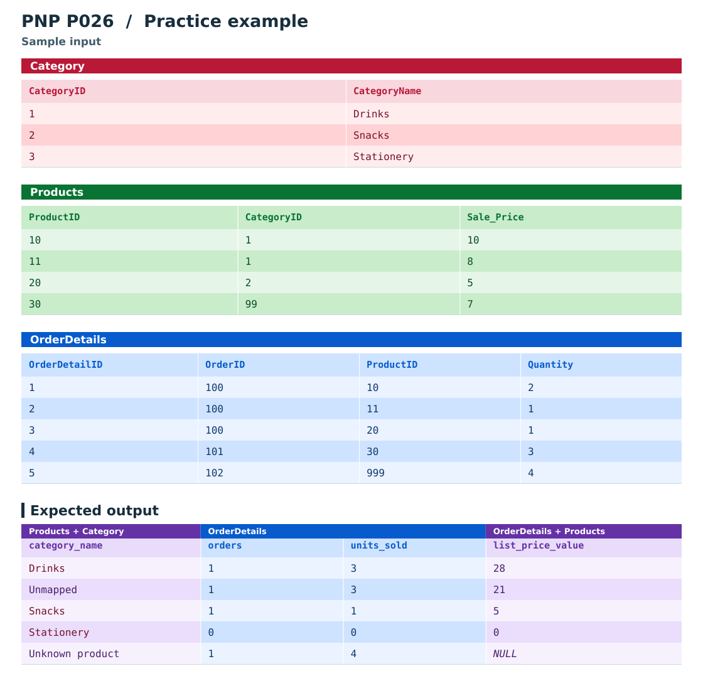
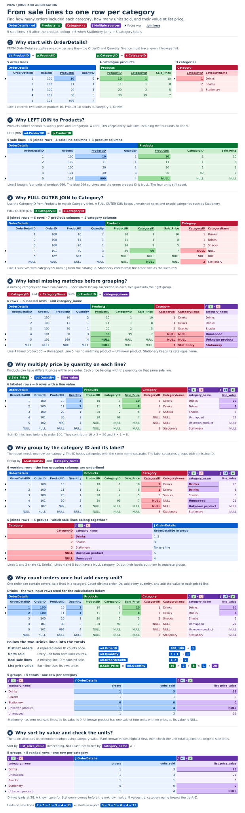
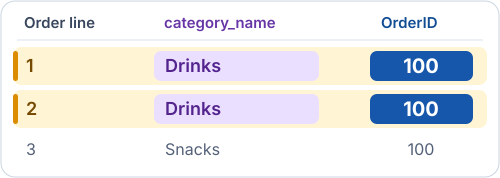

# PNP P026 — List-price value by category

**Topic** Joins and aggregation · **Difficulty** 

## Question

**Table colors** · 🟥 `Category` · 🟩 `Products` · 🟦 `OrderDetails` · 🟪 multiple sources

**Business scenario.** The category management team splits next quarter's promotion budget across categories. For each category they want three numbers: how many 🟦 `orders` included it, how many units moved, and what those units are worth at list price. Finance will tie the units column back to the order lines, so no line may go missing, even when its product or category reference is broken.

**Task.** For every category, return the number of distinct `orders` that contained at least one of its products, the units sold, and the list-price value (`Quantity` * 🟩 `Sale_Price`). Lines whose product points to a `CategoryID` with no 🟥 `Category` row go under Unmapped. Lines whose `ProductID` is not in `Products` go under Unknown product. Sort by list-price value, highest first.

[PNP source question](../../../2.PNP-%20foundations%20and%20practice/2.%20Joins/P026.%20List-price%20value%20by%20category.md#question-and-image)

### Required output columns

One output row represents one category represented on sale lines, including lines with an unknown product or unmapped category.

| Output column | Source or calculation | Meaning and applicable rules | Example value |
| --- | --- | --- | --- |
| `category_name` | 🟪 `Products` + `Category` | Category name, `Unmapped` or `Unknown product`. | Drinks |
| `orders` | 🟦 `OrderDetails` | Number of distinct orders containing a line in this category. | 1 |
| `units_sold` | 🟦 `OrderDetails` | Total quantity across the category’s sale lines. | 3 |
| `list_price_value` | 🟪 `OrderDetails` + `Products` | Total of each line’s quantity multiplied by its product’s sale price. | 28 |

### Practice example · Sample input

**🟥 `Category`**

| 🟥 CategoryID | 🟥 CategoryName |
|---:|---|
| 🟥 1 | 🟥 Drinks |
| 🟥 2 | 🟥 Snacks |
| 🟥 3 | 🟥 Stationery |

**🟩 `Products`**

| 🟩 ProductID | 🟩 CategoryID | 🟩 Sale_Price |
|---:|---:|---:|
| 🟩 10 | 🟩 1 | 🟩 10 |
| 🟩 11 | 🟩 1 | 🟩 8 |
| 🟩 20 | 🟩 2 | 🟩 5 |
| 🟩 30 | 🟩 99 | 🟩 7 |

**🟦 `OrderDetails`**

| 🟦 OrderDetailID | 🟦 OrderID | 🟦 ProductID | 🟦 Quantity |
|---:|---:|---:|---:|
| 🟦 1 | 🟦 100 | 🟦 10 | 🟦 2 |
| 🟦 2 | 🟦 100 | 🟦 11 | 🟦 1 |
| 🟦 3 | 🟦 100 | 🟦 20 | 🟦 1 |
| 🟦 4 | 🟦 101 | 🟦 30 | 🟦 3 |
| 🟦 5 | 🟦 102 | 🟦 999 | 🟦 4 |

### Expected output

| 🟪 category_name | 🟦 orders | 🟦 units_sold | 🟪 list_price_value |
|---|---:|---:|---:|
| 🟥 Drinks | 🟦 1 | 🟦 3 | 🟪 28 |
| 🟪 Unmapped | 🟦 1 | 🟦 3 | 🟪 21 |
| 🟥 Snacks | 🟦 1 | 🟦 1 | 🟪 5 |
| 🟥 Stationery | 🟦 0 | 🟦 0 | 🟪 0 |
| 🟪 Unknown product | 🟦 1 | 🟦 4 | 🟪 NULL |



[Open the full-size sample SVG](../../assets/question-samples/p026.svg?raw=1)

### How the sample produces this output

- 🟥 **Drinks.** Order 🟦 100 contains two 🟪 Drinks lines. They supply 🟦 `🟪 2 + 🟪 1 = 🟪 3` units and 🟪 `🟪 2 × 🟪 10 + 🟪 1 × 🟩 8 = 🟪 28` in value. Both lines belong to the same order, so the order count is 🟪 1.
- 🟪 **Unmapped.** 🟩 Product 🟪 30 points to category 🟩 99, which has no category record. Its line in 🟦 order 🟦 101 contributes 🟪 1 order, 🟪 3 units and 🟪 `🟪 3 × 🟩 7 = 🟪 21` in value.
- 🟥 **Snacks.** Order 🟦 100 also has one 🟪 Snacks unit priced at 🟪 5. 🟪 Snacks therefore shows 🟪 1 order, 🟪 1 unit and a value of 🟪 5.
- 🟥 **Stationery.** This category has no sold units. Its order count, units and value are all zero in the saved example.
- 🟪 **Unknown product.** Order 🟦 102 contains 🟦 4 units of product 🟦 999. There is no product record supplying a price, so the row shows 🟪 1 order, 🟦 4 units and a `🟪 NULL` value.

The five rows account for 🟦 `🟪 3 + 🟪 3 + 🟪 1 + 🟪 0 + 🟦 4 = 🟪 11` input units. Known values appear in the order 🟪 28, 🟪 21, 🟪 5, 🟪 0, followed by the unknown value.

## Step 1 · Your approach before writing SQL

1. What does one row of the final output represent?
2. Which table would you put in `FROM`? If you need other tables, which comes second, third, and so on, and why?
3. Would you use a join at any step? For each join you choose, name its type and matching columns and explain why it fits the question.

## Final learner solution — SQLite

Built from Shri’s submitted clauses with guidance on the category labels, the empty-category value, and the sort syntax.

```sql
SELECT
    CASE
        WHEN c.CategoryID IS NULL AND p.ProductID IS NULL
            THEN 'Unknown product'
        WHEN c.CategoryID IS NULL AND p.ProductID IS NOT NULL
            THEN 'Unmapped'
        WHEN c.CategoryID IS NOT NULL
            THEN c.CategoryName
    END AS category_name,
    COUNT(DISTINCT od.OrderID) AS orders,
    COALESCE(SUM(od.Quantity), 0) AS units_sold,
    CASE
        WHEN COUNT(od.OrderDetailID) = 0 THEN 0
        ELSE SUM(p.Sale_Price * od.Quantity)
    END AS list_price_value
FROM OrderDetails AS od
LEFT JOIN Products AS p
    ON od.ProductID = p.ProductID
FULL OUTER JOIN Category AS c
    ON c.CategoryID = p.CategoryID
GROUP BY c.CategoryID, category_name
ORDER BY list_price_value DESC NULLS LAST, category_name ASC;
```

<details>
<summary>Notes from the saved attempt</summary>

Return one row per catalogue category, including categories with no sales. Keep order lines with missing product or category references in the appropriate labeled groups. Show zero orders, units and value for an unsold category. Keep the value `NULL` when sales have no known price. Break ties by `category_name` in ascending order and put unknown values last.

</details>

## Visual walkthrough

[Open the Previous / Next walkthrough](../../assets/steps/PNP-P026/01.md)

🟦 **OrderDetails** supplies the sale lines. 🟩 **Products** supplies each product’s price and category reference. 🟥 **Category** supplies the catalogue names. The same colors identify those columns after every join, including any `NULL` cells. A violet (🟪) result combines sources. A double underline marks the join keys, and ▸ marks a row worth following.

Follow **line 5** to see why the first join must preserve sales. Follow **Stationery** to see why the second must also preserve unsold categories. In the grouping step, the two Drinks lines meet again under the same order ID. The aggregation step shows exactly which cells give Drinks **1 order, 3 units and 28 in list-price value**.



[Open the full-size graphic](../../assets/p026-from-inputs-to-result.svg?raw=1)

## Step-by-step walkthrough

One result row represents a category. Before aggregating, keep enough detail to tell whether an order line, product and category actually matched.

### 1. Why start with OrderDetails?

FROM OrderDetails supplies one row per sale line—the OrderID and Quantity Finance must trace even when product or category lookups fail. Order `100` spans three lines, each with its own product and quantity.

```sql
SELECT OrderDetailID, OrderID, ProductID, Quantity
FROM OrderDetails
ORDER BY OrderDetailID;
```

| 🟦 OrderDetailID | 🟦 OrderID | 🟦 ProductID | 🟦 Quantity |
| ---: | ---: | ---: | ---: |
| 🟦 1 | 🟦 100 | 🟦 10 | 🟦 2 |
| 🟦 2 | 🟦 100 | 🟦 11 | 🟦 1 |
| 🟦 3 | 🟦 100 | 🟦 20 | 🟦 1 |
| 🟦 4 | 🟦 101 | 🟦 30 | 🟦 3 |
| 🟦 5 | 🟦 102 | 🟦 999 | 🟦 4 |

There are five sale lines and eleven units. These are the numbers we can check as the joins change the table.

### 2. Why LEFT JOIN to Products?

🟩 `Products` comes second because it supplies the price and the category reference for each 🟦 sale line. The `LEFT JOIN` keeps line 5 and its four units even though product ID `999` has no match. The two product ID columns below distinguish the ID recorded on the order from the product actually found.

```sql
SELECT od.OrderDetailID, od.ProductID AS ordered_product_id,
       p.ProductID AS matched_product_id, p.Sale_Price
FROM OrderDetails AS od
LEFT JOIN Products AS p
    ON od.ProductID = p.ProductID
ORDER BY od.OrderDetailID;
```

| 🟦 OrderDetailID | 🟦 ordered_product_id | 🟩 matched_product_id | 🟩 Sale_Price |
| --- | --- | --- | --- |
| 🟦 1 | 🟦 10 | 🟩 10 | 🟩 10 |
| 🟦 2 | 🟦 11 | 🟩 11 | 🟩 8 |
| 🟦 3 | 🟦 20 | 🟩 20 | 🟩 5 |
| 🟦 4 | 🟦 30 | 🟩 30 | 🟩 7 |
| 🟦 ▸ 5 | 🟦 **999** | 🟩 **`NULL`** | 🟩 `NULL` |

### 3. Why FULL OUTER JOIN to Category?

The 🟩 `Products.CategoryID` obtained in step 2 supplies the key to add 🟥 `Category` third. The `FULL OUTER JOIN` preserves both an unmatched sale and a catalogue category with no matching sales, such as Stationery. Follow the last three rows. They show a product with a broken category reference, a sale with no product match, and a category with no sales.

```sql
SELECT od.OrderDetailID, p.ProductID AS matched_product_id,
       c.CategoryID, c.CategoryName
FROM OrderDetails AS od
LEFT JOIN Products AS p
    ON od.ProductID = p.ProductID
FULL OUTER JOIN Category AS c
    ON c.CategoryID = p.CategoryID
ORDER BY od.OrderDetailID NULLS LAST;
```

| 🟦 OrderDetailID | 🟩 matched_product_id | 🟥 CategoryID | 🟥 CategoryName |
| --- | --- | --- | --- |
| 🟦 1 | 🟩 10 | 🟥 1 | 🟥 Drinks |
| 🟦 2 | 🟩 11 | 🟥 1 | 🟥 Drinks |
| 🟦 3 | 🟩 20 | 🟥 2 | 🟥 Snacks |
| 🟦 ▸ **4** | 🟩 **30** | 🟥 **`NULL`** | 🟥 **`NULL`** |
| 🟦 ▸ **5** | 🟩 **`NULL`** | 🟥 **`NULL`** | 🟥 **`NULL`** |
| 🟦 ▸ **`NULL`** | 🟩 **`NULL`** | 🟥 **3** | 🟥 **Stationery** |

### 4. Why label missing matches before grouping?

Use the catalogue name whenever the category exists. For a missing category, check the product lookup. A matched product earns `Unmapped`, and a missing product earns `Unknown product`. Stationery still has a category ID and retains its own name.

```sql
SELECT od.OrderDetailID, c.CategoryID,
    CASE
        WHEN c.CategoryID IS NULL AND p.ProductID IS NULL
            THEN 'Unknown product'
        WHEN c.CategoryID IS NULL AND p.ProductID IS NOT NULL
            THEN 'Unmapped'
        WHEN c.CategoryID IS NOT NULL
            THEN c.CategoryName
    END AS category_name
FROM OrderDetails AS od
LEFT JOIN Products AS p
    ON od.ProductID = p.ProductID
FULL OUTER JOIN Category AS c
    ON c.CategoryID = p.CategoryID
ORDER BY od.OrderDetailID NULLS LAST;
```

| 🟦 OrderDetailID | 🟥 CategoryID | 🟪 category_name |
| --- | --- | --- |
| 🟦 1 | 🟥 1 | 🟪 Drinks |
| 🟦 2 | 🟥 1 | 🟪 Drinks |
| 🟦 3 | 🟥 2 | 🟪 Snacks |
| 🟦 ▸ 4 | 🟥 **`NULL`** | 🟪 **Unmapped** |
| 🟦 ▸ 5 | 🟥 **`NULL`** | 🟪 **Unknown product** |
| 🟦 ▸ `NULL` | 🟥 **3** | 🟪 **Stationery** |

### 5. Why multiply price by quantity on each line?

Drinks has two different prices within order `100`. Pair each price with its own line’s quantity while those values are still on the same row.

```sql
SELECT od.OrderDetailID, p.Sale_Price, od.Quantity,
       p.Sale_Price * od.Quantity AS line_value
FROM OrderDetails AS od
LEFT JOIN Products AS p ON od.ProductID = p.ProductID
FULL OUTER JOIN Category AS c ON c.CategoryID = p.CategoryID
ORDER BY od.OrderDetailID NULLS LAST;
```

| 🟦 OrderDetailID | 🟩 Sale_Price | 🟦 Quantity | 🟪 line_value |
| ---: | ---: | ---: | ---: |
| 🟦 ▸ 1 | 🟩 **10** | 🟦 **2** | 🟪 **20** |
| 🟦 ▸ 2 | 🟩 **8** | 🟦 **1** | 🟪 **8** |
| 🟦 3 | 🟩 5 | 🟦 1 | 🟪 5 |
| 🟦 4 | 🟩 7 | 🟦 3 | 🟪 21 |
| 🟦 5 | 🟩 `NULL` | 🟦 4 | 🟪 `NULL` |
| 🟦 `NULL` | 🟩 `NULL` | 🟦 `NULL` | 🟪 `NULL` |

The final query uses this multiplication inside `SUM`. The `line_value` column here makes each contribution visible.

### 6. Why group by the category ID and its label?

The report needs one row per category. The category ID keeps two catalogue categories with the same name separate. The label keeps the two kinds of missing match separate when both have a `NULL` category ID.

```sql
GROUP BY c.CategoryID, category_name
```

These are the groups that clause forms from the same six rows. The last column shows which sale lines feed each group.

| 🟥 CategoryID | 🟪 category_name | 🟦 Sale line IDs |
| ---: | --- | --- |
| 🟥 1 | 🟪 Drinks | 🟦 1, 2 |
| 🟥 2 | 🟪 Snacks | 🟦 3 |
| 🟥 3 | 🟪 Stationery | 🟦 No sale line |
| 🟥 `NULL` | 🟪 Unknown product | 🟦 5 |
| 🟥 `NULL` | 🟪 Unmapped | 🟦 4 |

### 7. Why count orders once but add every unit?

Trace the two marked Drinks lines. They share order ID `100`, so Drinks gets one order. Both quantities contribute to units sold, giving `2 + 1 = 3`. Stationery has no matched quantity. `COALESCE` gives it zero units.



```sql
SELECT
    CASE
        WHEN c.CategoryID IS NULL AND p.ProductID IS NULL
            THEN 'Unknown product'
        WHEN c.CategoryID IS NULL AND p.ProductID IS NOT NULL
            THEN 'Unmapped'
        WHEN c.CategoryID IS NOT NULL
            THEN c.CategoryName
    END AS category_name,
    COUNT(DISTINCT od.OrderID) AS orders,
    COALESCE(SUM(od.Quantity), 0) AS units_sold
FROM OrderDetails AS od
LEFT JOIN Products AS p
    ON od.ProductID = p.ProductID
FULL OUTER JOIN Category AS c
    ON c.CategoryID = p.CategoryID
GROUP BY c.CategoryID, category_name
ORDER BY category_name ASC;
```

| 🟪 category_name | 🟦 orders | 🟦 units_sold |
| --- | --- | --- |
| 🟪 ▸ Drinks | 🟦 **1** | 🟦 **3** |
| 🟪 Snacks | 🟦 1 | 🟦 1 |
| 🟪 ▸ Stationery | 🟦 **0** | 🟦 **0** |
| 🟪 Unknown product | 🟦 1 | 🟦 4 |
| 🟪 Unmapped | 🟦 1 | 🟦 3 |

#### Why does Stationery get a zero and Unknown product get NULL?

Multiply quantity by the price on that line before summing. To decide whether zero is justified, count `od.OrderDetailID`. The outer join gives Stationery a placeholder with a `NULL` line ID, so its count is zero. For `Unknown product`, order line 5 exists. Multiplication by its missing price gives `NULL`, and its group has no priced line to add.

```sql
SELECT
    CASE
        WHEN c.CategoryID IS NULL AND p.ProductID IS NULL
            THEN 'Unknown product'
        WHEN c.CategoryID IS NULL AND p.ProductID IS NOT NULL
            THEN 'Unmapped'
        WHEN c.CategoryID IS NOT NULL
            THEN c.CategoryName
    END AS category_name,
    COUNT(od.OrderDetailID) AS matching_lines,
    CASE
        WHEN COUNT(od.OrderDetailID) = 0 THEN 0
        ELSE SUM(p.Sale_Price * od.Quantity)
    END AS list_price_value
FROM OrderDetails AS od
LEFT JOIN Products AS p
    ON od.ProductID = p.ProductID
FULL OUTER JOIN Category AS c
    ON c.CategoryID = p.CategoryID
GROUP BY c.CategoryID, category_name
ORDER BY category_name ASC;
```

| 🟪 category_name | 🟦 matching_lines | 🟪 list_price_value |
| --- | --- | --- |
| 🟪 Drinks | 🟦 2 | 🟪 28 |
| 🟪 Snacks | 🟦 1 | 🟪 5 |
| 🟪 ▸ Stationery | 🟦 **0** | 🟪 **0** |
| 🟪 ▸ Unknown product | 🟦 **1** | 🟪 **`NULL`** |
| 🟪 Unmapped | 🟦 1 | 🟪 21 |

The zero check changes only `list_price_value`. The row for the unknown product still contributes one order and four units.

### 8. Why sort by value and check the units?

Apply the following clause to the complete learner query. Highest known value comes first. Equal values sort by category name, and unknown values come last.

```sql
ORDER BY list_price_value DESC NULLS LAST, category_name ASC;
```

| 🟪 category_name | 🟦 orders | 🟦 units_sold | 🟪 list_price_value |
| --- | --- | --- | --- |
| 🟪 ▸ Drinks | 🟦 1 | 🟦 3 | 🟪 **28** |
| 🟪 Unmapped | 🟦 1 | 🟦 3 | 🟪 21 |
| 🟪 Snacks | 🟦 1 | 🟦 1 | 🟪 5 |
| 🟪 Stationery | 🟦 0 | 🟦 0 | 🟪 0 |
| 🟪 ▸ Unknown product | 🟦 1 | 🟦 4 | 🟪 **`NULL`** |

All **11 units** are accounted for. The five order lines contain `2 + 1 + 1 + 3 + 4 = 11` units. The output contains `3 + 3 + 1 + 0 + 4 = 11`.

## Learner solution — SQL Server adaptation

The CTE makes `category_name` available as an input column for `GROUP BY`. In SQL Server a descending numeric sort places `NULL` last.

```sql
WITH labeled_rows AS (
    SELECT
        c.CategoryID AS category_id,
        CASE
            WHEN c.CategoryID IS NULL AND p.ProductID IS NULL
                THEN 'Unknown product'
            WHEN c.CategoryID IS NULL AND p.ProductID IS NOT NULL
                THEN 'Unmapped'
            WHEN c.CategoryID IS NOT NULL
                THEN c.CategoryName
        END AS category_name,
        od.OrderDetailID,
        od.OrderID,
        od.Quantity,
        p.Sale_Price
    FROM OrderDetails AS od
    LEFT JOIN Products AS p
        ON od.ProductID = p.ProductID
    FULL OUTER JOIN Category AS c
        ON c.CategoryID = p.CategoryID
)
SELECT
    category_name,
    COUNT(DISTINCT OrderID) AS orders,
    COALESCE(SUM(Quantity), 0) AS units_sold,
    CASE
        WHEN COUNT(OrderDetailID) = 0 THEN 0
        ELSE SUM(Sale_Price * Quantity)
    END AS list_price_value
FROM labeled_rows
GROUP BY category_id, category_name
ORDER BY list_price_value DESC, category_name ASC;
```

## Official solution

The published answer starts with order lines and uses two left joins. On this sample it returns Drinks, Unmapped, Snacks and Unknown product. The practice requirement to include every catalogue category also calls for Stationery’s zero row. The learner solution covers that case. [Source question and answer](<../../../2.PNP-%20foundations%20and%20practice/2.%20Joins/P026.%20List-price%20value%20by%20category.md>) · [PrepNPlaced, question 26, pp. 44–45](<../../../2.PNP-%20foundations%20and%20practice/Source%20Materials/Updated_100_SQL_Interview_Questions.pdf>)

### As supplied — PostgreSQL

```sql
SELECT CASE
    WHEN p.ProductID IS NULL THEN 'Unknown product'
    WHEN cat.CategoryID IS NULL THEN 'Unmapped'
    ELSE cat.CategoryName
END AS category_name,
COUNT(DISTINCT od.OrderID) AS orders,
SUM(od.Quantity) AS units_sold,
SUM(od.Quantity * p.Sale_Price) AS list_price_value
FROM OrderDetails AS od
LEFT JOIN Products AS p ON p.ProductID = od.ProductID
LEFT JOIN Category AS cat ON cat.CategoryID = p.CategoryID
GROUP BY category_name
ORDER BY list_price_value DESC NULLS LAST, category_name;
```

### Official answer — SQLite adaptation

The source query also runs as written in SQLite. Its order-line starting point produces four rows on this sample.

```sql
SELECT CASE
    WHEN p.ProductID IS NULL THEN 'Unknown product'
    WHEN cat.CategoryID IS NULL THEN 'Unmapped'
    ELSE cat.CategoryName
END AS category_name,
COUNT(DISTINCT od.OrderID) AS orders,
SUM(od.Quantity) AS units_sold,
SUM(od.Quantity * p.Sale_Price) AS list_price_value
FROM OrderDetails AS od
LEFT JOIN Products AS p ON p.ProductID = od.ProductID
LEFT JOIN Category AS cat ON cat.CategoryID = p.CategoryID
GROUP BY category_name
ORDER BY list_price_value DESC NULLS LAST, category_name;
```

### Official answer — SQL Server adaptation

Compute the source label in a CTE, group on it, and sort the value descending. This retains the published answer’s set of rows.

```sql
WITH labeled_lines AS (
    SELECT
        CASE
            WHEN p.ProductID IS NULL THEN 'Unknown product'
            WHEN c.CategoryID IS NULL THEN 'Unmapped'
            ELSE c.CategoryName
        END AS category_name,
        od.OrderID,
        od.Quantity,
        p.Sale_Price
    FROM OrderDetails AS od
    LEFT JOIN Products AS p ON p.ProductID = od.ProductID
    LEFT JOIN Category AS c ON c.CategoryID = p.CategoryID
)
SELECT
    category_name,
    COUNT(DISTINCT OrderID) AS orders,
    SUM(Quantity) AS units_sold,
    SUM(Quantity * Sale_Price) AS list_price_value
FROM labeled_lines
GROUP BY category_name
ORDER BY list_price_value DESC, category_name ASC;
```

## Comparison with the course answer

The locked query uses a `FULL OUTER JOIN` to `Category` after keeping all sale lines from `OrderDetails` and looking up `Products`. This preserves category rows with no sold product, so the practice output includes **Stationery with zero orders, units, and value**. The official answer uses a `LEFT JOIN` from sale lines to `Category`, so category-only rows never enter its report; that is why the official query returns four rows while the learner query returns five. Both keep unmatched order-line product IDs through the earlier `LEFT JOIN Products`, labelled `Unknown product`. The selected query and its five-row expected output remain unchanged.

## Verification

Ran the learner and official SQLite queries on SQLite 3.53.1. All five expected rows, output names and ordering matched for the learner query. The published query returned four rows. Additional learner checks covered an empty `OrderDetails` table, two catalogue categories with the same name, a real category named `Unmapped`, tied values, and a category whose sold products all had missing prices. The SQL Server adaptations were checked against the same sample using their SQLite-compatible statements. A native SQL Server run is pending.

[Practice index](../../README.md)
