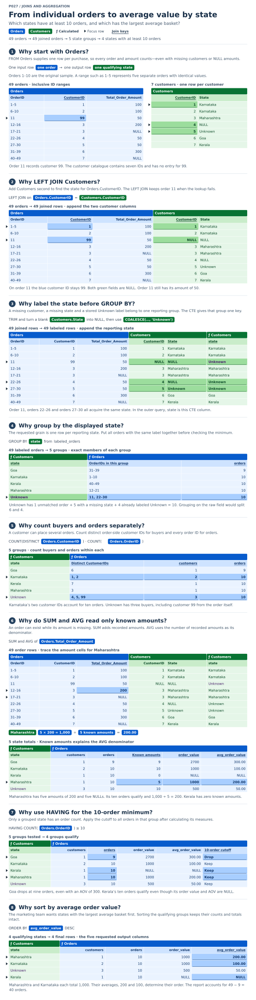
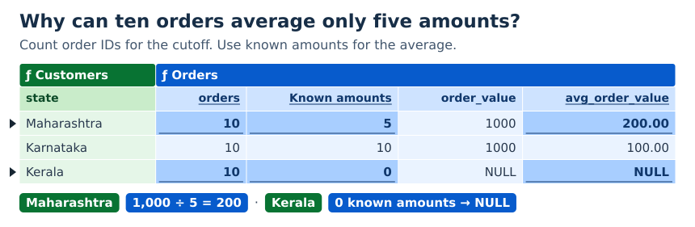

# PNP P027 — Average order value by customer state

**Topic** Joins and aggregation · **Difficulty** 

## Question

The regional marketing team wants to raise the free-delivery threshold in states where customers already place large orders. They’ll consider only states with **at least 10 orders**.

For each qualifying state, return these five columns.

| Column | What it represents |
|---|---|
| `state` | The customer’s state. Use `Unknown` when the state is missing or the order’s `CustomerID` has no matching customer. |
| `customers` | Number of distinct customers who placed orders in that group. |
| `orders` | Number of orders in the group, including orders with a missing amount. |
| `order_value` | Sum of the known `Total_Order_Amount` values. |
| `avg_order_value` | Total order value divided by the number of orders **with a known amount**. |

Apply the same 10-order minimum to `Unknown`. Sort the result by **average order value, highest first**. [PNP source question](<../../../2.PNP-%20foundations%20and%20practice/2.%20Joins/P027.%20Average%20order%20value%20by%20customer%20state.md>)

### Sample input and expected output

**🟩 Customers**

| CustomerID | State |
| ---: | --- |
| 1 | Karnataka |
| 2 | Karnataka |

**🟦 Orders**

| OrderID | CustomerID | Total_Order_Amount |
| --- | ---: | ---: |
| 1 | 1 | 100 |
| 2 | 1 | 100 |
| 3 | 1 | 100 |
| 4 | 1 | 100 |
| 5 | 1 | 100 |
| 6 | 2 | 100 |
| 7 | 2 | 100 |
| 8 | 2 | 100 |
| 9 | 2 | 100 |
| 10 | 2 | 100 |

**Expected output**

| state | customers | orders | order_value | avg_order_value |
| --- | ---: | ---: | ---: | ---: |
| Karnataka | 2 | 10 | 1000 | 100.00 |

Customers 1 and 2 placed five orders each in Karnataka. The ten order amounts of 100 sum to 1,000. All ten amounts are known, giving an average of 100.00.

## Visual walkthrough

🟦 **Orders** supplies the order IDs, buyer IDs and amounts. 🟩 **Customers** supplies the state. Each color stays with its source through the join, including any `NULL` cell. A double underline marks the join keys, ▸ marks a focus row, and ƒ marks a calculated column in its source color.

The diagram keeps the original ten orders and adds examples from practice. Follow **order 11** through the missing customer lookup. Then follow **Maharashtra** through the two counts used in this report. Lists such as `12–16` show inclusive OrderID ranges. Each number is a separate order.



[Open the full-size walkthrough](../../assets/p027-from-inputs-to-result.svg?raw=1)

## Final learner solution — SQLite

```sql
WITH labeled_orders AS (
    SELECT
        o.OrderID,
        o.CustomerID,
        o.Total_Order_Amount,
        COALESCE(NULLIF(TRIM(c.State), ''), 'Unknown') AS state
    FROM Orders AS o
    LEFT JOIN Customers AS c
        ON c.CustomerID = o.CustomerID
)
SELECT
    state,
    COUNT(DISTINCT Orders.CustomerID) AS customers,
    COUNT(Orders.OrderID) AS orders,
    SUM(Orders.Total_Order_Amount) AS order_value,
    AVG(Orders.Total_Order_Amount) AS avg_order_value
FROM labeled_orders AS Orders
GROUP BY state
HAVING COUNT(Orders.OrderID) >= 10
ORDER BY avg_order_value DESC;
```

`labeled_orders` is a common table expression (CTE). It gives every order its reporting label before the outer query groups it. In the outer query, `Orders` is a short name for those labeled rows. This lets the two amount expressions stay exactly as submitted and makes `GROUP BY state` refer to the normalized label. The published answer’s `TRIM` and `NULLIF` also send blank or all-space states to `Unknown`. The saved learner average retains its full numeric precision.

### Six decisions before coding

| Decision | P027 reasoning |
|---|---|
| What does one row represent? | One input order becomes part of one output row for a qualifying state. |
| Which rows must survive? | Every order survives the customer lookup. `CustomerID` connects the tables. |
| Where does each condition apply? | The fallback labels an individual order. The ten-order minimum applies to the whole state. |
| What contributes to each measure? | Each ordering buyer counts once per state. Every order counts. Recorded amounts contribute to the sum and average. |
| Which edge cases matter? | Missing customers and missing states share `Unknown`. A zero amount is known. A state with ten missing amounts qualifies with a `NULL` sum and average. |
| How can I check the order? | Two states can each total 1,000. With five known amounts the AOV is 200, and with ten it is 100. The 200 row appears first. |

## Step-by-step walkthrough

### 1. Why start with Orders?

An order is the event being counted. The example below uses the same 49 orders and seven customers in every step. In the blue table, each OrderID within a range has the listed CustomerID and amount.

**🟦 Orders**

| 🟦 OrderID | 🟦 CustomerID | 🟦 Total_Order_Amount |
| --- | ---: | ---: |
| 1–5 | 1 | 100 |
| 6–10 | 2 | 100 |
| 11 | 99 | 50 |
| 12–16 | 3 | 200 |
| 17–21 | 3 | `NULL` |
| 22–26 | 4 | 50 |
| 27–30 | 5 | 50 |
| 31–39 | 6 | 300 |
| 40–49 | 7 | `NULL` |

**🟩 Customers**

| 🟩 CustomerID | 🟩 State |
| ---: | --- |
| 1 | Karnataka |
| 2 | Karnataka |
| 3 | Maharashtra |
| 4 | `NULL` |
| 5 | Unknown |
| 6 | Goa |
| 7 | Kerala |

Order 11 carries buyer ID 99 even though the customer table has no row for 99.

### 2. Why LEFT JOIN Customers?

Start with the orders and look up each customer’s state. The customer key is unique, so an order can find at most one customer. A failed lookup still leaves one row for its order. This keeps all 49 rows available for the report.

```sql
SELECT o.OrderID, o.CustomerID AS ordered_by, o.Total_Order_Amount,
       c.CustomerID AS matched_customer, c.State
FROM Orders AS o
LEFT JOIN Customers AS c ON c.CustomerID = o.CustomerID
ORDER BY o.OrderID;
```

These rows show the three routes into the `Unknown` group. Color identifies the source of each value after the join.

| 🟦 OrderID | 🟦 CustomerID | 🟦 Total_Order_Amount | 🟩 CustomerID | 🟩 State |
| --- | ---: | ---: | ---: | --- |
| 11 | 99 | 50 | `NULL` | `NULL` |
| 22–26 | 4 | 50 | 4 | `NULL` |
| 27–30 | 5 | 50 | 5 | Unknown |

### 3. Why label the state before GROUP BY?

The reporting state is the value we will group. `TRIM` removes surrounding spaces, `NULLIF` converts an empty string to SQL `NULL`, and `COALESCE` supplies `Unknown` for a missing state. The CTE projects the resulting label as `state`.

```sql
COALESCE(NULLIF(TRIM(c.State), ''), 'Unknown') AS state
```

| 🟦 OrderID | 🟩 CustomerID | 🟩 State | 🟩 state |
| --- | ---: | --- | --- |
| 1–5 | 1 | Karnataka | Karnataka |
| 11 | `NULL` | `NULL` | Unknown |
| 22–26 | 4 | `NULL` | Unknown |
| 27–30 | 5 | Unknown | Unknown |

The full CTE is in the final learner solution. Before grouping, the working table still contains one row per order.

### 4. Why group by the displayed state?

In a single SQLite query, a bare `GROUP BY state` can resolve to the input column `Customers.State` when both the input and the output alias have that name. In this example the six orders with a raw `NULL` would form one group, and the four with stored text `Unknown` would form another. Each would fall below ten. The outer query of the CTE has just one state column, already normalized.

```sql
FROM labeled_orders AS Orders
GROUP BY state
```

| 🟩 state | 🟦 OrderIDs in this group | 🟦 orders |
| --- | --- | ---: |
| Goa | 31–39 | 9 |
| Karnataka | 1–10 | 10 |
| Kerala | 40–49 | 10 |
| Maharashtra | 12–21 | 10 |
| Unknown | 11, 22–30 | 10 |

Read the `Unknown` row as one unmatched order, five orders for a customer whose state is missing, and four whose stored state is already `Unknown`. All ten share a label.

### 5. Why count buyers and orders separately?

Count the buyer ID on the order side. For order 11 that value is 99 even though the customer lookup returned `NULL`. Repeated purchases by one buyer count once in `customers` and once per purchase in `orders`. If the order’s own buyer ID is SQL `NULL`, `COUNT(DISTINCT ...)` skips that unknown ID and the order itself still counts.

```sql
COUNT(DISTINCT Orders.CustomerID) AS customers,
COUNT(Orders.OrderID) AS orders
```

| 🟩 state | 🟦 Distinct CustomerIDs | 🟦 customers | 🟦 orders |
| --- | --- | ---: | ---: |
| Goa | 6 | 1 | 9 |
| Karnataka | 1, 2 | 2 | 10 |
| Kerala | 7 | 1 | 10 |
| Maharashtra | 3 | 1 | 10 |
| Unknown | 4, 5, 99 | 3 | 10 |

### 6. Why do SUM and AVG read only known amounts?

Each known order amount contributes once to `SUM`. `AVG` divides that sum by the count of known amounts. A recorded zero contributes a zero and adds one to the denominator. If there are no known amounts, both functions return `NULL`.

```sql
SUM(Orders.Total_Order_Amount) AS order_value,
AVG(Orders.Total_Order_Amount) AS avg_order_value
```

| 🟩 state | 🟦 customers | 🟦 orders | 🟦 Known amounts | 🟦 order_value | 🟦 avg_order_value |
| --- | ---: | ---: | ---: | ---: | ---: |
| Goa | 1 | 9 | 9 | 2700 | 300.00 |
| Karnataka | 2 | 10 | 10 | 1000 | 100.00 |
| Kerala | 1 | 10 | 0 | `NULL` | `NULL` |
| Maharashtra | 1 | 10 | 5 | 1000 | 200.00 |
| Unknown | 3 | 10 | 10 | 500 | 50.00 |

Maharashtra has five amounts of 200 and five missing amounts. Its `orders` is 10, its `order_value` is 1,000, and its `avg_order_value` is 1,000 ÷ 5 = 200.00. The **Known amounts** column illustrates the denominator and appears only in the walkthrough.



### 7. Why use HAVING for the 10-order minimum?

After the orders have been grouped, the order count answers whether the region qualifies. Use the order ID so an order with a missing amount still counts toward the threshold.

```sql
HAVING COUNT(Orders.OrderID) >= 10
```

| 🟩 state | 🟦 orders | 🟦 Known amounts | 🟦 10-order cutoff |
| --- | ---: | ---: | --- |
| Goa | 9 | 9 | Drop |
| Karnataka | 10 | 10 | Keep |
| Kerala | 10 | 0 | Keep |
| Maharashtra | 10 | 5 | Keep |
| Unknown | 10 | 10 | Keep |

Goa has the largest average among the five candidate states but only nine orders. Kerala qualifies with ten orders and zero known amounts.

### 8. Why sort by average order value?

The marketing team wants to see where the average basket is largest. In SQLite a descending numeric sort places the `NULL` average last. The task gives no secondary order for tied averages in the learner query.

```sql
ORDER BY avg_order_value DESC;
```

| 🟩 state | 🟦 customers | 🟦 orders | 🟦 order_value | 🟦 avg_order_value |
| --- | ---: | ---: | ---: | ---: |
| Maharashtra | 1 | 10 | 1000 | 200.00 |
| Karnataka | 2 | 10 | 1000 | 100.00 |
| Unknown | 3 | 10 | 500 | 50.00 |
| Kerala | 1 | 10 | `NULL` | `NULL` |

The qualifying rows account for **40 orders**. Together with Goa’s nine excluded orders, they reconcile to the original **49**. Even though Maharashtra and Karnataka have the same total value, their different counts of known amounts put Maharashtra first.

## Learner solution — SQL Server

The outer query uses the same grouping key. The CTE supplies a decimal amount so that integer-valued input columns also produce a fractional average. The source dataset defines amounts with two decimal places.

```sql
WITH labeled_orders AS (
    SELECT
        o.OrderID,
        o.CustomerID,
        CAST(o.Total_Order_Amount AS DECIMAL(19, 2)) AS Total_Order_Amount,
        COALESCE(NULLIF(TRIM(c.State), ''), 'Unknown') AS state
    FROM Orders AS o
    LEFT JOIN Customers AS c
        ON c.CustomerID = o.CustomerID
)
SELECT
    state,
    COUNT(DISTINCT Orders.CustomerID) AS customers,
    COUNT(Orders.OrderID) AS orders,
    SUM(Orders.Total_Order_Amount) AS order_value,
    AVG(Orders.Total_Order_Amount) AS avg_order_value
FROM labeled_orders AS Orders
GROUP BY state
HAVING COUNT(Orders.OrderID) >= 10
ORDER BY avg_order_value DESC;
```

## Official solution

The supplied PostgreSQL answer explicitly divides the sum by the count of known amounts, guards a zero denominator, and rounds the average to two decimals. It also breaks ties by state name. A non-null order primary key makes the learner’s `COUNT(Orders.OrderID)` and the official `COUNT(*)` count the same rows after this lookup. [Published SQL, Q27](<../../../2.PNP-%20foundations%20and%20practice/Source%20Materials/PrepNPlaced_SQL_100_v2/sql/all_100_solutions.sql#L310-L321>) · [Interview book, Q27, pp. 45–47](<../../../2.PNP-%20foundations%20and%20practice/Source%20Materials/Updated_100_SQL_Interview_Questions.pdf>)

### As supplied — PostgreSQL

```sql
SELECT COALESCE(NULLIF(TRIM(c.State), ''), 'Unknown')            AS state,
       COUNT(DISTINCT o.CustomerID)                               AS customers,
       COUNT(*)                                                   AS orders,
       SUM(o.Total_Order_Amount)                                  AS order_value,
       ROUND(SUM(o.Total_Order_Amount)
             / NULLIF(COUNT(o.Total_Order_Amount), 0), 2)        AS avg_order_value
FROM Orders AS o
LEFT JOIN Customers AS c ON c.CustomerID = o.CustomerID
GROUP BY COALESCE(NULLIF(TRIM(c.State), ''), 'Unknown')
HAVING COUNT(*) >= 10
ORDER BY avg_order_value DESC NULLS LAST, state;
```

### Official answer — SQLite adaptation

The factor `1.0` keeps a fractional result when the sample uses integer amounts.

```sql
SELECT
    COALESCE(NULLIF(TRIM(c.State), ''), 'Unknown') AS state,
    COUNT(DISTINCT o.CustomerID) AS customers,
    COUNT(*) AS orders,
    SUM(o.Total_Order_Amount) AS order_value,
    ROUND(1.0 * SUM(o.Total_Order_Amount)
          / NULLIF(COUNT(o.Total_Order_Amount), 0), 2) AS avg_order_value
FROM Orders AS o
LEFT JOIN Customers AS c ON c.CustomerID = o.CustomerID
GROUP BY COALESCE(NULLIF(TRIM(c.State), ''), 'Unknown')
HAVING COUNT(*) >= 10
ORDER BY avg_order_value DESC NULLS LAST, state;
```

### Official answer — SQL Server adaptation

`AVG` over a decimal amount implements the same known-amount denominator and yields `NULL` when there are no known amounts. Descending numeric order puts `NULL` last in SQL Server.

```sql
SELECT
    COALESCE(NULLIF(TRIM(c.State), ''), 'Unknown') AS state,
    COUNT(DISTINCT o.CustomerID) AS customers,
    COUNT(*) AS orders,
    SUM(o.Total_Order_Amount) AS order_value,
    ROUND(AVG(CAST(o.Total_Order_Amount AS DECIMAL(19, 2))), 2) AS avg_order_value
FROM Orders AS o
LEFT JOIN Customers AS c ON c.CustomerID = o.CustomerID
GROUP BY COALESCE(NULLIF(TRIM(c.State), ''), 'Unknown')
HAVING COUNT(*) >= 10
ORDER BY avg_order_value DESC, state;
```

## Verification

The learner and official SQLite versions passed the original 10-order sample, the 49-order walkthrough, and checks for groups of 9 and 10, all-missing amounts, real zeros, fractional averages, unmatched buyers, blank and padded states, duplicate buyer IDs, tied averages and empty inputs. A separate decimal calculation checked the counts and amounts.

On the supplied commerce data, **46,438 orders** and **5,072 customer records** produced **26 qualifying reporting states**. The SQL Server adaptations passed the same logical checks using SQLite-compatible statements. A native SQL Server execution remains unverified.

[Practice index](../../README.md)
