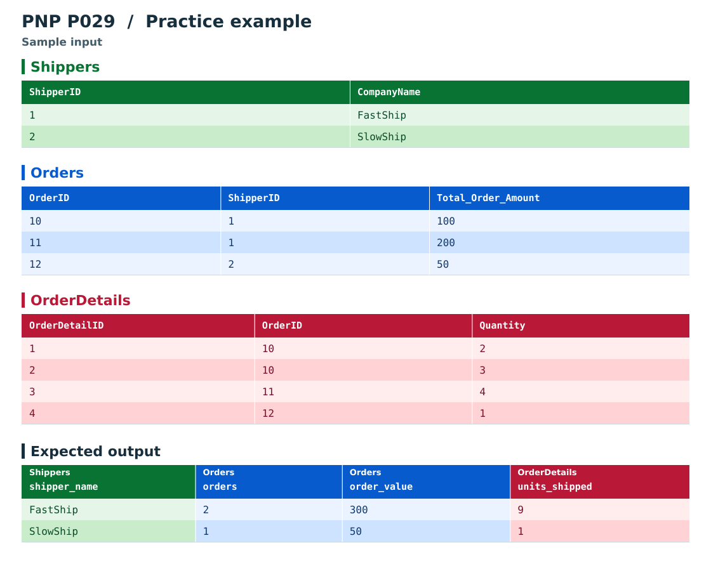
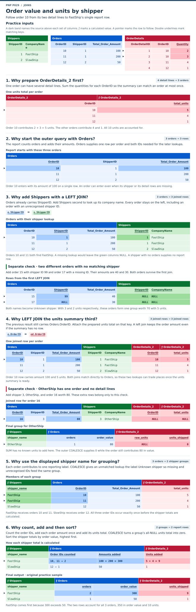

# PNP P029 — Order value and units by shipper without double counting

**Topic** Joins · **Difficulty** 

## Question

**Table colors** · 🟩 `Shippers` · 🟦 `Orders` · 🟥 `OrderDetails`

**Business scenario.** The logistics finance team is renegotiating courier rate cards. For each shipper they want three numbers side by side: how many orders it carried, the total order value it carried, and how many units were inside those orders. Last quarter an analyst produced this report and the order value came out higher than the finance ledger. Your job is to produce it correctly.

**Task.** For every shipper that carried at least one order, return the number of orders, the sum of 🟦 `Total_Order_Amount` for those orders, and the total units (🟥 `Quantity`) in those orders. Orders with a missing or unrecognised `ShipperID` should appear under one row labelled `Unknown shipper`. Sort by order value, highest first.

[PNP source question](../../../2.PNP-%20foundations%20and%20practice/2.%20Joins/P029.%20Order%20value%20and%20units%20by%20shipper%20without%20double%20counting.md#question-and-image)

### Required output columns

One output row represents one shipper represented on orders, including Unknown shipper for missing or unmatched IDs.

| Output column | Source or calculation | Meaning and applicable rules | Example value |
| --- | --- | --- | --- |
| `shipper_name` | 🟩 `Shippers` | The shipper’s company name, or `Unknown shipper`. | FastShip |
| `orders` | 🟦 `Orders` | Number of orders carried. | 2 |
| `order_value` | 🟦 `Orders` | Total of those orders’ amounts, with each order counted once. | 300 |
| `units_shipped` | 🟥 `OrderDetails` | Sum of the quantities on those orders’ detail lines. | 9 |

### Practice example · Sample input

*These practice rows illustrate the task. The PNP source supplies the output columns.*

**🟩 `Shippers`**

| 🟩 ShipperID | 🟩 CompanyName |
|---|---|
| 🟩 1 | 🟩 FastShip |
| 🟩 2 | 🟩 SlowShip |

**🟦 `Orders`**

| 🟦 OrderID | 🟦 ShipperID | 🟦 Total_Order_Amount |
|---|---|---|
| 🟦 10 | 🟦 1 | 🟦 100 |
| 🟦 11 | 🟦 1 | 🟦 200 |
| 🟦 12 | 🟦 2 | 🟦 50 |

**🟥 `OrderDetails`**

| 🟥 OrderDetailID | 🟥 OrderID | 🟥 Quantity |
|---|---|---|
| 🟥 1 | 🟥 10 | 🟥 2 |
| 🟥 2 | 🟥 10 | 🟥 3 |
| 🟥 3 | 🟥 11 | 🟥 4 |
| 🟥 4 | 🟥 12 | 🟥 1 |

### Expected output

| 🟩 shipper_name | 🟦 orders | 🟦 order_value | 🟥 units_shipped |
|---|---|---|---|
| 🟩 FastShip | 🟦 2 | 🟦 300 | 🟥 9 |
| 🟩 SlowShip | 🟦 1 | 🟦 50 | 🟥 1 |


[View sample inputs and output with colored cells](../../assets/question-samples/p029.svg?raw=1)

### How the sample produces this output

🟩 **FastShip** carried orders 🟪 10 and 🟪 11, worth 🟦 `🟦 100 + 🟦 200 = 🟦 300`. Order 🟪 10 contains 🟥 `🟪 2 + 🟥 3 = 5` units and order 🟪 11 contains another 🟥 4, giving 🟥 `5 + 🟥 4 = 🟥 9` units across two orders.

🟩 **SlowShip** carried order 🟪 12, worth 🟦 **🟦 50**, with 🟥 **🟪 1 unit**. 🟩 FastShip appears first because its order value is higher. Every sample order has a recognized shipper ID.

## Step 1 · Your approach before writing SQL

1. What does one row in the final report represent?
2. Which source would you start from, and what does one row there represent? If you use other sources, in what order would you bring them in, and why?
3. Would you use any joins? For each join you choose, what type would you use, and which columns would you match?

## Final learner solution — SQLite

Shri’s final SQLite solution uses the per-order CTE and both left joins. In the saved query, `COALESCE(SUM(od.total_units), 0)` gives OtherShip zero units when its only order has no detail rows.

```sql
WITH OrderDetails_2 AS (
    SELECT OrderID, SUM(Quantity) AS total_units
    FROM OrderDetails
    GROUP BY OrderID
)
SELECT
    COALESCE(s.CompanyName, 'Unknown shipper') AS shipper_name,
    COUNT(DISTINCT o.OrderID) AS orders,
    SUM(o.Total_Order_Amount) AS order_value,
    COALESCE(SUM(od.total_units), 0) AS units_shipped
FROM Orders AS o
LEFT JOIN Shippers AS s
    ON o.ShipperID = s.ShipperID
LEFT JOIN `OrderDetails_2` AS od
    ON od.OrderID = o.OrderID
GROUP BY shipper_name
ORDER BY order_value DESC;
```

### Review of the agreed approach

The final approach after revision scored **10/10**. First, give each 🟥 order ID one units total. Then start the report with one 🟦 order per row and use two left joins to add the 🟩 name and 🟥 units. Group the orders by the displayed shipper name, total their amounts and units, and sort by total value. The last revision makes a group with zero recorded units display **0** even when every joined units value is `NULL`.

## Visual walkthrough

[Open the Previous / Next walkthrough](../../assets/steps/PNP-P029/01.md)

Follow order 10 from its two 🟥 quantities to one 🟦 amount of 100 in the 🟩 FastShip group. Two labeled checks follow an order with a missing shipper and an order with no detail lines.



[Open the full-size walkthrough](../../assets/walkthroughs/p029.svg?raw=1) · [Review the Step 1 join plan](../../assets/walkthroughs/p029-join-plan.svg?raw=1)

## Step-by-step walkthrough

The main example uses the three original orders throughout. The preview queries order rows by ID to make them easy to follow. The final report sorts by value. Each separate check starts from the same original sample and introduces the extra rows it specifies.

### 1. Why prepare OrderDetails_2 first?

`FROM OrderDetails` supplies every sale line because each line contributes its `Quantity`; starting here preserves the full detail-line population before grouping. Grouping by `OrderID` produces one `OrderDetails_2` CTE row per order—not one row per detail line—so the summary can match an order at most once.

The 🟥 CTE keeps `OrderID` and the sum of `Quantity`. Individual detail IDs have already served their purpose once each line has contributed its units.

```sql
WITH OrderDetails_2 AS (
    SELECT OrderID, SUM(Quantity) AS total_units
    FROM OrderDetails
    GROUP BY OrderID
)
SELECT OrderID, total_units
FROM OrderDetails_2
ORDER BY OrderID;
```

**One units total per order** · 4 detail lines → 3 orders

| 🟥 `OrderID` | 🟥 `total_units` |
| ---: | ---: |
| 🟥 10 | 🟥 5 |
| 🟥 11 | 🟥 4 |
| 🟥 12 | 🟥 1 |

Order 10 contributes 2 + 3 = 5 units. The other orders contribute 4 and 1. All 10 units are accounted for.

### 2. Why start the outer query with Orders?

The report counts orders and adds their amounts. Orders supplies one row per order and both IDs needed for the later lookups.

A CTE can be declared before the outer query uses it. The outer `FROM Orders` determines which population enters the report.

```sql
SELECT OrderID, ShipperID, Total_Order_Amount FROM Orders ORDER BY OrderID;
```

**Report starts with these three orders** · 3 orders → 3 rows

| 🟦 `OrderID` | 🟦 `ShipperID` | 🟦 `Total_Order_Amount` |
| ---: | ---: | ---: |
| 🟦 10 | 🟦 1 | 🟦 100 |
| 🟦 11 | 🟦 1 | 🟦 200 |
| 🟦 12 | 🟦 2 | 🟦 50 |

Order 10 enters with its amount of 100 on a single row. An order can enter even when its shipper or its detail rows are missing.

### 3. Why add Shippers with a LEFT JOIN?

Orders already carries ShipperID. Add Shippers second to look up its company name. Every order stays on the left, including an order with an unrecognised shipper ID.

The key equality is 🟦 `o.ShipperID` = 🟩 `s.ShipperID`. One shipper can carry several orders. Its unique ID lets one order match at most one company.

```sql
SELECT o.OrderID, o.ShipperID, o.Total_Order_Amount,
       s.ShipperID, s.CompanyName
FROM Orders AS o
LEFT JOIN Shippers AS s
    ON o.ShipperID = s.ShipperID
ORDER BY o.OrderID;
```

**Orders with their shipper lookup** · 3 orders → 3 joined rows

| 🟦 `o.OrderID` | 🟦 `o.ShipperID` | 🟦 `o.Total_Order_Amount` | 🟩 `s.ShipperID` | 🟩 `s.CompanyName` |
| ---: | ---: | ---: | ---: | --- |
| 🟦 10 | 🟦 1 | 🟦 100 | 🟩 1 | 🟩 FastShip |
| 🟦 11 | 🟦 1 | 🟦 200 | 🟩 1 | 🟩 FastShip |
| 🟦 12 | 🟦 2 | 🟦 50 | 🟩 2 | 🟩 SlowShip |

Orders 10 and 11 both find FastShip. A missing lookup would leave the green columns NULL. A shipper with no orders supplies no report row.

**Separate check · missing and unrecognised shippers.** Add order 15 with `ShipperID = 99`, amount 40 and a detail quantity of 3. Add order 17 with a missing `ShipperID`, amount 30 and a detail quantity of 2. The first join returns these two additional rows.

| 🟦 `o.OrderID` | 🟦 `o.ShipperID` | 🟦 `o.Total_Order_Amount` | 🟩 `s.ShipperID` | 🟩 `s.CompanyName` |
| ---: | ---: | ---: | ---: | --- |
| 🟦 15 | 🟦 99 | 🟦 40 | 🟩 `NULL` | 🟩 `NULL` |
| 🟦 17 | 🟦 `NULL` | 🟦 30 | 🟩 `NULL` | 🟩 `NULL` |

Both shipper names are `NULL`, so the displayed label puts these two orders together. 🟩 `Unknown shipper` receives 🟦 **2 orders** worth **40 + 30 = 70**, and 🟥 **3 + 2 = 5 units**.

### 4. Why LEFT JOIN the units summary third?

The previous result still carries Orders.OrderID. Attach the prepared units total on that key. A left join keeps the order amount even if the summary has no row.

The added key is 🟥 `od.OrderID` = 🟦 `o.OrderID`. The left input is the result of the first join. Writing `od.OrderID` first inside the equality gives the same matches.

**Independent lookups can be exchanged.** `Shippers` and `OrderDetails_2` both look up values using keys already carried by `Orders`. Neither lookup needs the other’s columns, so—once the one-row-per-OrderID summary is prepared—the two joins can trade places. The dependency is inside the detail branch: `OrderDetails` must first be grouped into `OrderDetails_2` so several lines do not multiply a single order amount.

```sql
WITH OrderDetails_2 AS (
    SELECT OrderID, SUM(Quantity) AS total_units
    FROM OrderDetails
    GROUP BY OrderID
)
SELECT o.OrderID, o.ShipperID, o.Total_Order_Amount,
       s.ShipperID, s.CompanyName,
       od.OrderID, od.total_units
FROM Orders AS o
LEFT JOIN Shippers AS s
    ON o.ShipperID = s.ShipperID
LEFT JOIN `OrderDetails_2` AS od
    ON od.OrderID = o.OrderID
ORDER BY o.OrderID;
```

**One joined row per order** · 3 joined rows → 3 joined rows

| 🟦 `o.OrderID` | 🟦 `o.ShipperID` | 🟦 `o.Total_Order_Amount` | 🟩 `s.ShipperID` | 🟩 `s.CompanyName` | 🟥 `od.OrderID` | 🟥 `od.total_units` |
| ---: | ---: | ---: | ---: | --- | ---: | ---: |
| 🟦 10 | 🟦 1 | 🟦 100 | 🟩 1 | 🟩 FastShip | 🟥 10 | 🟥 5 |
| 🟦 11 | 🟦 1 | 🟦 200 | 🟩 1 | 🟩 FastShip | 🟥 11 | 🟥 4 |
| 🟦 12 | 🟦 2 | 🟦 50 | 🟩 2 | 🟩 SlowShip | 🟥 12 | 🟥 1 |

Order 10 now carries amount 100 and 5 units. Both joins match directly to Orders, so these two lookups can trade places once the units summary is ready.

**Why order 10’s amount stays at 100.** Joining the two raw detail lines would repeat its 🟦 amount twice. FastShip would then show `100 + 100 + 200 = 400`. The CTE gives order 10 one match and FastShip the correct `100 + 200 = 300`. Distinct order IDs alone only fix the order count.

**Separate check · one order with no details.** Start again from the original sample. Add 🟩 OtherShip with ID 3 and its only 🟦 order, ID 16, worth 80. Give order 16 no detail rows. Immediately after the second join the order looks like this.

| 🟦 `o.OrderID` | 🟦 `o.ShipperID` | 🟦 `o.Total_Order_Amount` | 🟩 `s.ShipperID` | 🟩 `s.CompanyName` | 🟥 `od.OrderID` | 🟥 `od.total_units` |
| ---: | ---: | ---: | ---: | --- | ---: | ---: |
| 🟦 16 | 🟦 3 | 🟦 80 | 🟩 3 | 🟩 OtherShip | 🟥 `NULL` | 🟥 `NULL` |

The 🟥 `od.OrderID` and `od.total_units` cells are `NULL`. Both come from the missing lookup row. Compare the two unit expressions for the resulting OtherShip group.

```sql
WITH OrderDetails_2 AS (
    SELECT OrderID, SUM(Quantity) AS total_units
    FROM OrderDetails
    GROUP BY OrderID
)
SELECT COALESCE(s.CompanyName, 'Unknown shipper') AS shipper_name,
       COUNT(DISTINCT o.OrderID) AS orders,
       SUM(o.Total_Order_Amount) AS order_value,
       SUM(od.total_units) AS raw_units,
       COALESCE(SUM(od.total_units), 0) AS units_shipped
FROM Orders AS o
LEFT JOIN Shippers AS s
    ON o.ShipperID = s.ShipperID
LEFT JOIN `OrderDetails_2` AS od
    ON od.OrderID = o.OrderID
GROUP BY shipper_name
HAVING shipper_name = 'OtherShip'
ORDER BY order_value DESC;
```

| 🟩 `shipper_name` | 🟦 `orders` | 🟦 `order_value` | 🟥 `raw_units` | 🟥 `units_shipped` |
| --- | ---: | ---: | ---: | ---: |
| 🟩 OtherShip | 🟦 1 | 🟦 80 | 🟥 `NULL` | 🟥 0 |

The raw 🟥 sum is `NULL` because there are no known units to add. The outside `COALESCE` changes the displayed units to **0**. The 🟦 order count stays **1** and the amount stays **80**.

### 5. Why use the displayed shipper name for grouping?

Each order contributes to one reporting label. COALESCE gives an unmatched lookup the label Unknown shipper so missing and unrecognised IDs feed the same group.

This preview shows the orders within each prospective group. The PNP reference groups by the displayed name. Two records with the same displayed company name therefore contribute to the same group.

```sql
WITH OrderDetails_2 AS (
    SELECT OrderID, SUM(Quantity) AS total_units
    FROM OrderDetails
    GROUP BY OrderID
)
SELECT COALESCE(s.CompanyName, 'Unknown shipper') AS shipper_name,
       o.OrderID, o.Total_Order_Amount, od.total_units
FROM Orders AS o
LEFT JOIN Shippers AS s
    ON o.ShipperID = s.ShipperID
LEFT JOIN `OrderDetails_2` AS od
    ON od.OrderID = o.OrderID
ORDER BY shipper_name, o.OrderID;
```

**Members of each group** · 3 orders → 2 shipper groups

| 🟩 `shipper_name` | 🟦 `OrderID` | 🟦 `Total_Order_Amount` | 🟥 `total_units` |
| --- | ---: | ---: | ---: |
| 🟩 FastShip | 🟦 10 | 🟦 100 | 🟥 5 |
| 🟩 FastShip | 🟦 11 | 🟦 200 | 🟥 4 |
| 🟩 SlowShip | 🟦 12 | 🟦 50 | 🟥 1 |

FastShip receives orders 10 and 11. SlowShip receives order 12. All three order IDs occur exactly once before the shipper totals are calculated.

### 6. Why count, add and then sort?

Count the order IDs, add each order amount once and add its units total. COALESCE turns a group’s all-NULL units total into zero. Sort the shipper totals by order value, highest first.

🟦 `COUNT(DISTINCT o.OrderID)` counts the member orders, 🟦 `SUM(o.Total_Order_Amount)` adds their amounts, and 🟥 `COALESCE(SUM(od.total_units), 0)` adds their known units with a zero fallback for the whole group.

| 🟩 `shipper_name` | 🟦 `Order IDs counted` | 🟦 `Amounts added` | 🟥 `Units added` |
| --- | ---: | ---: | ---: |
| 🟩 FastShip | 🟦 10, 11 → 2 | 🟦 100 + 200 = 300 | 🟥 5 + 4 = 9 |
| 🟩 SlowShip | 🟦 12 → 1 | 🟦 50 | 🟥 1 |

```sql
WITH OrderDetails_2 AS (
    SELECT OrderID, SUM(Quantity) AS total_units
    FROM OrderDetails
    GROUP BY OrderID
)
SELECT
    COALESCE(s.CompanyName, 'Unknown shipper') AS shipper_name,
    COUNT(DISTINCT o.OrderID) AS orders,
    SUM(o.Total_Order_Amount) AS order_value,
    COALESCE(SUM(od.total_units), 0) AS units_shipped
FROM Orders AS o
LEFT JOIN Shippers AS s
    ON o.ShipperID = s.ShipperID
LEFT JOIN `OrderDetails_2` AS od
    ON od.OrderID = o.OrderID
GROUP BY shipper_name
ORDER BY order_value DESC;
```

**Final output · original practice sample** · 2 groups → 2 report rows

| 🟩 `shipper_name` | 🟦 `orders` | 🟦 `order_value` | 🟥 `units_shipped` |
| --- | ---: | ---: | ---: |
| 🟩 FastShip | 🟦 2 | 🟦 300 | 🟥 9 |
| 🟩 SlowShip | 🟦 1 | 🟦 50 | 🟥 1 |

FastShip comes first because 300 exceeds 50. The two rows account for all 3 orders, 350 in order value and 10 units.

Only the units expression has this zero fallback. If every 🟦 amount in a shipper group is `NULL`, its `order_value` remains `NULL`. The exercise gives no secondary ordering for ties.

## Current and expected output

The pasted draft has two commas between `AS orders` and the next `SUM`. SQLite reports a syntax error there. Keep one comma and run the final `SELECT` in the same statement as `WITH OrderDetails_2 AS (...)` to see the draft’s result.

FastShip and SlowShip are the two original sample rows. For this check only, add OtherShip with a single order, ID 16, worth 80 and with no detail rows. The current units column uses `SUM(od.total_units)`. The expected units column comes from the PNP reference query.

| 🟩 `shipper_name` | 🟦 `orders` | 🟦 `order_value` | 🟥 Current `units_shipped` | 🟥 Expected `units_shipped` |
| --- | ---: | ---: | ---: | ---: |
| 🟩 FastShip | 🟦 2 | 🟦 300 | 🟥 9 | 🟥 9 |
| 🟩 OtherShip | 🟦 1 | 🟦 80 | 🟥 `NULL` | 🟥 0 |
| 🟩 SlowShip | 🟦 1 | 🟦 50 | 🟥 1 | 🟥 1 |

The second `LEFT JOIN` keeps order 16 and supplies `NULL` for its missing units. `SUM` has no numeric units to add for OtherShip. `COALESCE(SUM(od.total_units), 0)` displays zero for that group.

## Learner solution — SQL Server

Repeat the shipper-name expression in `GROUP BY` and use the unquoted CTE name. The order count, amounts and unit fallback follow the learner’s SQLite query.

```sql
WITH OrderDetails_2 AS (
    SELECT OrderID, SUM(Quantity) AS total_units
    FROM OrderDetails
    GROUP BY OrderID
)
SELECT
    COALESCE(s.CompanyName, 'Unknown shipper') AS shipper_name,
    COUNT(DISTINCT o.OrderID) AS orders,
    SUM(o.Total_Order_Amount) AS order_value,
    COALESCE(SUM(od.total_units), 0) AS units_shipped
FROM Orders AS o
LEFT JOIN Shippers AS s
    ON o.ShipperID = s.ShipperID
LEFT JOIN OrderDetails_2 AS od
    ON od.OrderID = o.OrderID
GROUP BY COALESCE(s.CompanyName, 'Unknown shipper')
ORDER BY order_value DESC;
```

## Official solution

The course counts the joined rows with `COUNT(*)`. The unique shipper key and the one-row-per-order units CTE give each order exactly one joined row, so this matches Shri’s distinct order count. Both solutions apply the zero fallback to the units sum. [PNP Q29 published SQL](../../../2.PNP-%20foundations%20and%20practice/Source%20Materials/PrepNPlaced_SQL_100_v2/sql/all_100_solutions.sql#L337-L351) · [Interview book, pp. 49–50](../../../2.PNP-%20foundations%20and%20practice/Source%20Materials/Updated_100_SQL_Interview_Questions.pdf)

### As supplied — PostgreSQL

```sql
WITH order_units AS (
    SELECT od.OrderID,
           SUM(od.Quantity) AS units
    FROM OrderDetails AS od
    GROUP BY od.OrderID
)
SELECT COALESCE(sh.CompanyName, 'Unknown shipper') AS shipper_name,
       COUNT(*)                                     AS orders,
       SUM(o.Total_Order_Amount)                    AS order_value,
       COALESCE(SUM(ou.units), 0)                   AS units_shipped
FROM Orders AS o
LEFT JOIN Shippers    AS sh ON sh.ShipperID = o.ShipperID
LEFT JOIN order_units AS ou ON ou.OrderID   = o.OrderID
GROUP BY COALESCE(sh.CompanyName, 'Unknown shipper')
ORDER BY order_value DESC NULLS LAST;
```

### Official answer — SQLite

```sql
WITH order_units AS (
    SELECT od.OrderID,
           SUM(od.Quantity) AS units
    FROM OrderDetails AS od
    GROUP BY od.OrderID
)
SELECT COALESCE(sh.CompanyName, 'Unknown shipper') AS shipper_name,
       COUNT(*)                                     AS orders,
       SUM(o.Total_Order_Amount)                    AS order_value,
       COALESCE(SUM(ou.units), 0)                   AS units_shipped
FROM Orders AS o
LEFT JOIN Shippers    AS sh ON sh.ShipperID = o.ShipperID
LEFT JOIN order_units AS ou ON ou.OrderID   = o.OrderID
GROUP BY shipper_name
ORDER BY order_value DESC;
```

### Official answer — SQL Server

```sql
WITH order_units AS (
    SELECT od.OrderID,
           SUM(od.Quantity) AS units
    FROM OrderDetails AS od
    GROUP BY od.OrderID
)
SELECT COALESCE(sh.CompanyName, 'Unknown shipper') AS shipper_name,
       COUNT(*)                                     AS orders,
       SUM(o.Total_Order_Amount)                    AS order_value,
       COALESCE(SUM(ou.units), 0)                   AS units_shipped
FROM Orders AS o
LEFT JOIN Shippers    AS sh ON sh.ShipperID = o.ShipperID
LEFT JOIN order_units AS ou ON ou.OrderID   = o.OrderID
GROUP BY COALESCE(sh.CompanyName, 'Unknown shipper')
ORDER BY order_value DESC;
```

## Verification

The learner and published reference produced the same 9 shipper rows on the PNP commerce data (46,438 orders and 168,567 detail lines). An independent calculation added each order amount once and reconciled every shipper’s count, value and units.

Ten SQLite fixtures covered the practice sample, multiple lines on one order, equal order amounts, orders without details, all-NULL quantities, mixed quantities, missing and unrecognised shipper IDs, repeated or missing company names, unused shippers, missing amounts, ties and empty input. The SQL Server versions passed the same logical checks in SQLite. Native SQL Server execution was not tested.

[Practice index](../../README.md)
