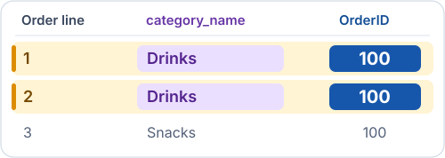

# SQL practice questions

This folder tracks the restart of all 205 PNP SQL questions and the Bosscoder SQL assignment reattempts.

Save one file per verified solution, immediately after the question is complete. Use `PNP-<source-id>.md` or `Bosscoder-<source-id>.md` and include the source question ID, topic, difficulty, final SQL, and the checks used to verify it. Use the same topic and difficulty labels in the study session and here.

Practice topics in the original Bosscoder assignment order. Within each topic, practice PNP questions from Easy to Medium to Hard. Reattempt matching Bosscoder assignments after dinner. Count each PNP source ID once toward the 205-question restart and track Bosscoder separately.

### Present each question

Use this sequence in chat and in every saved question, including reattempts.

1. Give the original PNP question word for word, including its business scenario and task. For a Bosscoder exercise, use its assignment wording. Link to the source in the saved record.
2. List the required output columns in their specified order, with a plain-English meaning for each.
3. Show the sample input as separate, named tables. Identify an example supplied by the assignment. Label any added data **Practice example**.
4. Show the expected output as a table with those same columns.
5. Explain how the sample rows produce each result. Trace the actual IDs and values, show the arithmetic where relevant, and explain the order or inclusion rules that affect the example.
6. Only then begin **Step 1 · Your approach before writing SQL**. Invite the learner to explain what one output row represents, which table comes first, second, third and so on, and which join type and matching columns they would choose at each applicable step. A single-table or multi-source question can be answered without a join.

Show each question’s **Table colors** key alongside the original wording in chat and on GitHub. Label every swatch with its table name. Use the same assignment in the question, the sample and the eventual walkthrough. List the key in the sample’s display order. Table order and join choices belong to the learner.

Mark table captions and input headers, identify the source of each required column, and carry its color into the expected output and the worked sample arithmetic. Keep single-source calculations in the source table’s color. Use 🟪 for a result that combines values from several tables and name those sources. When different result rows draw independently from different tables, mark each row with its own source. Give missing cells the same color as their column or row. Use 🟨 for a fourth table and an unused, labeled color for any further table.

In GitHub Markdown, use colored squares and keep the sample data selectable. Provide a linked view with source-colored cells for the same input and output tables. Keep this view limited to the given data and expected result so the learner can still choose an approach at Step 1.

Keep questions and sample explanations focused on the requested result. Include methods that the original source explicitly requires. Let the learner choose all other operations, table order and join types independently. Give hints when the learner asks. During a fresh attempt, pause at Step 1 for their answer. Place the verified visual walkthrough and solutions after the learner-facing exercise in the saved record.

### Explain the approach before coding

After the worked sample, the learner gives one plain-English plan covering the following decisions as they apply to the question.

1. What one output row represents and which columns it must contain.
2. Which tables and keys supply the data, how to join them, and which unmatched rows must survive.
3. Which conditions affect all input rows, a group of rows, or just one calculated column.
4. How to form each group and calculate each output, including how to count duplicates.
5. What should happen with missing data, boundaries, ties and the final ordering.
6. How a sample row or group travels from the inputs to its expected output.

Rate the submitted approach out of 10 for coverage and correctness. Identify what the learner got right and the specific requirement behind any gap. Use color to trace the learner’s proposed approach across the full sample tables and highlight the first step where a result diverges. Let the learner revise the plan in plain English. When it covers every applicable requirement, confirm that it is ready, show the complete agreed progression, and invite the learner to write SQL. Save that progression with the verified solution.

### Walkthrough format

Include the visual in the same commit as each newly verified PNP or Bosscoder solution. Embed a question-specific SVG in the question file under `## Visual walkthrough`, then link to its full-size view. Use relative paths and compare the diagram’s final rows with the saved query on the same sample. The written steps below the diagram provide the text version.

Use the same step-by-step approach during practice and in each PNP or Bosscoder write-up. Identify what one output row represents, then build the query one part at a time using the same example. For each step, explain what to do and why, show the SQL and output, and explain what the output demonstrates. When a join is used, explain why it fits and which unmatched rows it keeps. Explain whether each condition affects input rows, output groups, or one metric.

Preserve the official answer as supplied and add separate SQLite and SQL Server adaptations. Note dialect changes and verify executable versions when the engine is available.

#### Table color key

Use strongly contrasting colors for input tables. In P026, 🟦 `OrderDetails` is blue, 🟩 `Products` is green and 🟥 `Category` is red. Use 🟨 yellow with dark lettering when a fourth table appears. Keep each source’s color on its headers, values and unmatched `NULL` cells throughout the question. Write the table name or alias above its columns so the visual can also be read without color.

Start with all the sample input tables. At each join, keep the working columns in place and append the new table’s columns. Underline both join keys and connect their qualified names with an equals sign. Carry the preceding rows into the next stage, and mark which rows were added, removed, or repeated and why.

Give each step a heading that asks why this operation belongs here. Answer in one plain-English sentence using the question’s requirement, then point to a sample row that demonstrates the choice. Show row counts before and after a join or grouping. Use a neutral ▸ pointer for focus and a double underline for the two join keys.

Show which rows form each group before calculating its measures. For each aggregate, deepen the source color on the cells it reads, explain why it counts or adds those values, and show their arithmetic next to the result. A single-source calculation keeps its source color. A multi-source calculation uses violet and names its contributing tables. Finish with the sorted output and, when the question supplies one, a check such as reconciling output units with input units. Apply this format in chat and in the saved walkthrough.

## Practice question index

### SQL Basics

| ID | Question | Set | Difficulty |
| --- | --- | --- | --- |
| P001 | [Brand directory](SQL%20Basics/easy/PNP-P001.md) | PNP |  |
| P002 | [Ten highest-priced products](SQL%20Basics/easy/PNP-P002.md) | PNP |  |
| P003 | [Customers in metro cities](SQL%20Basics/easy/PNP-P003.md) | PNP |  |
| P004 | [Customer emails that cannot be delivered](SQL%20Basics/easy/PNP-P004.md) | PNP |  |
| P005 | [Orders placed in Q1 2025](SQL%20Basics/easy/PNP-P005.md) | PNP |  |
| P006 | [Most expensive products that are never discounted](SQL%20Basics/easy/PNP-P006.md) | PNP |  |
| P007 | [Discount amount and percentage per product](SQL%20Basics/easy/PNP-P007.md) | PNP |  |
| P008 | [Price band labels](SQL%20Basics/easy/PNP-P008.md) | PNP |  |
| P009 | [Check how Active and Allowed are encoded](SQL%20Basics/easy/PNP-P009.md) | PNP |  |
| P010 | [Headline order KPIs](SQL%20Basics/easy/PNP-P010.md) | PNP |  |
| P020 | [Days to ship and days to deliver](SQL%20Basics/easy/PNP-P020.md) | PNP |  |
| P023 | [Chocolate or cookie products under 250, excluding sugar-free](SQL%20Basics/easy/PNP-P023.md) | PNP |  |
| P024 | [Suppliers outside India or with no email](SQL%20Basics/easy/PNP-P024.md) | PNP |  |
| B1.01 | [Find Customers With Positive Revenue This Year](SQL%20Basics/easy/Bosscoder-1.01.md) | Bosscoder |  |
| B1.02 | [Calculate Special Bonus](SQL%20Basics/easy/Bosscoder-1.02.md) | Bosscoder |  |
| B1.04 | [Rearrange Products Table](SQL%20Basics/easy/Bosscoder-1.04.md) | Bosscoder |  |
| B1.05 | [Type Of Triangle](SQL%20Basics/easy/Bosscoder-1.05.md) | Bosscoder |  |
| B1.03 | [Binary Tree Nodes](SQL%20Basics/medium/Bosscoder-1.03.md) | Bosscoder |  |

### Aggregation

| ID | Question | Set | Difficulty |
| --- | --- | --- | --- |
| P011 | [How much of the catalogue has ever sold?](Aggregation/easy/PNP-P011.md) | PNP |  |
| P012 | [Price and discount statistics per category ID](Aggregation/easy/PNP-P012.md) | PNP |  |

### Sorting and Grouping

| ID | Question | Set | Difficulty |
| --- | --- | --- | --- |
| P013 | [States with at least five customers](Sorting%20and%20Grouping/easy/PNP-P013.md) | PNP |  |
| P014 | [Orders per month in 2025](Sorting%20and%20Grouping/easy/PNP-P014.md) | PNP |  |
| P022 | [Orders with more than eight line items](Sorting%20and%20Grouping/easy/PNP-P022.md) | PNP |  |
| P025 | [Customer sign-ups by year and quarter](Sorting%20and%20Grouping/easy/PNP-P025.md) | PNP |  |

### Joins

| ID | Question | Set | Difficulty |
| --- | --- | --- | --- |
| P015 | [Product count for every category](Joins/easy/PNP-P015.md) | PNP |  |
| P016 | [December 2025 orders with customer names](Joins/easy/PNP-P016.md) | PNP |  |
| P017 | [Orders with payment type and shipper](Joins/easy/PNP-P017.md) | PNP |  |
| P018 | [Customers with no order in the last 90 days](Joins/easy/PNP-P018.md) | PNP |  |
| P019 | [Units sold per product](Joins/easy/PNP-P019.md) | PNP |  |
| P021 | [Top five customers by number of orders](Joins/easy/PNP-P021.md) | PNP |  |
| P026 | [List-price value by category](Joins/medium/PNP-P026.md) | PNP |  |
| P027 | [Average order value by customer state](Joins/medium/PNP-P027.md) | PNP |  |

### Subqueries

| ID | Question | Set | Difficulty |
| --- | --- | --- | --- |
| P028 | [Payment mix: share of orders and value](Subqueries/medium/PNP-P028.md) | PNP |  |

Add each verified question to its topic, in difficulty order (Easy, Medium, Hard), then by source ID within each difficulty. Use the set column to distinguish PNP practice from Bosscoder reattempts.

## Difficulty rubric

| Rating | Criteria |
| --- | --- |
|  | One core SQL concept, a direct query, and straightforward output rules. |
|  | Combines concepts or requires careful reasoning about joins, grouping, query stages, or common edge cases. |
|  | Requires several dependent steps, advanced SQL patterns, or subtle handling of row grain, ties, NULLs, duplicates, or boundaries. |

Rate the reasoning required for a correct solution based on the question and its edge cases. Time spent and query length alone do not determine difficulty.
