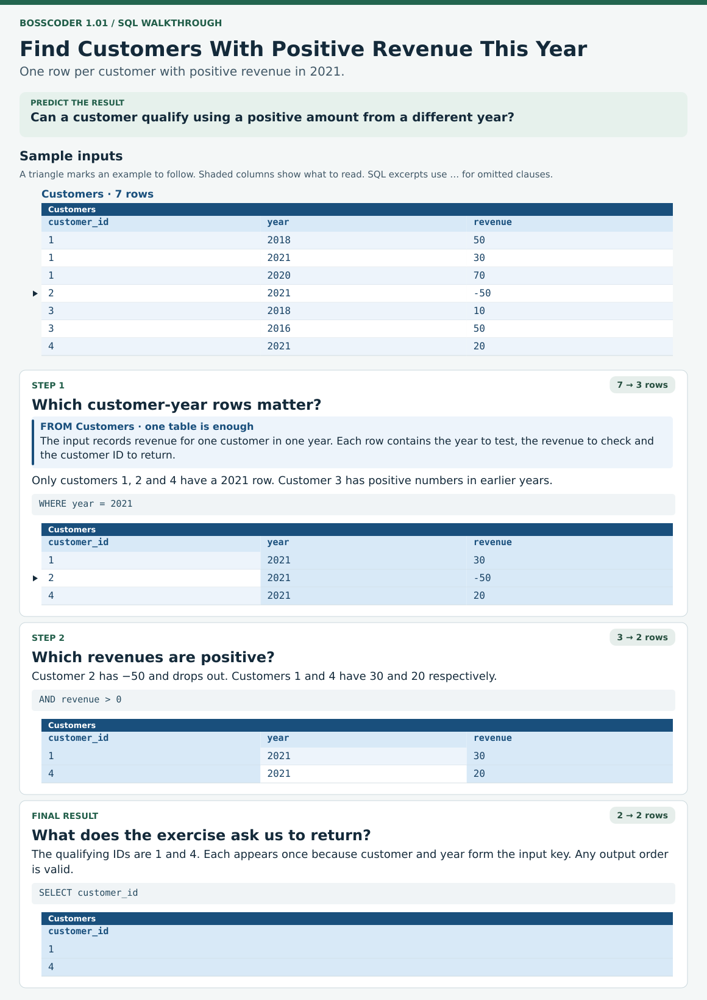

# Bosscoder 1.01 · Find Customers With Positive Revenue This Year

**Topic** SQL Basics · **Difficulty**  · Revised 2026-11-17

## Question

**Table colors** · 🟦 `Customers`

Write a solution to report the customers with positive revenue in the year 2021. Revenue can be negative. Return 🟦 `customer_id` in any order.

[Bosscoder assignment question](../../../1.Bosscoder%20Academy%20-%20foundational%20notes%20and%20Assignments/1.%20Intro%20to%20SQL%20and%20Advanced%20Select/1.Sql%20Find%20Customers%20With%20Positive%20Revenue%20This%20Year.md#question-and-image)

### Required output columns

One output row represents one customer with strictly positive 2021 revenue.

| Output column | Source or calculation | Meaning and applicable rules | Example value |
| --- | --- | --- | --- |
| `customer_id` | 🟦 `Customers.customer_id` | Identifier of each customer with positive revenue in 2021. | 1 |

### Assignment example · Sample input

**🟦 `Customers`**

| 🟦 customer_id | 🟦 year | 🟦 revenue |
|---:|---:|---:|
| 1 | 2018 | 50 |
| 1 | 2021 | 30 |
| 1 | 2020 | 70 |
| 2 | 2021 | -50 |
| 3 | 2018 | 10 |
| 3 | 2016 | 50 |
| 4 | 2021 | 20 |

### Expected output

| 🟦 customer_id |
|---:|
| 1 |
| 4 |

[View sample inputs and output with colored cells](../../assets/question-samples/b1-01.svg?raw=1)

### How the sample produces this output

🟦 Customer 1 earned **30** in 2021 and customer 4 earned **20** that year, so both IDs appear. Customer 2’s 2021 revenue is **−50**, and customer 3’s positive revenues belong to earlier years.

🟦 Customer 1 also has entries for 2018 and 2020. Neither changes the 2021 result. The assignment accepts either order for IDs 1 and 4.

## Step 1 · Your approach before writing SQL

1. What does one row of the final output represent?
2. Which table would you put in `FROM`? If you need other tables, which comes second, third, and so on, and why?
3. Would you use a join at any step? For each join you choose, name its type and matching columns and explain why it fits the question.

<details>
<summary>Notes from the saved attempt</summary>

### Problem solving checklist

1. **Define the output:** state what one result row represents, the required columns, and the ordering.
2. **Understand the inputs:** identify table meanings, keys, relationships, duplicates, and NULLs.
3. **Explain the logic:** describe the steps, calculations, and comparisons in plain English.
4. **Choose SQL operations:** match each step to the SQL operations it needs.
5. **Plan intermediate results:** list the needed columns and what each intermediate row represents.
6. **Build gradually:** write one part, inspect its output, and check row counts after joins.
7. **Verify the answer:** check the sample, duplicates, missing matches, NULLs, arithmetic, boundaries, ties, and sorting.

## Schema

`Customers`:

| Column Name | Type |
|---|---|
| customer_id | int |
| year | int |
| revenue | int |

`(customer_id, year)` is the primary key. Each row records one customer's revenue in one year; revenue may be negative.

</details>

## Visual walkthrough

[Open the Previous / Next walkthrough](../../assets/steps/Bosscoder-1.01/01.md)

Follow the sample rows through each query step. **Predict the result.** Can a customer qualify using a positive amount from a different year?



[Open the full-size walkthrough](../../assets/walkthroughs/b1-01.svg?raw=1)

## My solution — SQLite

```sql
SELECT customer_id
FROM Customers
WHERE year = 2021 AND revenue > 0;
```

### Step-by-step explanation with one example

🟦 **FROM Customers · one table is enough** · The input records revenue for one customer in one year. Each row contains the year to test, the revenue to check and the customer ID to return.

**Starting data.** Each row is one customer in one year. The `(customer_id, year)` key means a customer cannot have two separate rows for the same year.

| customer_id | year | revenue |
|---:|---:|---:|
| 1 | 2018 | 50 |
| 1 | 2021 | 30 |
| 1 | 2020 | 70 |
| 2 | 2021 | -50 |
| 3 | 2018 | 10 |
| 3 | 2016 | 50 |
| 4 | 2021 | 20 |

**1. Keep only 2021 records.** The question asks about revenue *in 2021*. Other years cannot decide whether a customer qualifies.

```sql
SELECT customer_id, year, revenue
FROM Customers
WHERE year = 2021
ORDER BY customer_id;
```

| customer_id | year | revenue |
|---:|---:|---:|
| 1 | 2021 | 30 |
| 2 | 2021 | -50 |
| 4 | 2021 | 20 |

Customer 3 disappears because there is no 2021 row. Customer 1's 2018 and 2020 revenue cannot affect this question.

**2. Keep only positive revenue.** `AND` requires the same row to satisfy both conditions. “Positive” means strictly above zero, so `0` and negative numbers fail.

```sql
SELECT customer_id, year, revenue
FROM Customers
WHERE year = 2021 AND revenue > 0
ORDER BY customer_id;
```

| customer_id | year | revenue |
|---:|---:|---:|
| 1 | 2021 | 30 |
| 4 | 2021 | 20 |

Customer 2's `-50` fails `revenue > 0`. The two remaining rows each meet **both** requirements.

**3. Return the requested column.** The output requires only `customer_id`, so the final `SELECT` drops the helper columns `year` and `revenue` from display:

```sql
SELECT customer_id
FROM Customers
WHERE year = 2021 AND revenue > 0;
```

| customer_id |
|---:|
| 1 |
| 4 |

No `DISTINCT` is needed because `(customer_id, year)` is unique and only one year is selected. The question permits any order, so no final `ORDER BY` is required. The shown order matches the example, but SQL does not guarantee it without `ORDER BY`.

## My solution — SQL Server

The same query works in SQL Server:

```sql
SELECT customer_id
FROM Customers
WHERE year = 2021 AND revenue > 0;
```

## Official solution

The supplied handout uses the same logic:

```sql
SELECT customer_id
FROM Customers
WHERE year = 2021 AND revenue > 0;
```

**What this tests:** Filtering rows with two conditions.

**The approach:** Keep a row only when its year is 2021 and its revenue is above zero, then return its customer ID.

**Why this way:** Both tests apply to each customer's 2021 row. The composite primary key already prevents duplicate rows for one customer in that year.

**Common mistakes:** Using `OR`, which would admit rows meeting just one requirement; using `>= 0`, which would include zero revenue; or looking at revenue from a different year.

### Official answer — SQLite adaptation

```sql
SELECT customer_id
FROM Customers
WHERE year = 2021 AND revenue > 0;
```

### Official answer — SQL Server adaptation

```sql
SELECT customer_id
FROM Customers
WHERE year = 2021 AND revenue > 0;
```

## Revision verification

The learner submitted SELECT customer_id FROM Customers WHERE year=2021 AND revenue >0. Executed in SQLite against the sample plus a zero-revenue row. Returned customer IDs 1 and 4. The official solution and both dialect versions above use the same logic. SQL Server was not executed.
