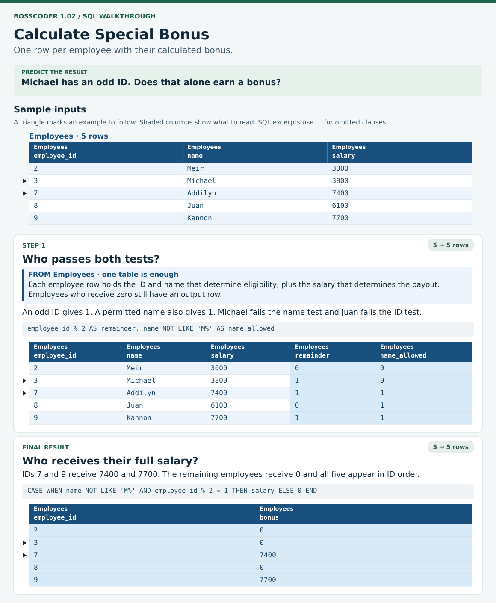

# Bosscoder 1.02 · Calculate Special Bonus

**Topic** SQL Basics  
**Difficulty**   
**Revision date** 2026-11-17

## Question

Calculate a bonus for every employee. An employee receives 100% of their salary when their `employee_id` is odd **and** their name does not start with `M`. The bonus is `0` otherwise. Return `employee_id` and `bonus`, ordered by `employee_id`.

[Bosscoder assignment question](../../../1.Bosscoder%20Academy%20-%20foundational%20notes%20and%20Assignments/1.%20Intro%20to%20SQL%20and%20Advanced%20Select/2.Sql%20Calculate%20Special%20Bonus.md#question-and-image)

### Required output columns

| Column | Meaning |
|---|---|
| `employee_id` | Employee identifier. |
| `bonus` | Bonus amount for that employee, including zero when applicable. |

### Assignment example · Sample input

**`Employees`**

| employee_id | name | salary |
|---:|---|---:|
| 2 | Meir | 3000 |
| 3 | Michael | 3800 |
| 7 | Addilyn | 7400 |
| 8 | Juan | 6100 |
| 9 | Kannon | 7700 |

### Expected output

| employee_id | bonus |
|---:|---:|
| 2 | 0 |
| 3 | 0 |
| 7 | 7400 |
| 8 | 0 |
| 9 | 7700 |

### How the sample produces this output

Employees 7 (Addilyn) and 9 (Kannon) have odd IDs and names starting with A and K. They receive their full salaries, **7400** and **7700**.

Employee 3 (Michael) has an odd ID but a name beginning with M. Employees 2 (Meir) and 8 (Juan) have even IDs. Those three employees each receive **0**. The output includes all five employees in ID order.

## Step 1 · Your approach before writing SQL

1. What does one row of the final output represent?
2. Which table would you put in `FROM`? If you need other tables, which comes second, third, and so on, and why?
3. Would you use a join at any step? For each join you choose, name its type and matching columns and explain why it fits the question.

<details>
<summary>Notes from the saved attempt</summary>

## Schema

Employees has integer employee_id (primary key), text name, and integer salary. Each row represents one employee.

</details>

## Visual walkthrough

Follow the sample rows through each query step. **Predict the result.** Michael has an odd ID. Does that alone earn a bonus?



[Open the full-size walkthrough](../../assets/walkthroughs/b1-02.svg?raw=1)

## My final solution · SQLite

```sql
SELECT employee_id,
       CASE
           WHEN name NOT LIKE 'M%' AND employee_id % 2 = 1 THEN salary
           ELSE 0
       END AS bonus
FROM Employees
ORDER BY employee_id ASC;
```

## My final solution · SQL Server

```sql
SELECT employee_id,
       CASE
           WHEN name NOT LIKE 'M%' AND employee_id % 2 = 1 THEN salary
           ELSE 0
       END AS bonus
FROM Employees
ORDER BY employee_id ASC;
```

Text matching in SQL Server depends on collation. This version was reviewed and was not executed.

## Progressive walkthrough

### 1. Keep one row per employee

The question asks for every employee, including employees receiving zero. Read Employees and keep all five rows. Apply the conditions inside the bonus calculation.


```sql
SELECT employee_id, name, salary FROM Employees ORDER BY employee_id;
```

The output is the five-row input table above.

### 2. Check the two requirements for each employee

An odd ID has remainder 1 when divided by 2. The name test excludes names starting with M. AND requires both checks to pass.


```sql
SELECT employee_id, name, salary,
       employee_id % 2 AS remainder,
       name NOT LIKE 'M%' AS name_allowed
FROM Employees ORDER BY employee_id;
```

| employee_id | name | salary | remainder | name_allowed |
|---:|---|---:|---:|---:|
| 2 | Meir | 3000 | 0 | 0 |
| 3 | Michael | 3800 | 1 | 0 |
| 7 | Addilyn | 7400 | 1 | 1 |
| 8 | Juan | 6100 | 0 | 1 |
| 9 | Kannon | 7700 | 1 | 1 |

Michael passes the odd-ID check but fails the name check. Juan passes the name check but fails the odd-ID check. Addilyn and Kannon pass both.

### 3. Choose the bonus and order the result

CASE returns salary when both checks are true, and ELSE returns zero for everyone else. Select employee_id and bonus, and order by employee_id ascending.


```sql
SELECT employee_id,
       CASE
           WHEN name NOT LIKE 'M%' AND employee_id % 2 = 1 THEN salary
           ELSE 0
       END AS bonus
FROM Employees
ORDER BY employee_id ASC;
```

| employee_id | bonus |
|---:|---:|
| 2 | 0 |
| 3 | 0 |
| 7 | 7400 |
| 8 | 0 |
| 9 | 7700 |

Five employees produce five output rows. No grouping is required because the calculation applies to each employee individually.

## Official solution · As supplied

```sql
SELECT employee_id,
       salary * (employee_id % 2 = 1 AND name NOT LIKE 'M%') AS bonus
FROM Employees
ORDER BY employee_id;
```

## Official solution · SQLite

The supplied query above runs in SQLite, where the Boolean expression acts as 1 or 0 for the sample. A NULL name may yield NULL with this multiplication method. The learner's CASE returns zero when eligibility is unknown.


```sql
SELECT employee_id,
       salary * (employee_id % 2 = 1 AND name NOT LIKE 'M%') AS bonus
FROM Employees
ORDER BY employee_id;
```

## Official solution · SQL Server adaptation

SQL Server uses CASE to choose the numeric bonus.

```sql
SELECT employee_id,
       CASE
           WHEN name NOT LIKE 'M%' AND employee_id % 2 = 1 THEN salary
           ELSE 0
       END AS bonus
FROM Employees
ORDER BY employee_id ASC;
```

## Verification

Executed the learner query in SQLite on the sample and an additional odd-ID employee with a NULL name. Both passed. SQL Server was not executed.
