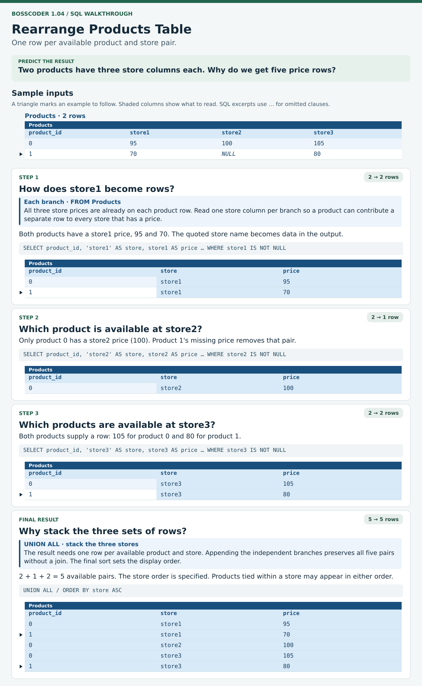

# Bosscoder 1.04 · Rearrange Products Table

**Topic** SQL Basics · **Difficulty**  · Revised 2026-11-17

## Question

**Table colors** · 🟦 `Products`

Each row in 🟦 `Products` gives one product's price in up to three stores. A `NULL` store price means the product is unavailable there.

Rearrange the table so each output row contains `(product_id, store, price)`. Omit any product-store combination whose price is `NULL`. Return the result ordered by `store`.

[Bosscoder assignment question](../../../1.Bosscoder%20Academy%20-%20foundational%20notes%20and%20Assignments/1.%20Intro%20to%20SQL%20and%20Advanced%20Select/4.Sql%20Rearrange%20Products%20Table.md#question-and-image)

### Required output columns

| Column | Meaning | Source |
|---|---|---|
| `product_id` | Product identifier. | 🟦 `Products` |
| `store` | Name of the store where the product is available. | 🟦 `Products` |
| `price` | Price of the product in that store. | 🟦 `Products` |

### Assignment example · Sample input

**🟦 `Products`**

| 🟦 product_id | 🟦 store1 | 🟦 store2 | 🟦 store3 |
|---:|---:|---:|---:|
| 0 | 95 | 100 | 105 |
| 1 | 70 | NULL | 80 |

### Expected output

| 🟦 product_id | 🟦 store | 🟦 price |
|---:|---|---:|
| 0 | store1 | 95 |
| 1 | store1 | 70 |
| 0 | store2 | 100 |
| 0 | store3 | 105 |
| 1 | store3 | 80 |

[View sample inputs and output with colored cells](../../assets/question-samples/b1-04.svg?raw=1)

### How the sample produces this output

🟦 Product 0 has a price at all three stores and supplies the pairs **store1 / 95**, **store2 / 100** and **store3 / 105**. Product 1 supplies **store1 / 70** and **store3 / 80**. Its store2 price is missing.

🟦 That makes **3 + 2 = 5** product–store pairs. In store order, there are two rows for store1, one for store2 and two for store3. The assignment specifies the store order and permits either order within a store.

## Step 1 · Your approach before writing SQL

1. What does one row of the final output represent?
2. Which table would you put in `FROM`? If you need other tables, which comes second, third, and so on, and why?
3. Would you use a join at any step? For each join you choose, name its type and matching columns and explain why it fits the question.

<details>
<summary>Notes from the saved attempt</summary>

### Problem solving checklist

1. **Define the output:** state what one result row represents, the required columns, and the ordering.
2. **Understand the inputs:** identify table meanings, keys, relationships, duplicates, and NULLs.
3. **Explain the logic:** describe the steps, calculations, and comparisons in plain English.
4. **Choose SQL operations:** match each step to the SQL operations it needs.
5. **Plan intermediate results:** list the needed columns and what each intermediate row represents.
6. **Build gradually:** write one part, inspect its output, and check row counts after joins.
7. **Verify the answer:** check the sample, duplicates, missing matches, NULLs, arithmetic, boundaries, ties, and sorting.

## Schema

`Products`:

| Column Name | Type |
|---|---|
| product_id | int |
| store1 | int |
| store2 | int |
| store3 | int |

`product_id` is the primary key. Each store column holds a price, or `NULL` if the product is unavailable at that store.

</details>

## Visual walkthrough

[Open the Previous / Next walkthrough](../../assets/steps/Bosscoder-1.04/01.md)

Follow the sample rows through each query step. **Predict the result.** Two products have three store columns each. Why do we get five price rows?



[Open the full-size walkthrough](../../assets/walkthroughs/b1-04.svg?raw=1)

## My solution — SQLite

```sql
SELECT product_id,
       'store1' AS store,
       store1 AS price
FROM Products
WHERE store1 IS NOT NULL

UNION ALL

SELECT product_id,
       'store2' AS store,
       store2 AS price
FROM Products
WHERE store2 IS NOT NULL

UNION ALL

SELECT product_id,
       'store3' AS store,
       store3 AS price
FROM Products
WHERE store3 IS NOT NULL

ORDER BY store ASC;
```

### Step-by-step explanation with one example

🟦 **Each branch · FROM Products** · All three store prices are already on each product row. Read one store column per branch so a product can contribute a separate row to every store that has a price.

**Starting data.** One input row represents one product; the three store prices occupy three separate columns.

| product_id | store1 | store2 | store3 |
|---:|---:|---:|---:|
| 0 | 95 | 100 | 105 |
| 1 | 70 | NULL | 80 |

We want **one output row per available product-store pair**, so product 0 will contribute three rows and product 1 will contribute two.

**1. Turn `store1` into rows.** The text `'store1'` becomes the output store label, while the value in column `store1` becomes `price`.

```sql
SELECT product_id,
       'store1' AS store,
       store1 AS price
FROM Products
WHERE store1 IS NOT NULL;
```

| product_id | store | price |
|---:|---|---:|
| 0 | store1 | 95 |
| 1 | store1 | 70 |

Both products have a `store1` price, so both remain.

**2. Do the same for `store2`.** Product 1 has `NULL` in this column and is excluded by the branch's `WHERE` condition.

```sql
SELECT product_id,
       'store2' AS store,
       store2 AS price
FROM Products
WHERE store2 IS NOT NULL;
```

| product_id | store | price |
|---:|---|---:|
| 0 | store2 | 100 |

**3. Do the same for `store3`.** Both products have a price there.

```sql
SELECT product_id,
       'store3' AS store,
       store3 AS price
FROM Products
WHERE store3 IS NOT NULL;
```

| product_id | store | price |
|---:|---|---:|
| 0 | store3 | 105 |
| 1 | store3 | 80 |

Each branch produces the **same three output columns** in the same order. A price of `0`, if present, would stay: `0 IS NOT NULL` is true. Only missing (`NULL`) prices are removed.

🟦 **UNION ALL · stack the three stores** · The result needs one row per available product and store. Appending the independent branches preserves all five pairs without a join. The final sort sets the display order.

**4. Stack the branch results with `UNION ALL`.** It retains all two `store1` rows, one `store2` row, and two `store3` rows: five output rows in total. The final `ORDER BY store ASC` arranges the stores as `store1`, `store2`, `store3`.

```sql
SELECT product_id, 'store1' AS store, store1 AS price
FROM Products
WHERE store1 IS NOT NULL
UNION ALL
SELECT product_id, 'store2' AS store, store2 AS price
FROM Products
WHERE store2 IS NOT NULL
UNION ALL
SELECT product_id, 'store3' AS store, store3 AS price
FROM Products
WHERE store3 IS NOT NULL
ORDER BY store ASC;
```

| product_id | store | price |
|---:|---|---:|
| 0 | store1 | 95 |
| 1 | store1 | 70 |
| 0 | store2 | 100 |
| 0 | store3 | 105 |
| 1 | store3 | 80 |

This is the sample output. The question only specifies sorting by `store`; rows tied within one store can appear in either product order. If a fixed order within each store were required, add `product_id` as a second sort key. `UNION ALL` keeps all rows without a duplicate-removal step.

## My solution — SQL Server

The same query works in SQL Server:

```sql
SELECT product_id,
       'store1' AS store,
       store1 AS price
FROM Products
WHERE store1 IS NOT NULL

UNION ALL

SELECT product_id,
       'store2' AS store,
       store2 AS price
FROM Products
WHERE store2 IS NOT NULL

UNION ALL

SELECT product_id,
       'store3' AS store,
       store3 AS price
FROM Products
WHERE store3 IS NOT NULL

ORDER BY store ASC;
```

## Official solution

The supplied handout uses the same three `UNION ALL` branches. Its original version allows any output order, so it ends without `ORDER BY`:

```sql
SELECT product_id, 'store1' AS store, store1 AS price
FROM Products
WHERE store1 IS NOT NULL
UNION ALL
SELECT product_id, 'store2' AS store, store2 AS price
FROM Products
WHERE store2 IS NOT NULL
UNION ALL
SELECT product_id, 'store3' AS store, store3 AS price
FROM Products
WHERE store3 IS NOT NULL;
```

For **this** question's added sorting requirement, the user's final query correctly adds `ORDER BY store ASC` after the last branch.

**What this tests:** Turning several columns into rows with `UNION ALL` and filtering missing prices.

**The approach:** Build one `(product_id, store, price)` result for each store column, then stack the three results.

**Why this way:** Each branch uses the same output shape. `IS NOT NULL` removes unavailable product-store pairs while keeping legitimate zero prices.

**Common mistakes:** Using `<> NULL` instead of `IS NOT NULL`, forgetting to remove missing prices, or applying `ORDER BY` to one branch instead of the final combined result.

## Official solution · SQLite adaptation

```sql
SELECT product_id, 'store1' AS store, store1 AS price
FROM Products
WHERE store1 IS NOT NULL
UNION ALL
SELECT product_id, 'store2' AS store, store2 AS price
FROM Products
WHERE store2 IS NOT NULL
UNION ALL
SELECT product_id, 'store3' AS store, store3 AS price
FROM Products
WHERE store3 IS NOT NULL
ORDER BY store ASC;
```

## Official solution · SQL Server adaptation

```sql
SELECT product_id, 'store1' AS store, store1 AS price
FROM Products
WHERE store1 IS NOT NULL
UNION ALL
SELECT product_id, 'store2' AS store, store2 AS price
FROM Products
WHERE store2 IS NOT NULL
UNION ALL
SELECT product_id, 'store3' AS store, store3 AS price
FROM Products
WHERE store3 IS NOT NULL
ORDER BY store ASC;
```

## Revision verification

The learner submitted the three UNION ALL branches shown in My solution — SQLite, ordered by store ascending. Executed the query in SQLite on the sample and additional zero-price and all-NULL-price rows. All passed. The zero price remains, and the product with all prices NULL contributes no rows. SQL Server was not executed.
