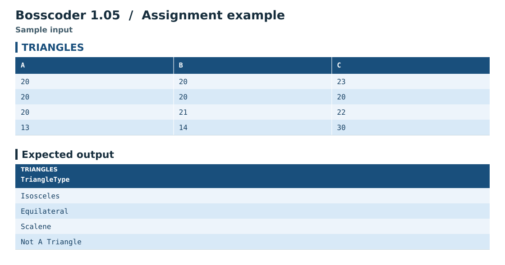
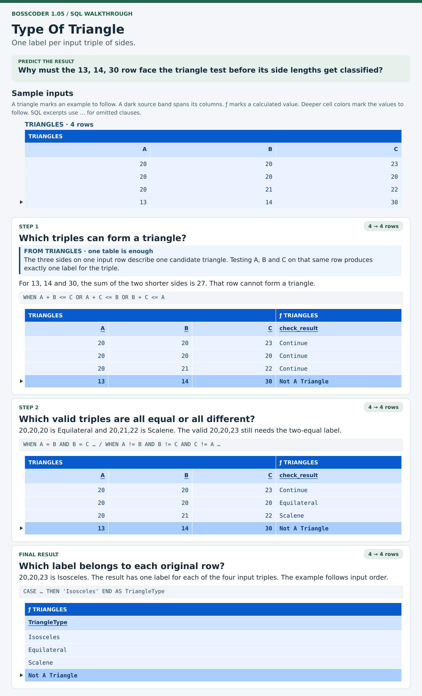

# Bosscoder 1.05 · Type Of Triangle

**Topic** SQL Basics  
**Difficulty**   
**Revised** 2026-11-17

## Question

**Table colors** · 🟦 `TRIANGLES`

For each row of 🟦 `TRIANGLES`, use side lengths `A`, `B`, and `C` to return one `TriangleType`:

- `Equilateral`: all three sides have equal length.
- `Isosceles`: two sides have equal length.
- `Scalene`: all three sides have different lengths.
- `Not A Triangle`: the three lengths cannot form a triangle.

The prompt does not specify an output order.

[Bosscoder assignment question](../../../1.Bosscoder%20Academy%20-%20foundational%20notes%20and%20Assignments/1.%20Intro%20to%20SQL%20and%20Advanced%20Select/5.Sql%20Type%20Of%20Triangle.md#question-and-image)

### Required output columns

One output row represents one input triangle triple, including triples that cannot form a triangle.

| Output column | Source or calculation | Meaning and applicable rules | Example value |
| --- | --- | --- | --- |
| `TriangleType` | 🟦 `TRIANGLES` | Classification of a side-length triple as `Equilateral`, `Isosceles`, `Scalene` or `Not A Triangle`. | Isosceles |

### Assignment example · Sample input

#### Schema

TRIANGLES has integer columns A, B, C. Each input row supplies three side lengths. The saved example assumes non-NULL side lengths.

**🟦 `TRIANGLES`**

| 🟦 A | 🟦 B | 🟦 C |
|---:|---:|---:|
| 🟦 20 | 🟦 20 | 🟦 23 |
| 🟦 20 | 🟦 20 | 🟦 20 |
| 🟦 20 | 🟦 21 | 🟦 22 |
| 🟦 13 | 🟦 14 | 🟦 30 |

### Expected output

| 🟦 TriangleType |
|---|
| 🟦 Isosceles |
| 🟦 Equilateral |
| 🟦 Scalene |
| 🟦 Not A Triangle |


[View sample inputs and output with colored cells](../../assets/question-samples/b1-05.svg?raw=1)

### How the sample produces this output

- 🟦 **🟦 20, 🟦 20, 🟦 23 → 🟦 Isosceles.** The two shorter sides add to 🟦 40, greater than 🟦 23, and exactly two sides are equal.
- 🟦 **🟦 20, 🟦 20, 🟦 20 → 🟦 Equilateral.** All three sides are equal and the sides form a triangle.
- 🟦 **🟦 20, 🟦 21, 🟦 22 → 🟦 Scalene.** The three sides have different lengths and `🟦 20 + 🟦 21 > 🟦 22`.
- 🟦 **🟦 13, 🟦 14, 🟦 30 → 🟦 Not A Triangle.** The two shorter sides add to 🟦 27, which is too short to reach a third side of length 🟦 30.

🟦 The four labels are displayed in input order for this example. The assignment accepts any row order.

## Step 1 · Your approach before writing SQL

1. What does one row of the final output represent?
2. Which table would you put in `FROM`? If you need other tables, which comes second, third, and so on, and why?
3. Would you use a join at any step? For each join you choose, name its type and matching columns and explain why it fits the question.

## My final solution · SQLite

```sql
SELECT
    CASE
        WHEN (A + B <= C) OR (A + C <= B) OR (B + C <= A)
            THEN 'Not A Triangle'
        WHEN A = B AND B = C AND C = A
            THEN 'Equilateral'
        WHEN A != B AND B != C AND C != A
            THEN 'Scalene'
        WHEN (A = B AND B != C)
          OR (B = C AND C != A)
          OR (C = A AND A != B)
            THEN 'Isosceles'
    END AS TriangleType
FROM TRIANGLES;
```

## Visual walkthrough

[Open the Previous / Next walkthrough](../../assets/steps/Bosscoder-1.05/01.md)

Follow the sample rows through each query step. **Predict the result.** Why must the 13, 14, 30 row face the triangle test before its side lengths get classified?



[Open the full-size walkthrough](../../assets/walkthroughs/b1-05.svg?raw=1)

## Progressive walkthrough

🟦 **FROM TRIANGLES · one table is enough** · The three sides on one input row describe one candidate triangle. Testing `A`, `B` and `C` on that same row produces exactly one label for the triple.

### 1. Start with one row per set of side lengths

Every row must receive a classification. Read TRIANGLES and calculate the label in SELECT.


```sql
SELECT A, B, C FROM TRIANGLES;
```

| A | B | C |
|---:|---:|---:|
| 20 | 20 | 23 |
| 20 | 20 | 20 |
| 20 | 21 | 22 |
| 13 | 14 | 30 |

Tables here follow the sample input order to trace the calculation. The question allows any output order.

### 2. Reject invalid triangles first

Each pair of sides must add up to strictly more than the remaining side. Any failed pair makes the row Not A Triangle. Use OR because one failed comparison is sufficient. Equality is invalid too, as with 2 + 3 = 5.


```sql
SELECT A, B, C,
       CASE WHEN A+B <= C OR A+C <= B OR B+C <= A
            THEN 'Not A Triangle' ELSE 'Continue' END AS check_result
FROM TRIANGLES;
```

| A | B | C | check_result |
|---:|---:|---:|---|
| 20 | 20 | 23 | Continue |
| 20 | 20 | 20 | Continue |
| 20 | 21 | 22 | Continue |
| 13 | 14 | 30 | Not A Triangle |

The last row has three different side lengths but cannot form a triangle. Checking validity first prevents a Scalene label. The 180-degree rule applies to angles, while these columns contain lengths.

### 3. Check all equal, then all different

For valid rows, all equal sides produce Equilateral. All three pairwise inequalities produce Scalene. A CASE stops at its first true branch.


```sql
SELECT A, B, C,
       CASE
           WHEN A+B <= C OR A+C <= B OR B+C <= A THEN 'Not A Triangle'
           WHEN A=B AND B=C AND C=A THEN 'Equilateral'
           WHEN A!=B AND B!=C AND C!=A THEN 'Scalene'
           ELSE 'Continue'
       END AS check_result
FROM TRIANGLES;
```

| A | B | C | check_result |
|---:|---:|---:|---|
| 20 | 20 | 23 | Continue |
| 20 | 20 | 20 | Equilateral |
| 20 | 21 | 22 | Scalene |
| 13 | 14 | 30 | Not A Triangle |

The first row remains because it has exactly two equal sides.

### 4. Check the equal pair and return the requested column

Your final branch tests each possible equal pair while requiring the third side to differ. All possible classifications are covered for non-NULL side lengths.


```sql
SELECT
    CASE
        WHEN (A + B <= C) OR (A + C <= B) OR (B + C <= A)
            THEN 'Not A Triangle'
        WHEN A = B AND B = C AND C = A
            THEN 'Equilateral'
        WHEN A != B AND B != C AND C != A
            THEN 'Scalene'
        WHEN (A = B AND B != C)
          OR (B = C AND C != A)
          OR (C = A AND A != B)
            THEN 'Isosceles'
    END AS TriangleType
FROM TRIANGLES;
```

| TriangleType |
|---|
| Isosceles |
| Equilateral |
| Scalene |
| Not A Triangle |

No grouping is needed because each row is classified independently. The final SELECT returns only the requested TriangleType column.

## My final solution · SQL Server

```sql
SELECT
    CASE
        WHEN (A + B <= C) OR (A + C <= B) OR (B + C <= A)
            THEN 'Not A Triangle'
        WHEN A = B AND B = C AND C = A
            THEN 'Equilateral'
        WHEN A != B AND B != C AND C != A
            THEN 'Scalene'
        WHEN (A = B AND B != C)
          OR (B = C AND C != A)
          OR (C = A AND A != B)
            THEN 'Isosceles'
    END AS TriangleType
FROM TRIANGLES;
```

## Official solution · As supplied

```sql
SELECT
    CASE
        WHEN A + B <= C OR A + C <= B OR B + C <= A THEN 'Not A Triangle'
        WHEN A = B AND B = C THEN 'Equilateral'
        WHEN A = B OR A = C OR B = C THEN 'Isosceles'
        ELSE 'Scalene'
    END AS TriangleType
FROM TRIANGLES;
```

## Official solution · SQLite adaptation

```sql
SELECT
    CASE
        WHEN A + B <= C OR A + C <= B OR B + C <= A THEN 'Not A Triangle'
        WHEN A = B AND B = C THEN 'Equilateral'
        WHEN A = B OR A = C OR B = C THEN 'Isosceles'
        ELSE 'Scalene'
    END AS TriangleType
FROM TRIANGLES;
```

## Official solution · SQL Server adaptation

```sql
SELECT
    CASE
        WHEN A + B <= C OR A + C <= B OR B + C <= A THEN 'Not A Triangle'
        WHEN A = B AND B = C THEN 'Equilateral'
        WHEN A = B OR A = C OR B = C THEN 'Isosceles'
        ELSE 'Scalene'
    END AS TriangleType
FROM TRIANGLES;
```

The official query checks invalid sides, then Equilateral, then any equal pair, and uses ELSE for Scalene. Your explicit pair conditions give the same labels for the supported non-NULL side lengths.

## Verification

Executed the learner solution in SQLite on the sample and all 343 combinations of side lengths from 0 through 6. Compared each classification against the sorted-side validity rule and number of distinct side lengths. All passed, including zero lengths and the equality boundary. SQL Server adaptations were not executed.
