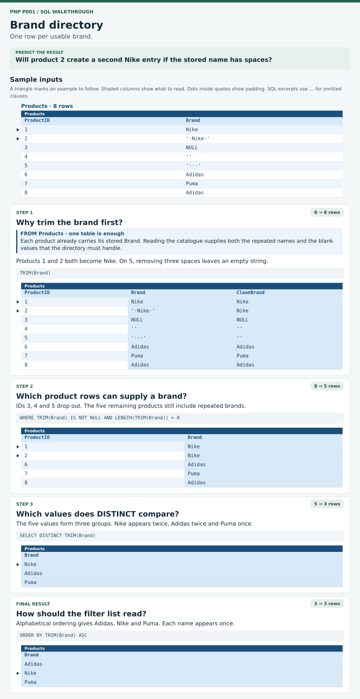

# PNP P001 — Brand directory

**Topic:** SQL Basics  
**Difficulty:** Easy

## Question

The catalogue team needs a list of brands for the app’s **Shop by brand** filter. Using the `Products` table, return one column named `Brand` with one row per clean brand name, sorted alphabetically.

Treat surrounding spaces as insignificant, so `'Nike'` and `' Nike '` represent the same brand. Exclude `NULL`, empty strings, and values that contain only spaces.

### Sample input

Only the relevant columns from `Products` are shown. Quotes make spaces visible and are used here to represent text values.

| ProductID | Brand |
| ---: | --- |
| 1 | `'Nike'` |
| 2 | `' Nike '` |
| 3 | `NULL` |
| 4 | `''` |
| 5 | `'   '` |
| 6 | `'Adidas'` |
| 7 | `'Puma'` |
| 8 | `'Adidas'` |

### Expected output

| Brand |
| --- |
| Adidas |
| Nike |
| Puma |

Products 1 and 2 represent the same brand. Products 6 and 8 both represent Adidas. Products 3–5 have no usable brand, so the filter contains three names in alphabetical order.

### Schema

The exercise uses `Products`. The sample shows `ProductID` (integer) and `Brand` (nullable text). Only `Brand` is required to solve the problem.

## Visual walkthrough

Follow the sample rows through each query step. **Predict the result.** Will product 2 create a second Nike entry if the stored name has spaces?



[Open the full-size walkthrough](../../assets/walkthroughs/p001.svg?raw=1)

## Learner solution — SQLite

```sql
select distinct trim(Brand) as Brand
from Products
where trim(Brand)is not null and length(trim(Brand))>0
order by trim(Brand) asc
```

The exact query was run against all eight sample rows in SQLite. The column name and all three rows matched the expected output in order.

## Learner solution — SQL Server

```sql
SELECT DISTINCT TRIM(Brand) AS Brand
FROM Products
WHERE TRIM(Brand) IS NOT NULL
  AND LEN(TRIM(Brand)) > 0
ORDER BY Brand ASC;
```

This adaptation uses SQL Server's `LEN` and sorts by the output alias. It was reviewed by inspection.

## Official solution

The [repository's PNP P001 source notes](<../../../2.PNP- foundations and practice/0. SQL basics/P001. Brand directory.md>) reproduce this query from the PNP answer key.

```sql
SELECT DISTINCT p.Brand
FROM Products AS p
WHERE NULLIF(TRIM(p.Brand), '') IS NOT NULL
ORDER BY p.Brand;
```

The official query trims brand names for filtering and returns raw brand names. On the illustrative sample, it treats the two Nike spellings as distinct in SQLite.

## Step-by-step walkthrough

**How to start.** What counts as one brand?

Use the same sample throughout and check the output after each step.

**Starting data.** Use the eight rows in the sample input above. Each row represents one product. The quotes around text values make surrounding spaces visible.

### 1. Clean each brand name

**What to do.** Clean each brand name.

**Why.** Compare cleaned values so padding does not create separate brands.

Use `TRIM` to remove spaces at the start and end. Keep `ProductID` and the original value visible so you can compare each product before and after cleaning.

```sql
SELECT ProductID, Brand, TRIM(Brand) AS CleanBrand
FROM Products
ORDER BY ProductID;
```

| ProductID | Brand | CleanBrand |
| ---: | --- | --- |
| 1 | `'Nike'` | `'Nike'` |
| 2 | `' Nike '` | `'Nike'` |
| 3 | `NULL` | `NULL` |
| 4 | `''` | `''` |
| 5 | `'   '` | `''` |
| 6 | `'Adidas'` | `'Adidas'` |
| 7 | `'Puma'` | `'Puma'` |
| 8 | `'Adidas'` | `'Adidas'` |

Products 1 and 2 now have the same cleaned brand. Product 3 still has `NULL`, and products 4 and 5 have empty strings.

### 2. Keep only usable brands

**What to do.** Keep only usable brands.

**Why.** Blank values cannot create useful filter entries.

Add the learner's two filter conditions. The null check excludes product 3. The length check excludes products 4 and 5 because their cleaned names have zero characters.

```sql
SELECT ProductID, TRIM(Brand) AS Brand
FROM Products
WHERE TRIM(Brand) IS NOT NULL
  AND LENGTH(TRIM(Brand)) > 0
ORDER BY ProductID;
```

| ProductID | Brand |
| ---: | --- |
| 1 | Nike |
| 2 | Nike |
| 6 | Adidas |
| 7 | Puma |
| 8 | Adidas |

Five product rows remain. Nike and Adidas each still appear twice.

### 3. Return one row per clean brand

**What to do.** Return one row per clean brand.

**Why.** Repeated products should yield just one brand.

Select just the cleaned brand and add `DISTINCT`. The output now represents brands instead of products.

```sql
SELECT DISTINCT TRIM(Brand) AS Brand
FROM Products
WHERE TRIM(Brand) IS NOT NULL
  AND LENGTH(TRIM(Brand)) > 0;
```

| Brand |
| --- |
| Nike |
| Adidas |
| Puma |

Products 1 and 2 contribute one Nike row, and products 6 and 8 contribute one Adidas row. This query can return the three rows in any order.

### 4. Sort the final brand list

**What to do.** Sort the final brand list.

**Why.** The output needs alphabetical order.

Add `ORDER BY` on the cleaned brand so the result appears alphabetically. This completes the learner's SQLite query.

```sql
SELECT DISTINCT TRIM(Brand) AS Brand
FROM Products
WHERE TRIM(Brand) IS NOT NULL
  AND LENGTH(TRIM(Brand)) > 0
ORDER BY TRIM(Brand) ASC;
```

| Brand |
| --- |
| Adidas |
| Nike |
| Puma |

### Official answer — SQLite adaptation

```sql
SELECT DISTINCT p.Brand
FROM Products AS p
WHERE NULLIF(TRIM(p.Brand), '') IS NOT NULL
ORDER BY p.Brand;
```

### Official answer — SQL Server adaptation

```sql
SELECT DISTINCT p.Brand
FROM Products AS p
WHERE NULLIF(TRIM(p.Brand), '') IS NOT NULL
ORDER BY p.Brand;
```

The answer key returns the stored brand text. The learner query also trims the displayed brand, which affects the padded-Nike sample.

SQLite adaptation executed on representative fixtures. SQL Server adaptation reviewed by inspection.
