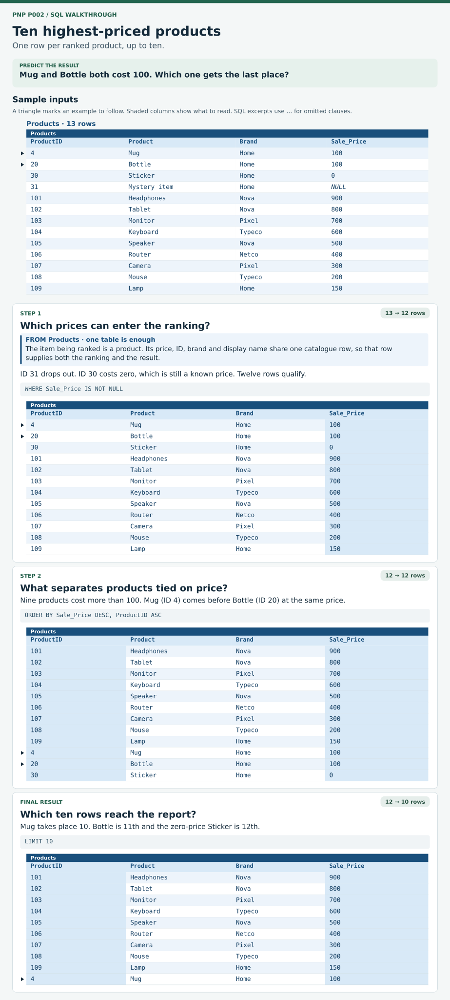

# PNP P002 — Ten highest-priced products

**Topic:** SQL Basics  
**Difficulty:** Easy

## Question

**Table colors** · 🟦 `Products`

**Business scenario.** The merchandising team fills a "Premium picks" carousel on the home page. It has exactly ten slots and shows the ten products with the highest current 🟦 `Sale_Price`. The job runs every night, and the carousel must not reshuffle when nothing has changed, so a tie for the last slot needs a fixed rule.

**Task.** Return the ten products with the highest `Sale_Price`, highest first. A product with no price must never take a slot. If products tie on price at the cut-off, the lower `ProductID` wins.

[PNP source question](../../../2.PNP-%20foundations%20and%20practice/1.%20Intro%20to%20SQL%20and%20Advanced%20Select/P002.%20Ten%20highest-priced%20products.md#question-and-image)

### Required output columns

One output row represents one priced product in the top ten. Lower product IDs take priority when prices tie.

| Output column | Source or calculation | Meaning and applicable rules | Example value |
| --- | --- | --- | --- |
| `ProductID` | 🟦 `Products.ProductID` | Product identifier. | 101 |
| `Product` | 🟦 `Products.Product` | Product name. | Headphones |
| `Brand` | 🟦 `Products.Brand` | Brand name. | Nova |
| `Sale_Price` | 🟦 `Products.Sale_Price` | Current sale price. | 900 |

### Practice example · Sample input

**🟦 `Products`**

| 🟦 ProductID | 🟦 Product | 🟦 Brand | 🟦 Sale_Price |
| ---: | --- | --- | ---: |
| 4 | Mug | Home | 100 |
| 20 | Bottle | Home | 100 |
| 30 | Sticker | Home | 0 |
| 31 | Mystery item | Home | `NULL` |
| 101 | Headphones | Nova | 900 |
| 102 | Tablet | Nova | 800 |
| 103 | Monitor | Pixel | 700 |
| 104 | Keyboard | Typeco | 600 |
| 105 | Speaker | Nova | 500 |
| 106 | Router | Netco | 400 |
| 107 | Camera | Pixel | 300 |
| 108 | Mouse | Typeco | 200 |
| 109 | Lamp | Home | 150 |

### Expected output

| 🟦 ProductID | 🟦 Product | 🟦 Brand | 🟦 Sale_Price |
| ---: | --- | --- | ---: |
| 101 | Headphones | Nova | 900 |
| 102 | Tablet | Nova | 800 |
| 103 | Monitor | Pixel | 700 |
| 104 | Keyboard | Typeco | 600 |
| 105 | Speaker | Nova | 500 |
| 106 | Router | Netco | 400 |
| 107 | Camera | Pixel | 300 |
| 108 | Mouse | Typeco | 200 |
| 109 | Lamp | Home | 150 |
| 4 | Mug | Home | 100 |

[View sample inputs and output with colored cells](../../assets/question-samples/p002.svg?raw=1)

### How the sample produces this output

🟦 Nine products have prices above 100. They fill positions 1–9 in descending price order, from Headphones (ID 101, price 900) to Lamp (ID 109, price 150).

🟦 Mug (ID 4) and Bottle (ID 20) both cost 100. The smaller ID gives Mug the tenth slot. Sticker has a known price of 0 and falls below the cutoff. Mystery item has no recorded price.

## Step 1 · Your approach before writing SQL

1. What does one row of the final output represent?
2. Which table would you put in `FROM`? If you need other tables, which comes second, third, and so on, and why?
3. Would you use a join at any step? For each join you choose, name its type and matching columns and explain why it fits the question.

<details>
<summary>Notes from the saved attempt</summary>

### Schema

The relevant columns in `Products` are `ProductID` (integer identifier), `Product` and `Brand` (text), and `Sale_Price` (nullable number). Return those four columns in that order.

</details>

## Learner solution — SQLite

```sql
select ProductID,Product, Brand, Sale_Price 
from Products
where Sale_Price is not null
order by Sale_Price desc, ProductID asc
limit 10
```

Verified in SQLite on the sample, with fewer than ten priced products including a zero-price row, and with only NULL prices.

## Visual walkthrough

[Open the Previous / Next walkthrough](../../assets/steps/PNP-P002/01.md)

Follow the sample rows through each query step. **Predict the result.** Mug and Bottle both cost 100. Which one gets the last place?



[Open the full-size walkthrough](../../assets/walkthroughs/p002.svg?raw=1)

## Step-by-step walkthrough

🟦 **FROM Products · one table is enough** · The item being ranked is a product. Its price, ID, brand and display name share one catalogue row, so that row supplies both the ranking and the result.

**How to start.** Which rows qualify before ranking?

Use the same sample throughout and check the output after each step.

Use the same sample throughout.

### 1. Exclude products without a price

**What to do.** Exclude products without a price.

**Why.** Unknown prices cannot take a slot.

Only Mystery item has a NULL price. Sticker stays eligible at a price of zero. This diagnostic query sorts by product ID to make the remaining rows easy to find in the sample.

```sql
select ProductID,Product, Brand, Sale_Price 
from Products
where Sale_Price is not null
order by ProductID
```

| ProductID | Product | Brand | Sale_Price |
| ---: | --- | --- | ---: |
| 4 | Mug | Home | 100 |
| 20 | Bottle | Home | 100 |
| 30 | Sticker | Home | 0 |
| 101 | Headphones | Nova | 900 |
| 102 | Tablet | Nova | 800 |
| 103 | Monitor | Pixel | 700 |
| 104 | Keyboard | Typeco | 600 |
| 105 | Speaker | Nova | 500 |
| 106 | Router | Netco | 400 |
| 107 | Camera | Pixel | 300 |
| 108 | Mouse | Typeco | 200 |
| 109 | Lamp | Home | 150 |

### 2. Sort by price and break ties by product ID

**What to do.** Sort by price and break ties by product ID.

**Why.** The lower ID must win an equal-price tie.

Switch to descending price, then ascending product ID for equal prices. Mug now appears immediately before Bottle at positions 10 and 11.

```sql
select ProductID,Product, Brand, Sale_Price 
from Products
where Sale_Price is not null
order by Sale_Price desc, ProductID asc
```

| ProductID | Product | Brand | Sale_Price |
| ---: | --- | --- | ---: |
| 101 | Headphones | Nova | 900 |
| 102 | Tablet | Nova | 800 |
| 103 | Monitor | Pixel | 700 |
| 104 | Keyboard | Typeco | 600 |
| 105 | Speaker | Nova | 500 |
| 106 | Router | Netco | 400 |
| 107 | Camera | Pixel | 300 |
| 108 | Mouse | Typeco | 200 |
| 109 | Lamp | Home | 150 |
| 4 | Mug | Home | 100 |
| 20 | Bottle | Home | 100 |
| 30 | Sticker | Home | 0 |

### 3. Keep the first ten rows

**What to do.** Keep the first ten rows.

**Why.** Limiting after sorting selects the ten highest eligible rows.

Apply the limit to the sorted result. Mug fills the last slot, while Bottle and Sticker fall below the cutoff.

```sql
select ProductID,Product, Brand, Sale_Price 
from Products
where Sale_Price is not null
order by Sale_Price desc, ProductID asc
limit 10
```

| ProductID | Product | Brand | Sale_Price |
| ---: | --- | --- | ---: |
| 101 | Headphones | Nova | 900 |
| 102 | Tablet | Nova | 800 |
| 103 | Monitor | Pixel | 700 |
| 104 | Keyboard | Typeco | 600 |
| 105 | Speaker | Nova | 500 |
| 106 | Router | Netco | 400 |
| 107 | Camera | Pixel | 300 |
| 108 | Mouse | Typeco | 200 |
| 109 | Lamp | Home | 150 |
| 4 | Mug | Home | 100 |

## Learner solution — SQL Server

```sql
SELECT TOP (10) ProductID, Product, Brand, Sale_Price
FROM Products
WHERE Sale_Price IS NOT NULL
ORDER BY Sale_Price DESC, ProductID ASC;
```

The SQL Server version applies `TOP (10)` with the same ordering. It was reviewed by inspection.

## Official solution

The [PNP source notes](https://github.com/MulikShrikantDattatray14/Data-Engineering-Mastry/blob/main/1.%20SQL%20Mastery/1.%20SQL%20Mastry/2.PNP-%20foundations%20and%20practice/1.%20Intro%20to%20SQL%20and%20Advanced%20Select/P002.%20Ten%20highest-priced%20products.md) reproduce this query from the PNP answer key.

```sql
SELECT p.ProductID,
       p.Product,
       p.Brand,
       p.Sale_Price
FROM Products AS p
WHERE p.Sale_Price IS NOT NULL
ORDER BY p.Sale_Price DESC,
         p.ProductID
LIMIT 10;
```

The source query uses table aliases and relies on ascending order as the default for `ProductID`. It produces the same ordering as the learner's explicit `ASC`.

### Official answer — SQLite adaptation

```sql
SELECT p.ProductID,
       p.Product,
       p.Brand,
       p.Sale_Price
FROM Products AS p
WHERE p.Sale_Price IS NOT NULL
ORDER BY p.Sale_Price DESC,
         p.ProductID
LIMIT 10;
```

### Official answer — SQL Server adaptation

```sql
SELECT TOP (10) p.ProductID,
       p.Product,
       p.Brand,
       p.Sale_Price
FROM Products AS p
WHERE p.Sale_Price IS NOT NULL
ORDER BY p.Sale_Price DESC,
         p.ProductID;
```

SQLite adaptation executed on representative fixtures. SQL Server adaptation reviewed by inspection.

## Verification

The saved learner query ran in SQLite on the [walkthrough fixture](../../assets/steps/PNP-P002/walkthrough.json). The column names and all 10 expected rows matched in the displayed order.
