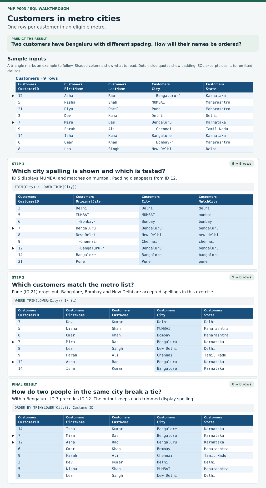

# PNP P003 — Customers in metro cities

**Topic:** SQL Basics  
**Difficulty:** Easy

## Question

**Table colors** · 🟦 `Customers`

**Business scenario.** Marketing is launching same-day delivery in five metros: Bengaluru, Mumbai, Delhi, Hyderabad and Chennai. They need the customers in those cities for the launch campaign. 🟦 `City` was typed in by hand at sign-up, so some values carry stray spaces or odd capitalisation.

**Task.** Return customers whose city is one of the five metros, matching regardless of case and surrounding spaces. Show the city with the spaces removed. Sort by city, then `CustomerID`.

**Dataset clarification.** The supplied data also calls Bengaluru `Bangalore`, Mumbai `Bombay`, and Delhi `New Delhi`. Treat those spellings as the same five metro areas.

[PNP source question](../../../2.PNP-%20foundations%20and%20practice/1.%20Intro%20to%20SQL%20and%20Advanced%20Select/P003.%20Customers%20in%20metro%20cities.md#question-and-image)

### Required output columns

One output row represents one customer in one of the five named metros, regardless of case or surrounding spaces in the stored city.

| Output column | Source or calculation | Meaning and applicable rules | Example value |
| --- | --- | --- | --- |
| `CustomerID` | 🟦 `Customers.CustomerID` | Customer identifier. | 14 |
| `FirstName` | 🟦 `Customers.FirstName` | Customer’s first name. | Isha |
| `LastName` | 🟦 `Customers.LastName` | Customer’s last name. | Kumar |
| `City` | 🟦 `Customers.City` | City with surrounding spaces removed. | Bangalore |
| `State` | 🟦 `Customers.State` | Customer’s state as stored. | Karnataka |

### Practice example · Sample input

Quotes around text values make surrounding spaces visible.

**🟦 `Customers`**

| 🟦 CustomerID | 🟦 FirstName | 🟦 LastName | 🟦 City | 🟦 State |
| ---: | --- | --- | --- | --- |
| 12 | Asha | Rao | `' Bengaluru '` | Karnataka |
| 5 | Nisha | Shah | `'MUMBAI'` | Maharashtra |
| 21 | Riya | Patil | `'Pune'` | Maharashtra |
| 3 | Dev | Kumar | `'Delhi'` | Delhi |
| 7 | Mira | Das | `'Bengaluru'` | Karnataka |
| 9 | Farah | Ali | `' Chennai '` | Tamil Nadu |
| 14 | Isha | Kumar | `'Bangalore'` | Karnataka |
| 6 | Omar | Khan | `' Bombay '` | Maharashtra |
| 8 | Lea | Singh | `'New Delhi'` | Delhi |

### Expected output

| 🟦 CustomerID | 🟦 FirstName | 🟦 LastName | 🟦 City | 🟦 State |
| ---: | --- | --- | --- | --- |
| 14 | Isha | Kumar | Bangalore | Karnataka |
| 7 | Mira | Das | Bengaluru | Karnataka |
| 12 | Asha | Rao | Bengaluru | Karnataka |
| 6 | Omar | Khan | Bombay | Maharashtra |
| 9 | Farah | Ali | Chennai | Tamil Nadu |
| 3 | Dev | Kumar | Delhi | Delhi |
| 5 | Nisha | Shah | MUMBAI | Maharashtra |
| 8 | Lea | Singh | New Delhi | Delhi |

[View sample inputs and output with colored cells](../../assets/question-samples/p003.svg?raw=1)

### How the sample produces this output

🟦 ID 21 lives in Pune, outside the five metro areas. The other eight customers qualify, including IDs 14, 6 and 8 under the dataset spellings Bangalore, Bombay and New Delhi. ID 5 qualifies with the stored spelling `MUMBAI`, which stays uppercase in the output.

🟦 The displayed names for IDs 7 and 12 are both Bengaluru, so ID 7 appears first. Surrounding spaces also disappear from Chennai and Bombay. Reading the displayed cities alphabetically gives the ID sequence **14, 7, 12, 6, 9, 3, 5, 8**.

## Step 1 · Your approach before writing SQL

1. What does one row of the final output represent?
2. Which table would you put in `FROM`? If you need other tables, which comes second, third, and so on, and why?
3. Would you use a join at any step? For each join you choose, name its type and matching columns and explain why it fits the question.

<details>
<summary>Notes from the saved attempt</summary>

### Schema

The relevant columns are `CustomerID` (integer identifier), `FirstName`, `LastName`, `City`, and `State` (text). Return them in that order.

The saved attempt keeps the displayed city’s original spelling and capitalization and orders city names case-insensitively.

</details>

## Learner solution — SQLite

```sql
select CustomerID,FirstName,LastName,trim(City) as City,State
from Customers
where trim(lower(City)) in ("bengaluru","mumbai","delhi","hyderabad","chennai","bangalore","bombay","new delhi")
order by trim(lower(City)) asc, CustomerID asc
```

The exact submission passed in SQLite with double-quoted string literal compatibility enabled. Single quotes are the standard spelling for string literals and produce the same result in SQLite. The checks also covered a mixed-case city tied on the sort key, Hyderabad, NULL, and a spaces-only value.

## Visual walkthrough

[Open the Previous / Next walkthrough](../../assets/steps/PNP-P003/01.md)

Follow the sample rows through each query step. **Predict the result.** Two customers have Bengaluru with different spacing. How will their names be ordered?



[Open the full-size walkthrough](../../assets/walkthroughs/p003.svg?raw=1)

## Step-by-step walkthrough

🟦 **FROM Customers · one table is enough** · The report lists people by their own city. One customer row supplies the city to test and the ID, name and state to display.

**How to start.** Which city value is for display and which is for comparison?

Use the same sample throughout and check the output after each step.

### 1. Check the displayed value and the matching value

**What to do.** Check the displayed value and the matching value.

**Why.** Case-insensitive matching can coexist with original display case.

Use `TRIM(City)` for display and `TRIM(LOWER(City))` for comparison. This diagnostic query shows both values for each sample row. Mumbai illustrates the difference between preserving case for display and normalizing it for matching.

```sql
SELECT CustomerID, City AS OriginalCity, TRIM(City) AS City,
       TRIM(LOWER(City)) AS MatchCity
FROM Customers
ORDER BY CustomerID;
```

| CustomerID | OriginalCity | City | MatchCity |
| ---: | --- | --- | --- |
| 3 | `'Delhi'` | Delhi | delhi |
| 5 | `'MUMBAI'` | MUMBAI | mumbai |
| 6 | `' Bombay '` | Bombay | bombay |
| 7 | `'Bengaluru'` | Bengaluru | bengaluru |
| 8 | `'New Delhi'` | New Delhi | new delhi |
| 9 | `' Chennai '` | Chennai | chennai |
| 12 | `' Bengaluru '` | Bengaluru | bengaluru |
| 14 | `'Bangalore'` | Bangalore | bangalore |
| 21 | `'Pune'` | Pune | pune |

### 2. Keep eligible cities

**What to do.** Keep eligible cities.

**Why.** Alternate names must still match the intended metros.

Use the normalized value in the filter and return the trimmed display value. Pune is removed and all three alternate names are retained. This intermediate query still displays the rows in customer ID order for inspection.

```sql
select CustomerID,FirstName,LastName,trim(City) as City,State
from Customers
where trim(lower(City)) in ("bengaluru","mumbai","delhi","hyderabad","chennai","bangalore","bombay","new delhi")
order by CustomerID;
```

| CustomerID | FirstName | LastName | City | State |
| ---: | --- | --- | --- | --- |
| 3 | Dev | Kumar | Delhi | Delhi |
| 5 | Nisha | Shah | MUMBAI | Maharashtra |
| 6 | Omar | Khan | Bombay | Maharashtra |
| 7 | Mira | Das | Bengaluru | Karnataka |
| 8 | Lea | Singh | New Delhi | Delhi |
| 9 | Farah | Ali | Chennai | Tamil Nadu |
| 12 | Asha | Rao | Bengaluru | Karnataka |
| 14 | Isha | Kumar | Bangalore | Karnataka |

### 3. Apply the requested ordering

**What to do.** Apply the requested ordering.

**Why.** Matching case should not affect alphabetical placement.

Use the normalized city as the first sort key and `CustomerID` as the second. The two Bengaluru rows now sit together, with customer 7 before customer 12.

```sql
select CustomerID,FirstName,LastName,trim(City) as City,State
from Customers
where trim(lower(City)) in ("bengaluru","mumbai","delhi","hyderabad","chennai","bangalore","bombay","new delhi")
order by trim(lower(City)) asc, CustomerID asc
```

| CustomerID | FirstName | LastName | City | State |
| ---: | --- | --- | --- | --- |
| 14 | Isha | Kumar | Bangalore | Karnataka |
| 7 | Mira | Das | Bengaluru | Karnataka |
| 12 | Asha | Rao | Bengaluru | Karnataka |
| 6 | Omar | Khan | Bombay | Maharashtra |
| 9 | Farah | Ali | Chennai | Tamil Nadu |
| 3 | Dev | Kumar | Delhi | Delhi |
| 5 | Nisha | Shah | MUMBAI | Maharashtra |
| 8 | Lea | Singh | New Delhi | Delhi |

## Learner solution — SQL Server

```sql
select CustomerID,FirstName,LastName,trim(City) as City,State
from Customers
where trim(lower(City)) in ('bengaluru','mumbai','delhi','hyderabad','chennai','bangalore','bombay','new delhi')
order by trim(lower(City)) asc, CustomerID asc;
```

The SQL Server adaptation uses single-quoted literals. It was reviewed by inspection.

## Official solution

The [PNP source notes](https://github.com/MulikShrikantDattatray14/Data-Engineering-Mastry/blob/main/1.%20SQL%20Mastery/1.%20SQL%20Mastry/2.PNP-%20foundations%20and%20practice/1.%20Intro%20to%20SQL%20and%20Advanced%20Select/P003.%20Customers%20in%20metro%20cities.md) reproduce this PostgreSQL query from the answer key.

```sql
SELECT c.CustomerID,
       c.FirstName,
       c.LastName,
       TRIM(c.City) AS City,
       c.State
FROM Customers AS c
WHERE LOWER(TRIM(c.City)) IN ('bengaluru', 'bangalore', 'mumbai', 'bombay',
                                'delhi', 'new delhi', 'hyderabad', 'chennai')
ORDER BY TRIM(c.City), c.CustomerID;
```

The official query orders by the trimmed city using the database collation. The learner query explicitly normalizes case in the sort key to match the exercise's case-insensitive ordering.

### Official answer — SQLite adaptation

```sql
SELECT c.CustomerID,
       c.FirstName,
       c.LastName,
       TRIM(c.City) AS City,
       c.State
FROM Customers AS c
WHERE LOWER(TRIM(c.City)) IN ('bengaluru', 'bangalore', 'mumbai', 'bombay',
                                'delhi', 'new delhi', 'hyderabad', 'chennai')
ORDER BY TRIM(c.City), c.CustomerID;
```

### Official answer — SQL Server adaptation

```sql
SELECT c.CustomerID,
       c.FirstName,
       c.LastName,
       TRIM(c.City) AS City,
       c.State
FROM Customers AS c
WHERE LOWER(TRIM(c.City)) IN ('bengaluru', 'bangalore', 'mumbai', 'bombay',
                                'delhi', 'new delhi', 'hyderabad', 'chennai')
ORDER BY TRIM(c.City), c.CustomerID;
```

These adaptations retain the answer key’s collation-dependent sort on the trimmed city. The learner query explicitly sorts case-insensitively.

SQLite adaptation executed on representative fixtures. SQL Server adaptation reviewed by inspection.

## Verification

The saved learner query ran in SQLite on the [walkthrough fixture](../../assets/steps/PNP-P003/walkthrough.json). The column names and all 8 expected rows matched in the displayed order.
