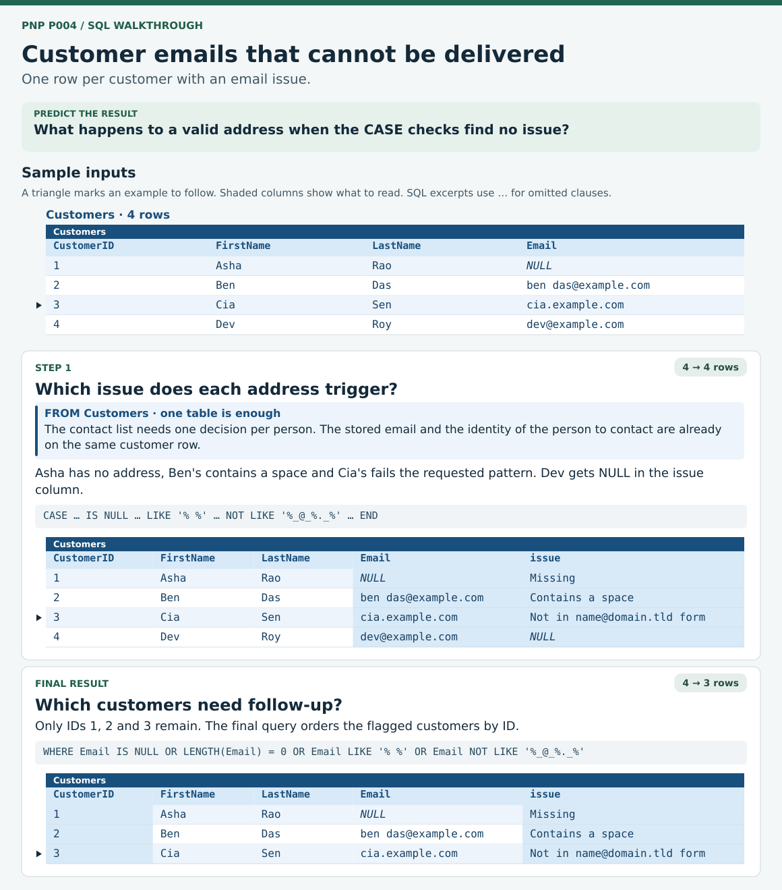

# PNP P004 — Customer emails that cannot be delivered

**Topic:** SQL Basics  
**Difficulty:** Easy

## Question

Marketing wants to catch obviously invalid email addresses before sending a campaign. From `Customers`, return only customers whose email fails the exercise’s validation rules. Label the issue using the first applicable rule in this order:

1. `Missing` if `Email` is `NULL` or empty.
2. `Contains a space` if `Email` contains a space.
3. `Not in name@domain.tld form` if `Email` fails the required shape. The shape requires at least one character before `@`, at least one between `@` and the dot, and at least one after the dot.

Return `CustomerID`, `FirstName`, `LastName`, `Email`, and `issue`. Show `Email` as stored and sort by `CustomerID` ascending.

### Sample input

| CustomerID | FirstName | LastName | Email |
| ---: | --- | --- | --- |
| 1 | Asha | Rao | `NULL` |
| 2 | Ben | Das | `ben das@example.com` |
| 3 | Cia | Sen | `cia.example.com` |
| 4 | Dev | Roy | `dev@example.com` |

### Expected output

| CustomerID | FirstName | LastName | Email | issue |
| ---: | --- | --- | --- | --- |
| 1 | Asha | Rao | `NULL` | Missing |
| 2 | Ben | Das | `ben das@example.com` | Contains a space |
| 3 | Cia | Sen | `cia.example.com` | Not in name@domain.tld form |

Dev’s address passes the exercise’s rules, so his row is excluded.

## Visual walkthrough

Follow the sample rows through each query step. **Predict the result.** What happens to a valid address when the CASE checks find no issue?



[Open the full-size walkthrough](../../assets/walkthroughs/p004.svg?raw=1)

## Learner solution — SQLite

```sql
SELECT CustomerID, FirstName, LastName, Email,
       (CASE
          WHEN Email IS NULL OR LENGTH(Email) == 0 THEN 'Missing'
          WHEN Email LIKE '% %' THEN 'Contains a space'
          WHEN Email NOT LIKE '%_@_%._%' THEN 'Not in name@domain.tld form'
        END) AS issue
FROM Customers
WHERE Email IS NULL OR LENGTH(Email) == 0 OR Email LIKE '% %'
   OR Email NOT LIKE '%_@_%._%'
ORDER BY CustomerID ASC;
```

The learner's query logic is preserved. The saved version removes chat escaping and link formatting, uses regular spaces in the issue text, and uses single quotes for SQL string literals. SQLite checks covered the sample, empty emails, incomplete address parts, and label precedence.

## Step-by-step walkthrough

**How to start.** Which issue should win when several apply?

Use the same sample throughout and check the output after each step.

### 1. Assign the issue to each customer

**What to do.** Assign the issue to each customer.

**Why.** Each customer needs the first applicable label.

Run the `CASE` without the filter. Asha's missing email matches the first rule, Ben's space matches the second, and Cia's email fails the shape check. Dev's email matches none of the branches, so its issue is NULL.

```sql
SELECT CustomerID, FirstName, LastName, Email,
       (CASE
          WHEN Email IS NULL OR LENGTH(Email) == 0 THEN 'Missing'
          WHEN Email LIKE '% %' THEN 'Contains a space'
          WHEN Email NOT LIKE '%_@_%._%' THEN 'Not in name@domain.tld form'
        END) AS issue
FROM Customers
ORDER BY CustomerID ASC;
```

| CustomerID | FirstName | LastName | Email | issue |
| ---: | --- | --- | --- | --- |
| 1 | Asha | Rao | `NULL` | Missing |
| 2 | Ben | Das | ben das@example.com | Contains a space |
| 3 | Cia | Sen | cia.example.com | Not in name@domain.tld form |
| 4 | Dev | Roy | dev@example.com | `NULL` |

### 2. Keep only rows that fail a check

**What to do.** Keep only rows that fail a check.

**Why.** The report includes only rows with an issue.

Add the `WHERE` clause. Its alternatives keep a row when any issue applies. Dev drops out and the result remains in customer ID order.

```sql
SELECT CustomerID, FirstName, LastName, Email,
       (CASE
          WHEN Email IS NULL OR LENGTH(Email) == 0 THEN 'Missing'
          WHEN Email LIKE '% %' THEN 'Contains a space'
          WHEN Email NOT LIKE '%_@_%._%' THEN 'Not in name@domain.tld form'
        END) AS issue
FROM Customers
WHERE Email IS NULL OR LENGTH(Email) == 0 OR Email LIKE '% %'
   OR Email NOT LIKE '%_@_%._%'
ORDER BY CustomerID ASC;
```

| CustomerID | FirstName | LastName | Email | issue |
| ---: | --- | --- | --- | --- |
| 1 | Asha | Rao | `NULL` | Missing |
| 2 | Ben | Das | ben das@example.com | Contains a space |
| 3 | Cia | Sen | cia.example.com | Not in name@domain.tld form |

## Learner solution — SQL Server

```sql
SELECT CustomerID, FirstName, LastName, Email,
       (CASE
          WHEN Email IS NULL OR DATALENGTH(Email) = 0 THEN 'Missing'
          WHEN Email LIKE '% %' THEN 'Contains a space'
          WHEN Email NOT LIKE '%_@_%._%' THEN 'Not in name@domain.tld form'
        END) AS issue
FROM Customers
WHERE Email IS NULL OR DATALENGTH(Email) = 0 OR Email LIKE '% %'
   OR Email NOT LIKE '%_@_%._%'
ORDER BY CustomerID ASC;
```

The SQL Server adaptation uses `DATALENGTH` for the empty-string check because it counts trailing spaces. This assumes a variable-length email column and preserves the distinction between empty and spaces-only email values. Reviewed by inspection.

## Official solution

[PNP source notes](https://github.com/MulikShrikantDattatray14/Data-Engineering-Mastry/blob/main/1.%20SQL%20Mastery/1.%20SQL%20Mastry/2.PNP-%20foundations%20and%20practice/8.%20Advance%20string%20functions,%20regex%20and%20clause/P004.%20Customer%20emails%20that%20cannot%20be%20delivered.md)

```sql
SELECT c.CustomerID,
       c.FirstName,
       c.LastName,
       c.Email,
       CASE WHEN c.Email IS NULL OR TRIM(c.Email) = '' THEN 'Missing'
            WHEN c.Email LIKE '% %'                    THEN 'Contains a space'
            ELSE 'Not in name@domain.tld form'
       END AS issue
FROM Customers AS c
WHERE c.Email IS NULL
   OR TRIM(c.Email) = ''
   OR c.Email LIKE '% %'
   OR c.Email NOT LIKE '%_@_%._%'
ORDER BY c.CustomerID;
```

The official solution treats spaces-only emails as `Missing`. The learner solution labels them `Contains a space`, following the exercise's stated rule that NULL or empty values are missing.

### Official answer — SQLite adaptation

```sql
SELECT c.CustomerID,
       c.FirstName,
       c.LastName,
       c.Email,
       CASE WHEN c.Email IS NULL OR TRIM(c.Email) = '' THEN 'Missing'
            WHEN c.Email LIKE '% %'                    THEN 'Contains a space'
            ELSE 'Not in name@domain.tld form'
       END AS issue
FROM Customers AS c
WHERE c.Email IS NULL
   OR TRIM(c.Email) = ''
   OR c.Email LIKE '% %'
   OR c.Email NOT LIKE '%_@_%._%'
ORDER BY c.CustomerID;
```

### Official answer — SQL Server adaptation

```sql
SELECT c.CustomerID,
       c.FirstName,
       c.LastName,
       c.Email,
       CASE WHEN c.Email IS NULL OR TRIM(c.Email) = '' THEN 'Missing'
            WHEN CHARINDEX(' ', c.Email) > 0                    THEN 'Contains a space'
            ELSE 'Not in name@domain.tld form'
       END AS issue
FROM Customers AS c
WHERE c.Email IS NULL
   OR TRIM(c.Email) = ''
   OR CHARINDEX(' ', c.Email) > 0
   OR c.Email NOT LIKE '%_@_%._%'
ORDER BY c.CustomerID;
```

SQLite adaptation executed on representative fixtures. SQL Server adaptation reviewed by inspection.
