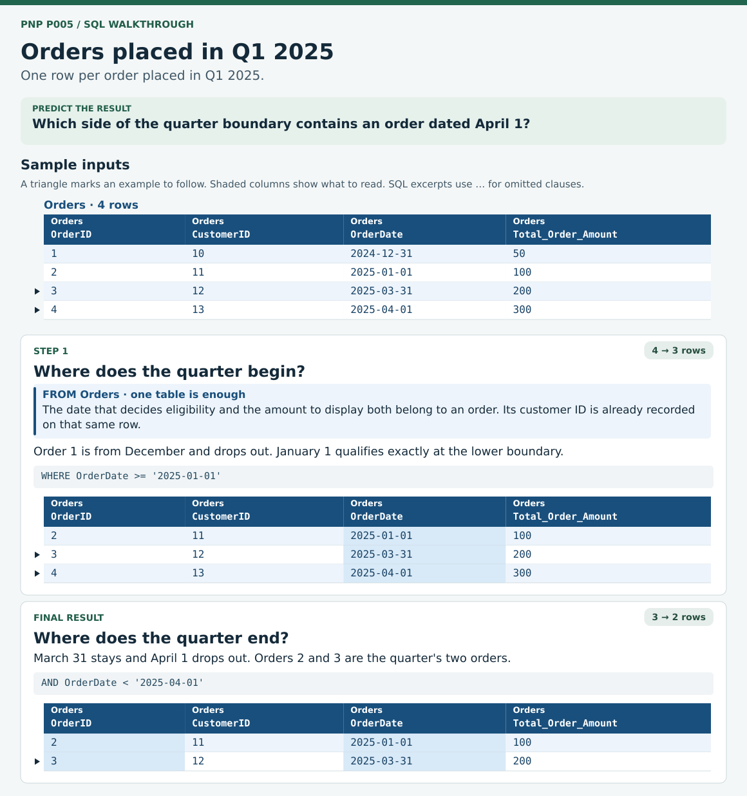

# PNP P005 — Orders placed in Q1 2025

**Topic:** SQL Basics  
**Difficulty:** Easy

## Question

**Table colors** · 🟦 `Orders`

**Business scenario.** Finance is closing January to March 2025 and needs the orders placed in that quarter to tie against the payment gateway report. Cancellations and refunds are not recorded in this dataset, so every row in 🟦 `Orders` counts as a placed order.

**Task.** Return every order with an `OrderDate` from 1 January 2025 to 31 March 2025 inclusive. Sort by `OrderDate`, then `OrderID`.

[PNP source question](../../../2.PNP-%20foundations%20and%20practice/1.%20Intro%20to%20SQL%20and%20Advanced%20Select/P005.%20Orders%20placed%20in%20Q1%202025.md#question-and-image)

### Required output columns

One output row represents one order placed from 1 January through 31 March 2025, including both endpoints.

| Output column | Source or calculation | Meaning and applicable rules | Example value |
| --- | --- | --- | --- |
| `OrderID` | 🟦 `Orders.OrderID` | Order identifier. | 2 |
| `CustomerID` | 🟦 `Orders.CustomerID` | Customer identifier. | 11 |
| `OrderDate` | 🟦 `Orders.OrderDate` | Date the order was placed. | 2025-01-01 |
| `Total_Order_Amount` | 🟦 `Orders.Total_Order_Amount` | Value of the order. | 100 |

### Practice example · Sample input

**🟦 `Orders`**

| 🟦 OrderID | 🟦 CustomerID | 🟦 OrderDate | 🟦 Total_Order_Amount |
| ---: | ---: | --- | ---: |
| 1 | 10 | 2024-12-31 | 50 |
| 2 | 11 | 2025-01-01 | 100 |
| 3 | 12 | 2025-03-31 | 200 |
| 4 | 13 | 2025-04-01 | 300 |

### Expected output

| 🟦 OrderID | 🟦 CustomerID | 🟦 OrderDate | 🟦 Total_Order_Amount |
| ---: | ---: | --- | ---: |
| 2 | 11 | 2025-01-01 | 100 |
| 3 | 12 | 2025-03-31 | 200 |

[View sample inputs and output with colored cells](../../assets/question-samples/p005.svg?raw=1)

### How the sample produces this output

🟦 Order 2 falls on January 1, the first date of the quarter. Its customer is 11 and its amount is 100. Order 3 falls on March 31, the last date of the quarter. Its customer is 12 and its amount is 200.

🟦 Order 1 falls one day before the quarter and order 4 falls one day after it. Only orders 2 and 3 appear, with the January order first.

## Step 1 · Your approach before writing SQL

1. What does one row of the final output represent?
2. Which table would you put in `FROM`? If you need other tables, which comes second, third, and so on, and why?
3. Would you use a join at any step? For each join you choose, name its type and matching columns and explain why it fits the question.

## Learner solution — SQLite

```sql
select OrderID, CustomerID, OrderDate,Total_Order_Amount
from Orders
where OrderDate>= '2025-01-01' and OrderDate < '2025-04-01'
order by OrderDate asc , OrderID asc
```

The query passed the sample and additional checks for March 31 timestamps, April 1 at midnight, and equal timestamps ordered by order ID. The SQLite comparisons use ISO-formatted date and timestamp text.

## Visual walkthrough

[Open the Previous / Next walkthrough](../../assets/steps/PNP-P005/01.md)

Follow the sample rows through each query step. **Predict the result.** Which side of the quarter boundary contains an order dated April 1?



[Open the full-size walkthrough](../../assets/walkthroughs/p005.svg?raw=1)

## Step-by-step walkthrough

🟦 **FROM Orders · one table is enough** · The date that decides eligibility and the amount to display both belong to an order. Its customer ID is already recorded on that same row.

**How to start.** Which dates begin this quarter and the next?

Use the same sample throughout and check the output after each step.

### 1. Keep orders from the start of the quarter

**What to do.** Keep orders from the start of the quarter.

**Why.** The first day belongs to the quarter.

The lower bound includes January 1 and removes order 1. Order 4 remains until the upper bound is applied. The preview uses the final ordering so the rows are easy to compare.

```sql
select OrderID, CustomerID, OrderDate,Total_Order_Amount
from Orders
where OrderDate>= '2025-01-01'
order by OrderDate asc , OrderID asc
```

| OrderID | CustomerID | OrderDate | Total_Order_Amount |
| ---: | ---: | --- | ---: |
| 2 | 11 | 2025-01-01 | 100 |
| 3 | 12 | 2025-03-31 | 200 |
| 4 | 13 | 2025-04-01 | 300 |

### 2. Exclude the start of the next quarter

**What to do.** Exclude the start of the next quarter.

**Why.** The next quarter is excluded while all March 31 timestamps remain eligible.

The exclusive April 1 boundary removes order 4 and keeps all of March 31, including timestamps such as `2025-03-31 15:00:00`. For orders with identical dates or timestamps, the lower order ID comes first.

```sql
select OrderID, CustomerID, OrderDate,Total_Order_Amount
from Orders
where OrderDate>= '2025-01-01' and OrderDate < '2025-04-01'
order by OrderDate asc , OrderID asc
```

| OrderID | CustomerID | OrderDate | Total_Order_Amount |
| ---: | ---: | --- | ---: |
| 2 | 11 | 2025-01-01 | 100 |
| 3 | 12 | 2025-03-31 | 200 |

## Learner solution — SQL Server

```sql
select OrderID, CustomerID, OrderDate,Total_Order_Amount
from Orders
where OrderDate>= '2025-01-01' and OrderDate < '2025-04-01'
order by OrderDate asc , OrderID asc;
```

The same range works with a SQL Server date or timestamp-valued column such as `datetime2`. Reviewed by inspection.

## Official solution

The [PNP source notes](https://github.com/MulikShrikantDattatray14/Data-Engineering-Mastry/blob/main/1.%20SQL%20Mastery/1.%20SQL%20Mastry/2.PNP-%20foundations%20and%20practice/1.%20Intro%20to%20SQL%20and%20Advanced%20Select/P005.%20Orders%20placed%20in%20Q1%202025.md) reproduce this PostgreSQL answer key query.

```sql
SELECT o.OrderID,
       o.CustomerID,
       o.OrderDate,
       o.Total_Order_Amount
FROM Orders AS o
WHERE o.OrderDate >= DATE '2025-01-01'
  AND o.OrderDate <  DATE '2025-04-01'
ORDER BY o.OrderDate, o.OrderID;
```

The official solution uses typed date literals with the same inclusive start and exclusive end as the learner's query.

### Official answer — SQLite adaptation

```sql
SELECT o.OrderID,
       o.CustomerID,
       o.OrderDate,
       o.Total_Order_Amount
FROM Orders AS o
WHERE o.OrderDate >= '2025-01-01'
  AND o.OrderDate <  '2025-04-01'
ORDER BY o.OrderDate, o.OrderID;
```

### Official answer — SQL Server adaptation

```sql
SELECT o.OrderID,
       o.CustomerID,
       o.OrderDate,
       o.Total_Order_Amount
FROM Orders AS o
WHERE o.OrderDate >= CONVERT(date, '20250101', 112)
  AND o.OrderDate <  CONVERT(date, '20250401', 112)
ORDER BY o.OrderDate, o.OrderID;
```

SQLite adaptation executed on representative fixtures. SQL Server adaptation reviewed by inspection.

## Verification

The saved learner query ran in SQLite on the [walkthrough fixture](../../assets/steps/PNP-P005/walkthrough.json). The column names and all 2 expected rows matched in the displayed order.
