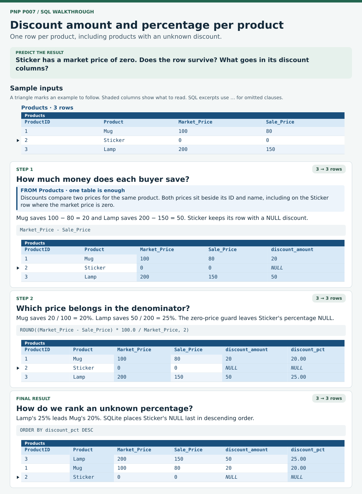

# PNP P007 — Discount amount and percentage per product

**Topic:** SQL Basics  
**Difficulty:** Easy

## Question

**Table colors** · 🟦 `Products`

**Business scenario.** The pricing team is checking how deep discounts run across the catalogue. 🟦 `Market_Price` is the MRP printed on the pack and `Sale_Price` is what the store charges today. A missing or zero `Market_Price` means the MRP was never captured, so that product has no measurable discount.

**Task.** For every product, return the discount in rupees and as a percentage of `Market_Price`, rounded to two decimals. `Products` with a missing or zero `Market_Price` get `NULL` for both. Sort by discount percentage, highest first, with NULLs at the end.

[PNP source question](../../../2.PNP-%20foundations%20and%20practice/1.%20Intro%20to%20SQL%20and%20Advanced%20Select/P007.%20Discount%20amount%20and%20percentage%20per%20product.md#question-and-image)

### Required output columns

| Column | Meaning | Source |
|---|---|---|
| `ProductID` | Product identifier. | 🟦 `Products` |
| `Product` | Product name. | 🟦 `Products` |
| `Market_Price` | Market price printed on the pack. | 🟦 `Products` |
| `Sale_Price` | Current sale price. | 🟦 `Products` |
| `discount_amount` | Market price minus sale price, in rupees. | 🟦 `Products` |
| `discount_pct` | Discount as a percentage of market price, rounded to two decimals. | 🟦 `Products` |

### Practice example · Sample input

**🟦 `Products`**

| 🟦 ProductID | 🟦 Product | 🟦 Market_Price | 🟦 Sale_Price |
| --- | --- | --- | --- |
| 1 | Mug | 100 | 80 |
| 2 | Sticker | 0 | 0 |
| 3 | Lamp | 200 | 150 |

### Expected output

| 🟦 ProductID | 🟦 Product | 🟦 Market_Price | 🟦 Sale_Price | 🟦 discount_amount | 🟦 discount_pct |
| --- | --- | --- | --- | --- | --- |
| 3 | Lamp | 200 | 150 | 50 | 25.00 |
| 1 | Mug | 100 | 80 | 20 | 20.00 |
| 2 | Sticker | 0 | 0 | `NULL` | `NULL` |

[View sample inputs and output with colored cells](../../assets/question-samples/p007.svg?raw=1)

### How the sample produces this output

🟦 Lamp saves `200 − 150 = 50`, which is `50 / 200 × 100 = 25.00%`. Mug saves `100 − 80 = 20`, or `20 / 100 × 100 = 20.00%`. Lamp therefore precedes Mug.

🟦 Sticker’s market price is zero. The question assigns `NULL` to both discount fields for that product. The row still appears, after the two products with known percentages.

## Step 1 · Your approach before writing SQL

1. What does one row of the final output represent?
2. Which table would you put in `FROM`? If you need other tables, which comes second, third, and so on, and why?
3. Would you use a join at any step? For each join you choose, name its type and matching columns and explain why it fits the question.

## Visual walkthrough

Follow the sample rows through each query step. **Predict the result.** Sticker has a market price of zero. Does the row survive? What goes in its discount columns?



[Open the full-size walkthrough](../../assets/walkthroughs/p007.svg?raw=1)

## Learner solution — SQLite

```sql
select 
ProductID,
Product,
 Market_Price,
Sale_Price,
(
case
when Market_Price is null or Market_Price =0 then Null
else (Market_Price - Sale_Price)
end 
) as discount_amount,
(
case
when Market_Price is null or Market_Price =0 then Null
else round((  ((Market_Price - Sale_Price)*100.0/ Market_Price)),2)
end 
) 

 as discount_pct
from Products
order by discount_pct desc
```

Verified on the sample and additional cases covering missing prices, a zero sale price, a sale price above market price, and a 3.33% discount. SQLite may display a numeric value like 25.00 as 25.0. The tables show two decimal places for readability.

## Step-by-step walkthrough

**How to start.** Does an unusable price affect the row or its metrics?

Use the same sample throughout and check the output after each step.

### 1. Calculate the discount amount

**What to do.** Calculate the discount amount.

**Why.** Every product must remain in the output.

Return every product. The first CASE sets Sticker's discount to NULL because its market price is zero.

```sql
select 
ProductID,
Product,
 Market_Price,
Sale_Price,
(
case
when Market_Price is null or Market_Price =0 then Null
else (Market_Price - Sale_Price)
end 
) as discount_amount
from Products
order by ProductID
```

| ProductID | Product | Market_Price | Sale_Price | discount_amount |
| --- | --- | --- | --- | --- |
| 1 | Mug | 100 | 80 | 20 |
| 2 | Sticker | 0 | 0 | `NULL` |
| 3 | Lamp | 200 | 150 | 50 |

### 2. Calculate the percentage

**What to do.** Calculate the percentage.

**Why.** Real-valued division preserves fractional percentages before rounding.

Multiply the difference by 100.0 before dividing by the market price. In SQLite this promotes the arithmetic to real division. Lamp's calculation is 50 × 100.0 ÷ 200, which rounds to 25.00. The preview is ordered by product ID.

```sql
select 
ProductID,
Product,
 Market_Price,
Sale_Price,
(
case
when Market_Price is null or Market_Price =0 then Null
else (Market_Price - Sale_Price)
end 
) as discount_amount,
(
case
when Market_Price is null or Market_Price =0 then Null
else round((  ((Market_Price - Sale_Price)*100.0/ Market_Price)),2)
end 
) 

 as discount_pct
from Products
order by ProductID
```

| ProductID | Product | Market_Price | Sale_Price | discount_amount | discount_pct |
| --- | --- | --- | --- | --- | --- |
| 1 | Mug | 100 | 80 | 20 | 20.00 |
| 2 | Sticker | 0 | 0 | `NULL` | `NULL` |
| 3 | Lamp | 200 | 150 | 50 | 25.00 |

### 3. Sort the result

**What to do.** Sort the result.

**Why.** The largest measured discounts belong first.

Order by discount percentage descending. SQLite puts the NULL percentages last in this order, so Lamp comes first and Sticker appears at the end.

```sql
select 
ProductID,
Product,
 Market_Price,
Sale_Price,
(
case
when Market_Price is null or Market_Price =0 then Null
else (Market_Price - Sale_Price)
end 
) as discount_amount,
(
case
when Market_Price is null or Market_Price =0 then Null
else round((  ((Market_Price - Sale_Price)*100.0/ Market_Price)),2)
end 
) 

 as discount_pct
from Products
order by discount_pct desc
```

| ProductID | Product | Market_Price | Sale_Price | discount_amount | discount_pct |
| --- | --- | --- | --- | --- | --- |
| 3 | Lamp | 200 | 150 | 50 | 25.00 |
| 1 | Mug | 100 | 80 | 20 | 20.00 |
| 2 | Sticker | 0 | 0 | `NULL` | `NULL` |

## Learner solution — SQL Server

```sql
select 
ProductID,
Product,
 Market_Price,
Sale_Price,
(
case
when Market_Price is null or Market_Price =0 then Null
else (Market_Price - Sale_Price)
end 
) as discount_amount,
(
case
when Market_Price is null or Market_Price =0 then Null
else round((  ((Market_Price - Sale_Price)*100.0/ Market_Price)),2)
end 
) 

 as discount_pct
from Products
order by discount_pct desc;
```

The decimal literal also avoids integer division in SQL Server. Descending order puts NULLs last. Reviewed by inspection.

## Official solution

The [PNP source notes](https://github.com/MulikShrikantDattatray14/Data-Engineering-Mastry/blob/main/1.%20SQL%20Mastery/1.%20SQL%20Mastry/2.PNP-%20foundations%20and%20practice/1.%20Intro%20to%20SQL%20and%20Advanced%20Select/P007.%20Discount%20amount%20and%20percentage%20per%20product.md) reproduce the answer key query.

```sql
SELECT p.ProductID,
       p.Product,
       p.Market_Price,
       p.Sale_Price,
       NULLIF(p.Market_Price, 0) - p.Sale_Price                                      AS discount_amount,
       ROUND(100.0 * (p.Market_Price - p.Sale_Price) / NULLIF(p.Market_Price, 0), 2) AS discount_pct
FROM Products AS p
ORDER BY discount_pct DESC NULLS LAST,
         p.ProductID;
```

### Official answer — SQLite adaptation

```sql
SELECT p.ProductID,
       p.Product,
       p.Market_Price,
       p.Sale_Price,
       NULLIF(p.Market_Price, 0) - p.Sale_Price                                      AS discount_amount,
       ROUND(100.0 * (p.Market_Price - p.Sale_Price) / NULLIF(p.Market_Price, 0), 2) AS discount_pct
FROM Products AS p
ORDER BY discount_pct DESC,
         p.ProductID;
```

### Official answer — SQL Server adaptation

```sql
SELECT p.ProductID,
       p.Product,
       p.Market_Price,
       p.Sale_Price,
       NULLIF(p.Market_Price, 0) - p.Sale_Price                                      AS discount_amount,
       ROUND(100.0 * (p.Market_Price - p.Sale_Price) / NULLIF(p.Market_Price, 0), 2) AS discount_pct
FROM Products AS p
ORDER BY discount_pct DESC,
         p.ProductID;
```

Descending order places NULL percentages last in both target engines.

SQLite adaptation executed on representative fixtures. SQL Server adaptation reviewed by inspection.
