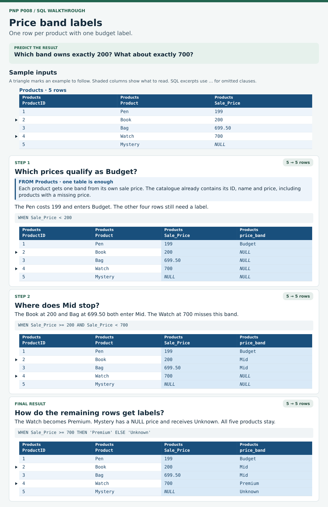

# PNP P008 — Price band labels

**Topic:** SQL Basics  
**Difficulty:** Easy

## Question

**Business scenario.** Merchandising is adding a "Shop by budget" filter to the app. Each product must carry exactly one band based on its current `Sale_Price`: Budget below 200, Mid from 200 up to 699, Premium from 700. A product with no price should show Unknown so it can be fixed, not disappear from the filter.

**Task.** Label every product with a price band. Mid means 200 or more and less than 700, so a price of 699.50 is Mid. Sort by `ProductID`.

[PNP source question](../../../2.PNP-%20foundations%20and%20practice/1.%20Intro%20to%20SQL%20and%20Advanced%20Select/P008.%20Price%20band%20labels.md#question-and-image)

### Required output columns

| Column | Meaning |
|---|---|
| `ProductID` | Product identifier. |
| `Product` | Product name. |
| `Sale_Price` | Current sale price. |
| `price_band` | One of `Budget`, `Mid`, `Premium` or `Unknown` for the product’s sale price. |

### Practice example · Sample input

**`Products`**

| ProductID | Product | Sale_Price |
| --- | --- | --- |
| 1 | Pen | 199 |
| 2 | Book | 200 |
| 3 | Bag | 699.50 |
| 4 | Watch | 700 |
| 5 | Mystery | `NULL` |

### Expected output

| ProductID | Product | Sale_Price | price_band |
| --- | --- | --- | --- |
| 1 | Pen | 199 | Budget |
| 2 | Book | 200 | Mid |
| 3 | Bag | 699.50 | Mid |
| 4 | Watch | 700 | Premium |
| 5 | Mystery | `NULL` | Unknown |

### How the sample produces this output

Pen at **199** is Budget. Book at **200** is exactly at the start of Mid, and Bag at **699.50** is still below 700, so both are Mid. Watch at **700** is the first price in Premium.

Mystery has no price and receives Unknown. All five product IDs appear in ascending order.

## Step 1 · Your approach before writing SQL

1. What does one row of the final output represent?
2. Which table would you put in `FROM`? If you need other tables, which comes second, third, and so on, and why?
3. Would you use a join at any step? For each join you choose, name its type and matching columns and explain why it fits the question.

## Visual walkthrough

Follow the sample rows through each query step. **Predict the result.** Which band owns exactly 200? What about exactly 700?



[Open the full-size walkthrough](../../assets/walkthroughs/p008.svg?raw=1)

## Learner solution — SQLite

```sql
select ProductID,Product,Sale_Price,
(
case
when Sale_Price < 200 then "Budget"
when Sale_Price >=200 and Sale_Price < 700 then "Mid"
when Sale_Price>=700 then"Premium"
else "Unknown"
end
) as 
price_band
from Products
order by ProductID asc
```

The exact query passed in the tested SQLite configuration, which accepts double-quoted string literals. Checks covered the sample, output names and order, NULL, and fractional prices just below each threshold.

## Step-by-step walkthrough

**How to start.** Which label owns each threshold?

Use the same sample throughout and check the output after each step.

### 1. Label prices below 200

**What to do.** Label prices below 200.

**Why.** Budget ends immediately before 200.

The first branch labels Pen. With only this branch and no ELSE, the other labels are NULL for now.

```sql
SELECT ProductID, Product, Sale_Price,
       CASE
           WHEN Sale_Price < 200 THEN 'Budget'
       END AS price_band
FROM Products
ORDER BY ProductID ASC;
```

| ProductID | Product | Sale_Price | price_band |
| --- | --- | --- | --- |
| 1 | Pen | 199 | Budget |
| 2 | Book | 200 | `NULL` |
| 3 | Bag | 699.50 | `NULL` |
| 4 | Watch | 700 | `NULL` |
| 5 | Mystery | `NULL` | `NULL` |

### 2. Add the Mid range

**What to do.** Add the Mid range.

**Why.** Mid includes fractional prices below 700.

Book and Bag satisfy both limits. The upper bound is exclusive, so Watch stays outside Mid.

```sql
SELECT ProductID, Product, Sale_Price,
       CASE
           WHEN Sale_Price < 200 THEN 'Budget'
           WHEN Sale_Price >= 200 AND Sale_Price < 700 THEN 'Mid'
       END AS price_band
FROM Products
ORDER BY ProductID ASC;
```

| ProductID | Product | Sale_Price | price_band |
| --- | --- | --- | --- |
| 1 | Pen | 199 | Budget |
| 2 | Book | 200 | Mid |
| 3 | Bag | 699.50 | Mid |
| 4 | Watch | 700 | `NULL` |
| 5 | Mystery | `NULL` | `NULL` |

### 3. Complete the labels

**What to do.** Complete the labels.

**Why.** A missing price still needs its own label.

The final query adds Premium for Watch. Mystery's NULL price makes all three numeric conditions unknown, so ELSE supplies Unknown. All five rows remain, sorted by product ID.

```sql
select ProductID,Product,Sale_Price,
(
case
when Sale_Price < 200 then "Budget"
when Sale_Price >=200 and Sale_Price < 700 then "Mid"
when Sale_Price>=700 then"Premium"
else "Unknown"
end
) as 
price_band
from Products
order by ProductID asc
```

| ProductID | Product | Sale_Price | price_band |
| --- | --- | --- | --- |
| 1 | Pen | 199 | Budget |
| 2 | Book | 200 | Mid |
| 3 | Bag | 699.50 | Mid |
| 4 | Watch | 700 | Premium |
| 5 | Mystery | `NULL` | Unknown |

## Learner solution — SQL Server

```sql
select ProductID,Product,Sale_Price,
(
case
when Sale_Price < 200 then 'Budget'
when Sale_Price >=200 and Sale_Price < 700 then 'Mid'
when Sale_Price>=700 then'Premium'
else 'Unknown'
end
) as 
price_band
from Products
order by ProductID asc;
```

The adaptation uses single-quoted text literals and was reviewed by inspection. The same quoting also passed in SQLite.

## Official solution

The [PNP source notes](https://github.com/MulikShrikantDattatray14/Data-Engineering-Mastry/blob/main/1.%20SQL%20Mastery/1.%20SQL%20Mastry/2.PNP-%20foundations%20and%20practice/1.%20Intro%20to%20SQL%20and%20Advanced%20Select/P008.%20Price%20band%20labels.md) reproduce this answer key query.

```sql
SELECT p.ProductID,
       p.Product,
       p.Sale_Price,
       CASE
           WHEN p.Sale_Price IS NULL THEN 'Unknown'
           WHEN p.Sale_Price < 200   THEN 'Budget'
           WHEN p.Sale_Price < 700   THEN 'Mid'
           ELSE 'Premium'
       END AS price_band
FROM Products AS p
ORDER BY p.ProductID;
```

The official solution checks NULL first and uses the ordering of the CASE branches to shorten the remaining comparisons. The learner's query expresses the ranges explicitly.

### Official answer — SQLite adaptation

```sql
SELECT p.ProductID,
       p.Product,
       p.Sale_Price,
       CASE
           WHEN p.Sale_Price IS NULL THEN 'Unknown'
           WHEN p.Sale_Price < 200   THEN 'Budget'
           WHEN p.Sale_Price < 700   THEN 'Mid'
           ELSE 'Premium'
       END AS price_band
FROM Products AS p
ORDER BY p.ProductID;
```

### Official answer — SQL Server adaptation

```sql
SELECT p.ProductID,
       p.Product,
       p.Sale_Price,
       CASE
           WHEN p.Sale_Price IS NULL THEN 'Unknown'
           WHEN p.Sale_Price < 200   THEN 'Budget'
           WHEN p.Sale_Price < 700   THEN 'Mid'
           ELSE 'Premium'
       END AS price_band
FROM Products AS p
ORDER BY p.ProductID;
```

SQLite adaptation executed on representative fixtures. SQL Server adaptation reviewed by inspection.
