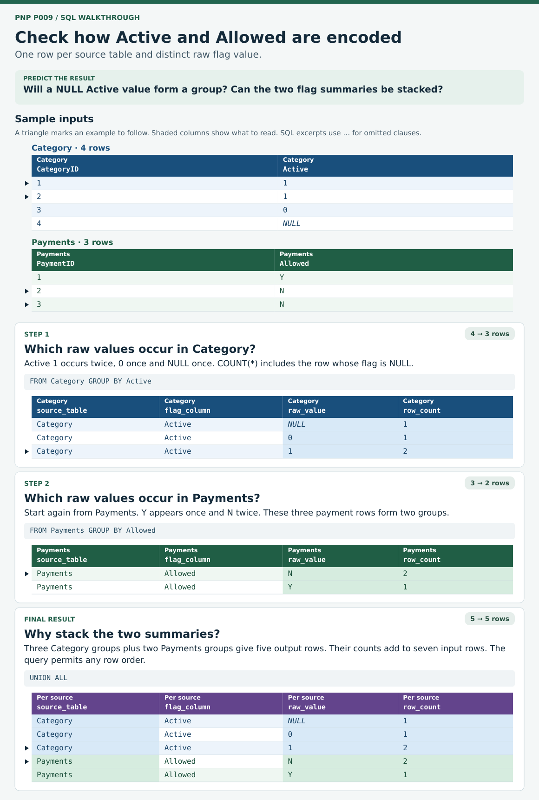

# PNP P009 — Check how Active and Allowed are encoded

**Topic:** SQL Basics  
**Difficulty:** Easy

## Question

**Table colors** · 🟦 `Category` · 🟩 `Payments`

**Business scenario.** The data platform team is publishing shared views that filter on "active categories" and "allowed payment methods". 🟦 `Category.Active` and 🟩 `Payments.Allowed` came in through CSV loads from two systems, and nobody documented the encoding. The team wants to see every stored value first.

**Task.** In one result, list each distinct raw value of `Category.Active` and `Payments.Allowed` with its row count. `NULL` counts as a value.

[PNP source question](../../../2.PNP-%20foundations%20and%20practice/3.%20Sorting%20and%20Grouping/P009.%20Check%20how%20Active%20and%20Allowed%20are%20encoded.md#question-and-image)

### Required output columns

| Column | Meaning | Source |
|---|---|---|
| `source_table` | Name of the table that stores the flag (`Category` or `Payments`). | 🟦 `Category` or 🟩 `Payments` (by row) |
| `flag_column` | Name of the flag being reported (`Active` or `Allowed`). | 🟦 `Category` or 🟩 `Payments` (by row) |
| `raw_value` | Stored flag value as text, or `NULL` when missing. | 🟦 `Category` or 🟩 `Payments` (by row) |
| `row_count` | Number of source rows holding that raw value. | 🟦 `Category` or 🟩 `Payments` (by row) |

### Practice example · Sample input

**🟦 `Category`**

| 🟦 CategoryID | 🟦 Active |
| --- | --- |
| 1 | 1 |
| 2 | 1 |
| 3 | 0 |
| 4 | `NULL` |

**🟩 `Payments`**

| 🟩 PaymentID | 🟩 Allowed |
| --- | --- |
| 1 | Y |
| 2 | N |
| 3 | N |

### Expected output

| source_table | flag_column | raw_value | row_count |
| --- | --- | --- | --- |
| 🟦 Category | Active | `'1'` | 2 |
| 🟦 Category | Active | `'0'` | 1 |
| 🟦 Category | Active | `NULL` | 1 |
| 🟩 Payments | Allowed | `'Y'` | 1 |
| 🟩 Payments | Allowed | `'N'` | 2 |

[View sample inputs and output with colored cells](../../assets/question-samples/p009.svg?raw=1)

### How the sample produces this output

In 🟦 Category, IDs 1 and 2 store the value 1, ID 3 stores 0, and ID 4 has a missing flag. Those three output rows have counts **2, 1 and 1**, accounting for all four categories.

In 🟩 Payments, ID 1 stores Y and IDs 2 and 3 store N. Those two rows have counts **1 and 2**, accounting for all three payments. The source and flag columns identify each set of counts. The known raw values are displayed as text and the missing value stays `NULL`.

## Step 1 · Your approach before writing SQL

1. What does one row of the final output represent?
2. Which table would you put in `FROM`? If you need other tables, which comes second, third, and so on, and why?
3. Would you use a join at any step? For each join you choose, name its type and matching columns and explain why it fits the question.

## Visual walkthrough

Follow the sample rows through each query step. **Predict the result.** Will a NULL Active value form a group? Can the two flag summaries be stacked?



[Open the full-size walkthrough](../../assets/walkthroughs/p009.svg?raw=1)

## Learner solution — SQLite

```sql
SELECT 'Category' AS source_table,
       'Active' AS flag_column, CAST(Active AS TEXT) AS raw_value , count(*) as row_count
from Category
Group by Active

union all

SELECT 'Payments' AS source_table,
       'Allowed' AS flag_column,
CAST(Allowed AS TEXT) AS raw_value , count(*) as row_count
from Payments
group by Allowed
```

Verified the sample, the output column names and text types, and additional cases with two missing payment flags and a flag value shared by both sources. Chat formatting was removed when assembling the submitted SQL.

## Step-by-step walkthrough

**How to start.** What is one output row?

Use the same sample throughout and check the output after each step.

### 1. Summarize Category

**What to do.** Summarize Category.

**Why.** One group represents one Active value, including NULL.

Group by Active and label every group with the table and flag names. Casting the flag as text preserves SQL NULL. COUNT(*) counts all rows in each group, including the missing flag row.

```sql
SELECT 'Category' AS source_table,
       'Active' AS flag_column, CAST(Active AS TEXT) AS raw_value , count(*) as row_count
from Category
Group by Active
```

| source_table | flag_column | raw_value | row_count |
| --- | --- | --- | --- |
| Category | Active | `NULL` | 1 |
| Category | Active | `'0'` | 1 |
| Category | Active | `'1'` | 2 |

### 2. Summarize Payments

**What to do.** Summarize Payments.

**Why.** Apply the same output shape to Allowed.

Apply the same four-column structure to Allowed. Two N flags produce one row with a count of two.

```sql
SELECT 'Payments' AS source_table,
       'Allowed' AS flag_column,
CAST(Allowed AS TEXT) AS raw_value , count(*) as row_count
from Payments
group by Allowed
```

| source_table | flag_column | raw_value | row_count |
| --- | --- | --- | --- |
| Payments | Allowed | `'N'` | 2 |
| Payments | Allowed | `'Y'` | 1 |

### 3. Combine both summaries

**What to do.** Combine both summaries.

**Why.** Appending keeps each source's groups visible.

The first SELECT supplies the four output column names. UNION ALL appends the Payments summary to the Category summary. The table shows the observed SQLite output order.

```sql
SELECT 'Category' AS source_table,
       'Active' AS flag_column, CAST(Active AS TEXT) AS raw_value , count(*) as row_count
from Category
Group by Active

union all

SELECT 'Payments' AS source_table,
       'Allowed' AS flag_column,
CAST(Allowed AS TEXT) AS raw_value , count(*) as row_count
from Payments
group by Allowed
```

| source_table | flag_column | raw_value | row_count |
| --- | --- | --- | --- |
| Category | Active | `NULL` | 1 |
| Category | Active | `'0'` | 1 |
| Category | Active | `'1'` | 2 |
| Payments | Allowed | `'N'` | 2 |
| Payments | Allowed | `'Y'` | 1 |

## Learner solution — SQL Server

```sql
SELECT 'Category' AS source_table,
       'Active' AS flag_column, CAST(Active AS NVARCHAR(MAX)) AS raw_value , count(*) as row_count
from Category
Group by Active

union all

SELECT 'Payments' AS source_table,
       'Allowed' AS flag_column,
CAST(Allowed AS NVARCHAR(MAX)) AS raw_value , count(*) as row_count
from Payments
group by Allowed;
```

The adaptation uses NVARCHAR(MAX) for text and was reviewed by inspection.

## Official solution

[PNP answer key, Q9](https://github.com/MulikShrikantDattatray14/Data-Engineering-Mastry/blob/main/1.%20SQL%20Mastery/1.%20SQL%20Mastry/2.PNP-%20foundations%20and%20practice/Source%20Materials/PrepNPlaced_SQL_100_v2/sql/all_100_solutions.sql)

```sql
SELECT 'Category'                  AS source_table,
       'Active'                    AS flag_column,
       CAST(cat.Active AS VARCHAR) AS raw_value,
       COUNT(*)                    AS row_count
FROM Category AS cat
GROUP BY CAST(cat.Active AS VARCHAR)
UNION ALL
SELECT 'Payments',
       'Allowed',
       CAST(pay.Allowed AS VARCHAR),
       COUNT(*)
FROM Payments AS pay
GROUP BY CAST(pay.Allowed AS VARCHAR)
ORDER BY source_table, raw_value NULLS LAST;
```

The answer key groups by the cast text and adds an explicit sort. The learner groups by the stored flag, then casts it for display. Both give the same groups on the sample.

### Official answer — SQLite adaptation

```sql
SELECT 'Category'                  AS source_table,
       'Active'                    AS flag_column,
       CAST(cat.Active AS TEXT) AS raw_value,
       COUNT(*)                    AS row_count
FROM Category AS cat
GROUP BY CAST(cat.Active AS TEXT)
UNION ALL
SELECT 'Payments',
       'Allowed',
       CAST(pay.Allowed AS TEXT),
       COUNT(*)
FROM Payments AS pay
GROUP BY CAST(pay.Allowed AS TEXT)
ORDER BY source_table, raw_value NULLS LAST;
```

### Official answer — SQL Server adaptation

```sql
WITH flag_counts AS (
    SELECT 'Category'                  AS source_table,
           'Active'                    AS flag_column,
           CAST(cat.Active AS NVARCHAR(MAX)) AS raw_value,
           COUNT(*)                    AS row_count
    FROM Category AS cat
    GROUP BY CAST(cat.Active AS NVARCHAR(MAX))
    UNION ALL
    SELECT 'Payments',
           'Allowed',
           CAST(pay.Allowed AS NVARCHAR(MAX)),
           COUNT(*)
    FROM Payments AS pay
    GROUP BY CAST(pay.Allowed AS NVARCHAR(MAX))
)
SELECT source_table, flag_column, raw_value, row_count
FROM flag_counts
ORDER BY source_table, CASE WHEN raw_value IS NULL THEN 1 ELSE 0 END, raw_value;
```

The SQL Server outer sort keeps a missing flag after the nonmissing flags within each source.

SQLite adaptation executed on representative fixtures. SQL Server adaptation reviewed by inspection.
