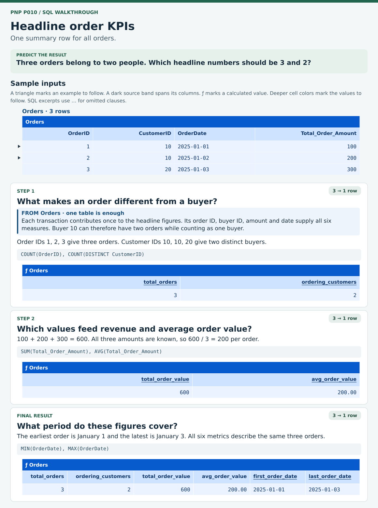

# PNP P010 — Headline order KPIs

**Topic:** SQL Basics  
**Difficulty:** Easy

## Question

**Table colors** · 🟦 `Orders`

**Business scenario.** Leadership opens every monthly review with one strip of numbers: how many orders, how many customers ordered, total order value, average order value (AOV), and the date range the data covers. Cancellations and refunds are not recorded here, so every row in 🟦 `Orders` counts as a placed order.

**Task.** Return one row with the headline numbers for the whole `Orders` table. AOV is the average `Total_Order_Amount` per order, rounded to two decimals.

[PNP source question](../../../2.PNP-%20foundations%20and%20practice/4.%20Aggregation/P010.%20Headline%20order%20KPIs.md#question-and-image)

### Required output columns

| Column | Meaning | Source |
|---|---|---|
| `total_orders` | Number of placed orders. | 🟦 `Orders` |
| `ordering_customers` | Number of distinct customers who placed an order. | 🟦 `Orders` |
| `total_order_value` | Total value of all orders. | 🟦 `Orders` |
| `avg_order_value` | Average order amount, rounded to two decimals. | 🟦 `Orders` |
| `first_order_date` | Earliest order date. | 🟦 `Orders` |
| `last_order_date` | Latest order date. | 🟦 `Orders` |

### Practice example · Sample input

**🟦 `Orders`**

| 🟦 OrderID | 🟦 CustomerID | 🟦 OrderDate | 🟦 Total_Order_Amount |
| ---: | ---: | --- | ---: |
| 1 | 10 | 2025-01-01 | 100 |
| 2 | 10 | 2025-01-02 | 200 |
| 3 | 20 | 2025-01-03 | 300 |

### Expected output

| 🟦 total_orders | 🟦 ordering_customers | 🟦 total_order_value | 🟦 avg_order_value | 🟦 first_order_date | 🟦 last_order_date |
| ---: | ---: | ---: | ---: | --- | --- |
| 3 | 2 | 600 | 200.00 | 2025-01-01 | 2025-01-03 |

[View sample inputs and output with colored cells](../../assets/question-samples/p010.svg?raw=1)

### How the sample produces this output

🟦 Orders 1 and 2 belong to customer 10. Order 3 belongs to customer 20. That gives **3 orders** and **2 distinct ordering customers**.

🟦 The three known amounts total `100 + 200 + 300 = 600`, giving an average of `600 / 3 = 200.00`. January 1 is the earliest order date and January 3 is the latest. All six values describe the same set of orders in a single row.

## Step 1 · Your approach before writing SQL

1. What does one row of the final output represent?
2. Which table would you put in `FROM`? If you need other tables, which comes second, third, and so on, and why?
3. Would you use a join at any step? For each join you choose, name its type and matching columns and explain why it fits the question.

## Visual walkthrough

Follow the sample rows through each query step. **Predict the result.** Three orders belong to two people. Which headline numbers should be 3 and 2?



[Open the full-size walkthrough](../../assets/walkthroughs/p010.svg?raw=1)

## Step-by-step walkthrough

🟦 **FROM Orders · one table is enough** · Each transaction contributes once to the headline figures. Its order ID, buyer ID, amount and date supply all six measures. Buyer 10 can therefore have two orders while counting as one buyer.

**How to start.** Is this one row per customer or one for the entire table?

Use the same sample throughout and check the output after each step.

### 1. Count orders and distinct customers

**What to do.** Count orders and distinct customers.

**Why.** Order volume and customer reach count different things.

```sql
SELECT COUNT(OrderID) AS total_orders,
       COUNT(DISTINCT CustomerID) AS ordering_customers
FROM Orders;
```

| total_orders | ordering_customers |
| ---: | ---: |
| 3 | 2 |

Customer 10 placed two orders and counts once as a customer. The learner's order count assumes OrderID is non-NULL, as with a primary key.

### 2. Compute order value metrics

**What to do.** Compute order value metrics.

**Why.** The sum and average use each order amount.

```sql
SELECT SUM(Total_Order_Amount) AS total_order_value,
       ROUND(AVG(Total_Order_Amount), 2) AS avg_order_value
FROM Orders;
```

| total_order_value | avg_order_value |
| ---: | ---: |
| 600 | 200.00 |

All three order amounts contribute to the sum and average.

### 3. Add the first and last dates

**What to do.** Add the first and last dates.

**Why.** The date bounds must describe the entire set of orders.

MIN and MAX find the earliest and latest ISO-formatted dates in this sample. All six aggregates operate on the whole table and produce one row.

```sql
SELECT COUNT(OrderID) AS total_orders,
       COUNT(DISTINCT CustomerID) AS ordering_customers,
       SUM(Total_Order_Amount) AS total_order_value,
       ROUND(AVG(Total_Order_Amount), 2) AS avg_order_value,
       MIN(OrderDate) AS first_order_date,
       MAX(OrderDate) AS last_order_date
FROM Orders;
```

| total_orders | ordering_customers | total_order_value | avg_order_value | first_order_date | last_order_date |
| ---: | ---: | ---: | ---: | --- | --- |
| 3 | 2 | 600 | 200.00 | 2025-01-01 | 2025-01-03 |

## Learner solution — SQLite

```sql
SELECT COUNT(OrderID) AS total_orders,
       COUNT(DISTINCT CustomerID) AS ordering_customers,
       SUM(Total_Order_Amount) AS total_order_value,
       ROUND(AVG(Total_Order_Amount), 2) AS avg_order_value,
       MIN(OrderDate) AS first_order_date,
       MAX(OrderDate) AS last_order_date
FROM Orders;
```

| total_orders | ordering_customers | total_order_value | avg_order_value | first_order_date | last_order_date |
| ---: | ---: | ---: | ---: | --- | --- |
| 3 | 2 | 600 | 200.00 | 2025-01-01 | 2025-01-03 |

Verified in SQLite with the sample and an additional order that makes the average 175.25. The submitted query's chat formatting and extra comma were cleaned up. SQLite may display 200.00 as 200.0.

## Learner solution — SQL Server

```sql
SELECT COUNT(OrderID) AS total_orders,
       COUNT(DISTINCT CustomerID) AS ordering_customers,
       SUM(Total_Order_Amount) AS total_order_value,
       ROUND(AVG(CAST(Total_Order_Amount AS DECIMAL(28, 6))), 2) AS avg_order_value,
       MIN(OrderDate) AS first_order_date,
       MAX(OrderDate) AS last_order_date
FROM Orders;
```

The adaptation casts the amount to a decimal before AVG to preserve fractions when the input type is an integer. Reviewed by inspection.

## Official solution

[PNP answer key, Q10](https://github.com/MulikShrikantDattatray14/Data-Engineering-Mastry/blob/main/1.%20SQL%20Mastery/1.%20SQL%20Mastry/2.PNP-%20foundations%20and%20practice/Source%20Materials/PrepNPlaced_SQL_100_v2/sql/all_100_solutions.sql)

```sql
SELECT COUNT(*)                            AS total_orders,
       COUNT(DISTINCT o.CustomerID)        AS ordering_customers,
       SUM(o.Total_Order_Amount)           AS total_order_value,
       ROUND(AVG(o.Total_Order_Amount), 2) AS avg_order_value,
       MIN(o.OrderDate)                    AS first_order_date,
       MAX(o.OrderDate)                    AS last_order_date
FROM Orders AS o;
```

The answer key uses COUNT(*) because the exercise counts every row as a placed order.

### Official answer — SQLite adaptation

```sql
SELECT COUNT(*)                            AS total_orders,
       COUNT(DISTINCT o.CustomerID)        AS ordering_customers,
       SUM(o.Total_Order_Amount)           AS total_order_value,
       ROUND(AVG(o.Total_Order_Amount), 2) AS avg_order_value,
       MIN(o.OrderDate)                    AS first_order_date,
       MAX(o.OrderDate)                    AS last_order_date
FROM Orders AS o;
```

### Official answer — SQL Server adaptation

```sql
SELECT COUNT(*)                            AS total_orders,
       COUNT(DISTINCT o.CustomerID)        AS ordering_customers,
       SUM(o.Total_Order_Amount)           AS total_order_value,
       ROUND(AVG(CAST(o.Total_Order_Amount AS DECIMAL(28, 6))), 2) AS avg_order_value,
       MIN(o.OrderDate)                    AS first_order_date,
       MAX(o.OrderDate)                    AS last_order_date
FROM Orders AS o;
```

SQLite adaptation executed on representative fixtures. SQL Server adaptation reviewed by inspection.
