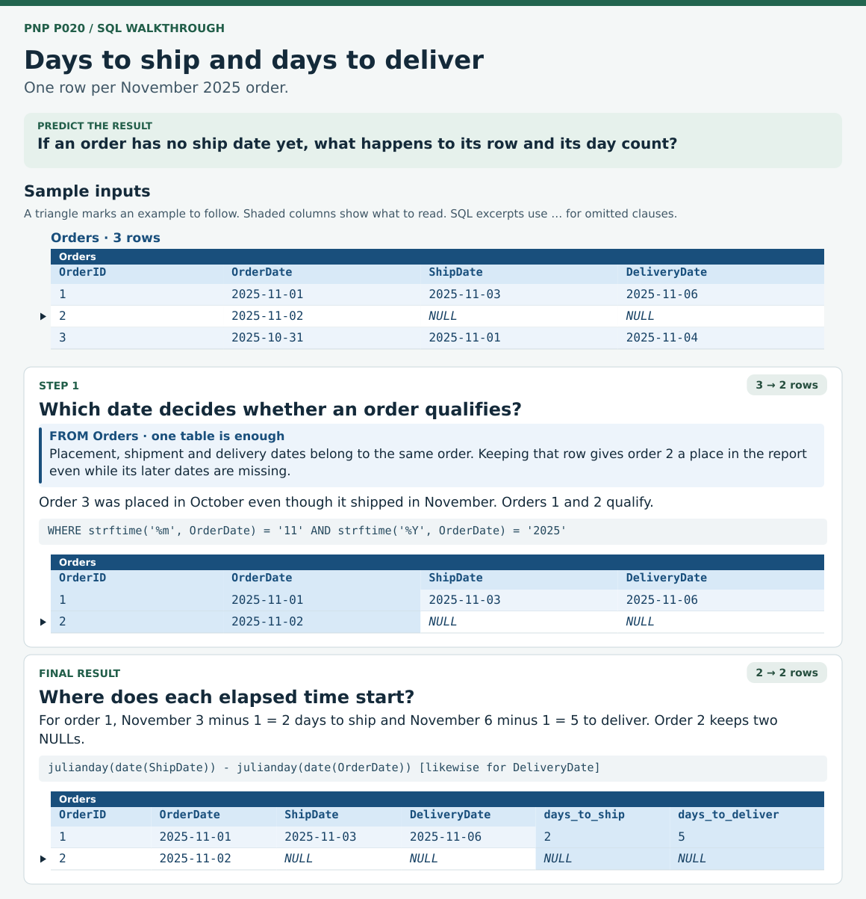

# PNP P020 — Days to ship and days to deliver

**Topic:** Dates  
**Difficulty:** Easy

## Question

**Table colors** · 🟦 `Orders`

**Business scenario.** The logistics team is reviewing November 2025 order by order. For each order they want two numbers: how many days the warehouse took to hand it to the courier, and how many days the customer waited from placing the order to receiving it.

**Task.** For every order placed in November 2025, return the three dates plus 🟦 `days_to_ship` (order to ship) and `days_to_deliver` (order to delivery) in whole days. Missing dates must give `NULL`, not a made-up number. Sort by `OrderDate`, then `OrderID`.

[PNP source question](../../../2.PNP-%20foundations%20and%20practice/12.%20Dates%20and%20Time/P020.%20Days%20to%20ship%20and%20days%20to%20deliver.md#question-and-image)

### Required output columns

| Column | Meaning | Source |
|---|---|---|
| `OrderID` | Order identifier. | 🟦 `Orders` |
| `OrderDate` | Date the order was placed. | 🟦 `Orders` |
| `ShipDate` | Date the order shipped. | 🟦 `Orders` |
| `DeliveryDate` | Date the order was delivered. | 🟦 `Orders` |
| `days_to_ship` | Whole days from order date to ship date. | 🟦 `Orders` |
| `days_to_deliver` | Whole days from order date to delivery date. | 🟦 `Orders` |

### Practice example · Sample input

**🟦 `Orders`**

| 🟦 OrderID | 🟦 OrderDate | 🟦 ShipDate | 🟦 DeliveryDate |
|---:|---|---|---|
| 1 | 2025-11-01 | 2025-11-03 | 2025-11-06 |
| 2 | 2025-11-02 | `NULL` | `NULL` |
| 3 | 2025-10-31 | 2025-11-01 | 2025-11-04 |

### Expected output

| 🟦 OrderID | 🟦 OrderDate | 🟦 ShipDate | 🟦 DeliveryDate | 🟦 days_to_ship | 🟦 days_to_deliver |
|---:|---|---|---|---:|---:|
| 1 | 2025-11-01 | 2025-11-03 | 2025-11-06 | 2 | 5 |
| 2 | 2025-11-02 | `NULL` | `NULL` | `NULL` | `NULL` |

[View sample inputs and output with colored cells](../../assets/question-samples/p020.svg?raw=1)

### How the sample produces this output

🟦 Order 1 was placed on November 1. It shipped on November 3 and arrived on November 6, so the elapsed times from the order date are **2 days** and **5 days**.

🟦 Order 2 was placed on November 2 and qualifies for the report, but its ship and delivery dates are both missing. Its two elapsed times stay `NULL`. Order 3 was placed in October, even though it shipped in November, so it falls outside the report.

## Step 1 · Your approach before writing SQL

1. What does one row of the final output represent?
2. Which table would you put in `FROM`? If you need other tables, which comes second, third, and so on, and why?
3. Would you use a join at any step? For each join you choose, name its type and matching columns and explain why it fits the question.

## Visual walkthrough

[Open the Previous / Next walkthrough](../../assets/steps/PNP-P020/01.md)

Follow the sample rows through each query step. **Predict the result.** If an order has no ship date yet, what happens to its row and its day count?



[Open the full-size walkthrough](../../assets/walkthroughs/p020.svg?raw=1)

## Learner submission — SQLite

```sql
SELECT OrderID, OrderDate, ShipDate, DeliveryDate,
       CAST(julianday(date(ShipDate)) - julianday(date(OrderDate)) AS INTEGER) AS days_to_ship,
       CAST(julianday(date(DeliveryDate)) - julianday(date(OrderDate)) AS INTEGER) AS days_to_deliver
FROM Orders
WHERE strftime("%m", OrderDate) = '11' AND strftime("%Y", OrderDate) = '2025'
ORDER BY OrderDate ASC, `OrderID` ASC;
```

Guided submission. Chat formatting was cleaned up. The tested SQLite configuration accepts the double-quoted format strings. Single quotes are the standard spelling.

## Step-by-step walkthrough

🟦 **FROM Orders · one table is enough** · Placement, shipment and delivery dates belong to the same order. Keeping that row gives order 2 a place in the report even while its later dates are missing.

One final row represents one order. All output fields come from Orders.

### 1. Keep November 2025 orders

**What to do.** Match both the month and year of OrderDate.

**Why.** The reporting period depends on when the order was placed. Order 3 was shipped in November but placed in October. Order 2 stays even though it has no shipping or delivery date.

```sql
SELECT OrderID, OrderDate, ShipDate, DeliveryDate
FROM Orders
WHERE strftime("%m", OrderDate) = '11' AND strftime("%Y", OrderDate) = '2025'
ORDER BY OrderDate ASC, `OrderID` ASC;
```

| OrderID | OrderDate | ShipDate | DeliveryDate |
|---:|---|---|---|
| 1 | 2025-11-01 | 2025-11-03 | 2025-11-06 |
| 2 | 2025-11-02 | `NULL` | `NULL` |

### 2. Calculate the calendar-day differences and sort

**What to do.** Convert the dates to numeric day values, subtract the order day from each later day, and return integers. Sort by order date, then order ID.

**Why.** Subtracting raw date strings in SQLite can subtract just their leading years. The inner date calls discard time, so crossing midnight counts as one calendar day. Each missing date affects only its own metric. The ID breaks order-date ties.

```sql
SELECT OrderID, OrderDate, ShipDate, DeliveryDate,
       CAST(julianday(date(ShipDate)) - julianday(date(OrderDate)) AS INTEGER) AS days_to_ship,
       CAST(julianday(date(DeliveryDate)) - julianday(date(OrderDate)) AS INTEGER) AS days_to_deliver
FROM Orders
WHERE strftime("%m", OrderDate) = '11' AND strftime("%Y", OrderDate) = '2025'
ORDER BY OrderDate ASC, `OrderID` ASC;
```

| OrderID | OrderDate | ShipDate | DeliveryDate | days_to_ship | days_to_deliver |
|---:|---|---|---|---:|---:|
| 1 | 2025-11-01 | 2025-11-03 | 2025-11-06 | 2 | 5 |
| 2 | 2025-11-02 | `NULL` | `NULL` | `NULL` | `NULL` |

SQLite checks covered the sample, each missing date independently, late November orders, a midnight crossing, orders outside the month or year, and ties.

## Learner submission — SQL Server adaptation

```sql
SELECT OrderID, OrderDate, ShipDate, DeliveryDate,
       DATEDIFF(day, OrderDate, ShipDate) AS days_to_ship,
       DATEDIFF(day, OrderDate, DeliveryDate) AS days_to_deliver
FROM Orders
WHERE MONTH(OrderDate) = 11 AND YEAR(OrderDate) = 2025
ORDER BY OrderDate ASC, OrderID ASC;
```

Uses DATEDIFF with day boundaries and the equivalent year and month checks. Reviewed by inspection.

## Official solution

[PNP answer key, Q20](https://github.com/MulikShrikantDattatray14/Data-Engineering-Mastry/blob/main/1.%20SQL%20Mastery/1.%20SQL%20Mastry/2.PNP-%20foundations%20and%20practice/Source%20Materials/PrepNPlaced_SQL_100_v2/sql/all_100_solutions.sql)

```sql
SELECT o.OrderID,
       o.OrderDate,
       o.ShipDate,
       o.DeliveryDate,
       o.ShipDate::date     - o.OrderDate::date AS days_to_ship,
       o.DeliveryDate::date - o.OrderDate::date AS days_to_deliver
FROM Orders AS o
WHERE o.OrderDate >= DATE '2025-11-01'
  AND o.OrderDate <  DATE '2025-12-01'
ORDER BY o.OrderDate, o.OrderID;
```

### Official answer — SQLite adaptation

```sql
SELECT o.OrderID,
       o.OrderDate,
       o.ShipDate,
       o.DeliveryDate,
       CAST(julianday(date(o.ShipDate)) - julianday(date(o.OrderDate)) AS INTEGER) AS days_to_ship,
       CAST(julianday(date(o.DeliveryDate)) - julianday(date(o.OrderDate)) AS INTEGER) AS days_to_deliver
FROM Orders AS o
WHERE o.OrderDate >= '2025-11-01'
  AND o.OrderDate <  '2025-12-01'
ORDER BY o.OrderDate, o.OrderID;
```

### Official answer — SQL Server adaptation

```sql
SELECT o.OrderID,
       o.OrderDate,
       o.ShipDate,
       o.DeliveryDate,
       DATEDIFF(day, o.OrderDate, o.ShipDate) AS days_to_ship,
       DATEDIFF(day, o.OrderDate, o.DeliveryDate) AS days_to_deliver
FROM Orders AS o
WHERE o.OrderDate >= DATEFROMPARTS(2025, 11, 1)
  AND o.OrderDate <  DATEFROMPARTS(2025, 12, 1)
ORDER BY o.OrderDate, o.OrderID;
```

The official answer uses an inclusive November 1 lower bound and an exclusive December 1 upper bound. The SQLite adaptation was checked against the learner query on the sample and a boundary fixture. The SQL Server versions were reviewed by inspection.
