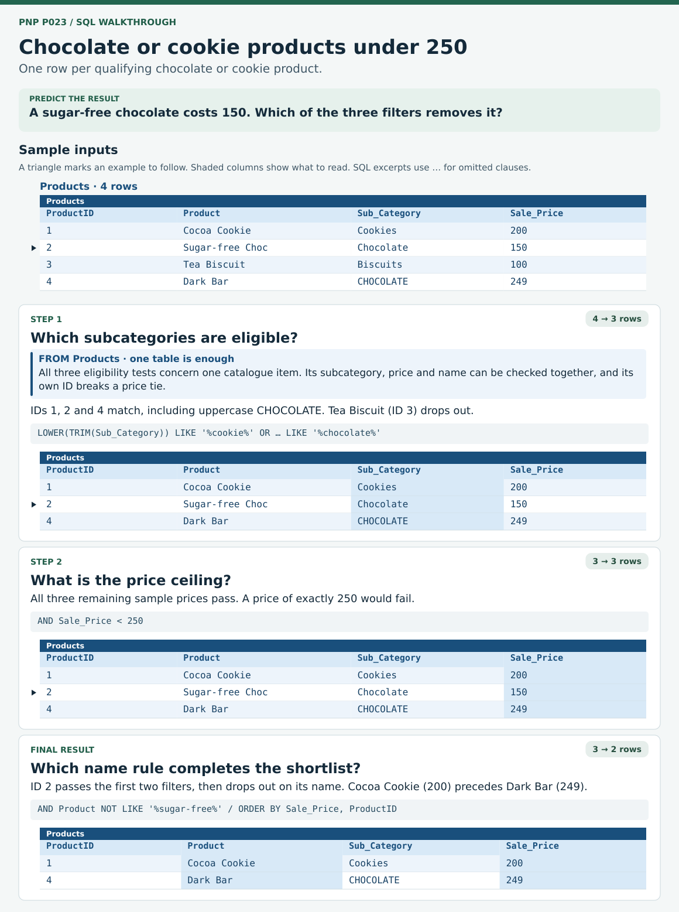

# PNP P023 — Chocolate or cookie products under 250, excluding sugar-free

**Topic:** SQL Basics  
**Difficulty:** Easy

## Question

**Table colors** · 🟦 `Products`

**Business scenario.** Merchandising is building a "Sweet treats under 250" banner for Diwali. It should show products from the chocolate and cookie sub-categories priced below 250. Sugar-free products are going into a separate wellness banner, so they must be left out of this one.

**Task.** Return products whose 🟦 `Sub_Category` contains "chocolate" or "cookie" (any case), whose `Sale_Price` is below 250, and whose name does not mark them as sugar-free. Sort by `Sale_Price`, then `ProductID`.

[PNP source question](../../../2.PNP-%20foundations%20and%20practice/8.%20Advance%20string%20functions%2C%20regex%20and%20clause/P023.%20Chocolate%20or%20cookie%20products%20under%20250%2C%20excluding%20sugar-free.md#question-and-image)

### Required output columns

One output row represents one qualifying chocolate or cookie product priced below 250, excluding sugar-free products.

| Output column | Source or calculation | Meaning and applicable rules | Example value |
| --- | --- | --- | --- |
| `ProductID` | 🟦 `Products.ProductID` | Product identifier. | 1 |
| `Product` | 🟦 `Products.Product` | Product name. | Cocoa Cookie |
| `Sub_Category` | 🟦 `Products.Sub_Category` | Product subcategory as stored. | Cookies |
| `Sale_Price` | 🟦 `Products.Sale_Price` | Current sale price. | 200 |

### Practice example · Sample input

**🟦 `Products`**

| 🟦 ProductID | 🟦 Product | 🟦 Sub_Category | 🟦 Sale_Price |
|---:|---|---|---:|
| 1 | Cocoa Cookie | Cookies | 200 |
| 2 | Sugar-free Choc | Chocolate | 150 |
| 3 | Tea Biscuit | Biscuits | 100 |
| 4 | Dark Bar | CHOCOLATE | 249 |

### Expected output

| 🟦 ProductID | 🟦 Product | 🟦 Sub_Category | 🟦 Sale_Price |
|---:|---|---|---:|
| 1 | Cocoa Cookie | Cookies | 200 |
| 4 | Dark Bar | CHOCOLATE | 249 |

[View sample inputs and output with colored cells](../../assets/question-samples/p023.svg?raw=1)

### How the sample produces this output

🟦 Cocoa Cookie (ID 1) belongs to Cookies and costs **200**. Dark Bar (ID 4) belongs to CHOCOLATE and costs **249**. Both qualify and the lower price puts Cocoa Cookie first.

🟦 Sugar-free Choc costs 150 and belongs to Chocolate, but its name identifies it as sugar-free. Tea Biscuit costs 100 and belongs to Biscuits, outside both requested subcategories.

## Step 1 · Your approach before writing SQL

1. What does one row of the final output represent?
2. Which table would you put in `FROM`? If you need other tables, which comes second, third, and so on, and why?
3. Would you use a join at any step? For each join you choose, name its type and matching columns and explain why it fits the question.

## Visual walkthrough

[Open the Previous / Next walkthrough](../../assets/steps/PNP-P023/01.md)

Follow the sample rows through each query step. **Predict the result.** A sugar-free chocolate costs 150. Which of the three filters removes it?



[Open the full-size walkthrough](../../assets/walkthroughs/p023.svg?raw=1)

## Learner submission — SQLite

```sql
select `ProductID`,Product,Sub_Category,Sale_Price
from Products
where ( trim(lower(Sub_Category)) like "%cookie%" or  trim(lower(Sub_Category)) like "%chocolate%")  and `Sale_Price` < 250 and `Product` not like "%sugar-free%"
order by `Sale_Price` asc, `ProductID` asc
```

Guided submission. Chat formatting was cleaned up. SQLite accepted the double-quoted patterns in the tested configuration. Single quotes are standard for string literals. The submitted sugar-free match uses SQLite's default case-insensitive ASCII LIKE behavior.

## Step-by-step walkthrough

🟦 **FROM Products · one table is enough** · All three eligibility tests concern one catalogue item. Its subcategory, price and name can be checked together, and its own ID breaks a price tie.

One row represents one qualifying product. All data comes from Products.

### 1. Find the two eligible subcategories

**What to do.** Normalize case, use LIKE for each substring, and group the alternatives with parentheses.

**Why.** Percent signs are wildcards in LIKE. The substring cookie also matches Cookies, and chocolate matches longer labels such as Dark Chocolate. Tea Biscuit drops out.

```sql
select `ProductID`,Product,Sub_Category,Sale_Price
from Products
where ( trim(lower(Sub_Category)) like "%cookie%" or  trim(lower(Sub_Category)) like "%chocolate%")
order by ProductID;
```

| ProductID | Product | Sub_Category | Sale_Price |
|---:|---|---|---:|
| 1 | Cocoa Cookie | Cookies | 200 |
| 2 | Sugar-free Choc | Chocolate | 150 |
| 4 | Dark Bar | CHOCOLATE | 249 |

### 2. Apply the price boundary

**What to do.** Require a price strictly below 250 for both subcategory alternatives.

**Why.** AND applies the price test to the entire parenthesized OR. All three remaining sample rows pass this check. A chocolate item priced exactly 250 fails.

```sql
select `ProductID`,Product,Sub_Category,Sale_Price
from Products
where ( trim(lower(Sub_Category)) like "%cookie%" or  trim(lower(Sub_Category)) like "%chocolate%")  and `Sale_Price` < 250
order by ProductID;
```

| ProductID | Product | Sub_Category | Sale_Price |
|---:|---|---|---:|
| 1 | Cocoa Cookie | Cookies | 200 |
| 2 | Sugar-free Choc | Chocolate | 150 |
| 4 | Dark Bar | CHOCOLATE | 249 |

### 3. Exclude sugar-free names and sort

**What to do.** Add the product name filter and order by price, then ID.

**Why.** Sugar-free Choc passes the category and price checks and must still be excluded. The product ID settles a price tie.

```sql
select `ProductID`,Product,Sub_Category,Sale_Price
from Products
where ( trim(lower(Sub_Category)) like "%cookie%" or  trim(lower(Sub_Category)) like "%chocolate%")  and `Sale_Price` < 250 and `Product` not like "%sugar-free%"
order by `Sale_Price` asc, `ProductID` asc
```

| ProductID | Product | Sub_Category | Sale_Price |
|---:|---|---|---:|
| 1 | Cocoa Cookie | Cookies | 200 |
| 4 | Dark Bar | CHOCOLATE | 249 |

Verified in SQLite with the sample and additional rows for a singular Cookie label, mixed case, a price of 250, and tied prices.

## Learner submission — SQL Server adaptation

```sql
select ProductID,Product,Sub_Category,Sale_Price
from Products
where ( trim(lower(Sub_Category)) like '%cookie%' or  trim(lower(Sub_Category)) like '%chocolate%')  and Sale_Price < 250 and LOWER(Product) not like '%sugar-free%'
order by Sale_Price asc, ProductID asc;
```

Uses single quotes and explicitly lowers the product name to preserve case-insensitive matching for the hyphenated marker. Reviewed by inspection.

## Official solution

[PNP answer key, Q23](https://github.com/MulikShrikantDattatray14/Data-Engineering-Mastry/blob/main/1.%20SQL%20Mastery/1.%20SQL%20Mastry/2.PNP-%20foundations%20and%20practice/Source%20Materials/PrepNPlaced_SQL_100_v2/sql/all_100_solutions.sql)

```sql
SELECT p.ProductID,
       p.Product,
       p.Sub_Category,
       p.Sale_Price
FROM Products AS p
WHERE (p.Sub_Category ILIKE '%chocolate%' OR p.Sub_Category ILIKE '%cookie%')
  AND p.Sale_Price < 250
  AND p.Product NOT ILIKE '%sugar%free%'
ORDER BY p.Sale_Price, p.ProductID;
```

### Official answer — SQLite adaptation

```sql
SELECT p.ProductID,
       p.Product,
       p.Sub_Category,
       p.Sale_Price
FROM Products AS p
WHERE (LOWER(p.Sub_Category) LIKE '%chocolate%' OR LOWER(p.Sub_Category) LIKE '%cookie%')
  AND p.Sale_Price < 250
  AND LOWER(p.Product) NOT LIKE '%sugar%free%'
ORDER BY p.Sale_Price, p.ProductID;
```

### Official answer — SQL Server adaptation

```sql
SELECT p.ProductID,
       p.Product,
       p.Sub_Category,
       p.Sale_Price
FROM Products AS p
WHERE (LOWER(p.Sub_Category) LIKE '%chocolate%' OR LOWER(p.Sub_Category) LIKE '%cookie%')
  AND p.Sale_Price < 250
  AND LOWER(p.Product) NOT LIKE '%sugar%free%'
ORDER BY p.Sale_Price, p.ProductID;
```

The official answer's broader pattern also excludes `Sugar free bar` without the hyphen. The learner pattern excludes the literal hyphenated marker. Both versions match the supplied sample. The SQLite variants were checked on the unhyphenated example. The SQL Server variants were reviewed by inspection.
