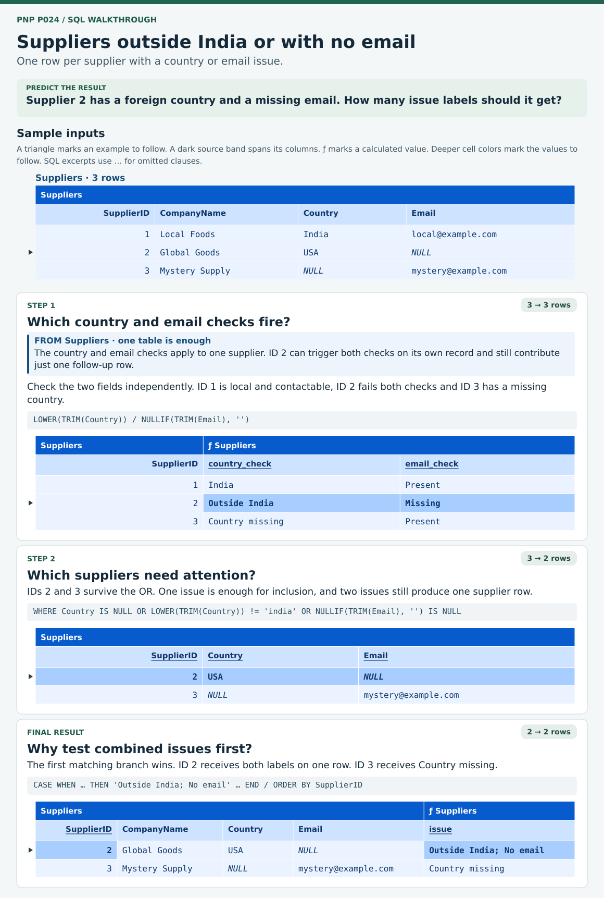

# P024 · Suppliers outside India or with no email

**Topic** SQL Basics  
**Difficulty** 

## Question

**Table colors** · 🟦 `Suppliers`

**Business scenario.** Procurement compliance runs a supplier review each quarter. 🟦 `Suppliers` outside India need import paperwork on file, and suppliers with no email cannot receive purchase orders from the new e-procurement system. A supplier with no country recorded is also a problem, because nobody can confirm it is domestic.

**Task.** Return every supplier whose country is not India, whose country is missing, or whose email is missing or blank. Add an `issue` column naming every problem found. Sort by `SupplierID`.

[PNP source question](../../../2.PNP-%20foundations%20and%20practice/11.%20NULL%20Logic/P024.%20Suppliers%20outside%20India%20or%20with%20no%20email.md#question-and-image)

### Required output columns

One output row represents one supplier outside India or with missing country or email information.

| Output column | Source or calculation | Meaning and applicable rules | Example value |
| --- | --- | --- | --- |
| `SupplierID` | 🟦 `Suppliers.SupplierID` | Supplier identifier. | 2 |
| `CompanyName` | 🟦 `Suppliers.CompanyName` | Supplier’s company name. | Global Goods |
| `Country` | 🟦 `Suppliers.Country` | Supplier country as stored. | USA |
| `Email` | 🟦 `Suppliers.Email` | Email address as stored. | NULL |
| `issue` | 🟦 `Suppliers` | Every applicable label among `Outside India`, `Country missing` and `No email`. A semicolon separates two labels. | Outside India; No email |

### Practice example · Sample input

**🟦 `Suppliers`**

| 🟦 SupplierID | 🟦 CompanyName | 🟦 Country | 🟦 Email |
|---:|---|---|---|
| 🟦 1 | 🟦 Local Foods | 🟦 India | 🟦 local@example.com |
| 🟦 2 | 🟦 Global Goods | 🟦 USA | 🟦 NULL |
| 🟦 3 | 🟦 Mystery Supply | 🟦 NULL | 🟦 mystery@example.com |

### Expected output

| 🟦 SupplierID | 🟦 CompanyName | 🟦 Country | 🟦 Email | 🟦 issue |
|---:|---|---|---|---|
| 🟦 2 | 🟦 Global Goods | 🟦 USA | 🟦 NULL | 🟦 Outside India; No email |
| 🟦 3 | 🟦 Mystery Supply | 🟦 NULL | 🟦 mystery@example.com | 🟦 Country missing |

[View sample inputs and output with colored cells](../../assets/question-samples/p024.svg?raw=1)

### How the sample produces this output

🟦 Global Goods (ID 🟦 2) lists **🟦 USA** and has no email. Both issues belong to the same supplier, so its single row reads `🟦 Outside 🟦 India; No email`. 🟦 Mystery Supply (ID 🟦 3) has an email but no country on file and receives `🟦 Country missing`.

🟦 Local Foods (ID 🟦 1) lists 🟦 India and a usable email, so it has no issue to report. IDs 🟦 2 and 🟦 3 appear in ascending order with their stored contact values.

## Step 1 · Your approach before writing SQL

1. What does one row of the final output represent?
2. Which table would you put in `FROM`? If you need other tables, which comes second, third, and so on, and why?
3. Would you use a join at any step? For each join you choose, name its type and matching columns and explain why it fits the question.

## My final solution · SQLite

```sql
SELECT SupplierID, CompanyName, Country, Email,
    CASE
        WHEN Country IS NULL
             AND (TRIM(Email) IS NULL OR LENGTH(TRIM(Email)) = 0)
            THEN 'Country missing; No email'
        WHEN TRIM(LOWER(Country)) != 'india'
             AND (TRIM(Email) IS NULL OR LENGTH(TRIM(Email)) = 0)
            THEN 'Outside India; No email'
        WHEN Country IS NULL THEN 'Country missing'
        WHEN TRIM(LOWER(Country)) != 'india' THEN 'Outside India'
        WHEN TRIM(Email) IS NULL OR LENGTH(TRIM(Email)) = 0 THEN 'No email'
    END AS issue
FROM Suppliers
WHERE Country IS NULL
   OR TRIM(LOWER(Country)) != 'india'
   OR TRIM(Email) IS NULL
   OR LENGTH(TRIM(Email)) = 0
ORDER BY SupplierID ASC;
```

<details>
<summary>Notes from the saved attempt</summary>

The saved attempt compares countries without surrounding spaces or case differences, and treats a blank or spaces-only email as missing. It preserves the original displayed values and puts the country issue first when both labels apply.

</details>

## Visual walkthrough

[Open the Previous / Next walkthrough](../../assets/steps/PNP-P024/01.md)

Follow the sample rows through each query step. **Predict the result.** Supplier 2 has a foreign country and a missing email. How many issue labels should it get?



[Open the full-size walkthrough](../../assets/walkthroughs/p024.svg?raw=1)

## Step-by-step walkthrough

🟦 **FROM Suppliers · one table is enough** · The country and email checks apply to one supplier. ID 2 can trigger both checks on its own record and still contribute just one follow-up row.

### 1. Decide what one output row represents

Read one row per supplier from `Suppliers`. Select the four original fields so any spaces or casing in the stored data remain visible. At this point the sample shows suppliers 1, 2, and 3.

### 2. Keep suppliers with any issue

Add the `WHERE` conditions. Check `Country IS NULL` explicitly because a comparison with a NULL country evaluates to unknown. Trim the country and lowercase it for comparison with `'india'`. Trim the email so a string of spaces becomes empty. Use `OR` because any issue qualifies the supplier.

| SupplierID | Country check | Email check | Result |
|---:|---|---|---|
| 1 | India | Present | Excluded |
| 2 | Outside India | Missing | Kept |
| 3 | Country missing | Present | Kept |

### 3. Build the issue text

Add `CASE` to the select list. SQLite returns the first matching branch, so check the two-issue combinations first. Supplier 2 reaches the second branch and gets both labels. Supplier 3 reaches the single missing-country branch and gets one label.

| SupplierID | Matching branch | issue |
|---:|---|---|
| 2 | Outside India and missing email | Outside India; No email |
| 3 | Missing country | Country missing |

### 4. Sort and check the edge cases

Add `ORDER BY SupplierID ASC` to guarantee the sample order of 2, then 3. The SQLite checks also covered a NULL country with a spaces-only email, a padded mixed-case India with an empty email, a padded foreign country with a present email, and a padded India with a present email.

## My solution · SQL Server

```sql
SELECT SupplierID, CompanyName, Country, Email,
    CASE
        WHEN Country IS NULL
             AND (TRIM(Email) IS NULL OR LEN(TRIM(Email)) = 0)
            THEN 'Country missing; No email'
        WHEN TRIM(LOWER(Country)) != 'india'
             AND (TRIM(Email) IS NULL OR LEN(TRIM(Email)) = 0)
            THEN 'Outside India; No email'
        WHEN Country IS NULL THEN 'Country missing'
        WHEN TRIM(LOWER(Country)) != 'india' THEN 'Outside India'
        WHEN TRIM(Email) IS NULL OR LEN(TRIM(Email)) = 0 THEN 'No email'
    END AS issue
FROM Suppliers
WHERE Country IS NULL
   OR TRIM(LOWER(Country)) != 'india'
   OR TRIM(Email) IS NULL
   OR LEN(TRIM(Email)) = 0
ORDER BY SupplierID ASC;
```

## Official answer · Source dialect

```sql
SELECT s.SupplierID,
       s.CompanyName,
       s.Country,
       s.Email,
       CONCAT_WS('; ',
           CASE WHEN s.Country IS NULL                 THEN 'Country missing'
                WHEN UPPER(TRIM(s.Country)) <> 'INDIA' THEN 'Outside India'
           END,
           CASE WHEN s.Email IS NULL OR TRIM(s.Email) = '' THEN 'No email'
           END) AS issue
FROM Suppliers AS s
WHERE s.Country IS NULL
   OR UPPER(TRIM(s.Country)) <> 'INDIA'
   OR s.Email IS NULL
   OR TRIM(s.Email) = ''
ORDER BY s.SupplierID;
```

## Official answer · SQLite adaptation

```sql
SELECT s.SupplierID,
       s.CompanyName,
       s.Country,
       s.Email,
       RTRIM(
           COALESCE(CASE WHEN s.Country IS NULL                 THEN 'Country missing'
                WHEN UPPER(TRIM(s.Country)) <> 'INDIA' THEN 'Outside India'
           END || '; ', '') ||
           COALESCE(CASE WHEN s.Email IS NULL OR TRIM(s.Email) = '' THEN 'No email'
           END, ''), '; ') AS issue
FROM Suppliers AS s
WHERE s.Country IS NULL
   OR UPPER(TRIM(s.Country)) <> 'INDIA'
   OR s.Email IS NULL
   OR TRIM(s.Email) = ''
ORDER BY s.SupplierID;
```

## Official answer · SQL Server adaptation

```sql
SELECT s.SupplierID,
       s.CompanyName,
       s.Country,
       s.Email,
       CONCAT_WS('; ',
           CASE WHEN s.Country IS NULL                 THEN 'Country missing'
                WHEN UPPER(TRIM(s.Country)) <> 'INDIA' THEN 'Outside India'
           END,
           CASE WHEN s.Email IS NULL OR TRIM(s.Email) = '' THEN 'No email'
           END) AS issue
FROM Suppliers AS s
WHERE s.Country IS NULL
   OR UPPER(TRIM(s.Country)) <> 'INDIA'
   OR s.Email IS NULL
   OR TRIM(s.Email) = ''
ORDER BY s.SupplierID;
```

The official SQL Server form uses `CONCAT_WS` and `TRIM`, available in SQL Server 2017 and later.

## Verification

The saved learner query ran in SQLite on the [walkthrough fixture](../../assets/steps/PNP-P024/walkthrough.json). The column names and all 2 expected rows matched in the displayed order.
