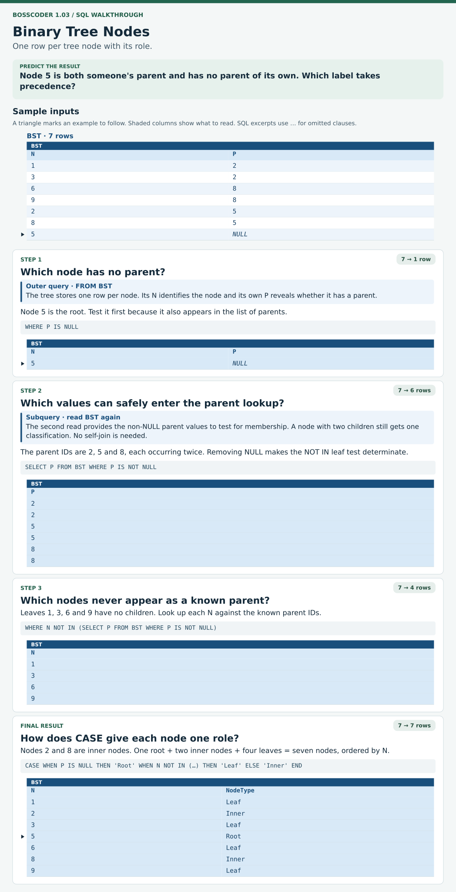

# Bosscoder 1.03 · Binary Tree Nodes

**Topic** SQL Basics  
**Difficulty**   
**Revised** 2026-11-17

## Question

**Table colors** · 🟦 `BST`

🟦 `BST` contains one row for each node of a binary tree. `N` is the node's value and `P` is the value of its parent. A missing `P` is `NULL`.

Report each node's type as `Root`, `Inner`, or `Leaf`, ordered by `N` ascending:

- **Root:** the node has no parent.
- **Inner:** the node is neither the root nor a leaf.
- **Leaf:** the node has no children.

[Bosscoder assignment question](../../../1.Bosscoder%20Academy%20-%20foundational%20notes%20and%20Assignments/1.%20Intro%20to%20SQL%20and%20Advanced%20Select/3.Sql%20Binary%20Tree%20Nodes.md#question-and-image)

### Required output columns

One output row represents one node in the binary tree.

| Output column | Source or calculation | Meaning and applicable rules | Example value |
| --- | --- | --- | --- |
| `N` | 🟦 `BST.N` | Node value. | 1 |
| `NodeType` | 🟦 `BST` | One of the node roles `Root`, `Inner` or `Leaf`. A node without a parent is Root. Among the others, a node with children is Inner and one without children is Leaf. | Leaf |

### Assignment example · Sample input

#### Schema

BST has integer columns N and P. Each row describes one node N and its parent P.

**🟦 `BST`**

| 🟦 N | 🟦 P |
|---:|---:|
| 🟦 1 | 🟦 2 |
| 🟦 3 | 🟦 2 |
| 🟦 6 | 🟦 8 |
| 🟦 9 | 🟦 8 |
| 🟦 2 | 🟦 5 |
| 🟦 8 | 🟦 5 |
| 🟦 5 | 🟦 NULL |


### Expected output

| 🟦 N | 🟦 NodeType |
|---:|---|
| 🟦 1 | 🟦 Leaf |
| 🟦 2 | 🟦 Inner |
| 🟦 3 | 🟦 Leaf |
| 🟦 5 | 🟦 Root |
| 🟦 6 | 🟦 Leaf |
| 🟦 8 | 🟦 Inner |
| 🟦 9 | 🟦 Leaf |

[View sample inputs and output with colored cells](../../assets/question-samples/b1-03.svg?raw=1)

### How the sample produces this output

🟦 Node 🟦 5 has no parent, giving it the label **🟦 Root**. Nodes 🟦 2 and 🟦 8 both have a parent and children, giving them the label **🟦 Inner**. Node 🟦 2 is the parent of 🟦 1 and 🟦 3, and node 🟦 8 is the parent of 🟦 6 and 🟦 9.

🟦 Nodes 🟦 1, 🟦 3, 🟦 6 and 🟦 9 have no children, so each is a **🟦 Leaf**. The one root, two inner nodes and four leaves account for all seven output rows, listed by ascending node value.

## Step 1 · Your approach before writing SQL

1. What does one row of the final output represent?
2. Which table would you put in `FROM`? If you need other tables, which comes second, third, and so on, and why?
3. Would you use a join at any step? For each join you choose, name its type and matching columns and explain why it fits the question.

## My final solution · SQLite

```sql
SELECT N,
       CASE
           WHEN P IS NULL THEN 'Root'
           WHEN N NOT IN (
               SELECT P
               FROM BST
               WHERE P IS NOT NULL
           ) THEN 'Leaf'
           ELSE 'Inner'
       END AS NodeType
FROM BST
ORDER BY N;
```

## Visual walkthrough

[Open the Previous / Next walkthrough](../../assets/steps/Bosscoder-1.03/01.md)

Follow the sample rows through each query step. **Predict the result.** Node 5 is both someone's parent and has no parent of its own. Which label takes precedence?



[Open the full-size walkthrough](../../assets/walkthroughs/b1-03.svg?raw=1)

## Progressive walkthrough

🟦 **Outer query · FROM BST** · The tree stores one row per node. Its `N` identifies the node and its own `P` reveals whether it has a parent.

### 1. Understand one input row

The row N = 1, P = 2 says node 1 has parent 2. To learn whether node 1 has children, look for its value in other rows' P column. Each output row will classify one N. Every node stays in the result.


```sql
SELECT N, P FROM BST ORDER BY N;
```

| N | P |
|---:|---:|
| 1 | 2 |
| 2 | 5 |
| 3 | 2 |
| 5 | NULL |
| 6 | 8 |
| 8 | 5 |
| 9 | 8 |

### 2. Identify the root first

P IS NULL identifies the node with no parent. Test this first because a single-node tree also has no children and must receive the Root label.


```sql
SELECT N, P FROM BST WHERE P IS NULL;
```

| N | P |
|---:|---|
| 5 | NULL |

Node 5 qualifies as Root whether it has children or has none.

### 3. Build the known parent list

🟦 **Subquery · read BST again** · The second read provides the non-NULL parent values to test for membership. A node with two children still gets one classification. No self-join is needed.

A value used in P has at least one child. Remove NULL here so NOT IN can decide whether a node is absent from this list.


```sql
SELECT P FROM BST WHERE P IS NOT NULL ORDER BY P;
```

| P |
|---:|
| 2 |
| 2 |
| 5 |
| 5 |
| 8 |
| 8 |

Repeated parent values do not change membership. The parent values are 2, 5, and 8.

### 4. Identify leaves

Check which N values are absent from the known parent list. Those nodes have no children.


```sql
SELECT N FROM BST
WHERE N NOT IN (SELECT P FROM BST WHERE P IS NOT NULL)
ORDER BY N;
```

| N |
|---:|
| 1 |
| 3 |
| 6 |
| 9 |

These four nodes have parents, but no children in the sample.

### 5. Combine the rules

Use CASE to check Root first, Leaf second, then return Inner for the remaining nodes. Apply ORDER BY N to produce the required ordering.


```sql
SELECT N,
       CASE
           WHEN P IS NULL THEN 'Root'
           WHEN N NOT IN (
               SELECT P
               FROM BST
               WHERE P IS NOT NULL
           ) THEN 'Leaf'
           ELSE 'Inner'
       END AS NodeType
FROM BST
ORDER BY N;
```

| N | NodeType |
|---:|---|
| 1 | Leaf |
| 2 | Inner |
| 3 | Leaf |
| 5 | Root |
| 6 | Leaf |
| 8 | Inner |
| 9 | Leaf |

Nodes 2 and 8 have parents and appear in the parent list, so both are Inner. All seven nodes remain in the output. No grouping is needed because each node is classified individually.

## My final solution · SQL Server

```sql
SELECT N,
       CASE
           WHEN P IS NULL THEN 'Root'
           WHEN N NOT IN (
               SELECT P
               FROM BST
               WHERE P IS NOT NULL
           ) THEN 'Leaf'
           ELSE 'Inner'
       END AS NodeType
FROM BST
ORDER BY N;
```

## New learning · NOT IN and NULL

Yes—**if the `NOT IN` list contains `NULL`, a value with no matching entry produces UNKNOWN**, so its `WHEN` branch won’t run.

If the value **does match** an entry, `NOT IN` returns FALSE. That’s why we remove `NULL` from the parent list.

For this nonempty parent list, checking node 1 without removing NULL behaves like comparing 1 against each known value and also against NULL. A comparison with NULL is unknown. CASE uses a WHEN branch only when its condition is true, so an unknown leaf test would incorrectly reach Inner.

## Official solution · As supplied

```sql
SELECT N,
       CASE
           WHEN P IS NULL THEN 'Root'
           WHEN N NOT IN (SELECT DISTINCT P FROM BST WHERE P IS NOT NULL) THEN 'Leaf'
           ELSE 'Inner'
       END AS NodeType
FROM BST
ORDER BY N;
```

## Official solution · SQLite adaptation

```sql
SELECT N,
       CASE
           WHEN P IS NULL THEN 'Root'
           WHEN N NOT IN (SELECT DISTINCT P FROM BST WHERE P IS NOT NULL) THEN 'Leaf'
           ELSE 'Inner'
       END AS NodeType
FROM BST
ORDER BY N;
```

## Official solution · SQL Server adaptation

```sql
SELECT N,
       CASE
           WHEN P IS NULL THEN 'Root'
           WHEN N NOT IN (SELECT DISTINCT P FROM BST WHERE P IS NOT NULL) THEN 'Leaf'
           ELSE 'Inner'
       END AS NodeType
FROM BST
ORDER BY N;
```

DISTINCT removes duplicates from the parent list. The learner's solution works without DISTINCT because duplicates do not affect NOT IN membership.

## Verification

Executed the learner SQLite solution on the seven-node sample and a single-node tree. Both passed. The SQL Server version uses the same syntax and was not executed.
