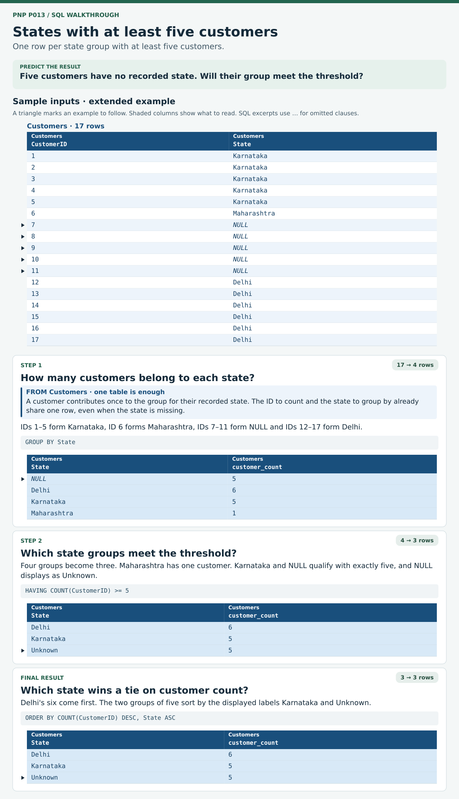

# PNP P013 — States with at least five customers

**Topic:** Sorting and Grouping  
**Difficulty:** Easy

## Question

**Table colors** · 🟦 `Customers`

**Business scenario.** Regional sales is deciding where to place field representatives. A rep is only worth assigning to a state with at least five registered customers. They want the qualifying states with the biggest first. 🟦 `Customers` with no state on file should be visible as their own line so the team can see how many cannot be placed.

**Task.** Count customers per state and keep only states with five or more. Label a missing state as Unknown. Sort by customer count, highest first, then by state.

[PNP source question](../../../2.PNP-%20foundations%20and%20practice/3.%20Sorting%20and%20Grouping/P013.%20States%20with%20at%20least%20five%20customers.md#question-and-image)

### Required output columns

| Column | Meaning | Source |
|---|---|---|
| `State` | State name, with `Unknown` for a missing state. | 🟦 `Customers` |
| `customer_count` | Number of customers registered in that state. | 🟦 `Customers` |

### Practice example · Sample input

**🟦 `Customers`**

| 🟦 CustomerID | 🟦 State |
|---:|---|
| 1 | Karnataka |
| 2 | Karnataka |
| 3 | Karnataka |
| 4 | Karnataka |
| 5 | Karnataka |
| 6 | Maharashtra |

### Expected output

| 🟦 State | 🟦 customer_count |
|---|---:|
| Karnataka | 5 |

[View sample inputs and output with colored cells](../../assets/question-samples/p013.svg?raw=1)

### How the sample produces this output

🟦 Customer IDs 1 through 5 all belong to Karnataka. Their count is exactly **5**, which meets the minimum. Maharashtra has only customer 6, giving it a count of **1**. Karnataka is therefore the only output row.

## Step 1 · Your approach before writing SQL

1. What does one row of the final output represent?
2. Which table would you put in `FROM`? If you need other tables, which comes second, third, and so on, and why?
3. Would you use a join at any step? For each join you choose, name its type and matching columns and explain why it fits the question.

## Visual walkthrough

[Open the Previous / Next walkthrough](../../assets/steps/PNP-P013/01.md)

The diagram follows the extended sample used in the step-by-step walkthrough. **Predict the result.** Five customers have no recorded state. Will their group meet the threshold?



[Open the full-size walkthrough](../../assets/walkthroughs/p013.svg?raw=1)

## Learner solution — SQLite (CASE)

```sql
select 
CASE
    WHEN State IS NOT NULL THEN State
    ELSE 'Unknown'
END AS State

, count(CustomerID) as customer_count
from Customers
group by state
having count(CustomerID)>=5
order by  count(CustomerID) desc, State asc
```

Verified on the original sample and the extended example below. The query assumes non-NULL customer IDs, as with a primary key.

## Step-by-step walkthrough

🟦 **FROM Customers · one table is enough** · A customer contributes once to the group for their recorded state. The ID to count and the state to group by already share one row, even when the state is missing.

Start by asking what one output row represents. It represents one state group. Use the same extended example throughout: keep the original six customers, add IDs 7–11 with a NULL state, and add IDs 12–17 with state Delhi. All fields come from Customers, so the query uses a single table.

### 1. Group and count the customer rows

**What to do.** Group by the stored state and count customers in each group.

**Why.** Karnataka's five rows belong to one group. The five missing states also form one group, and counting customer IDs includes those rows.

```sql
SELECT State, COUNT(CustomerID) AS customer_count FROM Customers GROUP BY State ORDER BY State;
```

| State | customer_count |
|---|---:|
| `NULL` | 5 |
| Delhi | 6 |
| Karnataka | 5 |
| Maharashtra | 1 |

### 2. Filter whole groups and label the missing state

**What to do.** Use HAVING to apply the threshold after counting. Use CASE to display Unknown for the NULL group and keep the stored state for other groups. The COALESCE alternative below makes the same choice. In this preview, sort by state to inspect the labels.

**Why.** The threshold is a condition on a whole group. Filtering missing states in WHERE would remove their rows before they can contribute to the Unknown group.

```sql
select 
CASE
    WHEN State IS NOT NULL THEN State
    ELSE 'Unknown'
END AS State

, count(CustomerID) as customer_count
from Customers
group by state
having count(CustomerID)>=5
ORDER BY State ASC
```

| State | customer_count |
|---|---:|
| Delhi | 6 |
| Karnataka | 5 |
| Unknown | 5 |

Maharashtra drops out. Karnataka and Unknown both qualify at exactly five.

### 3. Apply the requested sort

**What to do.** Sort by count descending and break ties by the displayed state name ascending.

**Why.** Delhi has the highest count. Karnataka and Unknown tie, so Karnataka comes first alphabetically. The preview happened to display the same order on these rows.

```sql
select 
CASE
    WHEN State IS NOT NULL THEN State
    ELSE 'Unknown'
END AS State

, count(CustomerID) as customer_count
from Customers
group by state
having count(CustomerID)>=5
order by  count(CustomerID) desc, State asc
```

| State | customer_count |
|---|---:|
| Delhi | 6 |
| Karnataka | 5 |
| Unknown | 5 |

## Learner solution — SQL Server (CASE)

```sql
select 
CASE
    WHEN State IS NOT NULL THEN State
    ELSE 'Unknown'
END AS State

, count(CustomerID) as customer_count
from Customers
group by state
having count(CustomerID)>=5
order by  count(CustomerID) desc, State asc;
```

This adaptation was reviewed by inspection.

## Alternative — COALESCE (SQLite and SQL Server)

`COALESCE` returns the first non-NULL value. It keeps a known state or uses `Unknown` for SQL NULL. The grouping, threshold, and sort are the same as in the CASE version.

```sql
select 
COALESCE(State, 'Unknown') AS State

, count(CustomerID) as customer_count
from Customers
group by state
having count(CustomerID)>=5
order by  count(CustomerID) desc, State asc;

```

Both expressions returned the same results in SQLite on the original and extended examples. The SQL Server versions were reviewed by inspection.

## Official solution

[PNP answer key, Q13](https://github.com/MulikShrikantDattatray14/Data-Engineering-Mastry/blob/main/1.%20SQL%20Mastery/1.%20SQL%20Mastry/2.PNP-%20foundations%20and%20practice/Source%20Materials/PrepNPlaced_SQL_100_v2/sql/all_100_solutions.sql)

```sql
SELECT COALESCE(TRIM(c.State), 'Unknown') AS State,
       COUNT(*)                           AS customer_count
FROM Customers AS c
GROUP BY COALESCE(TRIM(c.State), 'Unknown')
HAVING COUNT(*) >= 5
ORDER BY customer_count DESC, State;
```

### Official answer — SQLite adaptation

```sql
SELECT COALESCE(TRIM(c.State), 'Unknown') AS State,
       COUNT(*)                           AS customer_count
FROM Customers AS c
GROUP BY COALESCE(TRIM(c.State), 'Unknown')
HAVING COUNT(*) >= 5
ORDER BY customer_count DESC, State;
```

### Official answer — SQL Server adaptation

```sql
SELECT COALESCE(TRIM(c.State), 'Unknown') AS State,
       COUNT(*)                           AS customer_count
FROM Customers AS c
GROUP BY COALESCE(TRIM(c.State), 'Unknown')
HAVING COUNT(*) >= 5
ORDER BY customer_count DESC, State;
```

The answer-key SQL runs unchanged in SQLite and works with SQL Server 2017 or later. Its grouping expression trims state names and maps NULL to Unknown before counting. The learner groups by the stored state and labels NULL for display. Both returned the same results on the original and extended examples. The SQL Server version was reviewed by inspection.
