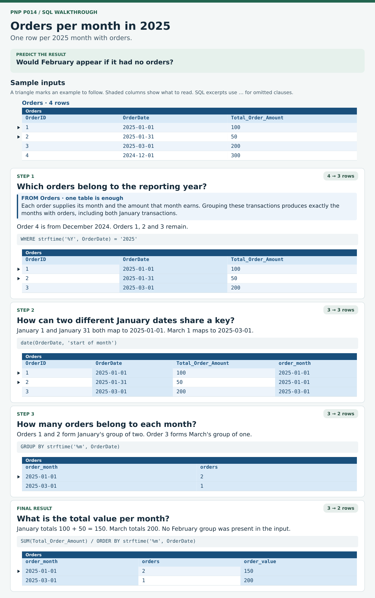

# PNP P014 — Orders per month in 2025

**Topic:** Sorting and Grouping  
**Difficulty:** Easy

## Question

**Business scenario.** Operations plans warehouse staffing month by month and wants to see how 2025 actually went: how many `orders` each month and the order value they carried. Cancellations and refunds are not recorded in this dataset, so every row in `Orders` counts as a placed order.

**Task.** For each month of 2025, return the first day of the month, the number of `orders` and the total `Total_Order_Amount`. Sort by month.

[PNP source question](../../../2.PNP-%20foundations%20and%20practice/3.%20Sorting%20and%20Grouping/P014.%20Orders%20per%20month%20in%202025.md#question-and-image)

### Required output columns

| Column | Meaning |
|---|---|
| `order_month` | First day of the month, as a date. |
| `orders` | Number of orders placed that month. |
| `order_value` | Total order amount for that month. |

### Practice example · Sample input

**`Orders`**

| OrderID | OrderDate | Total_Order_Amount |
|---:|---|---:|
| 1 | 2025-01-01 | 100 |
| 2 | 2025-01-31 | 50 |
| 3 | 2025-03-01 | 200 |
| 4 | 2024-12-01 | 300 |

### Expected output

| order_month | orders | order_value |
|---|---:|---:|
| 2025-01-01 | 2 | 150 |
| 2025-03-01 | 1 | 200 |

### How the sample produces this output

Orders 1 and 2 were placed on January 1 and January 31. Both belong to the row dated **2025-01-01**, with **2 orders** and an order value of `100 + 50 = 150`.

March has only order 3, worth **200**, so the row dated **2025-03-01** has **1 order**. February has no orders in this sample and order 4 belongs to December 2024. The two reported months appear chronologically.

## Step 1 · Your approach before writing SQL

1. What does one row of the final output represent?
2. Which table would you put in `FROM`? If you need other tables, which comes second, third, and so on, and why?
3. Would you use a join at any step? For each join you choose, name its type and matching columns and explain why it fits the question.

<details>
<summary>Notes from the saved attempt</summary>

The saved attempt reports months that have at least one order.

</details>

## Visual walkthrough

Follow the sample rows through each query step. **Predict the result.** Would February appear if it had no orders?



[Open the full-size walkthrough](../../assets/walkthroughs/p014.svg?raw=1)

## Learner solution — SQLite

```sql
SELECT date(OrderDate, 'start of month') AS order_month,
       count(*) AS orders,
       sum(Total_Order_Amount) AS order_value
FROM Orders
WHERE strftime('%Y', OrderDate) = '2025'
GROUP BY strftime('%m', OrderDate)
ORDER BY strftime('%m', OrderDate) ASC;
```

The submitted query was reformatted to remove chat markup. Tested on the sample, December and January year boundaries, and a July order placed after day one.

## Step-by-step walkthrough

The final output has one row per month, using data from Orders alone.

### 1. Keep only 2025 orders

**What to do.** Filter by year before grouping.

**Why.** Both the monthly counts and the totals must use only 2025 orders.

```sql
SELECT OrderID, OrderDate, Total_Order_Amount
FROM Orders
WHERE strftime('%Y', OrderDate) = '2025'
ORDER BY OrderID;
```

| OrderID | OrderDate | Total_Order_Amount |
|---:|---|---:|
| 1 | 2025-01-01 | 100 |
| 2 | 2025-01-31 | 50 |
| 3 | 2025-03-01 | 200 |

December 2024 drops out.

### 2. Give each order its month label

**What to do.** Add the first calendar day of the order's month while retaining the original order date.

**Why.** The first order in a month might have happened after the first. The label represents the calendar month.

```sql
SELECT OrderID, OrderDate, Total_Order_Amount,
       date(OrderDate, 'start of month') AS order_month
FROM Orders
WHERE strftime('%Y', OrderDate) = '2025'
ORDER BY OrderID;
```

| OrderID | OrderDate | Total_Order_Amount | order_month |
|---:|---|---:|---|
| 1 | 2025-01-01 | 100 | 2025-01-01 |
| 2 | 2025-01-31 | 50 | 2025-01-01 |
| 3 | 2025-03-01 | 200 | 2025-03-01 |

Order 2 keeps January 31 as its actual date and gets January 1 as its label.

### 3. Group and count orders

**What to do.** Group by the month number and count orders.

**Why.** The year filter means a month number identifies one month in 2025. A month with no orders does not form a group.

```sql
SELECT date(OrderDate, 'start of month') AS order_month,
       count(*) AS orders
FROM Orders
WHERE strftime('%Y', OrderDate) = '2025'
GROUP BY strftime('%m', OrderDate)
ORDER BY strftime('%m', OrderDate) ASC;
```

| order_month | orders |
|---|---:|
| 2025-01-01 | 2 |
| 2025-03-01 | 1 |

The two January orders merge into one summary row. There is no February row.

### 4. Add the monthly total and ensure chronological order

**What to do.** Sum the order amounts within each month and sort by month ascending.

**Why.** The count and sum describe the same order group. The explicit sort guarantees January precedes March.

```sql
SELECT date(OrderDate, 'start of month') AS order_month,
       count(*) AS orders,
       sum(Total_Order_Amount) AS order_value
FROM Orders
WHERE strftime('%Y', OrderDate) = '2025'
GROUP BY strftime('%m', OrderDate)
ORDER BY strftime('%m', OrderDate) ASC;
```

| order_month | orders | order_value |
|---|---:|---:|
| 2025-01-01 | 2 | 150 |
| 2025-03-01 | 1 | 200 |

January totals 100 + 50 = 150.

## Learner solution — SQL Server

```sql
SELECT DATEFROMPARTS(YEAR(OrderDate), MONTH(OrderDate), 1) AS order_month,
       COUNT(*) AS orders,
       SUM(Total_Order_Amount) AS order_value
FROM Orders
WHERE YEAR(OrderDate) = 2025
GROUP BY DATEFROMPARTS(YEAR(OrderDate), MONTH(OrderDate), 1)
ORDER BY order_month ASC;
```

SQL Server groups by the same first-of-month expression it selects. Reviewed by inspection.

## Official solution

[PNP answer key, Q14](https://github.com/MulikShrikantDattatray14/Data-Engineering-Mastry/blob/main/1.%20SQL%20Mastery/1.%20SQL%20Mastry/2.PNP-%20foundations%20and%20practice/Source%20Materials/PrepNPlaced_SQL_100_v2/sql/all_100_solutions.sql)

```sql
SELECT DATE_TRUNC('month', o.OrderDate)::date AS order_month,
       COUNT(*)                               AS orders,
       SUM(o.Total_Order_Amount)              AS order_value
FROM Orders AS o
WHERE o.OrderDate >= DATE '2025-01-01'
  AND o.OrderDate <  DATE '2026-01-01'
GROUP BY DATE_TRUNC('month', o.OrderDate)::date
ORDER BY order_month;
```

### Official answer — SQLite adaptation

```sql
SELECT date(o.OrderDate, 'start of month') AS order_month,
       COUNT(*)                               AS orders,
       SUM(o.Total_Order_Amount)              AS order_value
FROM Orders AS o
WHERE o.OrderDate >= '2025-01-01'
  AND o.OrderDate <  '2026-01-01'
GROUP BY date(o.OrderDate, 'start of month')
ORDER BY order_month;
```

### Official answer — SQL Server adaptation

```sql
SELECT DATEFROMPARTS(YEAR(o.OrderDate), MONTH(o.OrderDate), 1) AS order_month,
       COUNT(*)                               AS orders,
       SUM(o.Total_Order_Amount)              AS order_value
FROM Orders AS o
WHERE o.OrderDate >= DATEFROMPARTS(2025, 1, 1)
  AND o.OrderDate <  DATEFROMPARTS(2026, 1, 1)
GROUP BY DATEFROMPARTS(YEAR(o.OrderDate), MONTH(o.OrderDate), 1)
ORDER BY order_month;
```

The answer key uses a date range and groups by the full first-of-month date. The SQLite adaptation passed the same checks as the learner's final query. The SQL Server adaptation was reviewed by inspection.
