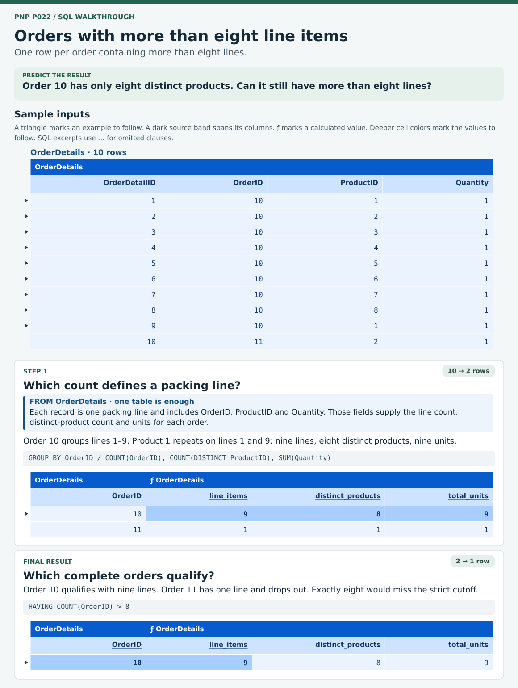

# PNP P022 — Orders with more than eight line items

**Topic:** Sorting and Grouping  
**Difficulty:** Easy

## Question

**Table colors** · 🟦 `OrderDetails`

**Business scenario.** The fulfilment centre sends orders with more than eight line items to a separate packing station with bigger cartons. The station supervisor wants to see those orders along with how many different products and how many units each one holds, so they can plan staffing for the station.

**Task.** For every order with more than eight rows in 🟦 `OrderDetails`, return the number of lines, the number of distinct products and the total units. Sort by line items, highest first, then `OrderID`.

[PNP source question](../../../2.PNP-%20foundations%20and%20practice/3.%20Sorting%20and%20Grouping/P022.%20Orders%20with%20more%20than%20eight%20line%20items.md#question-and-image)

### Required output columns

| Column | Meaning | Source |
|---|---|---|
| `OrderID` | Order identifier. | 🟦 `OrderDetails` |
| `line_items` | Number of detail lines in the order. | 🟦 `OrderDetails` |
| `distinct_products` | Number of different product IDs in the order. | 🟦 `OrderDetails` |
| `total_units` | Total quantity across the order’s lines. | 🟦 `OrderDetails` |

### Practice example · Sample input

**🟦 `OrderDetails`**

| 🟦 OrderDetailID | 🟦 OrderID | 🟦 ProductID | 🟦 Quantity |
|---:|---:|---:|---:|
| 1 | 10 | 1 | 1 |
| 2 | 10 | 2 | 1 |
| 3 | 10 | 3 | 1 |
| 4 | 10 | 4 | 1 |
| 5 | 10 | 5 | 1 |
| 6 | 10 | 6 | 1 |
| 7 | 10 | 7 | 1 |
| 8 | 10 | 8 | 1 |
| 9 | 10 | 1 | 1 |
| 10 | 11 | 2 | 1 |

### Expected output

| 🟦 OrderID | 🟦 line_items | 🟦 distinct_products | 🟦 total_units |
|---:|---:|---:|---:|
| 10 | 9 | 8 | 9 |

[View sample inputs and output with colored cells](../../assets/question-samples/p022.svg?raw=1)

### How the sample produces this output

🟦 Order 10 contains detail lines 1 through 9. Each line has quantity 1, so there are **9 lines** and **9 units**. Product 1 appears on lines 1 and 9, giving **8 distinct products** across those nine lines.

🟦 The cutoff is more than eight lines. Order 10 qualifies with nine. Order 11 has one line and falls below the cutoff.

## Step 1 · Your approach before writing SQL

1. What does one row of the final output represent?
2. Which table would you put in `FROM`? If you need other tables, which comes second, third, and so on, and why?
3. Would you use a join at any step? For each join you choose, name its type and matching columns and explain why it fits the question.

## Visual walkthrough

Follow the sample rows through each query step. **Predict the result.** Order 10 has only eight distinct products. Can it still have more than eight lines?



[Open the full-size walkthrough](../../assets/walkthroughs/p022.svg?raw=1)

## Learner solution — SQLite

```sql
select OrderID,count(OrderID)  as line_items, count(distinct(ProductID)) as distinct_products,
sum(Quantity) as total_units
from OrderDetails
group by OrderID
having count(OrderID) > 8
order by count(OrderID) desc ,OrderID asc
```

## Step-by-step walkthrough

🟦 **FROM OrderDetails · one table is enough** · Each record is one packing line and includes `OrderID`, `ProductID` and `Quantity`. Those fields supply the line count, distinct-product count and units for each order.

### 1. Define and check one row per order

**What to do.** Group the detail rows by OrderID and calculate each metric for the whole group.

**Why.** Several detail rows can belong to one order. Count the lines, count each distinct product once, and add the quantities. All three metrics come from OrderDetails.

```sql
select OrderID,count(OrderID)  as line_items, count(distinct(ProductID)) as distinct_products,
sum(Quantity) as total_units
from OrderDetails
group by OrderID
order by OrderID;
```

| OrderID | line_items | distinct_products | total_units |
|---:|---:|---:|---:|
| 10 | 9 | 8 | 9 |
| 11 | 1 | 1 | 1 |

Order 10 has nine rows. Product 1 repeats, so there are eight different product IDs. Each quantity is 1, so the total is nine units.

### 2. Apply the cutoff and sort

**What to do.** Keep groups with a line count greater than eight and sort by line count descending, then order ID ascending.

**Why.** HAVING checks the group count after aggregation. The order ID gives a consistent result for tied counts.

```sql
select OrderID,count(OrderID)  as line_items, count(distinct(ProductID)) as distinct_products,
sum(Quantity) as total_units
from OrderDetails
group by OrderID
having count(OrderID) > 8
order by count(OrderID) desc ,OrderID asc
```

| OrderID | line_items | distinct_products | total_units |
|---:|---:|---:|---:|
| 10 | 9 | 8 | 9 |

Verified in SQLite on the sample and an extended case. An order with exactly eight lines and 20 units was excluded. Two nine-line orders were sorted by ID even though their unit totals differed.

## Learner solution — SQL Server

```sql
select OrderID,count(OrderID)  as line_items, count(distinct(ProductID)) as distinct_products,
sum(Quantity) as total_units
from OrderDetails
group by OrderID
having count(OrderID) > 8
order by count(OrderID) desc ,OrderID asc;
```

Reviewed by inspection.

## Official solution

[PNP answer key, Q22](https://github.com/MulikShrikantDattatray14/Data-Engineering-Mastry/blob/main/1.%20SQL%20Mastery/1.%20SQL%20Mastry/2.PNP-%20foundations%20and%20practice/Source%20Materials/PrepNPlaced_SQL_100_v2/sql/all_100_solutions.sql)

```sql
SELECT od.OrderID,
       COUNT(*)                     AS line_items,
       COUNT(DISTINCT od.ProductID) AS distinct_products,
       SUM(od.Quantity)             AS total_units
FROM OrderDetails AS od
GROUP BY od.OrderID
HAVING COUNT(*) > 8
ORDER BY line_items DESC, od.OrderID;
```

### Official answer — SQLite adaptation

```sql
SELECT od.OrderID,
       COUNT(*)                     AS line_items,
       COUNT(DISTINCT od.ProductID) AS distinct_products,
       SUM(od.Quantity)             AS total_units
FROM OrderDetails AS od
GROUP BY od.OrderID
HAVING COUNT(*) > 8
ORDER BY line_items DESC, od.OrderID;
```

### Official answer — SQL Server adaptation

```sql
SELECT od.OrderID,
       COUNT(*)                     AS line_items,
       COUNT(DISTINCT od.ProductID) AS distinct_products,
       SUM(od.Quantity)             AS total_units
FROM OrderDetails AS od
GROUP BY od.OrderID
HAVING COUNT(*) > 8
ORDER BY line_items DESC, od.OrderID;
```

The official answer counts rows with COUNT(*). The learner uses COUNT(OrderID), which gives the same result when OrderID is non-NULL. The SQL Server versions were reviewed by inspection.
