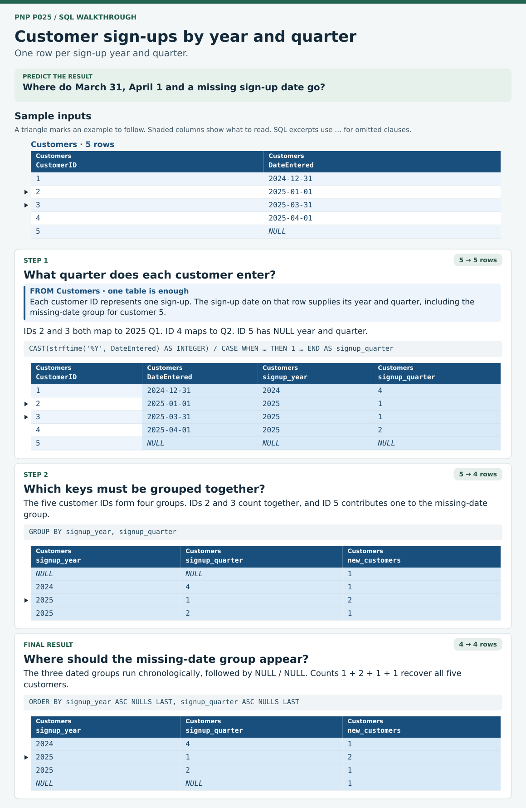

# P025 · Customer sign-ups by year and quarter

**Topic** Sorting and Grouping  
**Difficulty** 

## Question

**Business scenario.** The growth team reports new-customer acquisition to the board every quarter. A sign-up is the day an account was created (`DateEntered`), whether or not the person has ordered. They want new accounts per year and quarter in time order, with undated accounts on their own line.

**Task.** Count customers by the year and quarter of `DateEntered`. Accounts with no `DateEntered` form one group with `NULL` year and quarter, listed last. Sort by year, then quarter.

[PNP source question](../../../2.PNP-%20foundations%20and%20practice/3.%20Sorting%20and%20Grouping/P025.%20Customer%20sign-ups%20by%20year%20and%20quarter.md#question-and-image)

### Required output columns

| Column | Meaning |
|---|---|
| `signup_year` | Calendar year of sign-up, as an integer. |
| `signup_quarter` | Calendar quarter of sign-up, from 1 to 4. |
| `new_customers` | Number of accounts created in that year and quarter. |

### Practice example · Sample input

**`Customers`**

| CustomerID | DateEntered |
|---:|---|
| 1 | 2024-12-31 |
| 2 | 2025-01-01 |
| 3 | 2025-03-31 |
| 4 | 2025-04-01 |
| 5 | NULL |

### Expected output

| signup_year | signup_quarter | new_customers |
|---:|---:|---:|
| 2024 | 4 | 1 |
| 2025 | 1 | 2 |
| 2025 | 2 | 1 |
| NULL | NULL | 1 |

### How the sample produces this output

Customer 1 signed up on December 31, giving **2024 Q4** one account. Customers 2 and 3 signed up on January 1 and March 31, so **2025 Q1** has two. Customer 4 signed up on April 1, the first day of **2025 Q2**, giving that quarter one account.

Customer 5 has no sign-up date and contributes one account to the final row with `NULL` year and quarter. The four counts add to `1 + 2 + 1 + 1 = 5`, accounting for every customer.

## Step 1 · Your approach before writing SQL

1. What does one row of the final output represent?
2. Which table would you put in `FROM`? If you need other tables, which comes second, third, and so on, and why?
3. Would you use a join at any step? For each join you choose, name its type and matching columns and explain why it fits the question.

## Visual walkthrough

Follow the sample rows through each query step. **Predict the result.** Where do March 31, April 1 and a missing sign-up date go?



[Open the full-size walkthrough](../../assets/walkthroughs/p025.svg?raw=1)

## My final solution · SQLite

```sql
SELECT
    CAST(strftime('%Y', DateEntered) AS INTEGER) AS signup_year,
    CASE
        WHEN CAST(strftime('%m', DateEntered) AS INTEGER) >= 1
         AND CAST(strftime('%m', DateEntered) AS INTEGER) <= 3 THEN 1
        WHEN CAST(strftime('%m', DateEntered) AS INTEGER) >= 4
         AND CAST(strftime('%m', DateEntered) AS INTEGER) <= 6 THEN 2
        WHEN CAST(strftime('%m', DateEntered) AS INTEGER) >= 7
         AND CAST(strftime('%m', DateEntered) AS INTEGER) <= 9 THEN 3
        WHEN CAST(strftime('%m', DateEntered) AS INTEGER) >= 10
         AND CAST(strftime('%m', DateEntered) AS INTEGER) <= 12 THEN 4
        ELSE NULL
    END AS signup_quarter,
    COUNT(CustomerID) AS new_customers
FROM Customers
GROUP BY signup_year, signup_quarter
ORDER BY signup_year ASC NULLS LAST,
         signup_quarter ASC NULLS LAST;
```

## My solution · SQL Server

Equivalent adaptation for non-NULL CustomerID values.

```sql
SELECT YEAR(DateEntered) AS signup_year,
       DATEPART(QUARTER, DateEntered) AS signup_quarter,
       COUNT(CustomerID) AS new_customers
FROM Customers
GROUP BY YEAR(DateEntered), DATEPART(QUARTER, DateEntered)
ORDER BY CASE WHEN YEAR(DateEntered) IS NULL THEN 1 ELSE 0 END,
         signup_year, signup_quarter;
```

## Progressive walkthrough

### 1. Define one result row

One result row represents one year and quarter. The sample needs four groups, including the missing-date group. All customers participate, so start from Customers.


```sql
SELECT CustomerID, DateEntered FROM Customers;
```

The output is the five-row practice input above.

### 2. Extract the year and assign a quarter

Extract year with strftime and cast it to an integer. Extract month to decide which CASE range matches. Months 1–3 become quarter 1, and so on. A NULL date matches no range and reaches ELSE NULL.


```sql
SELECT CustomerID, DateEntered,
CAST(strftime('%Y', DateEntered) AS INTEGER) AS signup_year,
    CASE
        WHEN CAST(strftime('%m', DateEntered) AS INTEGER) >= 1
         AND CAST(strftime('%m', DateEntered) AS INTEGER) <= 3 THEN 1
        WHEN CAST(strftime('%m', DateEntered) AS INTEGER) >= 4
         AND CAST(strftime('%m', DateEntered) AS INTEGER) <= 6 THEN 2
        WHEN CAST(strftime('%m', DateEntered) AS INTEGER) >= 7
         AND CAST(strftime('%m', DateEntered) AS INTEGER) <= 9 THEN 3
        WHEN CAST(strftime('%m', DateEntered) AS INTEGER) >= 10
         AND CAST(strftime('%m', DateEntered) AS INTEGER) <= 12 THEN 4
        ELSE NULL
    END AS signup_quarter
FROM Customers;
```

| CustomerID | DateEntered | signup_year | signup_quarter |
|---:|---|---:|---:|
| 1 | 2024-12-31 | 2024 | 4 |
| 2 | 2025-01-01 | 2025 | 1 |
| 3 | 2025-03-31 | 2025 | 1 |
| 4 | 2025-04-01 | 2025 | 2 |
| 5 | NULL | NULL | NULL |

This demonstrates that customer 2 and customer 3 now share both grouping values.

### 3. Group and count

Replace the displayed customer and date with COUNT(CustomerID), then add GROUP BY signup_year, signup_quarter. Use the first part of the final query through GROUP BY.


```sql
SELECT
    CAST(strftime('%Y', DateEntered) AS INTEGER) AS signup_year,
    CASE
        WHEN CAST(strftime('%m', DateEntered) AS INTEGER) >= 1
         AND CAST(strftime('%m', DateEntered) AS INTEGER) <= 3 THEN 1
        WHEN CAST(strftime('%m', DateEntered) AS INTEGER) >= 4
         AND CAST(strftime('%m', DateEntered) AS INTEGER) <= 6 THEN 2
        WHEN CAST(strftime('%m', DateEntered) AS INTEGER) >= 7
         AND CAST(strftime('%m', DateEntered) AS INTEGER) <= 9 THEN 3
        WHEN CAST(strftime('%m', DateEntered) AS INTEGER) >= 10
         AND CAST(strftime('%m', DateEntered) AS INTEGER) <= 12 THEN 4
        ELSE NULL
    END AS signup_quarter,
    COUNT(CustomerID) AS new_customers
FROM Customers
GROUP BY signup_year, signup_quarter
;
```

| signup_year | signup_quarter | new_customers |
|---:|---:|---:|
| NULL | NULL | 1 |
| 2024 | 4 | 1 |
| 2025 | 1 | 2 |
| 2025 | 2 | 1 |

The displayed order is illustrative until ORDER BY is added. NULL grouping values belong to the same group. COUNT(CustomerID) counts those customers because their IDs are present, even when their dates are NULL. COUNT(*) is also suitable when counting every input row.

### 4. Sort the grouped result

Add ORDER BY signup_year ASC NULLS LAST, signup_quarter ASC NULLS LAST, as shown in the final solution. SQLite places NULL values first for an ascending sort by default, so NULLS LAST is needed. The result is the expected output table above.

No WHERE or HAVING condition is needed because every customer and every resulting group is requested.

## Official solution · Source dialect

```sql
SELECT EXTRACT(YEAR FROM c.DateEntered)::int AS signup_year,
       EXTRACT(QUARTER FROM c.DateEntered)::int AS signup_quarter,
       COUNT(*) AS new_customers
FROM Customers AS c
GROUP BY EXTRACT(YEAR FROM c.DateEntered)::int,
         EXTRACT(QUARTER FROM c.DateEntered)::int
ORDER BY signup_year NULLS LAST, signup_quarter NULLS LAST;
```

## Official solution · SQLite adaptation

```sql
SELECT
    CAST(strftime('%Y', DateEntered) AS INTEGER) AS signup_year,
    CASE
        WHEN CAST(strftime('%m', DateEntered) AS INTEGER) >= 1
         AND CAST(strftime('%m', DateEntered) AS INTEGER) <= 3 THEN 1
        WHEN CAST(strftime('%m', DateEntered) AS INTEGER) >= 4
         AND CAST(strftime('%m', DateEntered) AS INTEGER) <= 6 THEN 2
        WHEN CAST(strftime('%m', DateEntered) AS INTEGER) >= 7
         AND CAST(strftime('%m', DateEntered) AS INTEGER) <= 9 THEN 3
        WHEN CAST(strftime('%m', DateEntered) AS INTEGER) >= 10
         AND CAST(strftime('%m', DateEntered) AS INTEGER) <= 12 THEN 4
        ELSE NULL
    END AS signup_quarter,
    COUNT(*) AS new_customers
FROM Customers
GROUP BY signup_year, signup_quarter
ORDER BY signup_year ASC NULLS LAST,
         signup_quarter ASC NULLS LAST;
```

## Official solution · SQL Server adaptation

```sql
SELECT YEAR(DateEntered) AS signup_year,
       DATEPART(QUARTER, DateEntered) AS signup_quarter,
       COUNT(*) AS new_customers
FROM Customers
GROUP BY YEAR(DateEntered), DATEPART(QUARTER, DateEntered)
ORDER BY CASE WHEN YEAR(DateEntered) IS NULL THEN 1 ELSE 0 END,
         signup_year, signup_quarter;
```


## Verification

Executed the learner SQLite solution on the sample and checked all twelve months, with three months per quarter. Both checks passed. SQL Server adaptations were reviewed but were not executed.
