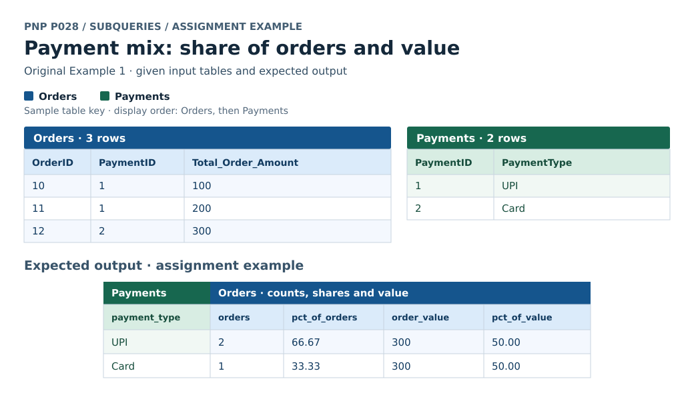
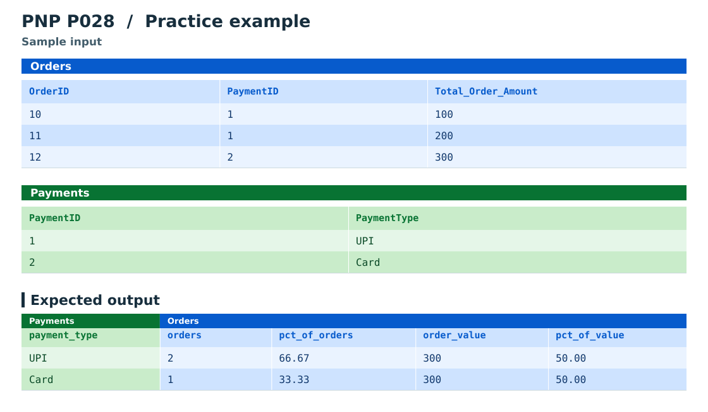
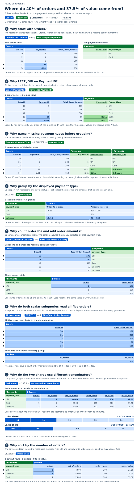
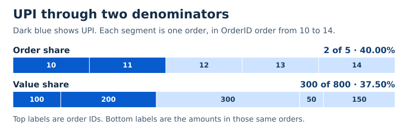

# PNP P028 — Payment mix: share of orders and value

**Topic** Subqueries · **Difficulty** 

## Question

**Table colors** · 🟦 `Orders` · 🟩 `Payments`

**Business scenario.** The payments team is renegotiating gateway fees, and fees are charged per transaction for some methods and as a share of value for others. They need each payment type's share of order count and its share of order value in one table. A method can carry many small 🟦 `orders` or a few large ones, so the two shares can tell different stories.

**Task.** For each payment type, return the number of `orders`, its percentage of all `orders`, the total order value and its percentage of all order value. `Orders` whose `PaymentID` is `NULL` or matches no payment row go under Unknown. Use scalar subqueries for the two denominators. Sort by `orders`, highest first.

[PNP source question](../../../2.PNP-%20foundations%20and%20practice/6.%20SubQueries/P028.%20Payment%20mix%20share%20of%20orders%20and%20value.md#question-and-image)

### Required output columns

One output row represents one payment type represented on orders, including Unknown for missing or unmatched payment IDs.

| Output column | Source or calculation | Meaning and applicable rules | Example value |
| --- | --- | --- | --- |
| `payment_type` | 🟩 `Payments` | Payment type name, or `Unknown` for a missing or unrecognized payment ID. | UPI |
| `orders` | 🟦 `Orders` | Number of orders for that payment type. | 2 |
| `pct_of_orders` | 🟦 `Orders` | This type’s share of all orders, as a percentage rounded to two decimals. | 40.00 |
| `order_value` | 🟦 `Orders` | Total amount of the orders for that payment type. | 300 |
| `pct_of_value` | 🟦 `Orders` | This type’s share of all order value, as a percentage rounded to two decimals. | 37.50 |

### Assignment example · PNP Example 1

*This is the input and expected result supplied in the linked PNP Q028 source. It is the assignment example, not added practice data.*

**Sample table key · display order:** 🟦 `Orders` · 🟩 `Payments`

**🟦 `Orders`**

| 🟦 OrderID | 🟦 PaymentID | 🟦 Total_Order_Amount |
| :--- | :--- | :--- |
| 🟦 10 | 🟦 1 | 🟦 100 |
| 🟦 11 | 🟦 1 | 🟦 200 |
| 🟦 12 | 🟦 2 | 🟦 300 |

**🟩 `Payments`**

| 🟩 PaymentID | 🟩 PaymentType |
| :--- | :--- |
| 🟩 1 | 🟩 UPI |
| 🟩 2 | 🟩 Card |

**Expected output · Assignment example**

| 🟩 payment_type | 🟦 orders | 🟦 pct_of_orders | 🟦 order_value | 🟦 pct_of_value |
| :--- | ---: | ---: | ---: | ---: |
| 🟩 UPI | 🟦 2 | 🟦 66.67 | 🟦 300 | 🟦 50.00 |
| 🟩 Card | 🟦 1 | 🟦 33.33 | 🟦 300 | 🟦 50.00 |



[Open the assignment-example SVG full size](../../assets/question-samples/p028-assignment.svg?raw=1)

**How the assignment example produces this output**

There are **🟦 3 orders** worth **🟦 100 + 🟦 200 + 🟦 300 = 🟦 600**.

- **🟩 UPI:** orders 🟦 10 and 🟦 11. Its count share is **🟦 2 / 🟦 3 × 100 = 🟦 66.67%**. Their value is **🟦 100 + 🟦 200 = 🟦 300**, or **🟦 300 / 🟦 600 × 100 = 🟦 50.00%**.
- **🟩 Card:** order 🟦 12. Its count share is **🟦 1 / 🟦 3 × 100 = 🟦 33.33%**. Its value is **🟦 300**, or **🟦 300 / 🟦 600 × 100 = 🟦 50.00%**.

The assignment example has no missing or unmatched payment ID, so it does not produce an Unknown row. The following **Practice example** extends these inputs with both cases to make the Unknown rule visible.

### Practice example · Sample input

**Sample table key · display order:** 🟦 `Orders` · 🟩 `Payments` · 🟪 `Unknown` combines `Orders.PaymentID` and `Payments.PaymentType`.

**🟦 `Orders`**

| 🟦 OrderID | 🟦 PaymentID | 🟦 Total_Order_Amount |
| :--- | :--- | :--- |
| 🟦 10 | 🟦 1 | 🟦 100 |
| 🟦 11 | 🟦 1 | 🟦 200 |
| 🟦 12 | 🟦 2 | 🟦 300 |
| 🟦 13 | 🟦 99 | 🟦 50 |
| 🟦 14 | 🟦 `NULL` | 🟦 150 |

**🟩 `Payments`**

| 🟩 PaymentID | 🟩 PaymentType |
| :--- | :--- |
| 🟩 1 | 🟩 UPI |
| 🟩 2 | 🟩 Card |

### Expected output · Practice example

| 🟩 payment_type | 🟦 orders | 🟦 pct_of_orders | 🟦 order_value | 🟦 pct_of_value |
| :--- | :--- | :--- | :--- | :--- |
| 🟪 Unknown | 🟦 2 | 🟦 40.00 | 🟦 200 | 🟦 25.00 |
| 🟩 UPI | 🟦 2 | 🟦 40.00 | 🟦 300 | 🟦 37.50 |
| 🟩 Card | 🟦 1 | 🟦 20.00 | 🟦 300 | 🟦 37.50 |



[Open the full-size sample SVG](../../assets/question-samples/p028.svg?raw=1)

### How the practice example produces this output

There are **🟦 5 orders** worth **🟦 100 + 🟦 200 + 🟦 300 + 🟦 50 + 🟦 150 = 🟦 800** in total.

- **🟩 UPI:** orders 🟦 10 and 🟦 11. The count is **🟦 2 / 🟦 5 × 100 = 🟦 40.00%**. Their value is **🟦 100 + 🟦 200 = 🟦 300**, or **🟦 300 / 🟦 800 × 100 = 🟦 37.50%**.
- **🟩 Card:** order 🟦 12. The count is **🟦 1 / 🟦 5 × 100 = 🟦 20.00%**. Its value is **🟦 300**, or **🟦 300 / 🟦 800 × 100 = 🟦 37.50%**.
- **🟪 Unknown:** order 🟦 13 uses payment ID 🟦 99, which has no lookup row, and order 🟦 14 has a missing payment ID. Together they are **🟦 2 / 🟦 5 × 100 = 🟦 40.00%** of orders, worth **🟦 50 + 🟦 150 = 🟦 200**, or **🟦 200 / 🟦 800 × 100 = 🟦 25.00%**.

The count sort places the two-order groups before Card. Unknown and UPI tie at two orders, so their relative order is not guaranteed by the source task.

## Step 1 · Your approach before writing SQL

1. What does one row of the final output represent?
2. Which table would you put in `FROM`? If you need other tables, which comes second, third, and so on, and why?
3. Would you use a join at any step? For each join you choose, name its type and matching columns and explain why it fits the question.

<details>
<summary>Notes from the saved attempt</summary>

**Earlier practice check**

Suppose one more order arrives in 🟦 `Orders` with `PaymentID = 99`. The 🟩 `Payments` table still looks exactly as shown.

**Which table would you start from, and where should that order appear in the final report?** Give me your reasoning in plain English first.

</details>

## Final learner solution — SQLite

```sql
SELECT
    COALESCE(Payments.PaymentType, 'Unknown') AS payment_type,
    COUNT(DISTINCT Orders.OrderID) AS orders,
    ROUND(
        COUNT(DISTINCT Orders.OrderID) * 100.0
        / (SELECT COUNT(*) FROM Orders),
        2
    ) AS pct_of_orders,
    SUM(Orders.Total_Order_Amount) AS order_value,
    ROUND(
        SUM(Orders.Total_Order_Amount) * 100.0
        / (SELECT SUM(Total_Order_Amount) FROM Orders),
        2
    ) AS pct_of_value
FROM Orders
LEFT JOIN Payments
    ON Orders.PaymentID = Payments.PaymentID
GROUP BY payment_type
ORDER BY orders DESC;
```

### Six decisions before coding

| Decision | How it applies here |
|---|---|
| What does one row mean? | One input order contributes to one output payment type. The four measures describe its count, count share, value and value share. |
| Which rows must survive? | Start with Orders. Look up Payments using PaymentID. Keep an order even when its payment record cannot be found. |
| Which rows get filtered? | All orders count. The fallback assigns a label to an individual row. Every resulting payment group is eligible. |
| How do we group and calculate? | Group by the displayed payment type. Count order IDs and add amounts inside each group. Read the overall count and overall value from Orders in two scalar subqueries. |
| What about missing values and ties? | Missing payments share the Unknown label. A missing amount still belongs to a counted order. With the learner’s sort, equal order counts can appear in either order. |
| Can we check one group by hand? | UPI contains orders 10 and 11. That is 2 of 5 orders and 300 of 800 in value. |

## Visual walkthrough

[Open the Previous / Next walkthrough](../../assets/steps/PNP-P028/01.md)

Use the original 🟦 three orders and the two we added during practice. 🟦 Order **13** carries payment ID **99** and an amount of **50**. 🟦 Order **14** carries a missing payment ID and an amount of **150**. These 🟦 five orders stay in view through the last step.

🟦 **Orders** supplies IDs and amounts. 🟩 **Payments** supplies labels. The two join keys have a double underline. A ▸ marks a focus row, and darker cells show the inputs to the current calculation. The ƒ symbol identifies calculated columns in their source colors.



[Open the full-size walkthrough](../../assets/p028-payment-mix-walkthrough.svg?raw=1)

## Step-by-step solution

### 1. Why start with Orders?

FROM Orders supplies one row per transaction; every order amount counts, even when PaymentID is missing.

```sql
SELECT OrderID, PaymentID, Total_Order_Amount FROM Orders ORDER BY OrderID;
SELECT PaymentID, PaymentType FROM Payments ORDER BY PaymentID;
```

**Five order rows**

| 🟦 `OrderID` | 🟦 `PaymentID` | 🟦 `Total_Order_Amount` |
| ---: | ---: | ---: |
| 🟦 10 | 🟦 1 | 🟦 100 |
| 🟦 11 | 🟦 1 | 🟦 200 |
| 🟦 12 | 🟦 2 | 🟦 300 |
| 🟦 13 | 🟦 99 | 🟦 50 |
| 🟦 14 | 🟦 `NULL` | 🟦 150 |

**Two payment methods**

| 🟩 `PaymentID` | 🟩 `PaymentType` |
| ---: | --- |
| 🟩 1 | 🟩 UPI |
| 🟩 2 | 🟩 Card |

🟦 Orders 10–12 are the original sample. Our practice example adds 🟦 order 13 for 🟦 50 and 🟦 order 14 for 🟦 150.

### 2. Why LEFT JOIN on PaymentID?

Each 🟦 order carries a `PaymentID`. Add 🟩 `Payments` second to look up the label for that ID. The `LEFT JOIN` keeps order 13, whose ID 99 has no match, and order 14, whose ID is missing. Their amounts still belong in the overall total.

```sql
SELECT o.OrderID, o.PaymentID AS order_payment_id, o.Total_Order_Amount,
       p.PaymentID AS matched_payment_id, p.PaymentType
FROM Orders AS o
LEFT JOIN Payments AS p ON o.PaymentID = p.PaymentID
ORDER BY o.OrderID;
```

**🟦 5 order rows → 🟪 5 joined rows**

| 🟦 `OrderID` | 🟦 `PaymentID` | 🟦 `Total_Order_Amount` | 🟩 `PaymentID` | 🟩 `PaymentType` |
| ---: | ---: | ---: | ---: | --- |
| 🟦 10 | 🟦 1 | 🟦 100 | 🟩 1 | 🟩 UPI |
| 🟦 11 | 🟦 1 | 🟦 200 | 🟩 1 | 🟩 UPI |
| 🟦 12 | 🟦 2 | 🟦 300 | 🟩 2 | 🟩 Card |
| 🟦 13 | 🟦 99 | 🟦 50 | 🟩 `NULL` | 🟩 `NULL` |
| 🟦 14 | 🟦 `NULL` | 🟦 150 | 🟩 `NULL` | 🟩 `NULL` |

🟦 Order 13 has payment ID 🟦 99. 🟦 Order 14 has a missing ID. Both keep their 🟦 order values and receive 🟩 `NULL`s.

### 3. Why name missing payment types before grouping?

The report needs one label for every order. A missing lookup becomes Unknown.

```sql
SELECT o.OrderID, o.PaymentID AS order_payment_id, o.Total_Order_Amount,
       p.PaymentID AS matched_payment_id, p.PaymentType,
       COALESCE(p.PaymentType, 'Unknown') AS payment_type
FROM Orders AS o
LEFT JOIN Payments AS p ON o.PaymentID = p.PaymentID
ORDER BY o.OrderID;
```

**🟪 5 joined rows → 🟪 5 labeled rows**

| 🟦 `OrderID` | 🟦 `PaymentID` | 🟦 `Total_Order_Amount` | 🟩 `PaymentID` | 🟩 `PaymentType` | 🟩 `payment_type` |
| ---: | ---: | ---: | ---: | --- | --- |
| 🟦 10 | 🟦 1 | 🟦 100 | 🟩 1 | 🟩 UPI | 🟩 UPI |
| 🟦 11 | 🟦 1 | 🟦 200 | 🟩 1 | 🟩 UPI | 🟩 UPI |
| 🟦 12 | 🟦 2 | 🟦 300 | 🟩 2 | 🟩 Card | 🟩 Card |
| 🟦 13 | 🟦 99 | 🟦 50 | 🟩 `NULL` | 🟩 `NULL` | 🟩 Unknown |
| 🟦 14 | 🟦 `NULL` | 🟦 150 | 🟩 `NULL` | 🟩 `NULL` | 🟩 Unknown |

🟦 Orders 13 and 14 now have the same 🟪 display label. Grouping by the original 🟦 order-side payment ID would split them.

### 4. Why group by the displayed payment type?

One report row represents one payment type. First collect the order IDs and amounts that belong to each label.

The two `GROUP_CONCAT` columns let you inspect each group’s members. They are temporary columns for this step.

```sql
WITH labeled AS (
    SELECT o.OrderID, o.Total_Order_Amount, COALESCE(p.PaymentType, 'Unknown') AS payment_type
    FROM Orders AS o
    LEFT JOIN Payments AS p ON o.PaymentID = p.PaymentID
)
SELECT payment_type,
       GROUP_CONCAT(OrderID, ', ') AS member_orders,
       GROUP_CONCAT(Total_Order_Amount, ' + ') AS member_amounts
FROM (SELECT * FROM labeled ORDER BY OrderID) AS ordered_rows
GROUP BY payment_type
ORDER BY MIN(OrderID);
```

**🟦 5 labeled orders → 🟪 3 groups**

| 🟩 `payment_type` | 🟦 `OrderIDs in group` | 🟦 `Amounts in group` |
| --- | --- | --- |
| 🟩 UPI | 🟦 10, 11 | 🟦 100 + 200 |
| 🟩 Card | 🟦 12 | 🟦 300 |
| 🟩 Unknown | 🟦 13, 14 | 🟦 50 + 150 |

🟦 Orders 10 and 11 belong to 🟩 UPI. 🟦 Orders 13 and 14 belong to 🟪 Unknown. Each 🟦 order is in exactly one 🟪 group.

### 5. Why count order IDs and add order amounts?

One measure counts transactions. The other measures the money collected by that payment type.

For this intermediate table, the first 🟦 OrderID in each group determines display order. The final sort appears in step 8.

```sql
SELECT COALESCE(p.PaymentType, 'Unknown') AS payment_type,
       COUNT(DISTINCT o.OrderID) AS orders,
       SUM(o.Total_Order_Amount) AS order_value
FROM Orders AS o
LEFT JOIN Payments AS p ON o.PaymentID = p.PaymentID
GROUP BY payment_type
ORDER BY MIN(o.OrderID);
```

**Order IDs and amounts read by each aggregate**

| 🟦 `OrderID` | 🟦 `Total_Order_Amount` | 🟩 `payment_type` |
| ---: | ---: | --- |
| 🟦 10 | 🟦 100 | 🟩 UPI |
| 🟦 11 | 🟦 200 | 🟩 UPI |
| 🟦 12 | 🟦 300 | 🟩 Card |
| 🟦 13 | 🟦 50 | 🟩 Unknown |
| 🟦 14 | 🟦 150 | 🟩 Unknown |

**Three group totals**

| 🟩 `payment_type` | 🟦 `orders` | 🟦 `order_value` |
| --- | ---: | ---: |
| 🟩 UPI | 🟦 2 | 🟦 300 |
| 🟩 Card | 🟦 1 | 🟦 300 |
| 🟩 Unknown | 🟦 2 | 🟦 200 |

🟩 UPI counts 🟦 orders 10 and 11 and adds 🟦 100 + 🟦 200 = 🟦 300. 🟩 Card reaches the same 🟦 value of 🟦 300 with 🟦 one order.

The 🟦 order-side IDs 13 and 14 are both present. Counting the matched 🟩 payment IDs would give 🟩 zero for the 🟪 Unknown group.

### 6. Why do both scalar subqueries read all five orders?

A payment type’s share needs a total for the whole report. Each scalar subquery returns one number that every group uses.

Read each inner `SELECT` on its own. Neither refers to the payment type in the outer row, so the same total is available for every group.

```sql
SELECT
    (SELECT COUNT(*) FROM Orders) AS all_orders,
    (SELECT SUM(Total_Order_Amount) FROM Orders) AS all_value;
```

**All five rows contribute to the denominators**

| 🟦 `OrderID` | 🟦 `Total_Order_Amount` |
| ---: | ---: |
| 🟦 10 | 🟦 100 |
| 🟦 11 | 🟦 200 |
| 🟦 12 | 🟦 300 |
| 🟦 13 | 🟦 50 |
| 🟦 14 | 🟦 150 |

**The same two totals for every group**

| 🟦 `all_orders` | 🟦 `all_value` |
| ---: | ---: |
| 🟦 5 | 🟦 800 |

🟦 Five order rows give a count of 🟦 5. Their amounts add to 🟦 100 + 🟦 200 + 🟦 300 + 🟦 50 + 🟦 150 = 🟦 800.

### 7. Why do the two shares use different denominators?

Compare a group’s order count with all orders and its value with all order value. Round each percentage to two decimal places.

For this intermediate table, the first 🟦 OrderID in each group determines display order. The final sort appears in step 8.

```sql
SELECT COALESCE(p.PaymentType, 'Unknown') AS payment_type,
       COUNT(DISTINCT o.OrderID) AS orders,
       (SELECT COUNT(*) FROM Orders) AS all_orders,
       ROUND(COUNT(DISTINCT o.OrderID) * 100.0
             / (SELECT COUNT(*) FROM Orders), 2) AS pct_of_orders,
       SUM(o.Total_Order_Amount) AS order_value,
       (SELECT SUM(Total_Order_Amount) FROM Orders) AS all_value,
       ROUND(SUM(o.Total_Order_Amount) * 100.0
             / (SELECT SUM(Total_Order_Amount) FROM Orders), 2) AS pct_of_value
FROM Orders AS o
LEFT JOIN Payments AS p ON o.PaymentID = p.PaymentID
GROUP BY payment_type
ORDER BY MIN(o.OrderID);
```

**Each numerator beside its denominator**

| 🟩 `payment_type` | 🟦 `orders` | 🟦 `all_orders` | 🟦 `pct_of_orders` | 🟦 `order_value` | 🟦 `all_value` | 🟦 `pct_of_value` |
| --- | ---: | ---: | ---: | ---: | ---: | ---: |
| 🟩 UPI | 🟦 2 | 🟦 5 | 🟦 40.00 | 🟦 300 | 🟦 800 | 🟦 37.50 |
| 🟩 Card | 🟦 1 | 🟦 5 | 🟦 20.00 | 🟦 300 | 🟦 800 | 🟦 37.50 |
| 🟩 Unknown | 🟦 2 | 🟦 5 | 🟦 40.00 | 🟦 200 | 🟦 800 | 🟦 25.00 |

🟩 UPI has 🟦 2 of 🟦 5 orders, or 🟦 40.00%. Its 🟦 300 out of 🟦 800 in value gives 🟦 37.50%.

The decimal literal `100.0` preserves the fraction. Round only after the division. For 🟪 Unknown the two shares are 🟦 2 × 100 ÷ 🟦 5 = 🟦 40.00% and 🟦 200 × 100 ÷ 🟦 800 = 🟦 25.00%.



### 8. Why sort by the number of orders?

The payments team wants the most-used methods first. UPI and Unknown tie at two orders, so either may appear first.

```sql
SELECT
    COALESCE(Payments.PaymentType, 'Unknown') AS payment_type,
    COUNT(DISTINCT Orders.OrderID) AS orders,
    ROUND(
        COUNT(DISTINCT Orders.OrderID) * 100.0
        / (SELECT COUNT(*) FROM Orders),
        2
    ) AS pct_of_orders,
    SUM(Orders.Total_Order_Amount) AS order_value,
    ROUND(
        SUM(Orders.Total_Order_Amount) * 100.0
        / (SELECT SUM(Total_Order_Amount) FROM Orders),
        2
    ) AS pct_of_value
FROM Orders
LEFT JOIN Payments
    ON Orders.PaymentID = Payments.PaymentID
GROUP BY payment_type
ORDER BY orders DESC;
```

**🟪 3 output rows · 🟦 5 orders · 🟦 800 in value**

| 🟩 `payment_type` | 🟦 `orders` | 🟦 `pct_of_orders` | 🟦 `order_value` | 🟦 `pct_of_value` |
| --- | ---: | ---: | ---: | ---: |
| 🟩 UPI | 🟦 2 | 🟦 40.00 | 🟦 300 | 🟦 37.50 |
| 🟩 Unknown | 🟦 2 | 🟦 40.00 | 🟦 200 | 🟦 25.00 |
| 🟩 Card | 🟦 1 | 🟦 20.00 | 🟦 300 | 🟦 37.50 |

The rows account for 🟦 2 + 🟦 2 + 🟦 1 = 🟦 5 orders and 🟦 300 + 🟦 200 + 🟦 300 = 🟦 800. Both shares sum to 🟦 100.00% in this example.

In other datasets, rounding each percentage separately can make the displayed shares add to 99.99% or 100.01%.

## Learner solution — SQL Server

SQL Server groups by the full payment-label expression. The `NULLIF` guards make a zero denominator yield `NULL`. The decimal literal `100.0` preserves fractional percentages on integer-valued sample inputs.

```sql
SELECT
    COALESCE(Payments.PaymentType, 'Unknown') AS payment_type,
    COUNT(DISTINCT Orders.OrderID) AS orders,
    ROUND(
        COUNT(DISTINCT Orders.OrderID) * 100.0
        / NULLIF((SELECT COUNT(*) FROM Orders), 0),
        2
    ) AS pct_of_orders,
    SUM(Orders.Total_Order_Amount) AS order_value,
    ROUND(
        SUM(Orders.Total_Order_Amount) * 100.0
        / NULLIF((SELECT SUM(Total_Order_Amount) FROM Orders), 0),
        2
    ) AS pct_of_value
FROM Orders
LEFT JOIN Payments
    ON Orders.PaymentID = Payments.PaymentID
GROUP BY COALESCE(Payments.PaymentType, 'Unknown')
ORDER BY orders DESC;
```

## Official solution

The course counts the joined rows using `COUNT(*)`. Each `Orders.OrderID` is unique and each order can match at most one payment record, so the course count and the learner’s distinct order count agree. The course explicitly guards both denominators and sorts tied counts alphabetically by payment type. [Published SQL, Q28](<../../../2.PNP-%20foundations%20and%20practice/Source%20Materials/PrepNPlaced_SQL_100_v2/sql/all_100_solutions.sql#L323-L334>) · [Interview book, Q28, pp. 47–49](<../../../2.PNP-%20foundations%20and%20practice/Source%20Materials/Updated_100_SQL_Interview_Questions.pdf>)

### As supplied — PostgreSQL

```sql
SELECT COALESCE(pay.PaymentType, 'Unknown')                          AS payment_type,
       COUNT(*)                                                       AS orders,
       ROUND(100.0 * COUNT(*)
             / NULLIF((SELECT COUNT(*) FROM Orders), 0), 2)          AS pct_of_orders,
       SUM(o.Total_Order_Amount)                                      AS order_value,
       ROUND(100.0 * SUM(o.Total_Order_Amount)
             / NULLIF((SELECT SUM(Total_Order_Amount) FROM Orders), 0), 2) AS pct_of_value
FROM Orders AS o
LEFT JOIN Payments AS pay ON pay.PaymentID = o.PaymentID
GROUP BY COALESCE(pay.PaymentType, 'Unknown')
ORDER BY orders DESC, payment_type;
```

### Official answer — SQLite

```sql
SELECT
    COALESCE(p.PaymentType, 'Unknown') AS payment_type,
    COUNT(*) AS orders,
    ROUND(100.0 * COUNT(*)
          / NULLIF((SELECT COUNT(*) FROM Orders), 0), 2) AS pct_of_orders,
    SUM(o.Total_Order_Amount) AS order_value,
    ROUND(100.0 * SUM(o.Total_Order_Amount)
          / NULLIF((SELECT SUM(Total_Order_Amount) FROM Orders), 0), 2) AS pct_of_value
FROM Orders AS o
LEFT JOIN Payments AS p ON p.PaymentID = o.PaymentID
GROUP BY payment_type
ORDER BY orders DESC, payment_type;
```

### Official answer — SQL Server

```sql
SELECT
    COALESCE(p.PaymentType, 'Unknown') AS payment_type,
    COUNT(*) AS orders,
    ROUND(100.0 * COUNT(*)
          / NULLIF((SELECT COUNT(*) FROM Orders), 0), 2) AS pct_of_orders,
    SUM(o.Total_Order_Amount) AS order_value,
    ROUND(100.0 * SUM(o.Total_Order_Amount)
          / NULLIF((SELECT SUM(Total_Order_Amount) FROM Orders), 0), 2) AS pct_of_value
FROM Orders AS o
LEFT JOIN Payments AS p ON p.PaymentID = o.PaymentID
GROUP BY COALESCE(p.PaymentType, 'Unknown')
ORDER BY orders DESC, payment_type;
```

## Verification

The learner and official SQLite queries passed the original three-order example, the five-order walkthrough and seven additional cases covering duplicate method names, unused methods, unmatched and missing payments, missing amounts, zero value, ties and empty input. The expected percentages were checked with independent decimal arithmetic. The SQL Server adaptations passed the same logical checks using SQLite-compatible expressions. Native SQL Server execution remains unverified.

[Practice index](../../README.md)
