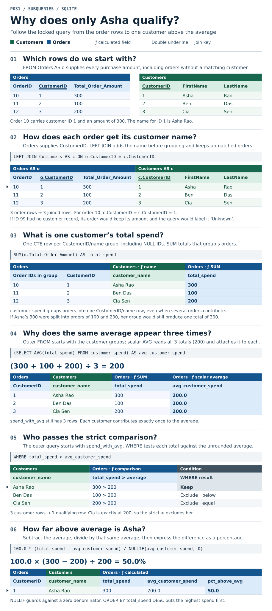

# PNP P031 — Customers who spend more than the average customer

**Topic** Subqueries · **Difficulty**  · **Restart practice** 2026-11-19

[Question and required columns](../../../2.PNP-%20foundations%20and%20practice/6.%20SubQueries/P031.%20Customers%20who%20spend%20more%20than%20the%20average%20customer.md#question-and-image) · [Practice input and expected output](../../../2.PNP-%20foundations%20and%20practice/6.%20SubQueries/P031.%20Customers%20who%20spend%20more%20than%20the%20average%20customer.md#sample-input-and-expected-output) · [Source-colored sample tables](../../assets/question-samples/p031.svg?raw=1)

## Final learner solution — SQLite

Shri selected this exact query as the final SQLite submission on 19 November 2026.

```sql
WITH customer_spend AS (
    SELECT
        o.CustomerID,
        COALESCE(c.FirstName || ' ' || c.LastName, 'Unknown') AS customer_name,
        SUM(o.Total_Order_Amount) AS total_spend
    FROM Orders AS o
    LEFT JOIN Customers AS c ON o.CustomerID = c.CustomerID
    GROUP BY o.CustomerID, c.FirstName, c.LastName
),
spend_with_avg AS (
    SELECT
        cs.*,
        (SELECT AVG(total_spend) FROM customer_spend) AS avg_customer_spend
    FROM customer_spend AS cs
)
SELECT
    CustomerID,
    customer_name,
    total_spend,
    avg_customer_spend,
    100.0 * (total_spend - avg_customer_spend)
        / NULLIF(avg_customer_spend, 0) AS pct_above_avg
FROM spend_with_avg
WHERE total_spend > avg_customer_spend
ORDER BY total_spend DESC;
```

## Visual walkthrough



[Open the walkthrough at full size](../../assets/walkthroughs/p031.svg?raw=1)

## Step-by-step walkthrough

### 1. Which rows do we start with?

`FROM Orders AS o` supplies one row per order. `Customers` supplies the names. These are the two sample inputs used throughout the walkthrough. The order below makes the examples easy to follow.

```sql
SELECT OrderID, CustomerID, Total_Order_Amount FROM Orders ORDER BY OrderID;
SELECT CustomerID, FirstName, LastName FROM Customers ORDER BY CustomerID;
```

**🟦 Orders**

| 🟦 OrderID | 🟦 CustomerID | 🟦 Total_Order_Amount |
| --- | --- | --- |
| 10 | 1 | 300 |
| 11 | 2 | 100 |
| 12 | 3 | 200 |

**🟩 Customers**

| 🟩 CustomerID | 🟩 FirstName | 🟩 LastName |
| --- | --- | --- |
| 1 | Asha | Rao |
| 2 | Ben | Das |
| 3 | Cia | Sen |

### 2. How does each order get a name?

The left side starts with the three orders. The right side supplies a customer record for each matching ID. Order 10 matches customer 1. With one match per order, the join produces three rows. An unmatched order survives with missing customer fields. The name expression in the next step displays `Unknown` for it.

```sql
SELECT o.OrderID, o.CustomerID, o.Total_Order_Amount,
       c.CustomerID, c.FirstName, c.LastName
FROM Orders AS o
LEFT JOIN Customers AS c ON o.CustomerID = c.CustomerID
ORDER BY o.OrderID;
```

| 🟦 OrderID | 🟦 o.CustomerID | 🟦 Total_Order_Amount | 🟩 c.CustomerID | 🟩 FirstName | 🟩 LastName |
| --- | --- | --- | --- | --- | --- |
| 10 | 1 | 300 | 1 | Asha | Rao |
| 11 | 2 | 100 | 2 | Ben | Das |
| 12 | 3 | 200 | 3 | Cia | Sen |

### 3. What does one customer spend?

The first CTE groups by the ordering ID and matched name fields. `SUM` adds every order amount in that group. The three input orders produce three customer rows in this example.

```sql
SELECT
    o.CustomerID,
    COALESCE(c.FirstName || ' ' || c.LastName, 'Unknown') AS customer_name,
    SUM(o.Total_Order_Amount) AS total_spend
FROM Orders AS o
LEFT JOIN Customers AS c ON o.CustomerID = c.CustomerID
GROUP BY o.CustomerID, c.FirstName, c.LastName;
```

| 🟦 CustomerID | 🟩 customer_name | 🟦 total_spend |
| --- | --- | --- |
| 1 | Asha Rao | 300 |
| 2 | Ben Das | 100 |
| 3 | Cia Sen | 200 |

In a separate check, replacing order 10 with two orders of 100 and 200 for Asha produced the same total of 300 and the same final row.

### 4. Why does every customer get the same average?

The second CTE starts with `customer_spend AS cs`. The scalar subquery reads all three customer totals. Its one result is (300 + 100 + 200) ÷ 3 = 200. The outer `SELECT` puts that number alongside each customer.

```sql
SELECT
    cs.*,
    (SELECT AVG(total_spend) FROM customer_spend) AS avg_customer_spend
FROM customer_spend AS cs;
```

| 🟦 CustomerID | 🟩 customer_name | 🟦 total_spend | 🟦 avg_customer_spend |
| --- | --- | --- | --- |
| 1 | Asha Rao | 300 | 200.0 |
| 2 | Ben Das | 100 | 200.0 |
| 3 | Cia Sen | 200 | 200.0 |

### 5. Who passes the filter?

The final query starts with `spend_with_avg`. This diagnostic projection makes its `WHERE` decision visible. In SQLite, 1 means true and 0 means false.

```sql
SELECT customer_name, total_spend, avg_customer_spend,
       total_spend > avg_customer_spend AS qualifies
FROM spend_with_avg
ORDER BY CustomerID;
```

| 🟩 customer_name | 🟦 total_spend | 🟦 avg_customer_spend | 🟦 qualifies |
| --- | --- | --- | --- |
| Asha Rao | 300 | 200.0 | 1 |
| Ben Das | 100 | 200.0 | 0 |
| Cia Sen | 200 | 200.0 | 0 |

The filter keeps Asha. Ben falls below 200. Cia is exactly at 200, so the strict greater-than comparison excludes her.

### 6. How far above average is Asha?

Apply the final projection and sort the surviving rows by descending spend. Asha is 100 above the average. Dividing that difference by 200 and multiplying by 100 gives 50 percent. `NULLIF` guards against dividing by zero.

```sql
SELECT
    CustomerID,
    customer_name,
    total_spend,
    avg_customer_spend,
    100.0 * (total_spend - avg_customer_spend)
        / NULLIF(avg_customer_spend, 0) AS pct_above_avg
FROM spend_with_avg
WHERE total_spend > avg_customer_spend
ORDER BY total_spend DESC;
```

| 🟦 CustomerID | 🟩 customer_name | 🟦 total_spend | 🟦 avg_customer_spend | 🟦 pct_above_avg |
| --- | --- | --- | --- | --- |
| 1 | Asha Rao | 300 | 200.0 | 50.0 |

## Sample verification

Executed in SQLite on the three orders in the practice example. Asha, Ben and Cia spend 300, 100 and 200 respectively. The scalar subquery returns 200. The strict comparison excludes Cia, whose total equals the average.

| 🟦 CustomerID | 🟩 customer_name | 🟦 total_spend | 🟦 avg_customer_spend | 🟦 pct_above_avg |
| ---: | --- | ---: | ---: | ---: |
| 1 | Asha Rao | 300 | 200.0 | 50.0 |

## Comparison with the course answer

- Adding an order worth 1000 with a `NULL` customer ID to the practice data produces a fourth group in the submitted query. SQLite returns that group with a total of 1000 and an average of 400. The course answer excludes orders with a `NULL` customer ID before it calculates the average.
- Giving that same order customer ID 99, which has no customer record, returns `Unknown` in the submission. The course uses `Unknown customer` for an unmatched ID and joins the available name parts for a matched customer.
- The submission returns the unrounded average and percentage and sorts by descending spend. The course rounds both displayed calculations to two decimals and uses customer ID to break spending ties. Both compare totals with the unrounded average.

[Official PostgreSQL answer, Q31](https://github.com/MulikShrikantDattatray14/Data-Engineering-Mastry/blob/fa70de6416696e0d6ab94faee964e048f9552ecd/1.%20SQL%20Mastery/1.%20SQL%20Mastry/2.PNP-%20foundations%20and%20practice/Source%20Materials/PrepNPlaced_SQL_100_v2/sql/all_100_solutions.sql#L370-L393)
