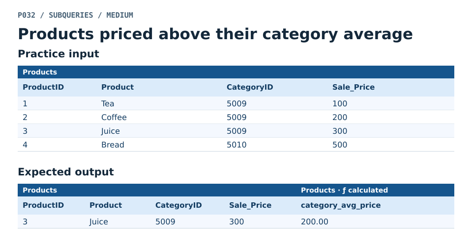
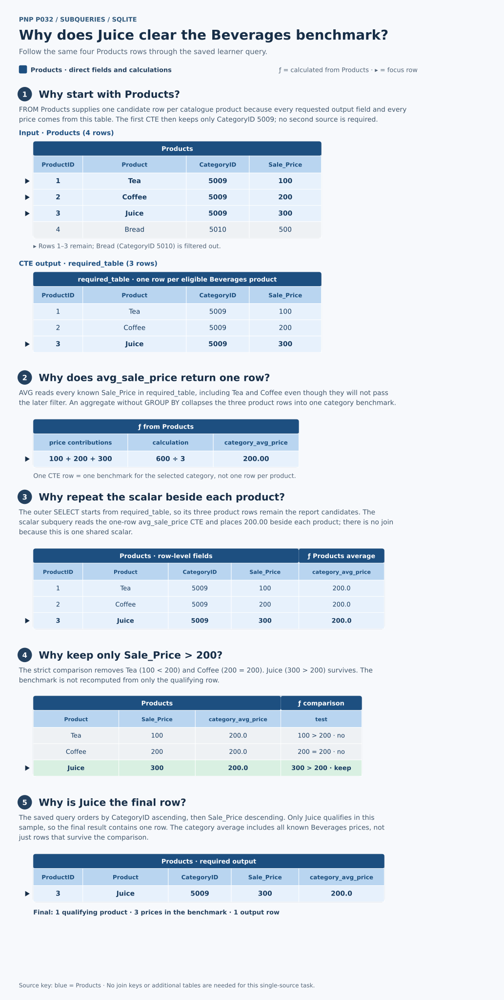

# PNP P032 — Products priced above their category average

**Topic** Subqueries · **Difficulty** 

> **Spoiler caution:** The linked original PNP Markdown includes solution sections. Keep the source page closed until after your independent attempt; this practice page itself stays solution-free.

[Original PNP question](../../../2.PNP-%20foundations%20and%20practice/6.%20SubQueries/P032.%20Products%20priced%20above%20their%20category%20average.md#question-and-image) · [PDF source](../../../2.PNP-%20foundations%20and%20practice/Source%20Materials/Updated_100_SQL_Interview_Questions.pdf), Q32, pp. 54–56.

## Question

**Table colors** · 🟦 `Products`

**Business scenario.** The pricing team is reviewing products that sit at the expensive end of their own category before a festive sale. A product at 600 is cheap in cookware and expensive in snacks, so a single catalogue-wide cut-off is useless. The festive sale is in Beverages first, so they start there, and they want each product compared only with the products in its own category.

**Task.** For the Beverages category ( CategoryID 5009), return every product whose Sale_Price is strictly greater than the average Sale_Price of all products with the same CategoryID . Show the category average next to it. Sort by CategoryID , then price, highest first.

### Required output columns

One result row represents one qualifying Beverages product. All five columns are supplied by, or calculated from, 🟦 `Products`. Return them in this order.

| # | Output column | Source / calculation | Meaning per output row, eligibility and precision rules | Example value |
| ---: | --- | --- | --- | --- |
| 1 | `ProductID` | 🟦 `Products.ProductID` | Return the identifier of the individual product whose price qualifies. It identifies the item in the pricing review. | 🟦 3 |
| 2 | `Product` | 🟦 `Products.Product` | Return the catalogue name belonging to that same product ID. | 🟦 Juice |
| 3 | `CategoryID` | 🟦 `Products.CategoryID` | Return the product’s category ID. The report is limited to Beverages, so every output row carries 5009. | 🟦 5009 |
| 4 | `Sale_Price` | 🟦 `Products.Sale_Price` | Return the individual product’s stored sale price. It qualifies only when strictly greater than the unrounded average for its own category. Equality does not qualify. | 🟦 300 |
| 5 | `category_avg_price` | 🟦 Calculated from `Products.Sale_Price` within the same `CategoryID` | Show the mean of all known sale prices in the product’s category, including this product. Below-average and equal-priced products contribute too. Display the benchmark to two decimals. | 🟦 200.00 |

**Row eligibility and ordering.** Compare using the unrounded category average. A product with a missing sale price cannot pass the comparison. Sort by `CategoryID` ascending, then `Sale_Price` descending. The prompt gives no further rule for equal prices.

### Practice example · Sample input

**Sample table key · display order:** 🟦 `Products`

*The assignment supplies the output columns but no sample input table. These four rows are illustrative practice data, not an assignment-provided example.*

**🟦 `Products`**

| 🟦 ProductID | 🟦 Product | 🟦 CategoryID | 🟦 Sale_Price |
| --- | --- | --- | --- |
| 🟦 1 | 🟦 Tea | 🟦 5009 | 🟦 100 |
| 🟦 2 | 🟦 Coffee | 🟦 5009 | 🟦 200 |
| 🟦 3 | 🟦 Juice | 🟦 5009 | 🟦 300 |
| 🟦 4 | 🟦 Bread | 🟦 5010 | 🟦 500 |

### Expected output

| 🟦 ProductID | 🟦 Product | 🟦 CategoryID | 🟦 Sale_Price | 🟦 category_avg_price |
| --- | --- | --- | --- | --- |
| 🟦 3 | 🟦 Juice | 🟦 5009 | 🟦 300 | 🟦 200.00 |



[Open the sample SVG full size](../../assets/question-samples/p032.svg?raw=1)

**Precision note.** The required output specification asks for the category average to display to two decimal places. The locked learner query deliberately leaves the benchmark unrounded, so SQLite returns `200.0` for this fixture; the expected display is `200.00`. The original course answer rounds the displayed benchmark to two decimals. The learner query is preserved verbatim.

### How the sample produces this output

For 🟦 Beverages (CategoryID 🟦 5009), Tea, Coffee and Juice contribute **🟦 100 + 🟦 200 + 🟦 300 = 🟦 600**. Dividing by the three known prices gives **🟦 600 ÷ 3 = 🟦 200.00**. Tea at 🟦 100 is below the average. Coffee at 🟦 200 equals it, so it does not meet the strict greater-than condition. Juice (ProductID 🟦 3) at 🟦 300 is above 🟦 200 and is the only qualifying row. Bread (ID 🟦 4) is in CategoryID 🟦 5010 and does not contribute to this category’s average or appear in the Beverages report.

## Step 1 · Your approach before writing SQL

1. What does one output row represent, and which columns should it contain?
2. Which table supplies the required fields, and why would you start from it? Would you need any other table?
3. Which products should contribute to the category average, and how would you compare an individual product with that benchmark?
4. How would you handle a product whose price equals the average or is missing?
5. How would you apply the Beverages restriction and the requested ordering?
6. Trace Tea, Coffee and Juice through your proposed steps, then explain why Bread is treated separately.

## My solution — SQLite

**Final learner-selected solution.** Checked against the illustrative sample in SQLite on 24 November 2026. It returns Juice (ProductID 3) at 300, with a category average of 200.0.

```sql
WITH required_table AS (
    SELECT
        ProductID,
        Product,
        CategoryID,
        Sale_Price
    FROM Products
    WHERE CategoryID = 5009
),

avg_sale_price AS (
    SELECT
        AVG(Sale_Price) AS category_avg_price
    FROM required_table
)

SELECT
    ProductID,
    Product,
    CategoryID,
    Sale_Price,
    (SELECT category_avg_price FROM avg_sale_price) AS category_avg_price
FROM required_table
WHERE Sale_Price > (
    SELECT category_avg_price
    FROM avg_sale_price
)
ORDER BY
    CategoryID ASC,
    Sale_Price DESC;
```

**Why no `GROUP BY` is needed:** `required_table` retains one row per product. `avg_sale_price` calculates one benchmark for the filtered category. The outer query compares each product row against that scalar benchmark, so individual product rows are not collapsed.

The benchmark includes all known sale prices in CategoryID 5009, including products that do not qualify. Equality is excluded by the strict `>` comparison.

## Important learnings from P032

### 1. Define the comparison population before calculating an average

The benchmark must represent **all known sale prices in the target category**, not only products that eventually qualify. Filter to CategoryID 5009 first, calculate its average, and only then compare each product against that scalar result. If the above-average predicate is applied before the average is calculated, the benchmark population becomes circular and incorrect.

### 2. Keep the row grain separate from the aggregate grain

- `required_table` retains one row per eligible product.
- `avg_sale_price` returns one row containing one category-wide scalar benchmark.
- The outer query starts from the product rows and compares each one with that scalar. The aggregate CTE does not replace the product rows.
- No `GROUP BY` is needed in the outer query because the task returns qualifying product rows, not one summary row.

### 3. Strict comparison and NULL behaviour

- `>` excludes a product whose price equals the average; `>=` would change the requirement.
- A NULL sale price cannot satisfy the comparison because comparisons with NULL are UNKNOWN, not TRUE.
- `AVG(Sale_Price)` ignores NULL prices. The benchmark is the average of known prices in the selected category.
- Do not round the benchmark before filtering. Display rounding and comparison precision are separate concerns.

### 4. Filtering and ordering

- Restrict the benchmark population to CategoryID 5009, because the requested report is specifically for Beverages.
- Sort by CategoryID ascending, then Sale_Price descending. Do not invent a required tie-breaker when the prompt does not specify one; if a deterministic tie-breaker is added, document it as an implementation choice.

### 5. Learner query versus official answer

The learner's CTE version and the course's correlated-subquery version express the same category benchmark for this single-category task. The official answer rounds the displayed average to two decimals and adds ProductID as a tie-breaker; the learner query preserves an unrounded benchmark and the stated sort only. Preserve the learner's selected query verbatim and describe these differences rather than silently changing it.

## Visual walkthrough



[Open the full-size walkthrough SVG](../../assets/walkthroughs/p032.svg?raw=1) · [Open Previous / Next walkthrough, stage 1](../../assets/steps/PNP-P032/01.md) · [Open the walkthrough fixture](../../assets/steps/PNP-P032/walkthrough.json)

## Step-by-step walkthrough

The query uses one source table, `Products`. There is no join: the category benchmark is a scalar aggregate, not a second row-level source that needs to be joined.

### 1. Which rows do we start with?

Start from `Products`, because it contains every product candidate and all five requested output fields. The practice input has four rows: Tea, Coffee, Juice and Bread.

```sql
WITH required_table AS (
    SELECT
        ProductID,
        Product,
        CategoryID,
        Sale_Price
    FROM Products
    WHERE CategoryID = 5009
)
```

The CategoryID filter keeps the three Beverages rows (Tea, Coffee and Juice) and removes Bread, whose CategoryID is 5010. Row count: **4 input products → 3 required_table rows**.

| ProductID | Product | CategoryID | Sale_Price |
|---:|---|---:|---:|
| 1 | Tea | 5009 | 100 |
| 2 | Coffee | 5009 | 200 |
| 3 | Juice | 5009 | 300 |

### 2. What population contributes to the average?

Calculate the average from all rows in `required_table`, before removing products that are not above average.

```sql
avg_sale_price AS (
    SELECT
        AVG(Sale_Price) AS category_avg_price
    FROM required_table
)
```

The CTE returns **one row** and one scalar benchmark:

`(100 + 200 + 300) / 3 = 200.00`

Tea and Coffee must contribute even though neither will appear in the final result. If we filtered to above-average products before calculating the average, we would change the population used to define the benchmark.

### 3. Which rows does the outer query start from?

The outer query starts from `required_table`, so it still has one row per Beverages product. It does not start from the one-row aggregate CTE.

```sql
SELECT
    ProductID,
    Product,
    CategoryID,
    Sale_Price,
    (SELECT category_avg_price FROM avg_sale_price) AS category_avg_price
FROM required_table
```

The scalar subquery supplies the same category average beside each of the three product rows. No join is required: this query asks for one scalar value, not matching rows from a second detail table.

| Product | Sale_Price | category_avg_price |
|---|---:|---:|
| Tea | 100 | 200.00 |
| Coffee | 200 | 200.00 |
| Juice | 300 | 200.00 |

### 4. Why does the strict comparison keep only Juice?

```sql
WHERE Sale_Price > (
    SELECT category_avg_price
    FROM avg_sale_price
)
```

- Tea: 100 is below 200, so it is removed.
- Coffee: 200 equals 200. The strict `>` condition is false, so it is removed.
- Juice: 300 is greater than 200, so it remains.

The filter changes the row count from **3 product rows → 1 qualifying row**. A NULL Sale_Price would not pass this comparison because a comparison with NULL is UNKNOWN, not TRUE.

### 5. How is the final result ordered?

```sql
ORDER BY
    CategoryID ASC,
    Sale_Price DESC;
```

CategoryID is ascending; within a category, Sale_Price is descending. The sample has one qualifying product, so the final output is:

| ProductID | Product | CategoryID | Sale_Price | category_avg_price |
|---:|---|---:|---:|---:|
| 3 | Juice | 5009 | 300 | 200.0 |

The saved learner query returns the same row. SQLite displays the unrounded numeric average as `200.0`; the specification's two-decimal presentation is `200.00`. The course answer explicitly rounds the displayed benchmark, while the locked learner query is preserved without that display-rounding change.

The final stage in the linked walkthrough reads the exact locked learner SQLite query and is checked against the expected output above.
## Learner solution — SQL Server adaptation

**Learner-query SQL Server adaptation.** This keeps the selected CTE structure and the unrounded benchmark. The source dataset defines `Sale_Price` as `NUMERIC(10,2)`, so SQL Server's `AVG` returns a decimal result.

```sql
WITH required_table AS (
    SELECT
        ProductID,
        Product,
        CategoryID,
        Sale_Price
    FROM Products
    WHERE CategoryID = 5009
),

avg_sale_price AS (
    SELECT
        AVG(Sale_Price) AS category_avg_price
    FROM required_table
)

SELECT
    ProductID,
    Product,
    CategoryID,
    Sale_Price,
    (SELECT category_avg_price FROM avg_sale_price) AS category_avg_price
FROM required_table
WHERE Sale_Price > (
    SELECT category_avg_price
    FROM avg_sale_price
)
ORDER BY
    CategoryID ASC,
    Sale_Price DESC;
```

## Official solution

### Original course answer — PostgreSQL 16

Source: [`all_100_solutions.sql`, Q32, lines 395–409](../../../2.PNP-%20foundations%20and%20practice/Source%20Materials/PrepNPlaced_SQL_100_v2/sql/all_100_solutions.sql#L395-L409). Preserved as supplied.

```sql
SELECT p.ProductID,
       p.Product,
       p.CategoryID,
       p.Sale_Price,
       ROUND((SELECT AVG(p2.Sale_Price)
              FROM Products AS p2
              WHERE p2.CategoryID = p.CategoryID), 2) AS category_avg_price
FROM Products AS p
WHERE p.CategoryID = 5009
  AND p.Sale_Price > (SELECT AVG(p2.Sale_Price)
                      FROM Products AS p2
                      WHERE p2.CategoryID = p.CategoryID)
ORDER BY p.CategoryID, p.Sale_Price DESC, p.ProductID;
```

### Official-answer SQLite adaptation

```sql
SELECT p.ProductID,
       p.Product,
       p.CategoryID,
       p.Sale_Price,
       ROUND((SELECT AVG(p2.Sale_Price)
              FROM Products AS p2
              WHERE p2.CategoryID = p.CategoryID), 2) AS category_avg_price
FROM Products AS p
WHERE p.CategoryID = 5009
  AND p.Sale_Price > (SELECT AVG(p2.Sale_Price)
                      FROM Products AS p2
                      WHERE p2.CategoryID = p.CategoryID)
ORDER BY p.CategoryID, p.Sale_Price DESC, p.ProductID;
```

### Official-answer SQL Server adaptation

```sql
SELECT p.ProductID,
       p.Product,
       p.CategoryID,
       p.Sale_Price,
       ROUND((SELECT AVG(p2.Sale_Price)
              FROM Products AS p2
              WHERE p2.CategoryID = p.CategoryID), 2) AS category_avg_price
FROM Products AS p
WHERE p.CategoryID = 5009
  AND p.Sale_Price > (SELECT AVG(p2.Sale_Price)
                      FROM Products AS p2
                      WHERE p2.CategoryID = p.CategoryID)
ORDER BY p.CategoryID, p.Sale_Price DESC, p.ProductID;
```

## Comparison with the course answer

- The course answer uses correlated scalar subqueries; the learner uses `required_table` and `avg_sale_price` CTEs.
- The learner filters to CategoryID 5009 before calculating the average. That is equivalent for this report because it is restricted to Beverages; the benchmark still includes every known Beverages price before the above-average filter.
- The course answer rounds the displayed average to two decimals. The locked learner query returns the unrounded value.
- The course answer adds ProductID as a final tie-breaker. The prompt does not specify a tie-breaker after price, so the learner's ordering satisfies the stated requirement.

The learner-selected SQL is retained exactly; these differences are documented rather than silently normalised.

## Verification

- Illustrative fixture: Tea 100, Coffee 200, Juice 300 in CategoryID 5009; Bread 500 in CategoryID 5010.
- Category 5009 benchmark: (100 + 200 + 300) / 3 = 200.
- Strict greater-than result: Juice only; Tea is below and Coffee equals the benchmark.
- Confirmed the learner SQLite query returns ProductID 3, Juice, CategoryID 5009, Sale_Price 300 and category_avg_price 200.0 for the illustrative fixture.
- Display precision note: the specification/example presents 200.00; the locked learner query returns 200.0 in SQLite. The original course answer rounds to two decimal places. Keep this difference explicit.
- SQL Server adaptation is documented; do not describe it as natively executed unless a SQL Server engine run is performed.
- This verification is limited to the stated fixture; it is not a proof over every possible dataset.
