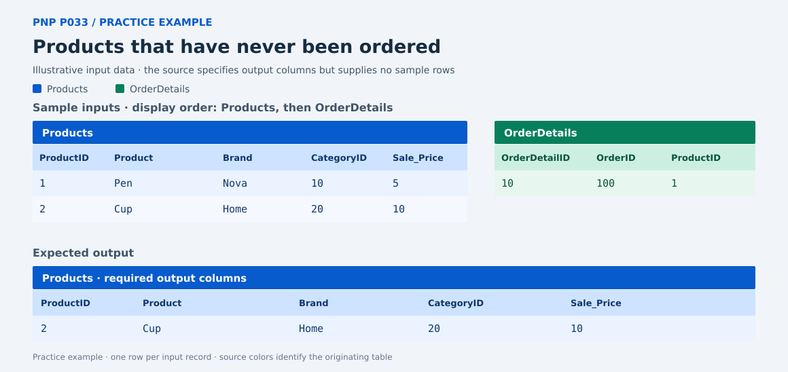
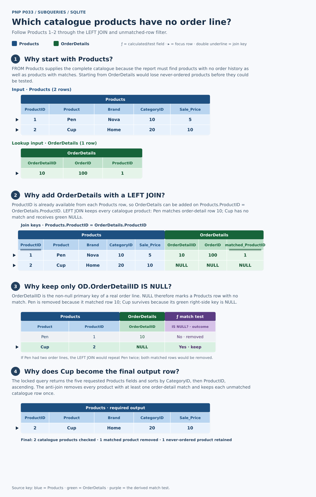

# PNP P033 — Products that have never been ordered

**Topic** Subqueries · **Difficulty** 

[Original PNP question](../../../2.PNP-%20foundations%20and%20practice/6.%20SubQueries/P033.%20Products%20that%20have%20never%20been%20ordered.md#question-and-image) · [PDF source](../../../2.PNP-%20foundations%20and%20practice/Source%20Materials/Updated_100_SQL_Interview_Questions.pdf), Q33, pp. 56–58.

## Question

**Table colors** · 🟦 `Products` · 🟩 `OrderDetails`

**Business scenario.** The merchandising team pays for shelf space in the warehouse and wants to delist products that have never sold. Before anything is removed from the catalogue, they want the list of products with zero order lines in the entire history. A product that appeared in even one order line, in any quantity, is not on the list.

**Task.** Return every product in Products that does not appear in any row of OrderDetails. Sort by CategoryID, then ProductID.

### Required output columns

One result row represents a product that has never appeared in an order line. Return the five columns in this order.

| # | Output column | Source | Requirement for this product row | Example |
| ---: | --- | --- | --- | --- |
| 1 | `ProductID` | 🟦 `Products.ProductID` | Identifier of the catalogue product being checked for any order-line appearance. | 🟦 2 |
| 2 | `Product` | 🟦 `Products.Product` | Product name belonging to that catalogue ID. | 🟦 Cup |
| 3 | `Brand` | 🟦 `Products.Brand` | Brand recorded for that product. | 🟦 Home |
| 4 | `CategoryID` | 🟦 `Products.CategoryID` | Category to which the product belongs; used in the requested ascending sort. | 🟦 20 |
| 5 | `Sale_Price` | 🟦 `Products.Sale_Price` | Stored sale price of the product. | 🟦 10 |

**Row eligibility and ordering.** Include a product only when no row in 🟩 `OrderDetails` has its `ProductID`. Even one order line disqualifies it, regardless of quantity. Sort by `CategoryID` ascending, then `ProductID` ascending.

### Practice example · Sample input

**Sample table key · display order:** 🟦 `Products` · 🟩 `OrderDetails`

*The source specifies output columns but no sample input rows. These are illustrative practice data.*

**🟦 Products**

| 🟦 ProductID | 🟦 Product | 🟦 Brand | 🟦 CategoryID | 🟦 Sale_Price |
| ---: | --- | --- | ---: | ---: |
| 🟦 1 | Pen | Nova | 10 | 5 |
| 🟦 2 | Cup | Home | 20 | 10 |

**🟩 OrderDetails**

| 🟩 OrderDetailID | 🟩 OrderID | 🟩 ProductID |
| ---: | ---: | ---: |
| 🟩 10 | 🟩 100 | 🟩 1 |

### Expected output · Practice example

| 🟦 ProductID | 🟦 Product | 🟦 Brand | 🟦 CategoryID | 🟦 Sale_Price |
| ---: | --- | --- | ---: | ---: |
| 🟦 2 | 🟦 Cup | 🟦 Home | 🟦 20 | 🟦 10 |



[Open the practice-example SVG full size](../../assets/question-samples/p033.svg?raw=1)

### How the practice example produces this output

🟦 Pen (ProductID 1) appears in 🟩 OrderDetails row 10, so it is excluded. 🟦 Cup (ProductID 2) has no matching order-detail row, so it qualifies. The result contains one product.

## Step 1 · Your approach before writing SQL

1. What does one output row represent, and which five columns should it contain?
2. Which source should supply the products being evaluated, and what role does the other source play?
3. Which table would you place first, and how would you use the other source? If you choose a join, what join type and matching key(s) would you use? If you choose a subquery or set operation, what membership test would it perform?
4. How does even one order line affect eligibility, regardless of quantity?
5. How would you apply the requested ordering?
6. Trace Pen and Cup through your proposed logic and explain why only Cup remains.

## Agreed approach

1. Keep `Products` as the driving (left) table because every catalogue product must be considered, including products with no order history.
2. LEFT JOIN `OrderDetails` using `Products.ProductID = OrderDetails.ProductID`.
3. A product with no matching order-detail row receives NULLs in the right-side columns.
4. Filter those unmatched rows with `OD.OrderDetailID IS NULL`. `OrderDetailID` is a non-null identifier for an actual order-detail row.
5. Return the five requested columns from `Products` and sort by `CategoryID` ascending, then `ProductID` ascending.

**Pattern:** LEFT ANTI JOIN — preserve left-side rows that have no match on the right.

## My solution — SQLite

**Final learner solution.** Sample-checked on 24 November 2026 using the illustrative Example 3 below.

```sql
SELECT
    P.ProductID,
    P.Product,
    P.Brand,
    P.CategoryID,
    P.Sale_Price
FROM Products P
LEFT JOIN OrderDetails OD
    ON P.ProductID = OD.ProductID
WHERE OD.OrderDetailID IS NULL
ORDER BY
    P.CategoryID ASC,
    P.ProductID ASC;
```

### Sample verification

**Practice example 3 · Products**

| 🟦 ProductID | 🟦 Product | 🟦 Brand | 🟦 CategoryID | 🟦 Sale_Price |
|---:|---|---|---:|---:|
| 201 | SQL Basics | TechBooks | 10 | 450 |
| 202 | Python Guide | CodePress | 10 | 600 |
| 203 | Data Science | LearnHub | 10 | 800 |
| 204 | Cloud Computing | TechBooks | 20 | 900 |
| 205 | Linux Essentials | CodePress | 20 | 550 |
| 206 | System Design | LearnHub | 20 | 750 |

**Practice example 3 · OrderDetails**

| 🟩 OrderDetailID | 🟩 OrderID | 🟩 ProductID |
|---:|---:|---:|
| 1 | 5001 | 201 |
| 2 | 5001 | 203 |
| 3 | 5002 | 204 |
| 4 | 5003 | 201 |
| 5 | 5004 | 206 |

**Expected and verified output**

| 🟦 ProductID | 🟦 Product | 🟦 Brand | 🟦 CategoryID | 🟦 Sale_Price |
|---:|---|---|---:|---:|
| 202 | Python Guide | CodePress | 10 | 600 |
| 205 | Linux Essentials | CodePress | 20 | 550 |

**Checks performed**

- Product 201 has two matching order-detail rows. It is excluded; duplicate matches do not make it eligible.
- Products 203, 204 and 206 each have at least one match and are excluded.
- Products 202 and 205 have no matching order-detail row and are retained.
- The output contains exactly the five requested columns.
- Sorting is CategoryID ascending, then ProductID ascending.
- No `DISTINCT` is required: the `IS NULL` filter removes every matched row, and unmatched left-side product rows occur once.

## My solution — SQL Server

**Learner-query SQL Server adaptation.** The anti-join pattern and NULL test are supported directly in SQL Server; the selected SQLite query's row logic is unchanged.

```sql
SELECT
    P.ProductID,
    P.Product,
    P.Brand,
    P.CategoryID,
    P.Sale_Price
FROM Products P
LEFT JOIN OrderDetails OD
    ON P.ProductID = OD.ProductID
WHERE OD.OrderDetailID IS NULL
ORDER BY
    P.CategoryID ASC,
    P.ProductID ASC;
```

## Official solution

### Original course answer — PostgreSQL 16

Source: [`all_100_solutions.sql`, Q33, lines 410–423](../../../2.PNP-%20foundations%20and%20practice/Source%20Materials/PrepNPlaced_SQL_100_v2/sql/all_100_solutions.sql#L410-L423). Preserved as supplied.

```sql
SELECT p.ProductID,
       p.Product,
       p.Brand,
       p.CategoryID,
       p.Sale_Price
FROM Products AS p
WHERE NOT EXISTS (
    SELECT 1
    FROM OrderDetails AS od
    WHERE od.ProductID = p.ProductID
)
ORDER BY p.CategoryID, p.ProductID;
```

### Official-answer SQLite adaptation

```sql
SELECT p.ProductID,
       p.Product,
       p.Brand,
       p.CategoryID,
       p.Sale_Price
FROM Products AS p
WHERE NOT EXISTS (
    SELECT 1
    FROM OrderDetails AS od
    WHERE od.ProductID = p.ProductID
)
ORDER BY p.CategoryID, p.ProductID;
```

### Official-answer SQL Server adaptation

```sql
SELECT p.ProductID,
       p.Product,
       p.Brand,
       p.CategoryID,
       p.Sale_Price
FROM Products AS p
WHERE NOT EXISTS (
    SELECT 1
    FROM OrderDetails AS od
    WHERE od.ProductID = p.ProductID
)
ORDER BY p.CategoryID, p.ProductID;
```

### Difference from the locked learner query

The course answer uses correlated `NOT EXISTS`; the learner uses a `LEFT JOIN` followed by `OD.OrderDetailID IS NULL`. Both implement the same anti-match requirement. The dataset defines `OrderDetailID` as a primary key, so it cannot be NULL on a real matched row; the learner's NULL test reliably identifies an unmatched product. A product with multiple order lines repeats at the intermediate LEFT JOIN stage, but every matched copy is removed by the NULL filter. The learner's selected query is preserved verbatim.

## Visual walkthrough



[Open the full-size walkthrough SVG](../../assets/walkthroughs/p033.svg?raw=1) · [Open Previous / Next walkthrough, stage 1](../../assets/steps/PNP-P033/01.md) · [Open the walkthrough fixture](../../assets/steps/PNP-P033/walkthrough.json)

### Written step-by-step explanation

1. **Start with `Products`.** It supplies every catalogue row because the report must include products even when they have no order history. Starting from `OrderDetails` would lose never-ordered products before they could be tested.
2. **Add `OrderDetails` second.** `Products.ProductID` is already available, so it can match `OrderDetails.ProductID`. The learner's LEFT JOIN keeps both catalogue rows: Pen matches detail row 10, while Cup has no match and receives NULLs in the green OrderDetails columns.
3. **Keep only the unmatched row.** `OrderDetailID` is the non-null primary key for a real order line. `OD.OrderDetailID IS NULL` therefore removes Pen and retains Cup. If a product had multiple order lines, it would repeat at the join stage, but every matched copy would be removed.
4. **Return and sort the required product fields.** The final query keeps the five Products columns and orders by CategoryID, then ProductID, ascending. No DISTINCT is needed because only unmatched left-side products survive, once each.

The final stage in the linked walkthrough reads the exact locked learner SQLite query and is checked against both the small practice fixture and the saved larger verification case.


## Important learnings from P033

### 1. Identify the driving table from the requested output population

The task asks for products that have never appeared in order lines. Every catalogue product must be considered, including products with no matching order history. Therefore, start from `Products`; starting from `OrderDetails` would lose the very products the report is trying to find.

### 2. LEFT ANTI JOIN pattern

The saved learner query uses:

```sql
FROM Products P
LEFT JOIN OrderDetails OD
    ON P.ProductID = OD.ProductID
WHERE OD.OrderDetailID IS NULL
```

- The LEFT JOIN preserves every product.
- A product with one or more order-detail matches receives a non-NULL OrderDetailID and is excluded.
- A product with no match receives NULL in the right-side columns and is retained.
- `OrderDetailID` is the non-null primary key of an actual order line, so it is a reliable unmatched-row test.
- A product with multiple order lines may repeat in the intermediate join result, but every matched copy is filtered out. No DISTINCT is needed for the remaining unmatched products.

### 3. Equivalent anti-match approaches

The official `NOT EXISTS` solution expresses the same business rule as the learner's LEFT JOIN plus NULL filter. Both ask whether any matching order-detail row exists. Keep the selected learner query unchanged and explain the alternative separately.

### 4. Sorting and output grain

One output row represents one never-ordered product. Return the five requested catalogue columns and sort by CategoryID ascending, then ProductID ascending. Quantity does not determine eligibility: even one order line disqualifies the product.

## Verification

- Small practice fixture: Pen (ProductID 1) has an order-detail match; Cup (ProductID 2) has none. Only Cup is returned.
- Larger practice fixture: products 201–206; order lines reference 201, 203, 204 and 206. Products 202 and 205 are the only unmatched products and are returned in CategoryID/ProductID order.
- Product 201 has duplicate order-line matches; it remains excluded, confirming that one or many matches both disqualify the product.
- Confirmed the result contains exactly the five requested Products columns.
- No DISTINCT is required because only unmatched left-side products survive once each.
- The SQL Server adaptation uses the same LEFT ANTI JOIN pattern; native SQL Server execution should be marked pending unless run on that engine.
- Verification covers the saved fixtures and stated edge cases; it does not claim proof for every possible dataset.
