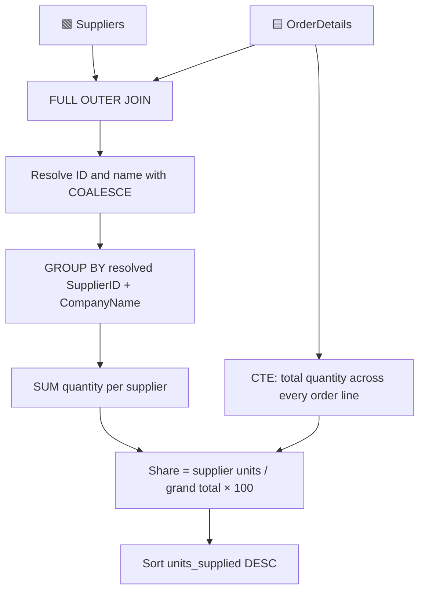

# PNP P034 — Each supplier's share of units supplied

**Topic** Aggregation and joins · **Difficulty** Medium

## Question

**Source:** [100 SQL Interview Questions](../../../2.PNP-%20foundations%20and%20practice/Source%20Materials/Updated_100_SQL_Interview_Questions.pdf), question 34, pp. 58–59. [Source question notes](../../../2.PNP-%20foundations%20and%20practice/9.%20Windowing%20Functions/P034.%20Each%20supplier's%20share%20of%20units%20supplied.md).

**Business scenario.** The supply chain team is reviewing dependence on each supplier before annual contracts are renewed. For every supplier on file they want the units it fulfilled and its share of all units. A supplier with no lines must still appear with zero units, and lines tagged with a SupplierID that is not on file must appear too, so the shares account for all units.

**Task.** For every supplier, and for every unknown SupplierID found on order lines, return the units supplied and the share of all units. Suppliers with no lines show 0 units. Sort by units, highest first.

**Table colors** · 🟩 `Suppliers` · 🟦 `OrderDetails` · 🟪 combined/calculated values.

### Required output columns

| Output column | Source / calculation | Meaning and rules | Example |
|---|---|---|---:|
| `SupplierID` | 🟪 `Suppliers.SupplierID` or `OrderDetails.SupplierID` | Resolved supplier identity; unknown IDs from order lines must remain. | 99 |
| `CompanyName` | 🟩 `Suppliers.CompanyName` or fallback | Supplier name; use `Unknown supplier` when no supplier record matches. | Unknown supplier |
| `units_supplied` | 🟦 `SUM(OrderDetails.Quantity)` | Total units for that supplier identity; 0 when no order lines exist. | 4 |
| `pct_of_units` | 🟪 supplier units / all order-line units × 100 | Share of all units, rounded to 2 decimal places. | 28.57 |

### Practice example · Sample input

*The source PDF specifies the task and output columns but does not provide sample rows. The following is an illustrative practice fixture. SupplierID 99 is deliberately added to test the unknown-supplier requirement.*

**🟩 Input — Suppliers**

| 🟩 SupplierID | 🟩 CompanyName |
|---:|---|
| 🟩 1 | 🟩 Alpha |
| 🟩 2 | 🟩 Beta |
| 🟩 3 | 🟩 Gamma |

**🟦 Input — OrderDetails**

| 🟦 OrderDetailID | 🟦 SupplierID | 🟦 Quantity |
|---:|---:|---:|
| 🟦 1 | 🟦 1 | 🟦 2 |
| 🟦 2 | 🟦 1 | 🟦 3 |
| 🟦 3 | 🟦 2 | 🟦 5 |
| 🟦 4 | 🟦 99 | 🟦 4 |

### Expected output

| 🟪 SupplierID | 🟪 CompanyName | 🟦 units_supplied | 🟪 pct_of_units |
|---:|---|---:|---:|
| 🟪 1 | 🟩 Alpha | 🟦 5 | 🟪 35.71 |
| 🟪 2 | 🟩 Beta | 🟦 5 | 🟪 35.71 |
| 🟪 99 | 🟪 Unknown supplier | 🟦 4 | 🟪 28.57 |
| 🟩 3 | 🟩 Gamma | 🟦 0 | 🟪 0.00 |

Total units = 🟪 2 + 3 + 5 + 4 = 🟪 14. The percentages are 5/14×100 = 35.71%, 5/14×100 = 35.71%, 4/14×100 = 28.57%, and 0/14×100 = 0.00%. Rounded shares sum to 99.99% because of decimal rounding; the unrounded shares sum to 100%.

### How the sample produces this output

- **Alpha (ID 1):** two 🟦 lines contribute 2 + 3 = 5 units. Both lines belong to the same supplier, so they aggregate into one output row. Its share is 5/14×100 = 35.71%.
- **Beta (ID 2):** one line contributes 5 units. Its share is 5/14×100 = 35.71%.
- **Unknown supplier (ID 99):** line 4 contributes 4 units. There is no 🟩 supplier row, but the order line must remain. Its share is 4/14×100 = 28.57%.
- **Gamma (ID 3):** the supplier exists but has no order lines. It must remain with 0 units and 0.00%.
- **Reconciliation:** all order-line units are represented: 5 + 5 + 4 + 0 = 14. The denominator includes the unknown supplier's 4 units.

## Step 1 · Your approach before writing SQL

The final learner query is already recorded below from your submitted attempt. Use these prompts when revisiting or explaining the logic:

1. What does one output row represent? Which columns together identify one supplier?
2. Which table should drive the join, and which unmatched rows must survive from each side?
3. Why is a FULL OUTER JOIN appropriate here? What would a LEFT JOIN lose?
4. How should the supplier ID and name be resolved for an unmatched order line?
5. Should the percentage denominator include unknown SupplierIDs? Why?
6. How should zero total quantity be handled to avoid division by zero?
7. Why should the grouping use both the resolved ID and resolved name?
8. How should the output be sorted, including ties?

**Approach review.** Your first LEFT JOIN approach was scored 7/10: it preserved suppliers without order lines but would discard order lines with unknown SupplierIDs. You revised to FULL OUTER JOIN, correctly preserving both sides. The final approach uses the resolved supplier ID and label as grouping keys and calculates the denominator from all OrderDetails rows.

## Final learner solution — SQLite

The following is Shri's final submitted query, preserved verbatim.

```sql
WITH sum_quantity AS (
    SELECT
        COALESCE(SUM(Quantity), 0) AS total_quantity
    FROM OrderDetails
)

SELECT
    COALESCE(S.SupplierID, OD.SupplierID) AS SupplierID,

    COALESCE(S.CompanyName, 'Unknown supplier') AS CompanyName,

    COALESCE(SUM(OD.Quantity), 0) AS units_supplied,

    CASE
        WHEN (SELECT total_quantity FROM sum_quantity) = 0
            THEN 0.00
        ELSE ROUND(
            COALESCE(SUM(OD.Quantity), 0) * 100.0 /
            (SELECT total_quantity FROM sum_quantity),
            2
        )
    END AS pct_of_units

FROM Suppliers AS S

FULL OUTER JOIN OrderDetails AS OD
    ON S.SupplierID = OD.SupplierID

GROUP BY
    COALESCE(S.SupplierID, OD.SupplierID),
    COALESCE(S.CompanyName, 'Unknown supplier')

ORDER BY
    units_supplied DESC;
```

## Important learnings from P034

### 1. Derive JOIN type from row-preservation requirements

- A supplier with no order line must remain: preserve unmatched 🟩 supplier rows.
- An order line with an unknown SupplierID must remain: preserve unmatched 🟦 order rows.
- A LEFT JOIN from Suppliers preserves the first case but loses the second.
- FULL OUTER JOIN preserves unmatched rows from both inputs.

### 2. Resolve identity and display label separately

`COALESCE(S.SupplierID, OD.SupplierID)` chooses the known supplier key when present, otherwise the ID recorded on the order line. `COALESCE(S.CompanyName, 'Unknown supplier')` provides a display label for an unmatched ID. The fallback label is not a unique key: two unknown IDs must remain separate groups.

### 3. Group by the complete identity

Group by both the resolved SupplierID and CompanyName. Grouping only by CompanyName could merge different supplier IDs that happen to share the same name. Reordering the two GROUP BY expressions does not change group membership; matching the SELECT order is a readability convention.

### 4. Calculate the denominator at the correct scope

The denominator is the sum of Quantity across all OrderDetails rows, not only matched suppliers. Unknown SupplierID rows are part of the business total and must contribute to both the numerator for their unknown-ID group and the overall denominator.

### 5. Protect division by zero

The CTE returns 0 when the table has no non-NULL quantities. The CASE returns 0.00 when the denominator is zero. Otherwise, multiplying by 100.0 forces decimal arithmetic before division, and ROUND(..., 2) formats the percentage to two decimal places.

### 6. Distinguish zero activity from missing identity

A supplier with no lines has a valid supplier identity and zero activity. An unmatched order line has activity but no supplier master record. The FULL OUTER JOIN plus COALESCE keeps these cases distinct.

## Visual walkthrough

**Row-preservation map**



The visual and written walkthrough use the same four-row fixture above. The join must retain both the unmatched Gamma supplier row and the unmatched SupplierID 99 order line.

## Step-by-step walkthrough

### 1. Calculate the grand total independently

```sql
WITH sum_quantity AS (
    SELECT COALESCE(SUM(Quantity), 0) AS total_quantity
    FROM OrderDetails
)
```

| 🟦 OrderDetailID | 🟦 Quantity |
|---:|---:|
| 🟦 1 | 🟦 2 |
| 🟦 2 | 🟦 3 |
| 🟦 3 | 🟦 5 |
| 🟦 4 | 🟦 4 |
| **Total** | **🟪 14** |

This CTE has one row and one scalar value: 14. It includes SupplierID 99 because the denominator represents every order line.

### 2. FULL OUTER JOIN both source tables

```sql
FROM Suppliers AS S
FULL OUTER JOIN OrderDetails AS OD
    ON S.SupplierID = OD.SupplierID
```

| 🟩 S.SupplierID | 🟩 CompanyName | 🟦 OD.SupplierID | 🟦 OrderDetailID | 🟦 Quantity |
|---:|---|---:|---:|---:|
| 🟩 1 | 🟩 Alpha | 🟦 1 | 🟦 1 | 🟦 2 |
| 🟩 1 | 🟩 Alpha | 🟦 1 | 🟦 2 | 🟦 3 |
| 🟩 2 | 🟩 Beta | 🟦 2 | 🟦 3 | 🟦 5 |
| 🟩 NULL | 🟩 NULL | 🟦 99 | 🟦 4 | 🟦 4 |
| 🟩 3 | 🟩 Gamma | 🟦 NULL | 🟦 NULL | 🟦 NULL |

Five joined rows result: four order lines plus one unmatched supplier. No source row required by the question is lost.

### 3. Resolve the supplier identity and label

```sql
COALESCE(S.SupplierID, OD.SupplierID) AS SupplierID,
COALESCE(S.CompanyName, 'Unknown supplier') AS CompanyName
```

| 🟪 SupplierID | 🟪 CompanyName | 🟦 Quantity |
|---:|---|---:|
| 🟪 1 | 🟩 Alpha | 🟦 2 |
| 🟪 1 | 🟩 Alpha | 🟦 3 |
| 🟪 2 | 🟩 Beta | 🟦 5 |
| 🟪 99 | 🟪 Unknown supplier | 🟦 4 |
| 🟪 3 | 🟩 Gamma | 🟦 NULL |

Gamma's joined Quantity is NULL because no order line matched. The final aggregate converts its missing activity to zero.

### 4. Aggregate by resolved supplier identity

```sql
GROUP BY
    COALESCE(S.SupplierID, OD.SupplierID),
    COALESCE(S.CompanyName, 'Unknown supplier')
```

| 🟪 SupplierID | 🟪 CompanyName | 🟪 SUM(Quantity) before COALESCE |
|---:|---|---:|
| 🟪 1 | 🟩 Alpha | 🟪 5 |
| 🟪 2 | 🟩 Beta | 🟪 5 |
| 🟪 99 | 🟪 Unknown supplier | 🟪 4 |
| 🟪 3 | 🟩 Gamma | 🟪 NULL |

Then `COALESCE(SUM(OD.Quantity), 0)` changes Gamma's NULL aggregate to 0. The four output groups reconcile to 14 units.

### 5. Calculate percentages and sort

For each group, use `units_supplied × 100.0 / 14`, rounded to two decimal places. The final ORDER BY sorts the unit totals descending. Alpha and Beta tie at 5; without a secondary key their relative order is not guaranteed by SQL.

## Learner solution — SQL Server adaptation

SQL Server supports the CTE, FULL OUTER JOIN, COALESCE, scalar subquery, CASE and ROUND used by the learner query. The same query text is valid as a SQL Server adaptation:

```sql
WITH sum_quantity AS (
    SELECT
        COALESCE(SUM(Quantity), 0) AS total_quantity
    FROM OrderDetails
)

SELECT
    COALESCE(S.SupplierID, OD.SupplierID) AS SupplierID,
    COALESCE(S.CompanyName, 'Unknown supplier') AS CompanyName,
    COALESCE(SUM(OD.Quantity), 0) AS units_supplied,
    CASE
        WHEN (SELECT total_quantity FROM sum_quantity) = 0
            THEN 0.00
        ELSE ROUND(
            COALESCE(SUM(OD.Quantity), 0) * 100.0 /
            (SELECT total_quantity FROM sum_quantity),
            2
        )
    END AS pct_of_units
FROM Suppliers AS S
FULL OUTER JOIN OrderDetails AS OD
    ON S.SupplierID = OD.SupplierID
GROUP BY
    COALESCE(S.SupplierID, OD.SupplierID),
    COALESCE(S.CompanyName, 'Unknown supplier')
ORDER BY
    units_supplied DESC;
```

*SQL Server execution has not been performed; syntax compatibility is assessed from supported SQL Server constructs, not a live engine run.*

## Official solution

**Source:** `PrepNPlaced_SQL_100_v2/sql/all_100_solutions.sql`, Q34. The original source query is PostgreSQL-style SQL and is preserved below.

```sql
SELECT COALESCE(s.SupplierID, od.SupplierID)                         AS SupplierID,
       COALESCE(s.CompanyName, 'Unknown supplier')                   AS CompanyName,
       COALESCE(SUM(od.Quantity), 0)                                 AS units_supplied,
       ROUND(100.0 * COALESCE(SUM(od.Quantity), 0)
             / NULLIF(SUM(SUM(od.Quantity)) OVER (), 0), 2)          AS pct_of_units
FROM Suppliers AS s
FULL OUTER JOIN OrderDetails AS od ON od.SupplierID = s.SupplierID
GROUP BY COALESCE(s.SupplierID, od.SupplierID), s.CompanyName
ORDER BY units_supplied DESC, SupplierID NULLS LAST;
```

The source uses a window aggregate over grouped sums for the grand total and NULLIF to protect division by zero.

## Comparison with the course answer

- **Same core logic:** both queries use FULL OUTER JOIN, resolve the ID with COALESCE, label missing supplier records as Unknown supplier, sum units per supplier, calculate percentage of the grand total, and sort by units descending.
- **Denominator implementation:** the learner query calculates the grand total once in a one-row CTE and reads it through a scalar subquery. The official query uses `SUM(SUM(od.Quantity)) OVER ()` over the grouped result.
- **Zero-total protection:** the learner uses CASE to return 0.00 when the total is zero. The official query uses NULLIF(total, 0), which makes the division result NULL for a zero denominator. These are different zero-total output semantics.
- **Grouping:** the learner groups by resolved ID and resolved display label. The official groups by resolved ID and the source CompanyName. In the supplied schema and normal supplier master data this yields the intended supplier groups; the learner's explicit fallback label makes the grouping expression align with the displayed output.
- **Ordering:** the learner sorts only by units descending. The official adds SupplierID ascending with NULLS LAST. Thus tie ordering is deterministic in the official answer but unspecified in the learner query.
- **Dialect:** the official query uses PostgreSQL features such as window aggregation and NULLS LAST. The learner query avoids those features and uses constructs supported by SQLite and SQL Server.

## Verification

**Verification status:** sample arithmetic independently checked from the fixture; live SQLite and SQL Server execution not performed in this repair.

| Check | Expected / observed from fixture | Status |
|---|---|---|
| Joined row preservation | 4 order lines + unmatched supplier Gamma = 5 rows | Checked by manual trace |
| Supplier 1 units | 2 + 3 = 5 | Checked |
| Supplier 2 units | 5 | Checked |
| Unknown SupplierID 99 | 4 units retained | Checked |
| Supplier 3 with no lines | 0 units | Checked |
| Grand total | 2 + 3 + 5 + 4 = 14 | Checked |
| Percentage arithmetic | 35.71, 35.71, 28.57, 0.00 | Checked |
| Rounded percentage sum | 99.99% due to rounding; unrounded = 100% | Checked |
| Zero denominator | Learner CASE returns 0.00 | Logic reviewed; no empty-table execution |
| SQLite execution | Not run in this repair | Pending |
| SQL Server execution | Not run | Pending |
| Official answer source | Q34 in source SQL file | Inspected |

**Completion note:** the record structure and saved content have been repaired. Do not mark this question fully execution-verified until the SQL is run against the intended SQLite fixture and SQL Server execution is tested or explicitly waived.
