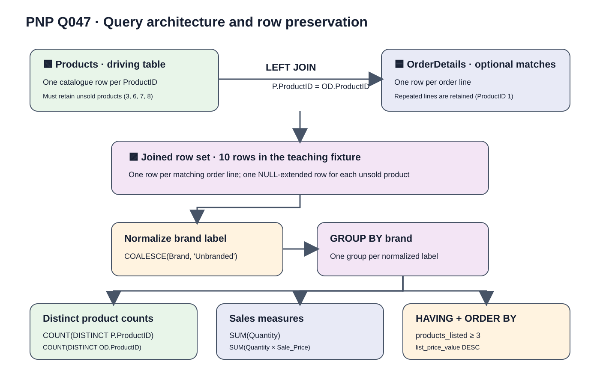
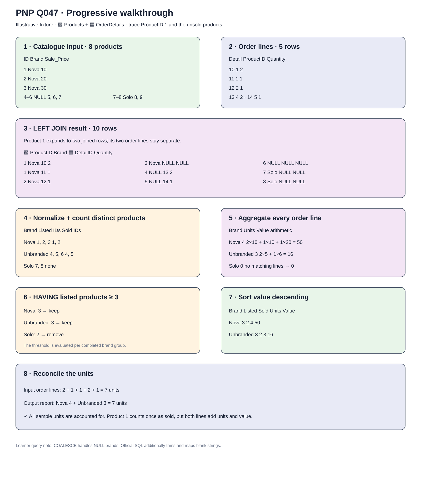

# PNP Q047 — Brands with at least three products, and how much they sold

**Topic** Aggregation · **Difficulty** 

## Question

**Source:** [100 SQL Interview Questions](<../Source Materials/Updated_100_SQL_Interview_Questions.pdf>), question 47, pp. 81–82. **Official SQL:** [Q047 in all_100_solutions.sql](<../Source Materials/PrepNPlaced_SQL_100_v2/sql/all_100_solutions.sql#L353-L364>) · PostgreSQL.

**Table colors** · 🟩 `Products` · 🟦 `OrderDetails` · 🟪 combined/calculated values.

**Business scenario.** The brand management team is choosing which brands get a dedicated brand page on the app. A brand qualifies only if it lists at least three products. For each qualifying brand, the team wants to see how much of its range sells, so it can identify dead listings before launch.

**Task.** For every brand with three or more products in `Products`, return how many products it lists, how many of those have at least one order line, total units sold and list-price value. Products with no brand are grouped under `Unbranded`. Sort by list-price value, highest first.

### Required output columns

One output row represents one normalized brand group that has at least three catalogue products.

| Output column | Source or calculation | Meaning and rules |
|---|---|---|
| `Brand` | 🟩 `Products.Brand` with fallback | Brand name; missing/blank brand is displayed as `Unbranded`. |
| `products_listed` | 🟩 `COUNT(DISTINCT ProductID)` | Number of distinct catalogue products in the brand group, including unsold products. |
| `products_sold` | 🟦 `COUNT(DISTINCT OrderDetails.ProductID)` | Distinct products with at least one order line, not the number of order lines. |
| `units_sold` | 🟦 `SUM(Quantity)` | Total units across all order lines; zero when nothing sold. |
| `list_price_value` | 🟪 `SUM(Quantity * Sale_Price)` | Sum of line quantity multiplied by product sale price; zero when nothing sold. |

### Practice example · Sample input

*Illustrative teaching fixture created for this record; the source question specifies the output contract but does not provide sample rows.*

**🟩 `Products`**

| 🟩 ProductID | 🟩 Brand | 🟩 Sale_Price |
|---:|---|---:|
| 1 | Nova | 10 |
| 2 | Nova | 20 |
| 3 | Nova | 30 |
| 4 | NULL | 5 |
| 5 | NULL | 6 |
| 6 | NULL | 7 |
| 7 | Solo | 8 |
| 8 | Solo | 9 |

**🟦 `OrderDetails`**

| 🟦 OrderDetailID | 🟦 ProductID | 🟦 Quantity |
|---:|---:|---:|
| 10 | 1 | 2 |
| 11 | 1 | 1 |
| 12 | 2 | 1 |
| 13 | 4 | 2 |
| 14 | 5 | 1 |

### Expected output

| 🟪 Brand | 🟪 products_listed | 🟪 products_sold | 🟪 units_sold | 🟪 list_price_value |
|---|---:|---:|---:|---:|
| Nova | 3 | 2 | 4 | 50 |
| Unbranded | 3 | 2 | 3 | 16 |

### How the sample produces this output

- **Nova:** three catalogue products (1, 2, 3). Products 1 and 2 appear in order lines, so two distinct products sold. Product 1 has two lines: its units are 2 + 1. Product 2 contributes 1 unit. Total units = 4. Value = (2 × 10) + (1 × 10) + (1 × 20) = 50. Product 3 remains in the catalogue count despite no sale.
- **Unbranded:** products 4, 5 and 6 have no brand. Products 4 and 5 sold; product 6 did not. Total units = 2 + 1 = 3. Value = (2 × 5) + (1 × 6) = 16.
- **Solo:** only two listed products, so it is excluded by the three-product threshold.
- Product 1 has two order lines but counts once in `products_sold`. This is why the product count must be distinct.

The result preserves the catalogue population: every listed product contributes to its brand's listed count, even if no order line exists.

## Step 1 · Your approach before writing SQL

**Learner's approach (captured during practice).** One output row represents one brand group. Start from `Products` because the catalogue defines the population of listed products, then `LEFT JOIN` `OrderDetails` so unsold catalogue products remain. Group by brand. Count distinct product IDs for listed and sold products. Sum quantities and line-level sale price multiplied by quantity. Apply the three-product threshold with `HAVING`, then sort by list-price value descending.

### Approach review

**Score: 8.5/10.** The learner independently selected the correct driving table, row-preserving join, brand-level grouping, aggregate calculations, aggregate filter and sort. During review, the initial expressions `COUNT(Brand)` and `COUNT(OrderDetailID)` were corrected to distinct product-ID counts. The final learner query then added zero fallbacks. The remaining improvement is to normalize blank/whitespace-only brands as the official answer does, and to decide how a real brand literally named `Unbranded` should be distinguished from missing-brand products.

## Final learner solution — SQLite

**Submitted final learner SQL, preserved verbatim:**

```sql
SELECT
    COALESCE(P.Brand, 'Unbranded') AS Brand,

    COUNT(DISTINCT P.ProductID) AS products_listed,

    COUNT(DISTINCT OD.ProductID) AS products_sold,

    COALESCE(SUM(OD.Quantity), 0) AS units_sold,

    COALESCE(
        SUM(P.Sale_Price * OD.Quantity),
        0
    ) AS list_price_value

FROM Products AS P

LEFT JOIN OrderDetails AS OD
    ON P.ProductID = OD.ProductID

GROUP BY
    COALESCE(P.Brand, 'Unbranded')

HAVING
    COUNT(DISTINCT P.ProductID) >= 3

ORDER BY
    list_price_value DESC;
```

**Review note:** This query implements the core requirement for NULL brand values. It does not normalize empty or whitespace-only strings to `Unbranded`, whereas the official PostgreSQL answer does. The query is preserved as submitted; do not silently replace it. A final corrected learner version requires the learner's approval.

## Important learnings from Q047

1. **Choose the driving table from the population the report must represent.** The task asks about products listed in the catalogue, including those that never sold. Therefore `Products` is the starting table.
2. **Use LEFT JOIN to preserve unsold catalogue products.** A product with no matching order line remains, with NULL values on the `OrderDetails` side.
3. **Separate product counts from order-line counts.** One product can have several order lines. `COUNT(DISTINCT ProductID)` counts the product once; `COUNT(OrderDetailID)` would count its lines.
4. **Listed and sold are different measures.** Listed products come from `Products`; sold products are distinct product IDs present in `OrderDetails`.
5. **Units and product count have different grains.** `SUM(Quantity)` adds units, while distinct product count counts catalogue items.
6. **Calculate line value before aggregating.** Each order line contributes `Quantity * Sale_Price`; summing those contributions gives the brand total.
7. **Use HAVING for aggregate eligibility.** The minimum of three products is a condition on each completed brand group, so it belongs in `HAVING`, not `WHERE`.
8. **COALESCE handles an empty SUM result.** For a brand with no order lines, `SUM` returns NULL; the requested display is zero.
9. **Normalize blank strings deliberately.** The official expression uses `COALESCE(NULLIF(TRIM(Brand), ''), 'Unbranded')`, which handles NULL, empty and whitespace-only values. The learner's submitted expression handles NULL only.
10. **Consider label collisions.** If a genuine brand is literally named `Unbranded`, replacing missing brands with the same label merges two distinct source groups. The task/source uses this label; if the dataset can contain that real brand, a separate internal grouping key is safer.

## Visual walkthrough

**Table colors:** 🟩 Products · 🟦 OrderDetails · 🟪 joined/calculated results. The source color stays with its values through each stage, including NULL-extended order-line cells.

### A. Query architecture · row-preservation overview

The architecture view shows why Products drives the query, what the LEFT JOIN preserves, and how brand normalization, aggregation, HAVING and sorting follow.



[Open the full-size query architecture SVG](assets/p047-query-flow.svg?raw=1)

### B. Progressive sample-row walkthrough

The progressive view follows the same eight-product/five-order-line fixture through the 10-row join, distinct product counts, sums, HAVING and final sort. Product 1 is highlighted conceptually because it has two order lines: one distinct sold product, but both lines contribute units and value.



[Open the full-size progressive walkthrough SVG](assets/p047-progressive-walkthrough.svg?raw=1)

### C. Previous / Next walkthrough · 8 stages

Follow the P026-style pages in order. Each page shows the SQL added or changed, its input, the intermediate result, and why the stage matters.

1. [01 · Why start with Products?](../../1.1%20Practice%20questions/assets/steps/PNP-Q047/01.md)
2. [02 · Why LEFT JOIN OrderDetails?](../../1.1%20Practice%20questions/assets/steps/PNP-Q047/02.md)
3. [03 · Why normalize the brand label?](../../1.1%20Practice%20questions/assets/steps/PNP-Q047/03.md)
4. [04 · Why count distinct products?](../../1.1%20Practice%20questions/assets/steps/PNP-Q047/04.md)
5. [05 · Why sum units and line values?](../../1.1%20Practice%20questions/assets/steps/PNP-Q047/05.md)
6. [06 · Why use HAVING?](../../1.1%20Practice%20questions/assets/steps/PNP-Q047/06.md)
7. [07 · Why sort qualifying groups?](../../1.1%20Practice%20questions/assets/steps/PNP-Q047/07.md)
8. [08 · Final output and units reconciliation](../../1.1%20Practice%20questions/assets/steps/PNP-Q047/08.md)

## Step-by-step walkthrough

The query's row grain changes as it moves through the stages. Before aggregation, a joined row represents one order line for a sold product, or one NULL-extended row for an unsold catalogue product. After GROUP BY, one row represents one normalized brand.

### Stage 1 — Start with Products: preserve the catalogue population

```sql
FROM Products AS P
```

The fixture has eight catalogue rows. Products 3, 6, 7 and 8 have no matching order line, but they still belong in `products_listed`. Starting from OrderDetails would omit them entirely, so the report would no longer describe all listed products.

### Stage 2 — LEFT JOIN order lines: retain unsold products

```sql
LEFT JOIN OrderDetails AS OD
    ON P.ProductID = OD.ProductID
```

The five order lines match products 1, 2, 4 and 5. Product 1 matches twice, so it produces two joined rows. Products 3, 6, 7 and 8 each produce one row with NULL values from OrderDetails.

| 🟩 ProductID | 🟩 Brand | 🟦 OrderDetailID | 🟦 Quantity |
|---:|---|---:|---:|
| 1 | Nova | 10 | 2 |
| 1 | Nova | 11 | 1 |
| 2 | Nova | 12 | 1 |
| 3 | Nova | NULL | NULL |
| 4 | NULL | 13 | 2 |
| 5 | NULL | 14 | 1 |
| 6 | NULL | NULL | NULL |
| 7 | Solo | NULL | NULL |
| 8 | Solo | NULL | NULL |

There are **9 joined rows**: four for Nova (product 1 contributes two, product 2 one, product 3 one), three for Unbranded, and two for Solo. This row count is the correct result for the eight catalogue products and five order lines.

### Stage 3 — Normalize the brand label

```sql
COALESCE(P.Brand, 'Unbranded') AS Brand
```

Products 4, 5 and 6 have NULL Brand and are grouped under Unbranded. The learner expression handles NULL. The official expression `COALESCE(NULLIF(TRIM(P.Brand), ''), 'Unbranded')` also converts empty and whitespace-only strings. That is a semantic improvement to consider, not a change silently applied to the submitted query.

### Stage 4 — Count listed products and sold products separately

```sql
COUNT(DISTINCT P.ProductID) AS products_listed,
COUNT(DISTINCT OD.ProductID) AS products_sold
```

| 🟪 Brand | 🟩 Listed product IDs | 🟦 Sold product IDs | Listed | Sold |
|---|---|---|---:|---:|
| Nova | 1, 2, 3 | 1, 2 | 3 | 2 |
| Unbranded | 4, 5, 6 | 4, 5 | 3 | 2 |
| Solo | 7, 8 | none | 2 | 0 |

Product 1 appears on two order lines, but it is one product. DISTINCT prevents the join expansion from inflating the product counts. The NULL order-line ProductID for unsold products is not counted by COUNT.

### Stage 5 — Sum every order line's units and line value

```sql
COALESCE(SUM(OD.Quantity), 0) AS units_sold,
COALESCE(SUM(P.Sale_Price * OD.Quantity), 0) AS list_price_value
```

| 🟪 Brand | 🟦 Unit arithmetic | 🟪 Value arithmetic | Units | Value |
|---|---|---|---:|---:|
| Nova | 2 + 1 + 1 | 2×10 + 1×10 + 1×20 | 4 | 50 |
| Unbranded | 2 + 1 | 2×5 + 1×6 | 3 | 16 |
| Solo | no order lines | no order lines | 0 | 0 |

Unlike product counts, units and value must include every order line. Product 1 contributes two separate line calculations: 2×10 and 1×10. For a brand with no order lines, SUM returns NULL; COALESCE displays zero.

### Stage 6 — Group by the normalized brand

```sql
GROUP BY COALESCE(P.Brand, 'Unbranded')
```

The three joined brand groups collapse into one aggregate row each. The group-level values are the three rows shown in stages 4–5. The GROUP BY expression must match the selected brand-label expression so NULL brands form the Unbranded group.

### Stage 7 — Apply the minimum catalogue size with HAVING

```sql
HAVING COUNT(DISTINCT P.ProductID) >= 3
```

Nova and Unbranded each have three catalogue products and remain. Solo has two and is removed. This is a group-level rule, so HAVING is the correct clause; WHERE would filter individual joined rows before aggregation.

### Stage 8 — Sort by list-price value

```sql
ORDER BY list_price_value DESC;
```

The qualifying results are Nova (50) followed by Unbranded (16). The official query adds Brand as a secondary sort key for deterministic tie ordering; the learner query only specifies the primary descending value order.

### Final reconciliation

The five input order lines contain 2 + 1 + 1 + 2 + 1 = **7 units**. The qualifying output reports 4 + 3 = **7 units**. All units are accounted for. Solo has no sales and is excluded because it has only two listed products, not because its sales are zero.

## Learner solution — SQL Server adaptation

The following is a dialect adaptation of the learner's submitted SQLite query. It preserves the same NULL-only brand fallback and result semantics.

```sql
SELECT
    COALESCE(P.Brand, 'Unbranded') AS Brand,
    COUNT(DISTINCT P.ProductID) AS products_listed,
    COUNT(DISTINCT OD.ProductID) AS products_sold,
    COALESCE(SUM(OD.Quantity), 0) AS units_sold,
    COALESCE(SUM(P.Sale_Price * OD.Quantity), 0) AS list_price_value
FROM Products AS P
LEFT JOIN OrderDetails AS OD
    ON P.ProductID = OD.ProductID
GROUP BY
    COALESCE(P.Brand, 'Unbranded')
HAVING
    COUNT(DISTINCT P.ProductID) >= 3
ORDER BY
    list_price_value DESC;
```

**Status:** Syntax adaptation prepared; native SQL Server execution has not been performed in this workflow.

## Official solution

**Source:** `Source Materials/PrepNPlaced_SQL_100_v2/sql/all_100_solutions.sql`, section `-- Q47`. The source file identifies the solution set as PostgreSQL 16. The following is the official query copied from that source:

```sql
SELECT COALESCE(NULLIF(TRIM(p.Brand), ''), 'Unbranded')               AS Brand,
       COUNT(DISTINCT p.ProductID)                  AS products_listed,
       COUNT(DISTINCT od.ProductID)                 AS products_sold,
       COALESCE(SUM(od.Quantity), 0)                AS units_sold,
       COALESCE(SUM(od.Quantity * p.Sale_Price), 0) AS list_price_value
FROM Products AS p
LEFT JOIN OrderDetails AS od ON od.ProductID = p.ProductID
GROUP BY COALESCE(NULLIF(TRIM(p.Brand), ''), 'Unbranded')
HAVING COUNT(DISTINCT p.ProductID) >= 3
ORDER BY list_price_value DESC, Brand;
```

## Comparison with the course answer

- **Same core design:** both start from `Products`, use `LEFT JOIN`, count distinct product IDs, sum quantities and line value, filter with `HAVING`, and sort by list-price value descending.
- **Brand normalization:** the official answer handles NULL, empty and whitespace-only brands with `COALESCE(NULLIF(TRIM(...), ''), 'Unbranded')`. The learner's query only handles NULL using `COALESCE`.
- **Tie-breaking:** the official answer sorts by `list_price_value DESC, Brand`; the learner sorts only by value. Both satisfy the stated primary sort, but the official answer defines a stable secondary order.
- **Zero totals:** both use `COALESCE` around the aggregate sums.
- **Dialect:** the published answer is PostgreSQL 16. The learner's saved version is SQLite; the separate SQL Server adaptation above is a translation, not the official source query.

The official solution is not silently substituted for the learner's query. The learner query remains preserved verbatim until the learner chooses whether to adopt the additional normalization and tie-breaker.

## Verification

### Static and sample verification

| Check | Result |
|---|---|
| One output row per brand group | Matches query grain |
| Unsold catalogue products retained | Yes, by Products LEFT JOIN OrderDetails |
| Repeated order lines inflate product counts | No, both product counts use DISTINCT |
| Sold products counted by distinct ProductID | Yes |
| Units sum Quantity | Yes |
| Value sums Quantity × Sale_Price | Yes |
| Three-product threshold applied after grouping | Yes, HAVING |
| Primary sort descending by list-price value | Yes |
| NULL sum displayed as zero | Yes, COALESCE |

### Sample arithmetic reconciliation

- Nova: listed = 3; sold = 2; units = 2 + 1 + 1 = 4; value = 20 + 10 + 20 = 50.
- Unbranded: listed = 3; sold = 2; units = 2 + 1 = 3; value = 10 + 6 = 16.
- Solo: listed = 2; excluded by HAVING.
- Total fixture order-line units = 7. The brand output contains 4 + 3 = 7 units, so all sample sales units reconcile.

### Edge-case review

| Edge case | Expected behavior | Learner query |
|---|---|---|
| Product has no order line | Still contributes to listed count; sales totals become zero if whole group has no sales | Correct |
| Product has multiple order lines | Counts once in products_listed and products_sold; every line contributes units/value | Correct |
| Brand is NULL | Displayed as Unbranded | Correct |
| Brand is empty/whitespace-only | Should be Unbranded per official normalization | Needs correction |
| Real brand named Unbranded | Could merge with missing-brand group | Collision caveat |
| Equal list-price values | Any tied order satisfies DESC; official adds Brand tie-breaker | Secondary order unspecified |

**Execution status:** The query and sample have been reviewed logically, but this record does not claim a live SQLite or SQL Server execution. Native engine execution and full source-dataset verification remain pending.

### Final audit status

- [x] Original question, source ID, topic and difficulty retained.
- [x] Required output contract documented.
- [x] Sample fixture and expected output supplied and reconciled.
- [x] Learner approach and score recorded.
- [x] Learner SQLite SQL preserved verbatim.
- [x] SQL Server adaptation drafted separately.
- [x] Question-specific learnings recorded.
- [x] Query architecture SVG created.
- [x] Progressive sample walkthrough SVG created.
- [x] Written stage-by-stage walkthrough added.
- [x] Official PostgreSQL answer copied from the repository source.
- [x] Course comparison added.
- [ ] Learner approval of the blank-brand normalization correction.
- [ ] Native SQLite execution recorded.
- [ ] Native SQL Server execution recorded.
- [ ] Full source dataset verification recorded.

**Status: NEEDS FINAL VERIFICATION — do not mark solved yet.** The learner query is saved and its core logic matches the official answer, but blank/whitespace brand normalization differs and execution evidence is not recorded.
