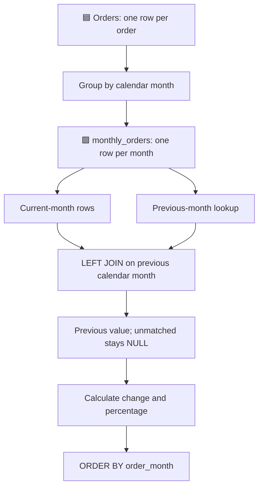

# PNP P044 — Month-over-month growth in order value

**Topic:** Windowing / date-based comparison · **Difficulty:** Medium · **Source:** *100 SQL Interview Questions*, Q44, pp. 76–77.

## Question

**Table colors** · 🟦 `Orders` · 🟪 derived monthly values and comparisons

**Business scenario.** The leadership team opens every monthly business review with one table: order value per month and how much it moved against the month before. The CFO wants it as a query on Orders instead of a spreadsheet. "Growth" means the change against the immediately preceding calendar month, not against whichever earlier month happens to have data.

**Task.** For every month that has orders, return the total order value, the previous calendar month's order value, the absolute change and the percentage change. If the previous calendar month has no orders, or there is no earlier month, the comparison columns must be NULL. Sort by month.

[Source question PDF](../Source%20Materials/Updated_100_SQL_Interview_Questions.pdf)

### Required output columns

One output row represents one calendar month that has at least one order.

| Output column | Source or calculation | Meaning and applicable rules | Example value |
|---|---|---|---:|
| `order_month` | 🟦 `Orders.OrderDate`, normalized to first day of month | Calendar-month key; one row per month with orders. | `2025-04-01` |
| `order_value` | 🟦 `SUM(Total_Order_Amount)` for that month | Total order value for all orders in the month. | 200 |
| `prev_month_value` | 🟪 Value from the row exactly one calendar month earlier | NULL if the immediately previous calendar month has no orders. Do not fall back to an older available month. | 150 |
| `mom_change` | 🟪 `order_value - prev_month_value` | Absolute month-over-month change; NULL when previous month is unavailable. | 50 |
| `mom_growth_pct` | 🟪 `(mom_change * 100.0) / prev_month_value`, rounded to 2 decimals | Percentage change; NULL when previous value is missing or zero. | 33.33 |

**Row eligibility:** include every calendar month represented in `Orders`.  
**Ordering:** ascending `order_month`.

### Practice example · Sample input

*The source provides the required output definition, not these sample rows. This is one illustrative practice fixture used throughout the walkthrough.*

**🟦 `Orders`**

| 🟦 OrderID | 🟦 OrderDate | 🟦 Total_Order_Amount |
|---:|---|---:|
| 1 | 2025-01-01 | 100 |
| 2 | 2025-03-01 | 150 |
| 3 | 2025-04-01 | 200 |

### Expected output

| 🟪 order_month | 🟪 order_value | 🟪 prev_month_value | 🟪 mom_change | 🟪 mom_growth_pct |
|---|---:|---:|---:|---:|
| 2025-01-01 | 100 | NULL | NULL | NULL |
| 2025-03-01 | 150 | NULL | NULL | NULL |
| 2025-04-01 | 200 | 150 | 50 | 33.33 |

### How the sample produces this output

- **January 2025:** its order contributes 100. There is no December 2024 row, so previous value and both comparisons are NULL.
- **March 2025:** its order contributes 150. February 2025 has no orders, so March's previous-month value is NULL. January is not a substitute: it is two calendar months earlier.
- **April 2025:** its order contributes 200. March exists with value 150, so change is (200-150=50), and growth is (50\times100/150=33.33\%).
- The three source orders produce three monthly rows. The self-join is a LEFT JOIN, so each current month remains even when no previous-month match exists.

## Step 1 · Your approach before writing SQL

The learner's submitted plan was:

1. Build a monthly aggregate CTE using `DATE(OrderDate, 'start of month')` and `SUM(Total_Order_Amount)`, grouped by that month.
2. Self-join the monthly CTE: current month on the left, previous month on the right, matching the previous row to exactly one calendar month before the current row.
3. Select the previous month's value, subtract it from the current value, and calculate percentage change rounded to two decimals.
4. Sort by current month.

The plan correctly captures the monthly grain, the immediate-calendar-month matching rule, preservation of current months, and the requested calculations. The exact numeric approach score was not recorded in the session, so no score is fabricated here.

## Final learner solution — SQLite

**Final learner submission — preserved exactly as provided by the learner.**

```sql
WITH monthly_orders AS (

    SELECT
        DATE(OrderDate, 'start of month') AS order_month,
        SUM(Total_Order_Amount) AS order_value

    FROM Orders

    GROUP BY DATE(OrderDate, 'start of month')

)

SELECT
    current_month.order_month,
    current_month.order_value,

    previous_month.order_value AS prev_month_value,

    (current_month.order_value - previous_month.order_value)
        AS mom_change,

    ROUND(
        (
            (current_month.order_value - previous_month.order_value)
            * 100.0
        ) / NULLIF(previous_month.order_value, 0),
        2
    ) AS mom_growth_pct

FROM monthly_orders AS current_month

LEFT JOIN monthly_orders AS previous_month
    ON previous_month.order_month =
       DATE(current_month.order_month, '-1 month')

ORDER BY current_month.order_month;
```

**Logic review:** The query aggregates orders by calendar month, looks up only the immediately preceding calendar month, calculates absolute and percentage change, rounds the percentage to two decimal places, and sorts chronologically. Missing previous calendar months remain NULL.

**Zero-denominator protection:** `NULLIF(previous_month.order_value, 0)` returns NULL when the previous month's total is zero. The percentage is therefore NULL rather than a division-by-zero result. A missing previous month also remains NULL.

## Important learnings from P044

### 1. A previous available row is not always the previous calendar month

The join condition must represent the business rule exactly:

```sql
previous_month.order_month =
    DATE(current_month.order_month, '-1 month')
```

For March 2025, this looks for February 2025. It does not choose January merely because January is the nearest earlier month present in the data.

### 2. Why LEFT JOIN is required

The current-month row is the row the report must return. The previous month is optional: it may not exist. Keeping the current monthly row on the left and using LEFT JOIN preserves January and March even when their previous-month lookup is unmatched.

### 3. NULL propagates through arithmetic

| Expression | Result |
|---|---:|
| `100 - NULL` | NULL |
| `100 + NULL` | NULL |
| `100 * NULL` | NULL |
| `100 / NULL` | NULL |
| `NULL + NULL` | NULL |

NULL means unknown or unavailable, not zero. In this question, a missing prior month means the comparison is not available, so do not replace it with zero using COALESCE.

### 4. Why NULLIF protects the percentage denominator

`NULLIF(value, 0)` returns NULL when value is zero and otherwise returns the original value. This makes percentage growth NULL when the previous month's value is zero. If the previous month is already NULL, the arithmetic remains NULL.

### 5. Why aggregate before self-joining

The CTE changes the grain from one row per order to one row per calendar month. The outer query then compares monthly rows, not individual orders. This avoids comparing order-level records when the requested result is monthly.

## Visual walkthrough

### A. Query architecture overview



[Open the Previous / Next walkthrough](../../assets/steps/PNP-P044/01.md) — **not yet created; link pending**.

### B. Progressive visual walkthrough using the same fixture

**Stage 0 — Source input (3 rows)**

| 🟦 OrderID | 🟦 OrderDate | 🟦 Total_Order_Amount |
|---:|---|---:|
| 1 | 2025-01-01 | 100 |
| 2 | 2025-03-01 | 150 |
| 3 | 2025-04-01 | 200 |

**Stage 1 — Monthly aggregation (3 rows in, 3 rows out)**

The CTE groups all orders by the first day of their calendar month.

| 🟪 order_month | 🟪 order_value | Source OrderIDs |
|---|---:|---|
| 2025-01-01 | 100 | 1 |
| 2025-03-01 | 150 | 2 |
| 2025-04-01 | 200 | 3 |

**Stage 2 — LEFT JOIN to the immediately previous calendar month (3 rows in, 3 rows out)**

| Current month | Current value | Required lookup month | Matched previous month | Previous value |
|---|---:|---|---|---:|
| 2025-01-01 | 100 | 2024-12-01 | No | NULL |
| 2025-03-01 | 150 | 2025-02-01 | No | NULL |
| 2025-04-01 | 200 | 2025-03-01 | Yes | 150 |

January and March remain because the current-month CTE is the left input. April matches March. No row is created for February because the current-month CTE contains only months with orders.

**Stage 3 — Absolute change (3 rows in, 3 rows out)**

| order_month | order_value | prev_month_value | Calculation | mom_change |
|---|---:|---:|---|---:|
| 2025-01-01 | 100 | NULL | 100 - NULL | NULL |
| 2025-03-01 | 150 | NULL | 150 - NULL | NULL |
| 2025-04-01 | 200 | 150 | 200 - 150 | 50 |

**Stage 4 — Percentage change (3 rows in, 3 rows out)**

| order_month | mom_change | Previous value | Calculation | mom_growth_pct |
|---|---:|---:|---|---:|
| 2025-01-01 | NULL | NULL | NULL arithmetic | NULL |
| 2025-03-01 | NULL | NULL | NULL arithmetic | NULL |
| 2025-04-01 | 50 | 150 | (50\times100/150) | 33.33 |

For a zero previous-month value, `NULLIF(previous_month.order_value, 0)` makes the denominator NULL; the percentage is NULL.

**Stage 5 — Final chronological ordering (3 rows in, 3 rows out)**

| 🟪 order_month | 🟪 order_value | 🟪 prev_month_value | 🟪 mom_change | 🟪 mom_growth_pct |
|---|---:|---:|---:|---:|
| 2025-01-01 | 100 | NULL | NULL | NULL |
| 2025-03-01 | 150 | NULL | NULL | NULL |
| 2025-04-01 | 200 | 150 | 50 | 33.33 |

**Walkthrough asset status:** The architecture diagram and progressive stage tables are included above. The separate generated SVG and interactive Previous/Next stage pages remain pending; this record is not claimed to have the complete P026 dual-visual asset implementation yet.

## Step-by-step walkthrough

### 1. Why start from Orders inside the CTE?

The source table is `Orders`, because the requested monthly value is calculated from each order's `OrderDate` and `Total_Order_Amount`. One source row represents one order. The question asks for monthly totals, so these order rows must first be grouped into calendar months.

```sql
SELECT
    DATE(OrderDate, 'start of month') AS order_month,
    SUM(Total_Order_Amount) AS order_value
FROM Orders
GROUP BY DATE(OrderDate, 'start of month')
```

The date expression maps any date in the same month to that month's first day. The SUM adds the amounts for all orders in each month. On the practice fixture, each month has one order, so the three monthly totals are 100, 150 and 200.

### 2. Why use the monthly CTE twice?

The CTE now contains one row per month. The outer query needs to compare each row (the current month) with another row from the same monthly result (the previous month). The two aliases represent two roles for the same CTE: `current_month` is the row being reported; `previous_month` is the lookup row.

### 3. Why LEFT JOIN and this exact date condition?

```sql
LEFT JOIN monthly_orders AS previous_month
    ON previous_month.order_month =
       DATE(current_month.order_month, '-1 month')
```

The left side is the set of current months that must appear. The right side is optional. For each current row, the expression calculates the exact calendar month to find. January looks for December; March looks for February; April looks for March. An unmatched lookup produces NULL columns from the right side, while the current row survives.

### 4. Why select the previous value and subtract?

```sql
previous_month.order_value AS prev_month_value,
(current_month.order_value - previous_month.order_value) AS mom_change
```

The first expression exposes the matched prior value. The second subtracts it from the current month's value. When there is no prior match, the prior value is NULL and the subtraction result is NULL.

### 5. Why multiply by 100.0 and use NULLIF?

```sql
ROUND(
    (
        (current_month.order_value - previous_month.order_value)
        * 100.0
    ) / NULLIF(previous_month.order_value, 0),
    2
) AS mom_growth_pct
```

Multiplying by 100 converts the ratio to a percentage. The decimal literal `100.0` ensures non-integer arithmetic. NULLIF prevents a zero denominator. ROUND keeps two digits after the decimal point.

### 6. Why ORDER BY last?

```sql
ORDER BY current_month.order_month
```

The report requires chronological month order. Sorting by the month key gives January, March, April for this fixture. The row count remains three.

## Learner solution — SQL Server adaptation

This is a dialect adaptation of the learner's query, not a second learner submission. It has not been executed in SQL Server.

```sql
WITH monthly_orders AS (

    SELECT
        DATEFROMPARTS(YEAR(OrderDate), MONTH(OrderDate), 1) AS order_month,
        SUM(Total_Order_Amount) AS order_value

    FROM Orders

    GROUP BY
        DATEFROMPARTS(YEAR(OrderDate), MONTH(OrderDate), 1)

)

SELECT
    current_month.order_month,
    current_month.order_value,

    previous_month.order_value AS prev_month_value,

    (current_month.order_value - previous_month.order_value)
        AS mom_change,

    ROUND(
        (
            (current_month.order_value - previous_month.order_value)
            * 100.0
        ) / NULLIF(previous_month.order_value, 0),
        2
    ) AS mom_growth_pct

FROM monthly_orders AS current_month

LEFT JOIN monthly_orders AS previous_month
    ON previous_month.order_month =
       DATEADD(month, -1, current_month.order_month)

ORDER BY current_month.order_month;
```

## Official solution

**Pending source extraction.** The source book/PDF is identified above, but the official answer text has not yet been transcribed and checked against the actual source page. No official query is invented here. The original answer and separate dialect adaptations must be added after inspecting the source answer on pp. 76–77.

## Comparison with the course answer

**Pending.** A fair comparison requires the official answer text from the source. The learner's query and its verification status are preserved unchanged until that answer is inspected.

## Verification

- **Engine used:** SQLite 3.46.1 via Python sqlite3.
- **Execution scope:** illustrative fixture below, not the actual PrepNPlaced dataset.
- **Fixture output checked:**

| order_month | order_value | prev_month_value | mom_change | mom_growth_pct |
|---|---:|---:|---:|---:|
| 2025-01-01 | 100.0 | NULL | NULL | NULL |
| 2025-03-01 | 150.0 | NULL | NULL | NULL |
| 2025-04-01 | 200.0 | 150.0 | 50.0 | 33.33 |

- **Row-count check:** 3 monthly rows before the self-join; 3 rows after the LEFT JOIN; 3 final rows.
- **Missing-calendar-month check:** March looks for February and returns NULL rather than using January.
- **Zero-denominator check:** a fixture with January total 0 and February total 100 returned previous value 0, change 100 and percentage NULL.
- **Actual PrepNPlaced dataset:** not yet executed.
- **SQL Server adaptation:** written, not executed in SQL Server.
- **Official source answer and comparison:** pending source inspection.
- **P026 dual-visual implementation:** architecture and progressive tables are present in this Markdown; standalone SVG and interactive Previous/Next assets remain pending.

**Status: NOT SOLVED YET.** The learner's final SQL is saved and the illustrative SQLite checks passed, but the complete P026 record completion gate is not yet met.
