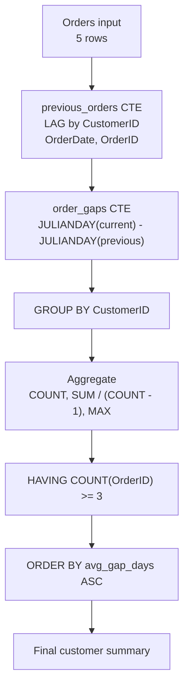

# PNP Q045. Typical gap between a customer's orders

 

## Question

**Source:** [100 SQL Interview Questions](<../Source Materials/Updated_100_SQL_Interview_Questions.pdf>), question 45, pp. 77–79. **Difficulty:** Medium.

**Business scenario.** The CRM team wants to time replenishment reminders. If a customer usually reorders every 20 days, a nudge on day 18 makes sense; on day 5 it is noise. They need each regular customer's typical gap between consecutive orders and their longest gap, which shows how long they have gone quiet before. "Regular" means at least three orders, so there are at least two gaps to average.

**Task.** For every customer with three or more orders, return the number of orders, the average number of days between consecutive orders, and the longest such gap. Sort by average gap, shortest first.

**Expected output (as supplied):**

- `CustomerID`
- `orders`: number of orders the customer placed
- `avg_gap_days`: average days between one order and the customer's next order, 2 decimals
- `max_gap_days`: longest gap in days

The source is a text-based PDF; no separate question image was supplied.

### Required output columns

One output row represents one customer with at least three orders.

| Output column | Source / calculation | Meaning and eligibility rule | Example |
|---|---|---|---:|
| `CustomerID` | `Orders.CustomerID` | Identifies the customer. | 10 |
| `orders` | `COUNT(OrderID)` | Number of orders placed by the customer. | 3 |
| `avg_gap_days` | Sum of consecutive gaps divided by number of gaps | Average days between consecutive orders, rounded to 2 decimals. | 4.50 |
| `max_gap_days` | `MAX(gap_days)` | Longest gap between consecutive orders. | 6 |

### Practice example · Sample input

*Illustrative practice fixture. The source question supplies no sample rows. This same fixture is used throughout this walkthrough and was executed in SQLite 3.46.1.*

**Input — `Orders`** (only the columns used by this query are shown)

| 🟦 OrderID | 🟦 CustomerID | 🟦 OrderDate |
|---:|---:|---|
| 1 | 10 | 2025-01-01 |
| 2 | 10 | 2025-01-04 |
| 3 | 10 | 2025-01-10 |
| 4 | 20 | 2025-01-02 |
| 5 | 20 | 2025-01-08 |

**Column meanings**

- `OrderID`: identifies an order; assumed non-NULL and unique for this example.
- `CustomerID`: identifies which customer placed the order.
- `OrderDate`: date the order was placed.

There are **5 input rows**: Customer 10 has 3 orders; Customer 20 has 2 orders.

### Expected output

| 🟦 CustomerID | 🟪 orders | 🟪 avg_gap_days | 🟪 max_gap_days |
|---:|---:|---:|---:|
| 10 | 3 | 4.50 | 6 |

Customer 10 has consecutive gaps of 3 and 6 days. Customer 20 is excluded because they have fewer than three orders.

### How the sample produces this output

For Customer 10, the order dates are 1 January, 4 January and 10 January 2025:

- 4 January − 1 January = **3 days**
- 10 January − 4 January = **6 days**
- Average = (3 + 6) / 2 = **4.50 days**
- Maximum = **6 days**

Customer 20 has two orders and therefore only one consecutive gap. The requirement is at least three orders, so Customer 20 is excluded.

## Step 1 · Your approach before writing SQL

The agreed approach was to start with the original `Orders` rows, find each customer's immediately previous order date using `LAG()`, calculate each row's gap, then aggregate those gaps per customer. Finally, retain customers with at least three orders and sort by average gap ascending.

## Final learner solution — SQLite

**Saved learner solution — preserved verbatim:**

```sql
WITH previous_orders AS (

    SELECT
        OrderID,
        CustomerID,
        OrderDate,

        LAG(OrderDate) OVER (
            PARTITION BY CustomerID
            ORDER BY OrderDate ASC, OrderID ASC
        ) AS previous_order_date

    FROM Orders

),

order_gaps AS (

    SELECT
        OrderID,
        CustomerID,
        OrderDate,

        JULIANDAY(OrderDate) -
        JULIANDAY(previous_order_date) AS gap_days

    FROM previous_orders

)

SELECT
    CustomerID,
    COUNT(OrderID) AS orders,

    ROUND(
        SUM(gap_days) * 1.0 / (COUNT(OrderID) - 1),
        2
    ) AS avg_gap_days,

    MAX(gap_days) AS max_gap_days

FROM order_gaps

GROUP BY CustomerID

HAVING COUNT(OrderID) >= 3

ORDER BY avg_gap_days ASC;
```

## Important learnings from PNP-P045

### Reusable concept — LAG() and LEAD()

Both `LAG()` and `LEAD()` are analytic/window functions that let each row access a value from another row in the same ordered window, without a self-join.

| Function | Direction | Typical use |
|---|---|---|
| `LAG(expression, offset, default)` | Looks backward to a preceding row | Previous order date, previous month's value |
| `LEAD(expression, offset, default)` | Looks forward to a following row | Next order date, next event or delivery |

**General syntax**

```sql
LAG(expression, offset, default_value) OVER (
    PARTITION BY group_column
    ORDER BY sort_column
)

LEAD(expression, offset, default_value) OVER (
    PARTITION BY group_column
    ORDER BY sort_column
)
```

- `expression`: the value to retrieve from another row.
- `offset`: how many rows backward or forward; it defaults to 1.
- `default_value`: returned when that offset row does not exist; it defaults to NULL.
- `PARTITION BY`: creates independent sequences for each group. The function does not cross a partition boundary.
- `ORDER BY`: defines the row sequence and therefore what “previous” and “next” mean.
- Include a deterministic tie-breaker (such as `OrderID`) when the primary ordering column can contain ties.

**P045 example — previous order date with LAG**

```sql
LAG(OrderDate) OVER (
    PARTITION BY CustomerID
    ORDER BY OrderDate ASC, OrderID ASC
) AS previous_order_date
```

For Customer 10, the ordered dates are 1 Jan → 4 Jan → 10 Jan. LAG returns NULL → 1 Jan → 4 Jan.

**Same example — next order date with LEAD**

```sql
LEAD(OrderDate) OVER (
    PARTITION BY CustomerID
    ORDER BY OrderDate ASC, OrderID ASC
) AS next_order_date
```

For Customer 10, LEAD returns 4 Jan → 10 Jan → NULL. For Customer 20, it returns 8 Jan → NULL.

**Quick rule:** LAG looks behind the current row; LEAD looks ahead. Both preserve the number of input rows and return NULL by default when the requested neighbouring row does not exist. In P045, LAG is the right choice because each order needs the date of the order immediately before it. LEAD would be useful if the requirement asked for the next order date or the gap until the next order.

1. **`LAG()` retrieves a prior row's value.** With `PARTITION BY CustomerID`, each customer's order sequence is independent. The first row in each partition has no previous order, so its `previous_order_date` is `NULL`.
2. **The window ordering matters.** `ORDER BY OrderDate ASC, OrderID ASC` sorts each customer's orders chronologically and uses `OrderID` as a deterministic tie-breaker when dates match.
3. **A customer with (n) orders has (n-1) consecutive gaps**, provided each order has a usable date and the order rows are distinct.
4. **SQLite `JULIANDAY()` makes date subtraction possible.** Subtracting the previous date's Julian day number from the current date's Julian day number yields the elapsed days for the example's ISO date values.
5. **`SUM()` and `MAX()` ignore NULL inputs.** The first order in each customer partition has a NULL gap, so it does not add a gap or affect the maximum.
6. **The average denominator is the number of gaps, not the number of orders.** Here that is `COUNT(OrderID) - 1). Multiplying by `1.0` ensures floating-point division in SQLite.
7. **`HAVING` filters customer groups after aggregation.** `HAVING COUNT(OrderID) >= 3` retains customers with at least three order rows.
8. **A tie-breaker in the window order is not the same as final output ordering.** The window order determines previous-order relationships; the final `ORDER BY avg_gap_days ASC` sorts customer result rows.

## Visual walkthrough

### A. Query architecture overview



The diagram shows the dependency between the two CTEs and the final grouped result. The row-level transformations are traced in the detailed stages below.

### B. Progressive row walkthrough — one fixture, from start to finish

All tables below use the exact five input rows shown above. Outputs in this section are the actual results returned by SQLite 3.46.1 for this fixture.

## Step-by-step walkthrough

### Stage 1 — Read the source rows (`FROM Orders`)

**A. Original code fragment**

```sql
FROM Orders
```

**B. What happens here?**

The first CTE reads the source `Orders` table. The query needs one row per order so it can compare each order date with the previous order date for the same customer. No rows are filtered at this point.

**C. Trace the single example**

The source contains five order rows: three for Customer 10 and two for Customer 20.

**D. Intermediate output**

| 🟦 OrderID | 🟦 CustomerID | 🟦 OrderDate |
|---:|---:|---|
| 1 | 10 | 2025-01-01 |
| 2 | 10 | 2025-01-04 |
| 3 | 10 | 2025-01-10 |
| 4 | 20 | 2025-01-02 |
| 5 | 20 | 2025-01-08 |

**E. Row count / state check**

- Input rows: 5
- Output rows: 5
- Rows removed: 0
- Rows added: 0
- Each row still represents one order.

**F. Key takeaway**

Start with the order-level grain. Do not group customers yet, because the query first needs the previous date for each individual order.

### Stage 2 — Find the previous order date (`LAG` window function)

**A. Original code fragment**

```sql
LAG(OrderDate) OVER (
    PARTITION BY CustomerID
    ORDER BY OrderDate ASC, OrderID ASC
) AS previous_order_date
```

**B. What happens here?**

- `PARTITION BY CustomerID` divides the rows into separate customer sequences. Customer 10's rows cannot look back into Customer 20's rows.
- `ORDER BY OrderDate ASC, OrderID ASC` orders each customer's rows from earliest to latest. `OrderID` resolves ties when two orders share a date.
- `LAG(OrderDate)` returns the `OrderDate` from the immediately preceding row within that ordered customer partition.
- No window frame is specified. `LAG()` accesses a preceding row by offset; it does not need a running aggregate frame.

**C. Trace the single example**

Customer 10's ordered dates are 1 Jan → 4 Jan → 10 Jan:
- Order 1 has no earlier order for Customer 10, so previous date is NULL.
- Order 2 looks back to Order 1, so previous date is 1 Jan.
- Order 3 looks back to Order 2, so previous date is 4 Jan.

Customer 20's ordered dates are 2 Jan → 8 Jan:
- Order 4 is the first row in Customer 20's partition, so previous date is NULL.
- Order 5 looks back to Order 4, so previous date is 2 Jan.

**D. Intermediate output — complete `previous_orders` CTE**

| 🟦 OrderID | 🟦 CustomerID | 🟦 OrderDate | 🟪 previous_order_date |
|---:|---:|---|---|
| 1 | 10 | 2025-01-01 | NULL |
| 2 | 10 | 2025-01-04 | 2025-01-01 |
| 3 | 10 | 2025-01-10 | 2025-01-04 |
| 4 | 20 | 2025-01-02 | NULL |
| 5 | 20 | 2025-01-08 | 2025-01-02 |

**E. Row count / state check**

- Input rows: 5
- Output rows: 5
- Rows removed: 0
- Rows added: 0
- One derived column, `previous_order_date`, is added.
- There are two independent partitions: Customer 10 (3 rows) and Customer 20 (2 rows).

**F. Key takeaway**

A window function adds information to each existing row without collapsing rows. `LAG()` restarts at each customer boundary because of `PARTITION BY CustomerID`.

### Stage 3 — Calculate each consecutive gap (`order_gaps` CTE)

**A. Original code fragment**

```sql
JULIANDAY(OrderDate) -
JULIANDAY(previous_order_date) AS gap_days
```

**B. What happens here?**

The second CTE reads the rows produced by `previous_orders`. SQLite's `JULIANDAY()` converts each date into a numeric Julian day value. Subtracting the previous date's value from the current date's value calculates the elapsed days. If `previous_order_date` is NULL, the subtraction returns NULL.

**C. Trace the single example**

| 🟦 OrderID | Calculation | 🟪 gap_days |
|---:|---|---:|
| 1 | First order for Customer 10; no previous date | NULL |
| 2 | 2025-01-04 − 2025-01-01 | 3 |
| 3 | 2025-01-10 − 2025-01-04 | 6 |
| 4 | First order for Customer 20; no previous date | NULL |
| 5 | 2025-01-08 − 2025-01-02 | 6 |

**D. Intermediate output — complete `order_gaps` CTE**

| 🟦 OrderID | 🟦 CustomerID | 🟦 OrderDate | 🟪 gap_days |
|---:|---:|---|---:|
| 1 | 10 | 2025-01-01 | NULL |
| 2 | 10 | 2025-01-04 | 3 |
| 3 | 10 | 2025-01-10 | 6 |
| 4 | 20 | 2025-01-02 | NULL |
| 5 | 20 | 2025-01-08 | 6 |

**E. Row count / state check**

- Input rows: 5
- Output rows: 5
- Rows removed: 0
- Rows added: 0
- `gap_days` is added to each row.
- Two rows have NULL gaps because they are the first order in their respective customer partitions.

**F. Key takeaway**

The first order has no gap before it. NULL is the correct representation; it must not be changed to zero because zero would claim two consecutive orders occurred on the same date.

### Stage 4 — Group the gap rows by customer (`GROUP BY`)

**A. Original code fragment**

```sql
FROM order_gaps
GROUP BY CustomerID
```

**B. What happens here?**

The final query reads the five rows from `order_gaps` and groups rows with the same `CustomerID`. Each group now represents one customer. Grouping changes the result grain from one row per order to one row per customer.

**C. Trace the single example**

- Customer 10 group: OrderIDs 1, 2, 3; gap values NULL, 3, 6.
- Customer 20 group: OrderIDs 4, 5; gap values NULL, 6.

**D. Intermediate output — group membership**

| 🟦 CustomerID | 🟦 OrderIDs in group | 🟪 gap_days in group | Rows in group |
|---:|---|---|---:|
| 10 | 1, 2, 3 | NULL, 3, 6 | 3 |
| 20 | 4, 5 | NULL, 6 | 2 |

**E. Row count / state check**

- Input rows: 5
- Groups produced: 2
- Rows are combined into customer groups; no source order is discarded at this stage.
- The next aggregate SELECT produces one summary row per group.

**F. Key takeaway**

`GROUP BY CustomerID` is what turns the order-level gap data into customer-level summaries.

### Stage 5 — Calculate order count, average gap and maximum gap

**A. Original code fragment**

```sql
COUNT(OrderID) AS orders,

ROUND(
    SUM(gap_days) * 1.0 / (COUNT(OrderID) - 1),
    2
) AS avg_gap_days,

MAX(gap_days) AS max_gap_days
```

**B. What happens here?**

For each customer group:
- `COUNT(OrderID)` counts the order rows.
- `SUM(gap_days)` adds non-NULL gap values; NULL gaps are ignored.
- `COUNT(OrderID) - 1` calculates the number of consecutive gaps when all order dates are present and each order contributes one row.
- Multiplication by `1.0` makes the division floating-point in SQLite.
- `ROUND(..., 2)` rounds the average to two decimal places.
- `MAX(gap_days)` returns the largest non-NULL gap.

**C. Trace the single example**

Customer 10:
- `orders` = COUNT(OrderID) = 3
- `SUM(gap_days)` = 3 + 6 = 9 (NULL is ignored)
- Number of gaps = 3 − 1 = 2
- `avg_gap_days` = ROUND(9 × 1.0 / 2, 2) = **4.50**
- `max_gap_days` = MAX(NULL, 3, 6) = **6**

Customer 20:
- `orders` = 2
- `SUM(gap_days)` = 6
- Number of gaps = 2 − 1 = 1
- `avg_gap_days` = ROUND(6 × 1.0 / 1, 2) = **6.00**
- `max_gap_days` = 6

**D. Intermediate output — aggregate result before HAVING**

| 🟦 CustomerID | 🟪 orders | 🟪 avg_gap_days | 🟪 max_gap_days |
|---:|---:|---:|---:|
| 10 | 3 | 4.50 | 6 |
| 20 | 2 | 6.00 | 6 |

**E. Row count / state check**

- Input customer groups: 2
- Output aggregate rows: 2
- Each group becomes exactly one summary row.
- No customer has been filtered yet.

**F. Key takeaway**

There are (n-1) consecutive gaps for (n) orders. The average is the sum of those gaps divided by the gap count, not by the order count.

### Stage 6 — Keep customers with at least three orders (`HAVING`)

**A. Original code fragment**

```sql
HAVING COUNT(OrderID) >= 3
```

**B. What happens here?**

`HAVING` filters grouped customer results using an aggregate condition. It is applied after groups and their aggregate values have been formed. It keeps only customers whose order count is at least three.

**C. Trace the single example**

- Customer 10: COUNT(OrderID) = 3; 3 >= 3 is true, so keep.
- Customer 20: COUNT(OrderID) = 2; 2 >= 3 is false, so remove.

**D. Intermediate output — after HAVING**

| 🟦 CustomerID | 🟪 orders | 🟪 avg_gap_days | 🟪 max_gap_days |
|---:|---:|---:|---:|
| 10 | 3 | 4.50 | 6 |

**E. Row count / state check**

- Input aggregate rows: 2
- Output rows: 1
- Customer 20 is removed because it has fewer than three orders.
- Customer 10 remains.

**F. Key takeaway**

Use `HAVING` for conditions on groups and aggregate values. A WHERE filter here would operate on individual order rows before grouping and is not the right place for this customer-level count requirement.

### Stage 7 — Sort the final customer results (`ORDER BY`)

**A. Original code fragment**

```sql
ORDER BY avg_gap_days ASC
```

**B. What happens here?**

The final result rows are sorted by average gap in ascending order, meaning the smallest average gap appears first. Sorting does not change the values or number of rows.

**C. Trace the single example**

Only Customer 10 remains after HAVING, so there is one row to sort.

**D. Intermediate output — final result**

| 🟦 CustomerID | 🟪 orders | 🟪 avg_gap_days | 🟪 max_gap_days |
|---:|---:|---:|---:|
| 10 | 3 | 4.50 | 6 |

**E. Row count / state check**

- Input rows: 1
- Output rows: 1
- Rows added or removed: 0
- The row is already the only result, so sorting does not visibly change its position.

**F. Key takeaway**

`ORDER BY` controls presentation order after the result has been formed. It is separate from the window's `ORDER BY`, which controls which order is considered previous.

## Learner solution — SQL Server adaptation

**Pending.** The saved learner query is SQLite-specific because it uses `JULIANDAY()`. A SQL Server adaptation will be added and separately verified; it is not claimed as executed here.

## Official solution

**Pending source extraction.** The official answer must be transcribed from the supplied source PDF before comparison. It is not replaced by a guessed or generic solution.

## Comparison with the course answer

**Pending** until the official answer has been extracted from the source PDF.

## Verification

**Fixture execution:** Executed the exact saved learner query against the five-row illustrative fixture in SQLite **3.46.1**.

Actual output returned:

| CustomerID | orders | avg_gap_days | max_gap_days |
|---:|---:|---:|---:|
| 10 | 3 | 4.5 | 6.0 |

The displayed expected value 4.50 is the same numeric result formatted to two decimal places. The query returned one row, as expected.

**Intermediate execution checks:**
- `previous_orders`: 5 rows; previous dates were NULL, 2025-01-01, 2025-01-04, NULL, 2025-01-02 in customer/date order.
- `order_gaps`: 5 rows; gaps were NULL, 3, 6, NULL, 6 in customer/date order.
- Group aggregation before HAVING: 2 customer rows (Customer 10: 3 orders, 4.50 average, 6 maximum; Customer 20: 2 orders, 6.00 average, 6 maximum).
- After HAVING: 1 row (Customer 10).
- Final ORDER BY: one row; ordering is trivially satisfied.

**Limitations and edge cases not represented by this one fixture:**
- The formula `COUNT(OrderID) - 1` assumes every counted order has a valid, non-NULL `OrderDate`. If dates can be NULL, `LAG()` may produce NULL gaps while the denominator still counts those orders; the average can then be understated. A robust variant should explicitly define how undated orders are treated and count valid gaps.
- The formula assumes one row per order and a non-NULL `OrderID`. Duplicate order rows or NULL order IDs can make the count inconsistent with the number of consecutive date intervals.
- Equal order dates produce a zero-day gap; `OrderID` provides deterministic sequencing but does not make the dates different.
- The example uses date-only ISO values. Timestamp values can produce fractional-day differences; the required meaning (whole calendar days versus elapsed 24-hour periods) should be confirmed before applying the query to timestamp data.
- The sample fixture was executed, but the actual PrepNPlaced dataset has not been executed here.
- SQL Server adaptation, official answer extraction, course comparison, dual-visual asset/navigation audit and full completion audit remain pending. Therefore P045 remains **NOT SOLVED YET**.

[Practice index](../../README.md)
