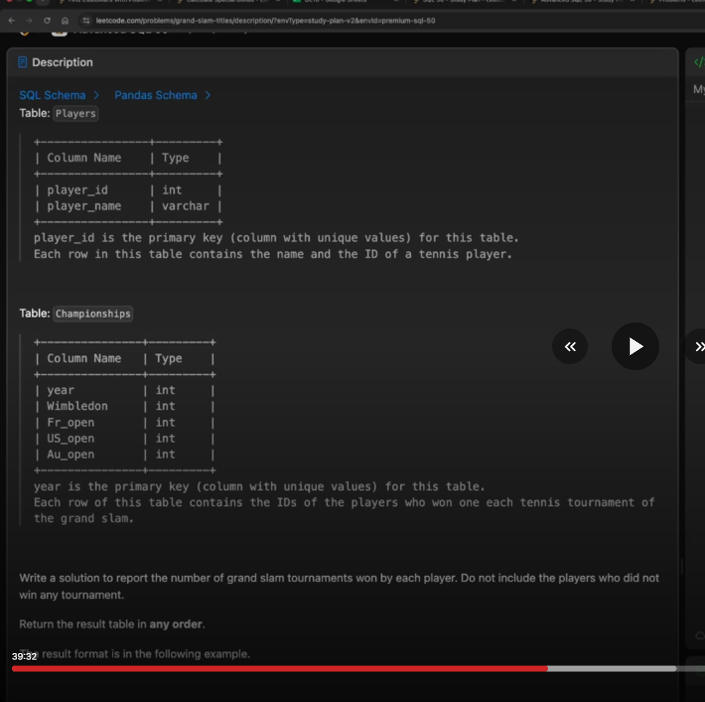
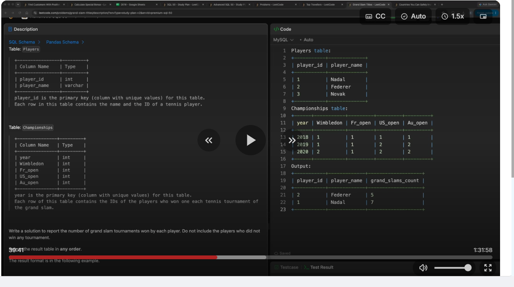

# 2. SQL Grand Slam Titles

## Question and image

**1783. Grand Slam Titles**

**Difficulty:** Medium

Table: `Players`

| Column Name | Type |
|---|---|
| player_id | int |
| player_name | varchar |

player_id is the primary key (column with unique values) for this table.

Each row in this table contains the name and the ID of a tennis player.

Table: `Championships`

| Column Name | Type |
|---|---|
| year | int |
| Wimbledon | int |
| Fr_open | int |
| US_open | int |
| Au_open | int |

year is the primary key (column with unique values) for this table.

Each row of this table contains the IDs of the players who won one each tennis tournament of the grand slam.

Write a solution to report the number of grand slam tournaments won by each player. Do not include the players who did not win any tournament.

Return the result table in any order.

The result format is in the following example.

**Example:**

**Input:**

Players table:

| player_id | player_name |
|---|---|
| 1 | Nadal |
| 2 | Federer |
| 3 | Novak |

Championships table:

| year | Wimbledon | Fr_open | US_open | Au_open |
|---|---|---|---|---|
| 2018 | 1 | 1 | 1 | 1 |
| 2019 | 1 | 1 | 2 | 2 |
| 2020 | 2 | 1 | 2 | 2 |

**Output:**

| player_id | player_name | grand_slams_count |
|---|---|---|
| 2 | Federer | 5 |
| 1 | Nadal | 7 |

No example explanation was supplied in the screenshots.

### Supplied screenshots






### Problem solving checklist

1. **Define the output:** state what one result row represents, the required columns, and the ordering.
2. **Understand the inputs:** identify table meanings, keys, relationships, duplicates, and NULLs.
3. **Explain the logic:** describe the steps, calculations, and comparisons in plain English.
4. **Choose SQL operations:** match each step to the SQL operations it needs.
5. **Plan intermediate results:** list the needed columns and what each intermediate row represents.
6. **Build gradually:** write one part, inspect its output, and check row counts after joins.
7. **Verify the answer:** check the sample, duplicates, missing matches, NULLs, arithmetic, boundaries, ties, and sorting.

Work through one step at a time during practice. Complete the current step before moving to the next.

## Schema

**Players**

| Column Name | Type |
|---|---|
| player_id | int |
| player_name | varchar |

- `player_id` is the primary key and identifies a tennis player.
- `player_name` is the name of the player.

**Championships**

| Column Name | Type |
|---|---|
| year | int |
| Wimbledon | int |
| Fr_open | int |
| US_open | int |
| Au_open | int |

- `year` is the primary key.
- The four tournament columns store the IDs of their winning players for that year.

## My solution — SQLite

### Final solution

```sql
SELECT
    playersinfo.player_id,
    Players.player_name,
    COUNT(*) AS grand_slams_count
FROM (
    SELECT Wimbledon AS player_id
    FROM Championships

    UNION ALL

    SELECT Fr_open AS player_id
    FROM Championships

    UNION ALL

    SELECT US_open AS player_id
    FROM Championships

    UNION ALL

    SELECT Au_open AS player_id
    FROM Championships
) AS playersinfo
JOIN Players
    ON playersinfo.player_id = Players.player_id
GROUP BY
    playersinfo.player_id,
    Players.player_name;
```

### Step-by-step explanation with one example

Use the supplied example throughout. The intermediate results below were checked in SQLite using these same Players and Championships rows.

**Starting data**

`Players`:

| player_id | player_name |
| --- | --- |
| 1 | Nadal |
| 2 | Federer |
| 3 | Novak |

`Championships`:

| year | Wimbledon | Fr_open | US_open | Au_open |
| --- | --- | --- | --- | --- |
| 2018 | 1 | 1 | 1 | 1 |
| 2019 | 1 | 1 | 2 | 2 |
| 2020 | 2 | 1 | 2 | 2 |

One final row represents a player who won at least one tournament. It must contain player_id, player_name, and grand_slams_count. The four tournament columns contain winning player IDs: each cell represents one title, so this example has 3 years * 4 tournaments = 12 titles to count.

**1. Read the Wimbledon winners as player IDs.**

Select one tournament column and give it the common output name player_id. Keep all its rows because a player can win the same tournament in multiple years.

```sql
SELECT Wimbledon AS player_id
FROM Championships;
```

Result:

| player_id |
| --- |
| 1 |
| 1 |
| 2 |

The values 1, 1, and 2 represent two Wimbledon titles for Nadal and one for Federer. AS player_id changes the output column name; it does not create a player_name column or add player details.

**2. Read the other three tournaments in the same form.**

Each query returns one column called player_id. Matching the number and meaning of the columns lets the four query results be combined.

`Fr_open` winners:

```sql
SELECT Fr_open AS player_id
FROM Championships;
```

Result:

| player_id |
| --- |
| 1 |
| 1 |
| 1 |

`US_open` winners:

```sql
SELECT US_open AS player_id
FROM Championships;
```

Result:

| player_id |
| --- |
| 1 |
| 2 |
| 2 |

`Au_open` winners:

```sql
SELECT Au_open AS player_id
FROM Championships;
```

Result:

| player_id |
| --- |
| 1 |
| 2 |
| 2 |

Nadal wins Fr_open in all three years. For US_open and Au_open, Nadal wins in 2018 and Federer wins in 2019 and 2020. Every SELECT reads the same original Championships table.

**3. Stack all winning occurrences with UNION ALL.**

We need one row per title across all four tournament columns. UNION ALL appends the four result sets and retains repeated IDs. No COUNT is needed inside these branches: all the winning occurrences must remain available for the final count.

```sql
SELECT Wimbledon AS player_id
FROM Championships

UNION ALL

SELECT Fr_open AS player_id
FROM Championships

UNION ALL

SELECT US_open AS player_id
FROM Championships

UNION ALL

SELECT Au_open AS player_id
FROM Championships;
```

Result:

| player_id |
| --- |
| 1 |
| 1 |
| 2 |
| 1 |
| 1 |
| 1 |
| 1 |
| 2 |
| 2 |
| 1 |
| 2 |
| 2 |

The combined result has twelve rows. ID 1 occurs seven times and ID 2 occurs five times. The rows are shown here in tournament-branch order; the query does not request a particular ordering.

UNION would remove duplicate IDs and leave only 1 and 2, losing the number of titles. UNION ALL keeps those duplicates because each one represents a different tournament win.

**4. Join the winning IDs to their player names.**

Place the combined SELECT inside parentheses and name that derived table playersinfo. It exposes only player_id. Join its ID to Players.player_id to retrieve Players.player_name.

```sql
SELECT
    playersinfo.player_id,
    Players.player_name
FROM (
    SELECT Wimbledon AS player_id
    FROM Championships

    UNION ALL

    SELECT Fr_open AS player_id
    FROM Championships

    UNION ALL

    SELECT US_open AS player_id
    FROM Championships

    UNION ALL

    SELECT Au_open AS player_id
    FROM Championships
) AS playersinfo
JOIN Players
    ON playersinfo.player_id = Players.player_id;
```

Result:

| player_id | player_name |
| --- | --- |
| 1 | Nadal |
| 1 | Nadal |
| 2 | Federer |
| 1 | Nadal |
| 1 | Nadal |
| 1 | Nadal |
| 1 | Nadal |
| 2 | Federer |
| 2 | Federer |
| 1 | Nadal |
| 2 | Federer |
| 2 | Federer |

The player ID is unique in Players, so each winning row matches one player and the twelve wins remain twelve rows. Joining does not move the name column into playersinfo: refer to it as Players.player_name. There is no additional name match to perform.

Novak is absent because ID 3 does not occur among the tournament winners. This follows the requirement to exclude players who have never won.

**5. Count the winning rows for each player and assemble the final query.**

Group by playersinfo.player_id and Players.player_name, then COUNT(*) counts the rows in each player's group. Using the player ID keeps different players separate even when they have the same name. The grouped name also makes the query valid in SQL Server.

Keep the semicolon at the end of the complete statement, after GROUP BY. A semicolon inside the parentheses would end the statement before its join and grouping.

```sql
SELECT
    playersinfo.player_id,
    Players.player_name,
    COUNT(*) AS grand_slams_count
FROM (
    SELECT Wimbledon AS player_id
    FROM Championships

    UNION ALL

    SELECT Fr_open AS player_id
    FROM Championships

    UNION ALL

    SELECT US_open AS player_id
    FROM Championships

    UNION ALL

    SELECT Au_open AS player_id
    FROM Championships
) AS playersinfo
JOIN Players
    ON playersinfo.player_id = Players.player_id
GROUP BY
    playersinfo.player_id,
    Players.player_name;
```

Final result for this example:

| player_id | player_name | grand_slams_count |
| --- | --- | --- |
| 1 | Nadal | 7 |
| 2 | Federer | 5 |

**Check the result:** Nadal wins 4 titles in 2018, 2 in 2019, and 1 in 2020: 4 + 2 + 1 = 7. Federer wins 0 + 2 + 3 = 5. Their totals add to all 12 tournament results, and Novak has no output row. The screenshot lists Federer first; this query may list Nadal first because the problem permits any output order.

## My solution — SQL Server

```sql
SELECT
    playersinfo.player_id,
    Players.player_name,
    COUNT(*) AS grand_slams_count
FROM (
    SELECT Wimbledon AS player_id
    FROM Championships

    UNION ALL

    SELECT Fr_open AS player_id
    FROM Championships

    UNION ALL

    SELECT US_open AS player_id
    FROM Championships

    UNION ALL

    SELECT Au_open AS player_id
    FROM Championships
) AS playersinfo
JOIN Players
    ON playersinfo.player_id = Players.player_id
GROUP BY
    playersinfo.player_id,
    Players.player_name;
```

## Official solution

Not provided for this practice set.
