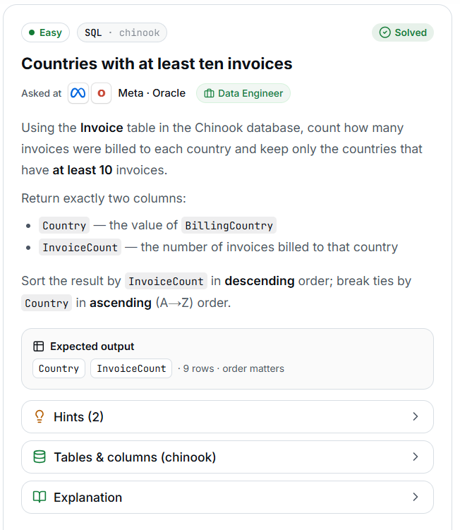

# 1. Countries with at least ten invoices

## Question and image

Using the **Invoice** table in the Chinook database, count how many invoices were billed to each country and keep only the countries that have **at least 10 invoices**.

Return exactly two columns:

- `Country` — the value of `BillingCountry`.
- `InvoiceCount` — the number of invoices billed to that country.

Sort the result by `InvoiceCount` in **descending** order; break ties by `Country` in **ascending (A–Z)** order.

**Expected output:** `Country`, `InvoiceCount` · 9 rows · order matters.



### Problem solving checklist

1. **Define the output:** state what one result row represents, the required columns, and the ordering.
2. **Understand the inputs:** identify table meanings, keys, relationships, duplicates, and NULLs.
3. **Explain the logic:** describe the steps, calculations, and comparisons in plain English.
4. **Choose SQL operations:** match each step to the SQL operations it needs.
5. **Plan intermediate results:** list the needed columns and what each intermediate row represents.
6. **Build gradually:** write one part, inspect its output, and check row counts after joins.
7. **Verify the answer:** check the sample, duplicates, missing matches, NULLs, arithmetic, boundaries, ties, and sorting.

Work through one step at a time during practice. Complete the current step before moving to the next.

## Schema

SQL table names are case-sensitive according to the question.

### Album

`AlbumId, Title, ArtistId`

### Artist

`ArtistId, Name`

### Customer

`CustomerId, FirstName, LastName, Company, Address, City, State, Country, PostalCode, Phone, Fax, Email, SupportRepId`

### Employee

`EmployeeId, LastName, FirstName, Title, ReportsTo, BirthDate, HireDate, Address, City, State, Country, PostalCode, Phone, Fax, Email`

### Genre

`GenreId, Name`

### Invoice

`InvoiceId, CustomerId, InvoiceDate, BillingAddress, BillingCity, BillingState, BillingCountry, BillingPostalCode, Total`

### InvoiceLine

`InvoiceLineId, InvoiceId, TrackId, UnitPrice, Quantity`

### MediaType

`MediaTypeId, Name`

### Playlist

`PlaylistId, Name`

### PlaylistTrack

`PlaylistId, TrackId`

### Track

`TrackId, Name, AlbumId, MediaTypeId, GenreId, Composer, Milliseconds, Bytes, UnitPrice`

## My solution — SQLite

```sql
select BillingCountry as Country, count(*) as InvoiceCount
from Invoice
group by BillingCountry
having count (*) >=10
order by InvoiceCount desc, Country asc
```


### Step-by-step explanation with one example

Use this small illustrative dataset throughout. It uses the actual table and column names; only columns relevant to this question are shown. These rows are teaching data, not the complete Chinook database, so the number of results can differ from the prompt's full-database count.

**Starting data**

`Invoice`:

| InvoiceId | BillingCountry |
| --- | --- |
| 1 | Canada |
| 2 | Canada |
| 3 | Canada |
| 4 | Canada |
| 5 | Canada |
| 6 | Canada |
| 7 | Canada |
| 8 | Canada |
| 9 | Canada |
| 10 | Canada |
| 11 | Brazil |
| 12 | Brazil |
| 13 | Brazil |
| 14 | Brazil |
| 15 | Brazil |
| 16 | Brazil |
| 17 | Brazil |
| 18 | Brazil |
| 19 | Brazil |
| 20 | Brazil |
| 21 | USA |
| 22 | USA |
| 23 | USA |
| 24 | USA |
| 25 | USA |
| 26 | USA |
| 27 | USA |
| 28 | USA |
| 29 | USA |
| 30 | USA |
| 31 | USA |
| 32 | France |
| 33 | France |

**1. Group invoices by billing country**

Each input row is one invoice. One output row must represent a country, so count all invoice rows within each BillingCountry group.

```sql
SELECT BillingCountry AS Country, COUNT(*) AS InvoiceCount
FROM Invoice
GROUP BY BillingCountry;
```

Result:

| Country | InvoiceCount |
| --- | --- |
| Brazil | 10 |
| Canada | 10 |
| France | 2 |
| USA | 11 |

The groups contain 10 invoices for Brazil, 10 for Canada, 2 for France, and 11 for USA. COUNT(*) counts invoices, including repeated country values.

**2. Keep groups with at least ten invoices**

The threshold concerns an aggregate count, so use HAVING after GROUP BY. The inclusive >= operator retains groups with exactly ten invoices.

```sql
SELECT BillingCountry AS Country, COUNT(*) AS InvoiceCount
FROM Invoice
GROUP BY BillingCountry
HAVING COUNT(*) >= 10;
```

Result:

| Country | InvoiceCount |
| --- | --- |
| Brazil | 10 |
| Canada | 10 |
| USA | 11 |

France is removed because 2 is below the threshold. Brazil and Canada remain at the exact boundary of 10.

**3. Assemble the final query**

Combine the steps using the saved solution. The query below preserves the original logic.

```sql
select BillingCountry as Country, count(*) as InvoiceCount
from Invoice
group by BillingCountry
having count (*) >=10
order by InvoiceCount desc, Country asc
```

Final result for this example:

| Country | InvoiceCount |
| --- | --- |
| USA | 11 |
| Brazil | 10 |
| Canada | 10 |

**Check the result:** USA is first with 11 invoices. Brazil and Canada both have 10, so Country ASC puts Brazil before Canada. The final output has only Country and InvoiceCount; invoice IDs are used to illustrate rows, not returned.

## My solution — SQL Server

```sql
select BillingCountry as Country, count(*) as InvoiceCount
from Invoice
group by BillingCountry
having count (*) >=10
order by InvoiceCount desc, Country asc
```

## Official solution

```sql
SELECT BillingCountry AS Country,
       COUNT(*) AS InvoiceCount
FROM Invoice
GROUP BY BillingCountry
HAVING COUNT(*) >= 10
ORDER BY InvoiceCount DESC, Country ASC;
```

### What this tests

Grouping data, counting rows per group, and filtering groups using aggregate results.

### The approach

Group invoices by BillingCountry; count invoices as InvoiceCount; keep countries with at least ten invoices; sort by count descending and country ascending. Use the required aliases Country and InvoiceCount.

### Why this way

HAVING filters groups after their counts are calculated. WHERE filters individual rows before grouping, so WHERE COUNT(*) >= 10 cannot express this group-level condition.

### Common mistakes

Using incorrect output aliases, omitting HAVING or using WHERE with COUNT(*), and missing or reversing the required sorting order.
