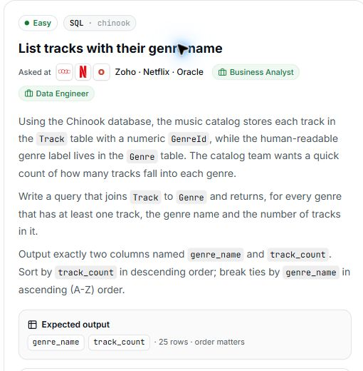

# 10. List tracks with their genre name

## Question and image

Using the Chinook database, the music catalog stores each track in the `Track` table with a numeric `GenreId`, while the human-readable genre label lives in the `Genre` table. The catalog team wants a quick count of how many tracks fall into each genre.

Write a query that joins `Track` to `Genre` and returns, for every genre that has **at least one track**, the genre name and the number of tracks in it.

Output exactly two columns named `genre_name` and `track_count`.

Sort by `track_count` in **descending** order; break ties by `genre_name` in **ascending** (A-Z) order.

**Expected output:** `genre_name`, `track_count` · 25 rows · order matters.



### Problem solving checklist

1. **Define the output:** state what one result row represents, the required columns, and the ordering.
2. **Understand the inputs:** identify table meanings, keys, relationships, duplicates, and NULLs.
3. **Explain the logic:** describe the steps, calculations, and comparisons in plain English.
4. **Choose SQL operations:** match each step to the SQL operations it needs.
5. **Plan intermediate results:** list the needed columns and what each intermediate row represents.
6. **Build gradually:** write one part, inspect its output, and check row counts after joins.
7. **Verify the answer:** check the sample, duplicates, missing matches, NULLs, arithmetic, boundaries, ties, and sorting.

Work through one step at a time during practice. Complete the current step before moving to the next.

## Schema

SQL table names are case-sensitive according to the question.

### Album

`AlbumId, Title, ArtistId`

### Artist

`ArtistId, Name`

### Customer

`CustomerId, FirstName, LastName, Company, Address, City, State, Country, PostalCode, Phone, Fax, Email, SupportRepId`

### Employee

`EmployeeId, LastName, FirstName, Title, ReportsTo, BirthDate, HireDate, Address, City, State, Country, PostalCode, Phone, Fax, Email`

### Genre

`GenreId, Name`

### Invoice

`InvoiceId, CustomerId, InvoiceDate, BillingAddress, BillingCity, BillingState, BillingCountry, BillingPostalCode, Total`

### InvoiceLine

`InvoiceLineId, InvoiceId, TrackId, UnitPrice, Quantity`

### MediaType

`MediaTypeId, Name`

### Playlist

`PlaylistId, Name`

### PlaylistTrack

`PlaylistId, TrackId`

### Track

`TrackId, Name, AlbumId, MediaTypeId, GenreId, Composer, Milliseconds, Bytes, UnitPrice`

## My solution — SQLite

```sql
select Genre.Name as genre_name, count(Track.TrackId) as track_count
from Track
join Genre on Track.GenreId = Genre.GenreId
group by Genre.GenreId
having count(Track.TrackId) >=1
order by track_count desc, genre_name asc
```

### Step-by-step explanation with one example

Use this small illustrative dataset throughout. It uses the question's actual table and column names; only columns needed for this explanation are shown. These are teaching rows, not the complete database or its expected row count. Every query result below was executed in SQLite on these same rows.

**Starting data**

`Genre`:

| GenreId | Name |
| --- | --- |
| 1 | Rock |
| 2 | Jazz |
| 3 | Classical |
| 4 | Pop |

`Track`:

| TrackId | Name | GenreId |
| --- | --- | --- |
| 1 | Stone | 1 |
| 2 | Cliff | 1 |
| 3 | Blue | 2 |
| 4 | Swing | 2 |
| 5 | Sonata | 3 |

**1. Attach a genre name to every matching track**

Track stores the genre key; Genre provides its readable name. Joining on GenreId creates one row per matching track.

```sql
SELECT Track.TrackId, Track.Name AS TrackName, Genre.GenreId, Genre.Name AS genre_name
FROM Track
JOIN Genre ON Track.GenreId = Genre.GenreId
ORDER BY Track.TrackId;
```

Result:

| TrackId | TrackName | GenreId | genre_name |
| --- | --- | --- | --- |
| 1 | Stone | 1 | Rock |
| 2 | Cliff | 1 | Rock |
| 3 | Blue | 2 | Jazz |
| 4 | Swing | 2 | Jazz |
| 5 | Sonata | 3 | Classical |

Pop has no matching track, so the inner join produces no Pop row. The other five tracks retain their own identities.

**2. Count the tracks in each genre group**

The output needs one row per genre rather than one per track. GROUP BY GenreId combines the joined rows, and COUNT(TrackId) counts the tracks in each group.

```sql
SELECT Genre.GenreId, Genre.Name AS genre_name, COUNT(Track.TrackId) AS track_count
FROM Track
JOIN Genre ON Track.GenreId = Genre.GenreId
GROUP BY Genre.GenreId
HAVING COUNT(Track.TrackId) >= 1;
```

Result:

| GenreId | genre_name | track_count |
| --- | --- | --- |
| 1 | Rock | 2 |
| 2 | Jazz | 2 |
| 3 | Classical | 1 |

Rock and Jazz each have two tracks; Classical has one. The saved HAVING condition keeps all these groups because the inner join already guarantees a matching track.

**3. Assemble the final query**

Combine the steps using the saved solution. The query below preserves the original logic.

```sql
select Genre.Name as genre_name, count(Track.TrackId) as track_count
from Track
join Genre on Track.GenreId = Genre.GenreId
group by Genre.GenreId
having count(Track.TrackId) >=1
order by track_count desc, genre_name asc
```

Final result for this example:

| genre_name | track_count |
| --- | --- |
| Jazz | 2 |
| Rock | 2 |
| Classical | 1 |

**Check the result:** The counts total 2 + 2 + 1 = 5, matching the five input tracks. Jazz precedes Rock because their counts tie and genre_name is the second sort key; Classical follows with one.

## My solution — SQL Server

```sql
select Genre.Name as genre_name, count(Track.TrackId) as track_count
from Track
join Genre on Track.GenreId = Genre.GenreId
group by Genre.GenreId, Genre.Name
having count(Track.TrackId) >=1
order by track_count desc, genre_name asc
```

## Official solution

```sql
SELECT g.Name AS genre_name,
       COUNT(t.TrackId) AS track_count
FROM Genre g
JOIN Track t ON t.GenreId = g.GenreId
GROUP BY g.GenreId, g.Name
ORDER BY track_count DESC, genre_name ASC;
```

### What this tests

Joining tables, counting per group, setting aliases, and sorting aggregates.

### The approach

Inner join genres to tracks; group by genre ID and name; count tracks; sort by count descending and name ascending.

### Why this way

The inner join includes only genres with matching tracks, satisfying the at-least-one-track requirement.

### Common mistakes

Returning IDs instead of names, using wrong aliases, omitting grouping, or adding filters that remove valid genres.
