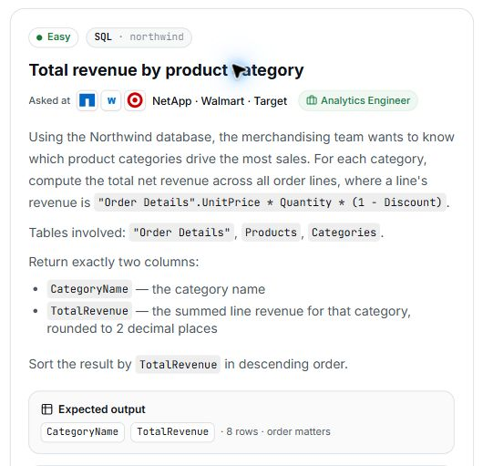

# 12. Total revenue by product category

## Question and image

Using the Northwind database, the merchandising team wants to know which product categories drive the most sales. For each category, compute the total net revenue across all order lines, where a line's revenue is `"Order Details".UnitPrice * Quantity * (1 - Discount)`.

Tables involved: `"Order Details"`, `Products`, `Categories`.

Return exactly two columns:

- `CategoryName`: the category name.
- `TotalRevenue`: the summed line revenue for that category, rounded to **2 decimal places**.

Sort the result by `TotalRevenue` in **descending** order.

**Expected output:** `CategoryName`, `TotalRevenue` · 8 rows · order matters.



### Problem solving checklist

1. **Define the output:** state what one result row represents, the required columns, and the ordering.
2. **Understand the inputs:** identify table meanings, keys, relationships, duplicates, and NULLs.
3. **Explain the logic:** describe the steps, calculations, and comparisons in plain English.
4. **Choose SQL operations:** match each step to the SQL operations it needs.
5. **Plan intermediate results:** list the needed columns and what each intermediate row represents.
6. **Build gradually:** write one part, inspect its output, and check row counts after joins.
7. **Verify the answer:** check the sample, duplicates, missing matches, NULLs, arithmetic, boundaries, ties, and sorting.

Work through one step at a time during practice. Complete the current step before moving to the next.

## Schema

SQL table names are case-sensitive according to the question.

### Categories

`CategoryID, CategoryName, Description, Picture`

### CustomerCustomerDemo

`CustomerID, CustomerTypeID`

### CustomerDemographics

`CustomerTypeID, CustomerDesc`

### Customers

`CustomerID, CompanyName, ContactName, ContactTitle, Address, City, Region, PostalCode, Country, Phone, Fax`

### EmployeeTerritories

`EmployeeID, TerritoryID`

### Employees

`EmployeeID, LastName, FirstName, Title, TitleOfCourtesy, BirthDate, HireDate, Address, City, Region, PostalCode, Country, HomePhone, Extension, Photo, Notes, ReportsTo, PhotoPath`

### Order Details

`OrderID, ProductID, UnitPrice, Quantity, Discount`

### Orders

`OrderID, CustomerID, EmployeeID, OrderDate, RequiredDate, ShippedDate, ShipVia, Freight, ShipName, ShipAddress, ShipCity, ShipRegion, ShipPostalCode, ShipCountry`

### Products

`ProductID, ProductName, SupplierID, CategoryID, QuantityPerUnit, UnitPrice, UnitsInStock, UnitsOnOrder, ReorderLevel, Discontinued`

### Regions

`RegionID, RegionDescription`

### Shippers

`ShipperID, CompanyName, Phone`

### Suppliers

`SupplierID, CompanyName, ContactName, ContactTitle, Address, City, Region, PostalCode, Country, Phone, Fax, HomePage`

### Territories

`TerritoryID, TerritoryDescription, RegionID`

The pasted schema also included the label `svgExplanation`, with no columns supplied.

## My solution — SQLite

```sql
select Categories .CategoryName , round( sum ("Order Details".UnitPrice * Quantity * (1 - Discount)),2) as TotalRevenue
from "Order Details"
join Products on "Order Details". ProductID =Products. ProductID
join Categories on Products .CategoryID =Categories . CategoryID
group by Categories.CategoryID
order by TotalRevenue desc
```

### Step-by-step explanation with one example

Use this small illustrative dataset throughout. It uses the question's actual table and column names; only columns needed for this explanation are shown. These are teaching rows, not the complete database or its expected row count. Every query result below was executed in SQLite on these same rows.

**Starting data**

`Categories`:

| CategoryID | CategoryName |
| --- | --- |
| 1 | Beverages |
| 2 | Food |

`Products`:

| ProductID | ProductName | CategoryID |
| --- | --- | --- |
| 1 | Tea | 1 |
| 2 | Coffee | 1 |
| 3 | Bread | 2 |

`Order Details`:

| OrderID | ProductID | UnitPrice | Quantity | Discount |
| --- | --- | --- | --- | --- |
| 101 | 1 | 10 | 2 | 0.1 |
| 102 | 1 | 10 | 3 | 0 |
| 102 | 2 | 20 | 1 | 0.25 |
| 103 | 3 | 5 | 4 | 0 |

**1. Connect each order line to its category**

Order Details identifies a product. Products links that product to CategoryID, and Categories supplies CategoryName. Keep one row per order line until its revenue is calculated.

```sql
SELECT "Order Details".OrderID, Products.ProductName, Categories.CategoryName,
       "Order Details".UnitPrice, Quantity, Discount
FROM "Order Details"
JOIN Products ON "Order Details".ProductID = Products.ProductID
JOIN Categories ON Products.CategoryID = Categories.CategoryID
ORDER BY "Order Details".OrderID, Products.ProductID;
```

Result:

| OrderID | ProductName | CategoryName | UnitPrice | Quantity | Discount |
| --- | --- | --- | --- | --- | --- |
| 101 | Tea | Beverages | 10 | 2 | 0.1 |
| 102 | Tea | Beverages | 10 | 3 | 0 |
| 102 | Coffee | Beverages | 20 | 1 | 0.25 |
| 103 | Bread | Food | 5 | 4 | 0 |

Both Tea lines and the Coffee line belong to Beverages; the Bread line belongs to Food. No order line is lost or duplicated by these key joins.

**2. Calculate revenue for each individual line**

Multiply the order-line price by quantity, then multiply by the fraction left after the discount. Use the price recorded on the order line.

```sql
SELECT "Order Details".OrderID, Products.ProductName, Categories.CategoryName,
       "Order Details".UnitPrice * Quantity * (1 - Discount) AS LineRevenue
FROM "Order Details"
JOIN Products ON "Order Details".ProductID = Products.ProductID
JOIN Categories ON Products.CategoryID = Categories.CategoryID
ORDER BY "Order Details".OrderID, Products.ProductID;
```

Result:

| OrderID | ProductName | CategoryName | LineRevenue |
| --- | --- | --- | --- |
| 101 | Tea | Beverages | 18 |
| 102 | Tea | Beverages | 30 |
| 102 | Coffee | Beverages | 15 |
| 103 | Bread | Food | 20 |

The four line revenues are 18, 30, 15, and 20. For example, the first Tea line is 10 * 2 * (1 - 0.1) = 18.

**3. Add line revenues inside each category**

GROUP BY CategoryID makes one result row per category. SUM combines all line revenues in that category before the final rounding and sorting.

```sql
SELECT Categories.CategoryID, Categories.CategoryName,
       SUM("Order Details".UnitPrice * Quantity * (1 - Discount)) AS CategoryRevenue
FROM "Order Details"
JOIN Products ON "Order Details".ProductID = Products.ProductID
JOIN Categories ON Products.CategoryID = Categories.CategoryID
GROUP BY Categories.CategoryID;
```

Result:

| CategoryID | CategoryName | CategoryRevenue |
| --- | --- | --- |
| 1 | Beverages | 63 |
| 2 | Food | 20 |

Beverages becomes 18 + 30 + 15 = 63; Food becomes 20. The final query rounds each total to two decimal places and orders the largest total first.

**4. Assemble the final query**

Combine the steps using the saved solution. The query below preserves the original logic.

```sql
select Categories .CategoryName , round( sum ("Order Details".UnitPrice * Quantity * (1 - Discount)),2) as TotalRevenue
from "Order Details"
join Products on "Order Details". ProductID =Products. ProductID
join Categories on Products .CategoryID =Categories . CategoryID
group by Categories.CategoryID
order by TotalRevenue desc
```

Final result for this example:

| CategoryName | TotalRevenue |
| --- | --- |
| Beverages | 63 |
| Food | 20 |

**Check the result:** Beverages earns 63 and Food earns 20, for total revenue 83 across the same four order lines. ROUND changes numeric precision; SQLite may display whole-number results as 63.0 rather than a fixed-width 63.00.

## My solution — SQL Server

```sql
select Categories .CategoryName , round( sum ([Order Details].UnitPrice * Quantity * (1 - Discount)),2) as TotalRevenue
from [Order Details]
join Products on [Order Details]. ProductID =Products. ProductID
join Categories on Products .CategoryID =Categories . CategoryID
group by Categories.CategoryID, Categories.CategoryName
order by TotalRevenue desc
```

## Official solution

```sql
SELECT c.CategoryName,
       ROUND(SUM(od."UnitPrice" * od.Quantity * (1 - od.Discount)), 2) AS TotalRevenue
FROM "Order Details" od
JOIN Products p ON od.ProductID = p.ProductID
JOIN Categories c ON p.CategoryID = c.CategoryID
GROUP BY c.CategoryName
ORDER BY TotalRevenue DESC;
```

### What this tests

Joining multiple tables, calculating line revenue, and aggregating by category.

### The approach

Join order lines to products and categories; sum UnitPrice × Quantity × (1 - Discount) per category; round to two decimals; sort revenue descending.

### Why this way

Products connects each order line to its category, allowing the net revenue to be summarized in one grouped query.

### Common mistakes

Missing or incorrect joins, omitting GROUP BY, or calculating the discount-adjusted revenue incorrectly.
