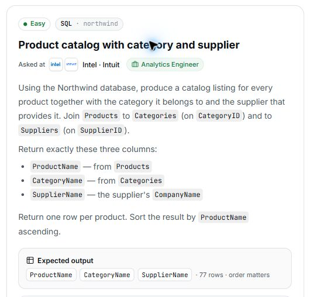

# 16. Product catalog with category and supplier

## Question and image

Using the Northwind database, produce a catalog listing for every product together with the category it belongs to and the supplier that provides it. Join `Products` to `Categories` (on `CategoryID`) and to `Suppliers` (on `SupplierID`).

Return exactly these three columns:

- `ProductName`: from `Products`.
- `CategoryName`: from `Categories`.
- `SupplierName`: the supplier's `CompanyName`.

Return **one row per product**. Sort the result by `ProductName` **ascending**.

**Expected output:** `ProductName`, `CategoryName`, `SupplierName` · 77 rows · order matters.



### Problem solving checklist

1. **Define the output:** state what one result row represents, the required columns, and the ordering.
2. **Understand the inputs:** identify table meanings, keys, relationships, duplicates, and NULLs.
3. **Explain the logic:** describe the steps, calculations, and comparisons in plain English.
4. **Choose SQL operations:** match each step to the SQL operations it needs.
5. **Plan intermediate results:** list the needed columns and what each intermediate row represents.
6. **Build gradually:** write one part, inspect its output, and check row counts after joins.
7. **Verify the answer:** check the sample, duplicates, missing matches, NULLs, arithmetic, boundaries, ties, and sorting.

Work through one step at a time during practice. Complete the current step before moving to the next.

## Schema

SQL table names are case-sensitive according to the question.

### Categories

`CategoryID, CategoryName, Description, Picture`

### CustomerCustomerDemo

`CustomerID, CustomerTypeID`

### CustomerDemographics

`CustomerTypeID, CustomerDesc`

### Customers

`CustomerID, CompanyName, ContactName, ContactTitle, Address, City, Region, PostalCode, Country, Phone, Fax`

### EmployeeTerritories

`EmployeeID, TerritoryID`

### Employees

`EmployeeID, LastName, FirstName, Title, TitleOfCourtesy, BirthDate, HireDate, Address, City, Region, PostalCode, Country, HomePhone, Extension, Photo, Notes, ReportsTo, PhotoPath`

### Order Details

`OrderID, ProductID, UnitPrice, Quantity, Discount`

### Orders

`OrderID, CustomerID, EmployeeID, OrderDate, RequiredDate, ShippedDate, ShipVia, Freight, ShipName, ShipAddress, ShipCity, ShipRegion, ShipPostalCode, ShipCountry`

### Products

`ProductID, ProductName, SupplierID, CategoryID, QuantityPerUnit, UnitPrice, UnitsInStock, UnitsOnOrder, ReorderLevel, Discontinued`

### Regions

`RegionID, RegionDescription`

### Shippers

`ShipperID, CompanyName, Phone`

### Suppliers

`SupplierID, CompanyName, ContactName, ContactTitle, Address, City, Region, PostalCode, Country, Phone, Fax, HomePage`

### Territories

`TerritoryID, TerritoryDescription, RegionID`

## My solution — SQLite

```sql
select Products.ProductName as ProductName , Categories.CategoryName as CategoryName , Suppliers.CompanyName as SupplierName
from Categories
join Products on Products.CategoryID = Categories.CategoryID
join Suppliers on Products.SupplierID = Suppliers.SupplierID
order by ProductName asc
```

### Step-by-step explanation with one example

Use this small illustrative dataset throughout. It uses the question's actual table and column names; only columns needed for this explanation are shown. These are teaching rows, not the complete database or its expected row count. Every query result below was executed in SQLite on these same rows.

**Starting data**

`Categories`:

| CategoryID | CategoryName |
| --- | --- |
| 1 | Beverages |
| 2 | Food |

`Products`:

| ProductID | ProductName | CategoryID | SupplierID |
| --- | --- | --- | --- |
| 1 | Tea | 1 | 2 |
| 2 | Bread | 2 | 1 |
| 3 | Coffee | 1 | 1 |

`Suppliers`:

| SupplierID | CompanyName |
| --- | --- |
| 1 | Harbor Supply |
| 2 | Hill Supply |

**1. Find the category of each product**

Products.CategoryID connects each product to its category. The join provides a readable category name while retaining one row per product.

```sql
SELECT Products.ProductID, Products.ProductName, Categories.CategoryName, Products.SupplierID
FROM Categories
JOIN Products ON Products.CategoryID = Categories.CategoryID
ORDER BY Products.ProductID;
```

Result:

| ProductID | ProductName | CategoryName | SupplierID |
| --- | --- | --- | --- |
| 1 | Tea | Beverages | 2 |
| 2 | Bread | Food | 1 |
| 3 | Coffee | Beverages | 1 |

Tea and Coffee belong to Beverages; Bread belongs to Food. SupplierID remains available for the next join.

**2. Add the supplier company name**

The supplier is a separate relationship: match Products.SupplierID to Suppliers.SupplierID. Do not join category IDs to supplier IDs.

```sql
SELECT Products.ProductID, Products.ProductName, Categories.CategoryName,
       Suppliers.CompanyName AS SupplierName
FROM Categories
JOIN Products ON Products.CategoryID = Categories.CategoryID
JOIN Suppliers ON Products.SupplierID = Suppliers.SupplierID
ORDER BY Products.ProductID;
```

Result:

| ProductID | ProductName | CategoryName | SupplierName |
| --- | --- | --- | --- |
| 1 | Tea | Beverages | Hill Supply |
| 2 | Bread | Food | Harbor Supply |
| 3 | Coffee | Beverages | Harbor Supply |

Tea is supplied by Hill Supply; Bread and Coffee are supplied by Harbor Supply. The final query returns the three requested name columns and sorts by ProductName.

**3. Assemble the final query**

Combine the steps using the saved solution. The query below preserves the original logic.

```sql
select Products.ProductName as ProductName , Categories.CategoryName as CategoryName , Suppliers.CompanyName as SupplierName
from Categories
join Products on Products.CategoryID = Categories.CategoryID
join Suppliers on Products.SupplierID = Suppliers.SupplierID
order by ProductName asc
```

Final result for this example:

| ProductName | CategoryName | SupplierName |
| --- | --- | --- |
| Bread | Food | Harbor Supply |
| Coffee | Beverages | Harbor Supply |
| Tea | Beverages | Hill Supply |

**Check the result:** All three products appear once. ProductName ordering is Bread, Coffee, Tea, with each row preserving its own category and supplier.

## My solution — SQL Server

```sql
select Products.ProductName as ProductName , Categories.CategoryName as CategoryName , Suppliers.CompanyName as SupplierName
from Categories
join Products on Products.CategoryID = Categories.CategoryID
join Suppliers on Products.SupplierID = Suppliers.SupplierID
order by ProductName asc
```

## Official solution

```sql
SELECT
    p.ProductName AS ProductName,
    c.CategoryName AS CategoryName,
    s.CompanyName AS SupplierName
FROM Products p
JOIN Categories c ON p.CategoryID = c.CategoryID
JOIN Suppliers s ON p.SupplierID = s.SupplierID
ORDER BY p.ProductName ASC;
```

### What this tests

Combining related tables and selecting the required output columns.

### The approach

Join Products to Categories and Suppliers using their IDs; select the product name, category name, and supplier company name; sort by product name.

### Why this way

Products links to both related tables, so direct joins retrieve the catalog details together.

### Common mistakes

Missing or incorrect joins, choosing the wrong supplier column or aliases, or omitting ORDER BY.
