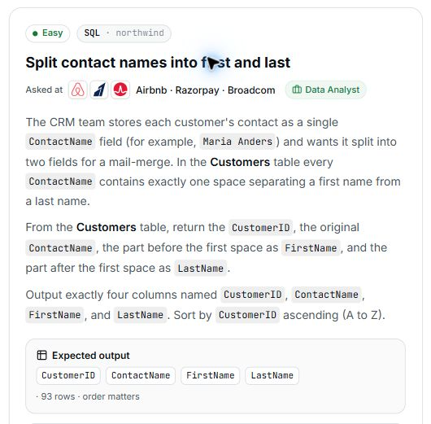

# 17. Split contact names into first and last

## Question and image

The CRM team stores each customer's contact as a single `ContactName` field (for example, `Maria Anders`) and wants it split into two fields for a mail-merge. In the **Customers** table every `ContactName` contains **exactly one space** separating a first name from a last name.

From the **Customers** table, return the `CustomerID`, the original `ContactName`, the part before the first space as `FirstName`, and the part after the first space as `LastName`.

Output exactly four columns named `CustomerID`, `ContactName`, `FirstName`, and `LastName`. Sort by `CustomerID` **ascending (A to Z)**.

**Expected output:** `CustomerID`, `ContactName`, `FirstName`, `LastName` · 93 rows · order matters.



### Problem solving checklist

1. **Define the output:** state what one result row represents, the required columns, and the ordering.
2. **Understand the inputs:** identify table meanings, keys, relationships, duplicates, and NULLs.
3. **Explain the logic:** describe the steps, calculations, and comparisons in plain English.
4. **Choose SQL operations:** match each step to the SQL operations it needs.
5. **Plan intermediate results:** list the needed columns and what each intermediate row represents.
6. **Build gradually:** write one part, inspect its output, and check row counts after joins.
7. **Verify the answer:** check the sample, duplicates, missing matches, NULLs, arithmetic, boundaries, ties, and sorting.

Work through one step at a time during practice. Complete the current step before moving to the next.

## Schema

SQL table names are case-sensitive according to the question.

### Categories

`CategoryID, CategoryName, Description, Picture`

### CustomerCustomerDemo

`CustomerID, CustomerTypeID`

### CustomerDemographics

`CustomerTypeID, CustomerDesc`

### Customers

`CustomerID, CompanyName, ContactName, ContactTitle, Address, City, Region, PostalCode, Country, Phone, Fax`

### EmployeeTerritories

`EmployeeID, TerritoryID`

### Employees

`EmployeeID, LastName, FirstName, Title, TitleOfCourtesy, BirthDate, HireDate, Address, City, Region, PostalCode, Country, HomePhone, Extension, Photo, Notes, ReportsTo, PhotoPath`

### Order Details

`OrderID, ProductID, UnitPrice, Quantity, Discount`

### Orders

`OrderID, CustomerID, EmployeeID, OrderDate, RequiredDate, ShippedDate, ShipVia, Freight, ShipName, ShipAddress, ShipCity, ShipRegion, ShipPostalCode, ShipCountry`

### Products

`ProductID, ProductName, SupplierID, CategoryID, QuantityPerUnit, UnitPrice, UnitsInStock, UnitsOnOrder, ReorderLevel, Discontinued`

### Regions

`RegionID, RegionDescription`

### Shippers

`ShipperID, CompanyName, Phone`

### Suppliers

`SupplierID, CompanyName, ContactName, ContactTitle, Address, City, Region, PostalCode, Country, Phone, Fax, HomePage`

### Territories

`TerritoryID, TerritoryDescription, RegionID`

## My solution — SQLite

```sql
select CustomerID, ContactName, SUBSTR(ContactName, 1, INSTR(ContactName, ' ')-1) as FirstName, SUBSTR(ContactName, INSTR(ContactName, ' ')+1, LENGTH(ContactName)) as LastName
from Customers
order by CustomerID asc
```

### Step-by-step explanation with one example

Use this small illustrative dataset throughout. It uses the question's actual table and column names; only columns needed for this explanation are shown. These are teaching rows, not the complete database or its expected row count. Every query result below was executed in SQLite on these same rows.

**Starting data**

`Customers`:

| CustomerID | ContactName |
| --- | --- |
| C | Liam Fox |
| A | Maria Anders |
| B | Ana Diaz |

**1. Locate the separator in each contact name**

The prompt guarantees exactly one separating space. INSTR returns its one-based position, which tells us where the first name ends and the last name starts.

```sql
SELECT CustomerID, ContactName, INSTR(ContactName, ' ') AS SpacePosition,
       LENGTH(ContactName) AS NameLength
FROM Customers
ORDER BY CustomerID;
```

Result:

| CustomerID | ContactName | SpacePosition | NameLength |
| --- | --- | --- | --- |
| A | Maria Anders | 6 | 12 |
| B | Ana Diaz | 4 | 8 |
| C | Liam Fox | 5 | 8 |

Maria Anders has its space at position 6; Ana Diaz at 4; Liam Fox at 5. Subtracting 1 gives the number of characters in the first name.

**2. Extract the part before the space**

SUBSTR starts at position 1 and takes SpacePosition - 1 characters. This excludes the separating space itself.

```sql
SELECT CustomerID, ContactName,
       SUBSTR(ContactName, 1, INSTR(ContactName, ' ') - 1) AS FirstName
FROM Customers
ORDER BY CustomerID;
```

Result:

| CustomerID | ContactName | FirstName |
| --- | --- | --- |
| A | Maria Anders | Maria |
| B | Ana Diaz | Ana |
| C | Liam Fox | Liam |

The first names are Maria, Ana, and Liam. The remaining part begins one position after the space.

**3. Extract the part after the space**

Start the last-name substring at SpacePosition + 1. The saved LENGTH(ContactName) argument is more than enough characters; SQLite stops at the end of the string.

```sql
SELECT CustomerID, ContactName,
       SUBSTR(ContactName, INSTR(ContactName, ' ') + 1, LENGTH(ContactName)) AS LastName
FROM Customers
ORDER BY CustomerID;
```

Result:

| CustomerID | ContactName | LastName |
| --- | --- | --- |
| A | Maria Anders | Anders |
| B | Ana Diaz | Diaz |
| C | Liam Fox | Fox |

The last names are Anders, Diaz, and Fox. Assemble both expressions with the original ID and contact name for the requested four columns.

**4. Assemble the final query**

Combine the steps using the saved solution. The query below preserves the original logic.

```sql
select CustomerID, ContactName, SUBSTR(ContactName, 1, INSTR(ContactName, ' ')-1) as FirstName, SUBSTR(ContactName, INSTR(ContactName, ' ')+1, LENGTH(ContactName)) as LastName
from Customers
order by CustomerID asc
```

Final result for this example:

| CustomerID | ContactName | FirstName | LastName |
| --- | --- | --- | --- |
| A | Maria Anders | Maria | Anders |
| B | Ana Diaz | Ana | Diaz |
| C | Liam Fox | Liam | Fox |

**Check the result:** Maria Anders splits into Maria and Anders, Ana Diaz into Ana and Diaz, and Liam Fox into Liam and Fox. The final rows are ordered by CustomerID A, B, C.

## My solution — SQL Server

```sql
select CustomerID, ContactName, SUBSTRING(ContactName, 1, CHARINDEX(' ', ContactName)-1) as FirstName, SUBSTRING(ContactName, CHARINDEX(' ', ContactName)+1, LEN(ContactName)) as LastName
from Customers
order by CustomerID asc
```

## Official solution

```sql
SELECT CustomerID,
       ContactName,
       substr(ContactName, 1, instr(ContactName, ' ') - 1) AS FirstName,
       substr(ContactName, instr(ContactName, ' ') + 1) AS LastName
FROM Customers
ORDER BY CustomerID ASC;
```

### What this tests

Finding a delimiter and extracting parts of a string.

### The approach

Keep CustomerID and ContactName; find the space with INSTR; extract the text before it as FirstName and after it as LastName with SUBSTR; sort by CustomerID.

### Why this way

With exactly one separating space, locating that position is enough to extract both names using SQLite string functions.

### Common mistakes

Returning incorrect columns, including the space through an off-by-one error, or forgetting the CustomerID sort.
