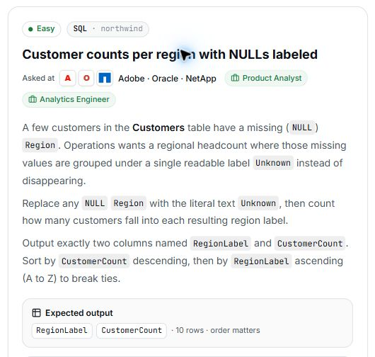

# 19. Customer counts per region with NULLs labeled

## Question and image

A few customers in the **Customers** table have a missing (`NULL`) `Region`. Operations wants a regional headcount where those missing values are grouped under a single readable label `Unknown` instead of disappearing.

Replace any `NULL` `Region` with the literal text `Unknown`, then count how many customers fall into each resulting region label.

Output exactly two columns named `RegionLabel` and `CustomerCount`. Sort by `CustomerCount` **descending**, then by `RegionLabel` **ascending (A to Z)** to break ties.

**Expected output:** `RegionLabel`, `CustomerCount` · 10 rows · order matters.



### Problem solving checklist

1. **Define the output:** state what one result row represents, the required columns, and the ordering.
2. **Understand the inputs:** identify table meanings, keys, relationships, duplicates, and NULLs.
3. **Explain the logic:** describe the steps, calculations, and comparisons in plain English.
4. **Choose SQL operations:** match each step to the SQL operations it needs.
5. **Plan intermediate results:** list the needed columns and what each intermediate row represents.
6. **Build gradually:** write one part, inspect its output, and check row counts after joins.
7. **Verify the answer:** check the sample, duplicates, missing matches, NULLs, arithmetic, boundaries, ties, and sorting.

Work through one step at a time during practice. Complete the current step before moving to the next.

## Schema

SQL table names are case-sensitive according to the question.

### Categories

`CategoryID, CategoryName, Description, Picture`

### CustomerCustomerDemo

`CustomerID, CustomerTypeID`

### CustomerDemographics

`CustomerTypeID, CustomerDesc`

### Customers

`CustomerID, CompanyName, ContactName, ContactTitle, Address, City, Region, PostalCode, Country, Phone, Fax`

### EmployeeTerritories

`EmployeeID, TerritoryID`

### Employees

`EmployeeID, LastName, FirstName, Title, TitleOfCourtesy, BirthDate, HireDate, Address, City, Region, PostalCode, Country, HomePhone, Extension, Photo, Notes, ReportsTo, PhotoPath`

### Order Details

`OrderID, ProductID, UnitPrice, Quantity, Discount`

### Orders

`OrderID, CustomerID, EmployeeID, OrderDate, RequiredDate, ShippedDate, ShipVia, Freight, ShipName, ShipAddress, ShipCity, ShipRegion, ShipPostalCode, ShipCountry`

### Products

`ProductID, ProductName, SupplierID, CategoryID, QuantityPerUnit, UnitPrice, UnitsInStock, UnitsOnOrder, ReorderLevel, Discontinued`

### Regions

`RegionID, RegionDescription`

### Shippers

`ShipperID, CompanyName, Phone`

### Suppliers

`SupplierID, CompanyName, ContactName, ContactTitle, Address, City, Region, PostalCode, Country, Phone, Fax, HomePage`

### Territories

`TerritoryID, TerritoryDescription, RegionID`

## My solution — SQLite

```sql
select
    (case
        WHEN Region IS NULL THEN 'Unknown'
        else Region
    end) as RegionLabel,
    count(CustomerID) as CustomerCount
from Customers
group by RegionLabel
order by CustomerCount desc, RegionLabel asc
```

### Step-by-step explanation with one example

Use this small illustrative dataset throughout. It uses the question's actual table and column names; only columns needed for this explanation are shown. These are teaching rows, not the complete database or its expected row count. Every query result below was executed in SQLite on these same rows.

**Starting data**

`Customers`:

| CustomerID | Region |
| --- | --- |
| A | East |
| B | NULL |
| C | West |
| D | East |
| E | NULL |
| F | Unknown |

**1. Give every customer a region label**

CASE replaces a missing Region with Unknown and keeps other region text unchanged. This is a row-level calculation before counting.

```sql
SELECT CustomerID, Region,
       CASE WHEN Region IS NULL THEN 'Unknown' ELSE Region END AS RegionLabel
FROM Customers
ORDER BY CustomerID;
```

Result:

| CustomerID | Region | RegionLabel |
| --- | --- | --- |
| A | East | East |
| B | NULL | Unknown |
| C | West | West |
| D | East | East |
| E | NULL | Unknown |
| F | Unknown | Unknown |

B and E receive Unknown. F already has that literal region name, so all three customers now share the same resulting label.

**2. Count customers by the resulting label**

Grouping by RegionLabel combines customers that have the same final label, including the formerly NULL values.

```sql
SELECT CASE WHEN Region IS NULL THEN 'Unknown' ELSE Region END AS RegionLabel,
       COUNT(CustomerID) AS CustomerCount
FROM Customers
GROUP BY RegionLabel;
```

Result:

| RegionLabel | CustomerCount |
| --- | --- |
| East | 2 |
| Unknown | 3 |
| West | 1 |

Unknown has three customers, East has two, and West has one. COUNT(CustomerID) counts the customer IDs, which are populated in this example.

**3. Assemble the final query**

Combine the steps using the saved solution. The query below preserves the original logic.

```sql
select
    (case
        WHEN Region IS NULL THEN 'Unknown'
        else Region
    end) as RegionLabel,
    count(CustomerID) as CustomerCount
from Customers
group by RegionLabel
order by CustomerCount desc, RegionLabel asc
```

Final result for this example:

| RegionLabel | CustomerCount |
| --- | --- |
| Unknown | 3 |
| East | 2 |
| West | 1 |

**Check the result:** The counts 3 + 2 + 1 account for all six customers. Unknown appears first because it has the largest count; the final second sort key handles any equal counts by label.

## My solution — SQL Server

```sql
select
    (case
        WHEN Region IS NULL THEN 'Unknown'
        else Region
    end) as RegionLabel,
    count(CustomerID) as CustomerCount
from Customers
group by
    (case
        WHEN Region IS NULL THEN 'Unknown'
        else Region
    end)
order by CustomerCount desc, RegionLabel asc
```

## Official solution

```sql
SELECT COALESCE(Region, 'Unknown') AS RegionLabel,
       COUNT(*) AS CustomerCount
FROM Customers
GROUP BY COALESCE(Region, 'Unknown')
ORDER BY CustomerCount DESC, RegionLabel ASC;
```

### What this tests

Handling NULL values and aggregating customers by a transformed region label.

### The approach

Use COALESCE to replace a NULL Region with 'Unknown'; count customers with COUNT(*); group by the same transformed expression; sort by count descending and label ascending.

### Why this way

COALESCE returns the first non-NULL value, providing a fallback label without excluding customers or updating the stored data.

### Common mistakes

Filtering out NULL regions, grouping by the original value instead of the resulting label, or assuming that dialect-specific NULL-handling functions have the same availability everywhere.
