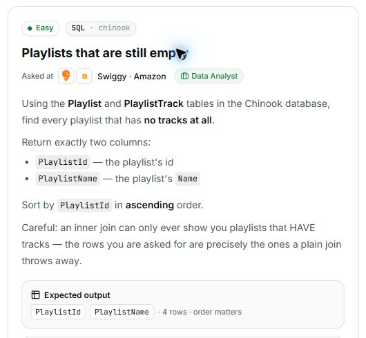

# 21. Playlists that are still empty

## Question and image

Using the **Playlist** and **PlaylistTrack** tables in the Chinook database, find every playlist that has **no tracks at all**.

Return exactly two columns:

- `PlaylistId` — the playlist's id.
- `PlaylistName` — the playlist's `Name`.

Sort by `PlaylistId` in **ascending** order.

Careful: an inner join can only ever show you playlists that HAVE tracks — the rows you are asked for are precisely the ones a plain join throws away.

**Expected output:** `PlaylistId`, `PlaylistName` · 4 rows · order matters.



### Problem solving checklist

1. **Define the output:** state what one result row represents, the required columns, and the ordering.
2. **Understand the inputs:** identify table meanings, keys, relationships, duplicates, and NULLs.
3. **Explain the logic:** describe the steps, calculations, and comparisons in plain English.
4. **Choose SQL operations:** match each step to the SQL operations it needs.
5. **Plan intermediate results:** list the needed columns and what each intermediate row represents.
6. **Build gradually:** write one part, inspect its output, and check row counts after joins.
7. **Verify the answer:** check the sample, duplicates, missing matches, NULLs, arithmetic, boundaries, ties, and sorting.

Work through one step at a time during practice. Complete the current step before moving to the next.

## Schema

SQL table names are case-sensitive according to the question.

### Album

`AlbumId, Title, ArtistId`

### Artist

`ArtistId, Name`

### Customer

`CustomerId, FirstName, LastName, Company, Address, City, State, Country, PostalCode, Phone, Fax, Email, SupportRepId`

### Employee

`EmployeeId, LastName, FirstName, Title, ReportsTo, BirthDate, HireDate, Address, City, State, Country, PostalCode, Phone, Fax, Email`

### Genre

`GenreId, Name`

### Invoice

`InvoiceId, CustomerId, InvoiceDate, BillingAddress, BillingCity, BillingState, BillingCountry, BillingPostalCode, Total`

### InvoiceLine

`InvoiceLineId, InvoiceId, TrackId, UnitPrice, Quantity`

### MediaType

`MediaTypeId, Name`

### Playlist

`PlaylistId, Name`

### PlaylistTrack

`PlaylistId, TrackId`

### Track

`TrackId, Name, AlbumId, MediaTypeId, GenreId, Composer, Milliseconds, Bytes, UnitPrice`

## My solution — SQLite

```sql
select
    Playlist.PlaylistId as PlaylistId,
    Playlist.Name as PlaylistName
from Playlist
left join PlaylistTrack on Playlist.PlaylistId = PlaylistTrack.PlaylistId
where PlaylistTrack.TrackId is null
order by Playlist.PlaylistId asc;
```

### Step-by-step explanation with one example

Use this small illustrative dataset throughout. It uses the question's actual table and column names; only columns needed for this explanation are shown. These are teaching rows, not the complete database or its expected row count. Every query result below was executed in SQLite on these same rows.

**Starting data**

`Playlist`:

| PlaylistId | Name |
| --- | --- |
| 1 | Morning |
| 2 | Quiet |
| 3 | Evening |
| 4 | Later |

`PlaylistTrack`:

| PlaylistId | TrackId |
| --- | --- |
| 1 | 101 |
| 1 | 102 |
| 3 | 103 |

**1. Preserve playlists while looking for their tracks**

Start from Playlist and use LEFT JOIN. Matched playlists can have several joined rows; an unmatched playlist is retained with NULL right-side columns.

```sql
SELECT Playlist.PlaylistId, Playlist.Name, PlaylistTrack.TrackId
FROM Playlist
LEFT JOIN PlaylistTrack ON Playlist.PlaylistId = PlaylistTrack.PlaylistId
ORDER BY Playlist.PlaylistId, PlaylistTrack.TrackId;
```

Result:

| PlaylistId | Name | TrackId |
| --- | --- | --- |
| 1 | Morning | 101 |
| 1 | Morning | 102 |
| 2 | Quiet | NULL |
| 3 | Evening | 103 |
| 4 | Later | NULL |

Morning has two track rows and Evening has one. Quiet and Later each have a placeholder row with TrackId NULL.

**2. Keep only playlists with no matching track**

The NULL placeholder identifies an unmatched playlist. Filtering the right-side TrackId with IS NULL retains exactly the empty playlists in this relationship.

```sql
SELECT Playlist.PlaylistId, Playlist.Name, PlaylistTrack.TrackId
FROM Playlist
LEFT JOIN PlaylistTrack ON Playlist.PlaylistId = PlaylistTrack.PlaylistId
WHERE PlaylistTrack.TrackId IS NULL
ORDER BY Playlist.PlaylistId;
```

Result:

| PlaylistId | Name | TrackId |
| --- | --- | --- |
| 2 | Quiet | NULL |
| 4 | Later | NULL |

Only Quiet and Later survive. The final SELECT hides the diagnostic TrackId and names the playlist column PlaylistName.

**3. Assemble the final query**

Combine the steps using the saved solution. The query below preserves the original logic.

```sql
select
    Playlist.PlaylistId as PlaylistId,
    Playlist.Name as PlaylistName
from Playlist
left join PlaylistTrack on Playlist.PlaylistId = PlaylistTrack.PlaylistId
where PlaylistTrack.TrackId is null
order by Playlist.PlaylistId asc;
```

Final result for this example:

| PlaylistId | PlaylistName |
| --- | --- |
| 2 | Quiet |
| 4 | Later |

**Check the result:** PlaylistTrack contains IDs 1 and 3 but no rows for playlist IDs 2 or 4. Therefore the result is Quiet and Later in increasing PlaylistId order.

## My solution — SQL Server

```sql
select
    Playlist.PlaylistId as PlaylistId,
    Playlist.Name as PlaylistName
from Playlist
left join PlaylistTrack on Playlist.PlaylistId = PlaylistTrack.PlaylistId
where PlaylistTrack.TrackId is null
order by Playlist.PlaylistId asc;
```

## Official solution

```sql
SELECT
    p.PlaylistId,
    p.Name AS PlaylistName
FROM Playlist p
LEFT JOIN PlaylistTrack pt ON pt.PlaylistId = p.PlaylistId
WHERE pt.PlaylistId IS NULL
ORDER BY p.PlaylistId;
```

### What this tests

An anti-join: finding rows in one table that have no matching rows in another.

### The approach

1. Start from `Playlist` so every playlist is considered.
2. Use a `LEFT JOIN` to `PlaylistTrack` on `PlaylistId`. Unmatched playlists remain, with `NULL` values in the right-side columns.
3. Keep only rows where `pt.PlaylistId IS NULL`, indicating no track association was found.
4. Return the required columns and sort by `PlaylistId` ascending.

### Why this way

`LEFT JOIN` followed by `IS NULL` finds playlists without matches. A correlated `NOT EXISTS` is an equally valid alternative. A plain inner join discards unmatched playlists before they can be selected.

### Common mistakes

- Using an inner join and then testing for a missing right-side match; the unmatched playlists have already been removed.
- Testing a left-side column, or a right-side column that can be `NULL` in genuine matches. Use a right-side column that is non-`NULL` for real matches.
- Using `COUNT(*)` to count tracks after a grouped left join: an empty playlist still contributes one unmatched row.
